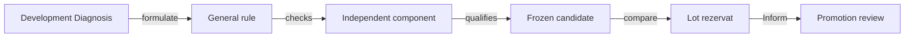

# Offline learning and evaluation

## Overview

Each candidate represents an identified change in the bid or choice of the card. The protocol specifies the role assessed, sources, families of opponents, score profile and distributions prior to execution.

- **Start:** [Construction and improvement of the IA](ATF_PolicyEvolution.md) policy changes explicitly; recalculation of the context of the hand does not rewrite the accepted parameters.
- **Liabilities:** [Laboratorul AI](../../whist-lab-app/ai-lab/README.md) be responsible for the implementation of the Union's policy on the implementation of the Union's macro-financial assistance; [lansatoarele comune](../../scripts/README.md) select the configuration and resources of the isolated execution.

- [Corpusul](ATF_Corpus.md) defines parties and integrity of entries.
- [Selection](ATF_Selection.md) restricts analysis to distinct lessons.
- [Arena](ATF_Arena.md) compares policies on distribution and controlled places.
- [Retention](ATF_Retention.md) maintains the role and provenance of external data.
- [Transfer to another game](ATF_GameTransfer.md) delimits what we re-use and criteria of the first adapter.

## Qualification steps

| Step | What to check |
|---|---|
| Diagnostic | A public observation is drawn from a development match. A counterexample must be justified independently of the result recorded. |
| Component | The legality of the move, the need for the contract, the return card and cases where the conclusion ceases to be valid shall be verified. |
| Dezvoltare | Each pair uses identical distributions and places. The results separate on the role, family from opponents and size of the hand. |
| Reserved assessment | Sources are frozen before the range is opened. The external register shall keep the ranges used. |
| Decision | The declared thresholds and the requirement for strict progress shall apply. Neutral and negative results remain available. |

## Interpretare

- A seed with rotated seats gives several correlated parties.
- Accurate contracts, points and victories divided by equality shall be read separately.
- The number of feasible worlds listed is a measure of the field of demonstration. A probability also requires a model of their distribution.
- A different choice can change the bids and scores of subsequent hands. The first divergence shall be identified prior to the award of the gain.

## Reproducere

[Collections Launcher](../../scripts/run-whist-collection.ps1) selects the tournament according to protocol schematics and verifies the frozen sources. [Ghidul comenzilor](../testing/ATF_Collections.md#frozen-experiments-and-sources) holds the parameters, overlapping modes and actual preconditions.

- A copy shall be identified by the captured sources and configuration; a live modification shall not retrospectively recalibrate it.
- Reproduction of an old evaluation uses its retained sources and does not open up a new unmet evaluation.
- [Registrul comun](ATF_EvaluationRegistry.md) faces the ranges and historical exposure independently of the corpus. Development can replay distributions and the continuation retains identity; none represents a new untouched batch.

## Stable rules and experimental data

[Rules and configuration of AI](../ai/ATF_RulesConfiguration.md) holds the inventory of the manifests and their executable effect. The code, scheme and parameters are identified; parties, concrete selections and results belong to the external repository.

[The contract of the body](ATF_Corpus.md) defines the format and partitions, and [retention](ATF_Retention.md) defines the preservation of origin. The change in the name or location of a selection shall not make a batch exposed again untouched.

## The improvement cycle

[The procedure for evolution](ATF_PolicyEvolution.md) holds the steps and exit criteria. This map guides the reading; the arena, components and collections have specialized contracts.

Legend: protocol precedes evaluation

The roles, opponents, score, distributions, budgets and criteria are declared before the reserved lot. The result shall inform the candidate without retrospective adjustment of the thresholds.

For first improvement, follow [low diagnosis and regression](ATF_PolicyEvolution.md#from-game-to-question-specific), then [comparison of games](ATF_PolicyEvolution.md#how-do-we-compare-games) and [promovarea](ATF_PolicyEvolution.md#when-we-promote). The protocol shall be established prior to the reserved assessment.

A defeat locates analysis without demonstrating a mistake on its own. Full hands are admitted to post-game audit, while policy remains limited to [Obligation allowed](../ai/ATF_DecisionModel.md#contract-of-a-decision).

[Arena](ATF_Arena.md) · [Componente AI](../testing/ATF_AiComponents.md) · [Comenzi](../testing/ATF_Collections.md)
