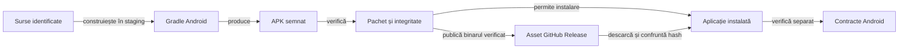

# Contractul livrării Android

Livrarea leagă configurația surselor de identitatea APK-ului și de compatibilitatea instalării. Versiunea declarată în sursă, binarul produs și aplicația instalată au identități care trebuie verificate separat.

## Responsabilități

Legendă: build și comportament

Build-ul verifică producerea binarului, iar controalele statice verifică pachetul, SDK-urile, semnătura și alinierea. Verificarea dispozitivului se referă la hash-ul APK-ului instalat efectiv.

## Condiții de livrare

- Citiți identitatea pachetului, SDK-urile și versiunea din [configurația Gradle a aplicației](../../whist-lab-app/app/build.gradle).
- Construiți într-o copie temporară proprie, cu dependențe identificate.
- Verificați API-urile Java disponibile pe platforma Android vizată; nivelul `sourceCompatibility` nu adaugă metode absente din sistem. Configurați explicit desugaring-ul bibliotecilor de bază dacă produsul depinde de el.
- Verificați integritatea, semnătura, alinierea și compatibilitatea cheii pentru upgrade.
- Păstrați APK-ul curent și rapoartele Extent care îi justifică verificarea în [registrul local de dovezi release](../../artifacts/reports/README.md). Rapoartele istorice și build-urile intermediare rămân în directoarele externe de lucru.
- Verificați binarul instalat înainte de a atribui unui scenariu comportamentul acelei livrări.
- Distingeți build-ul local de distribuția prin magazin și de gestionarea cheilor de distribuție.

## Compatibilitate și calificare

Compatibilitatea unei versiuni Android noi se califică separat de alegerea `targetSdk`. Numărul SDK-ului din APK nu dovedește instalarea, afișarea ori stabilitatea pe acel sistem.

| Nivel | Ce verifică | Limită |
|---|---|---|
| Construire și pachet | Surse, dependențe, manifest, SDK-uri, semnătură și APK complet. | Nu execută aplicația pe fiecare sistem acceptat. |
| Componente JVM | Modelele ferestrei, geometria, salvarea și regulile, cu intrări controlate. | Nu execută callback-urile sistemului sau gesturile reale. |
| Android identificat | Instalare, restaurare, fereastră, interacțiune și stabilitate pe binarul efectiv. | Califică profilul și sistemul declarate, cu limitele înregistrate. |

## Distribuția prin GitHub

- **Descărcare:** [GitHub Releases](https://github.com/crististefanita/atf_j4/releases/latest) este intrarea stabilă și urmărește ultima versiune publicată; pentru folosire personală, autentificați-vă în același browser și alegeți APK-ul din **Assets**.

- **Copie locală:** [directorul dist](../../dist/README.md) păstrează copia curentă și trimite către Releases prin README; APK-ul și checksum-ul local sunt excluse din Git.
- **Navigare:** GitHub afișează directorul repository-ului ca fișiere și documentație; README-ul oferă o legătură către descărcare, fără redirect HTTP automat.

- **Identitate:** [registrul release-ului](../../artifacts/reports/README.md#apk-documentat) deține versiunea, adresele asset-urilor și probele de integritate.
- **Canale:** descărcarea personală autentificată și accesul anonim au calificări separate; lipsa accesului anonim nu blochează acceptarea canalului personal verificat.

| Etapă | Criteriu de acceptare |
|---|---|
| Publicare | Upload-ul asset-ului are exact numărul de bytes al APK-ului semnat; checksum-ul identifică același fișier. |
| Descărcare | Asset-ul este accesibil în canalul declarat, iar copia descărcată are mărimea și SHA-256 originale; pentru folosirea personală se verifică browserul autentificat. |
| Integritate | Arhiva ZIP trece CRC pentru toate intrările și conține manifestul Android și codul aplicației; semnătura și alinierea sunt verificate separat. |
| Instalare | Verificarea folosește copia completă, cu identitatea pachetului și cheia de upgrade a release-ului. |

Un răspuns HTTP de eroare nu constituie un APK, indiferent de extensia fișierului salvat. Reușita construirii și instalării locale nu dovedește reușita descărcării publice; integritatea și proveniența copiei descărcate se verifică separat.

- Copiați fișierul local într-un nume temporar, verificați-l și publicați-l prin redenumire atomică. Descărcați din nou asset-ul GitHub și confruntați-l înainte de handoff; răspunsurile HTTP negative rămân erori, fără promovarea lor la pachet instalabil.

- Calificați separat accesul autentificat și accesul anonim. `visibility=public`, starea `uploaded` și digest-ul corect al asset-ului nu dovedesc că browserul unui vizitator poate descărca binarul. Proba păstrează codul HTTP, numărul de bytes și hash-ul copiei primite; un blocaj de vizibilitate rămâne deschis până la răspunsul public reușit.

## Procesul unei versiuni

[Modelul GitHub Releases](https://docs.github.com/en/repositories/releasing-projects-on-github/about-releases) leagă livrarea de un tag și permite atașarea binarelor. APK-ul se distribuie ca asset, iar `dist` rămâne ieșire locală; redenumirea lui în `releases` nu creează o secțiune GitHub sau un redirect.

1. Identificați commit-ul surselor și versiunea aplicației; fixați copia de construire în TMP.
2. Construiți și semnați o singură dată, apoi verificați pachetul și scenariile relevante ale acelui binar.
3. Pregătiți un draft legat de tag, cu APK și checksum; confruntați identitatea asset-ului cu registrul livrării.
4. Publicați versiunea completă și marcați-o drept ultima versiune; păstrați binarul publicat stabil, iar corecțiile primesc o versiune nouă.
5. Verificați descărcarea în canalul cerut și actualizați registrul, legăturile și dosarul de dovezi.

[GitHub recomandă draftul înaintea atașării asset-urilor și publicării](https://docs.github.com/en/repositories/releasing-projects-on-github/managing-releases-in-a-repository) pentru release-urile imuabile. Procesul proiectului folosește această ordine și păstrează diferența dintre politica stabilită și activarea opțiunii native de imutabilitate.

## Prezentarea unei versiuni

Pagina Release este destinată utilizatorului. Păstrează trei secțiuni cu bullets și trimite către dosarul dedicat pentru audit:

| Secțiune | Conținut |
|---|---|
| Descărcare | Autentificare în browser, linkul direct al APK-ului și checksum-ul versiunii. |
| Îmbunătățiri față de versiunea precedentă | Schimbări confirmate pentru binarul publicat, cu versiunea de comparație identificată. |
| Documentație | Legătura către rapoarte și proveniență, într-un commit identificat. |

- **Comparație:** dacă diferențele față de versiunea precedentă nu sunt confirmate, secțiunea se numește **Pe scurt** și descrie doar capabilități cunoscute ale versiunii. Nu transformați rezumatul în istoric inventat; următoarea livrare își adună schimbările pe parcursul dezvoltării.
- **Audit:** numerele testelor, verdicturile tehnice, mesajele despre dispozitive neverificate și diagnosticul distribuției aparțin dosarului de dovezi. Linkul din Release păstrează accesul la ele fără a încărca prezentarea produsului.

[Guvernanța prezentării](../../atf-tests/src/test/java/atf/tests/governance/documentation/release/ReleasePresentationGovernanceTest.java) confruntă snapshot-ul notelor cu asset-ul și registrul: bullets, destinația APK-ului, checksum, referință de audit și comparație declarată ori rezumat explicit. Probele negative acoperă legături Raw, versiuni greșite, lipsa bazei de comparație și detalii de testare introduse în prezentare.

## Fereastra și versiunile Android noi

[Documentația Android](https://developer.android.com/develop/ui/views/layout/edge-to-edge) descrie afișarea edge-to-edge pentru aplicațiile cu `targetSdk` de cel puțin 35 pe Android 15 sau mai nou. [WindowContent](../../whist-lab-app/app/src/main/java/ro/whistlab/app/window/WindowContent.java) separă protecția vederii de măsurarea ferestrei:

| Cale din cod | Comportament implementat |
|---|---|
| `protect`, API 35+ | Adaugă barele, decupajul și IME la padding-ul inițial și consumă insets-urile. Baza se păstrează, fără acumulare la reaplicare. |
| `widthDp` / `heightDp`, API 30+ | Folosește fereastra curentă și exclude barele și decupajul, independent de vizibilitatea lor. IME nu este scăzut în această măsurare; protecția rădăcinii are cale proprie. |
| Sisteme anterioare | Măsurarea folosește configurația platformei; listenerul de protecție nu este instalat de această clasă înainte de API 35. |

[Componentele ferestrei](../../whist-lab-app/app/src/test/java/ro/whistlab/app/window/WindowPaddingComponentTest.java) verifică aritmetica și bugetele modelului. [Acceptanța nativă](../feedback/ATF_Android.md#acceptanță-nativă-android-17) confruntă viewport-ul real, gesturile, navigarea cu trei butoane, decupajul și tastatura; ea nu rezultă din modelul JVM.

## Memorie și diagnostic pe Android 17

[Android 17 / API 37](https://developer.android.com/about/versions/17/behavior-changes-all) aplică limite de memorie inclusiv aplicațiilor care țintesc versiuni anterioare. Documentația identifică intervenția limiterului prin `ApplicationExitInfo`, motivul `REASON_OTHER` și descrierea care conține `MemoryLimiter:AnonSwap`.

- Identificați APK-ul, sistemul, profilul mesei și starea aplicației din aceeași execuție.
- Înregistrați memoria de referință și evoluția ei la reluare și la mărimi diferite de mână; costul căutării AI și reactivitatea au măsurători proprii.
- Confruntați motivul ieșirii cu jurnalul AndroidRuntime; codul sau mesajul izolat nu substituie corelarea procesului și intervalului.
- Păstrați limitele sistemului pentru acceptanță și consemnați explicit un diagnostic incomplet. Corectitudinea calculelor JVM nu califică memoria procesului Android.

## Restaurarea datelor

1. Exportați salvările înaintea intervenției asupra unei aplicații cu date existente.
2. Verificați integritatea exportului înaintea instalării, resetării sau curățării.
3. Tratați eroarea de citire drept eroare, fără a o interpreta ca absență a datelor.
4. Verificați restaurarea și schema înainte de a elimina copia de siguranță.
5. Păstrați explicit limitele migrării informației lipsă.

[Build-ul aplicației](../../whist-lab-app/README.md) · [Testarea Android](../testing/ATF_Android.md) · [Istoricul scorului](../game/ATF_ScoreHistory.md)
