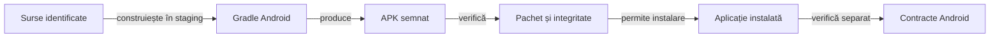

# Contractul livrării Android

Livrarea leagă configurația surselor de identitatea APK-ului și de compatibilitatea instalării. Versiunea declarată în sursă, binarul produs și aplicația instalată au identități care trebuie verificate separat.

## Responsabilități

Legendă: build și comportament

Build-ul verifică producerea binarului, iar controalele statice verifică pachetul, SDK-urile, semnătura și alinierea. Verificarea dispozitivului se referă la hash-ul APK-ului instalat efectiv.

## Condiții de livrare

- Citiți identitatea pachetului, SDK-urile și versiunea din configurația Gradle.
- Construiți într-o copie temporară proprie, cu dependențe identificate.
- Verificați integritatea, semnătura, alinierea și compatibilitatea cheii pentru upgrade.
- Păstrați configurația și identitatea rezultatului în registrul extern al livrării.
- Verificați binarul instalat înainte de a atribui unui scenariu comportamentul acelei livrări.
- Distingeți build-ul local de distribuția prin magazin și de gestionarea cheilor de distribuție.

## Protejarea stării utilizatorului

1. Exportați salvările înaintea intervenției asupra unei aplicații cu date existente.
2. Verificați integritatea exportului înaintea instalării, resetării sau curățării.
3. Tratați eroarea de citire drept eroare, fără a o interpreta ca absență a datelor.
4. Verificați restaurarea și schema înainte de a elimina copia de siguranță.
5. Păstrați explicit limitele migrării informației lipsă.

[Build-ul aplicației](../../whist-lab-app/README.md) · [Testarea Android](../testing/ATF_Android.md) · [Istoricul scorului](../game/ATF_ScoreHistory.md)
