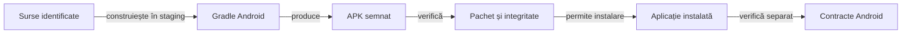

# Contractul livrării Android

Livrarea leagă configurația surselor de identitatea APK-ului și de compatibilitatea instalării. Versiunea declarată în sursă, binarul produs și aplicația instalată au identități care trebuie verificate separat.

## Responsabilități

Legendă: build și comportament

Build-ul verifică producerea binarului, iar controalele statice verifică pachetul, SDK-urile, semnătura și alinierea. Verificarea dispozitivului se referă la hash-ul APK-ului instalat efectiv.

## Condiții de livrare

- Citiți identitatea pachetului, SDK-urile și versiunea din [configurația Gradle a aplicației](../../whist-lab-app/app/build.gradle).
- Construiți într-o copie temporară proprie, cu dependențe identificate.
- Verificați API-urile Java disponibile pe platforma Android vizată; nivelul `sourceCompatibility` nu adaugă metode absente din sistem. Configurați explicit desugaring-ul bibliotecilor de bază dacă produsul depinde de el.
- Verificați integritatea, semnătura, alinierea și compatibilitatea cheii pentru upgrade.
- Păstrați APK-ul curent și rapoartele Extent care îi justifică verificarea în [registrul local de dovezi release](../../artifacts/reports/README.md). Rapoartele istorice și build-urile intermediare rămân în directoarele externe de lucru.
- Verificați binarul instalat înainte de a atribui unui scenariu comportamentul acelei livrări.
- Distingeți build-ul local de distribuția prin magazin și de gestionarea cheilor de distribuție.

## Compatibilitate și calificare

Compatibilitatea unei versiuni Android noi se califică separat de alegerea `targetSdk`. Numărul SDK-ului din APK nu dovedește instalarea, afișarea ori stabilitatea pe acel sistem.

## Fereastra și versiunile Android noi

[WindowContent](../../whist-lab-app/app/src/main/java/ro/whistlab/app/window/WindowContent.java) protejează rădăcinile ecranelor față de bare, decupaj și tastatură pe sistemele cu afișare edge-to-edge impusă. Padding-ul pornește dintr-o bază imuabilă, fără acumulare la redistribuirea insets-urilor.

| Responsabilitate | Contract și calificare |
|---|---|
| Măsurarea ferestrei | Pe API 30+, geometria folosește fereastra curentă și exclude barele și decupajul înainte de alegerea politicii mesei; sistemele mai vechi păstrează configurația gestionată de platformă. [Componentele ferestrei](../../whist-lab-app/app/src/test/java/ro/whistlab/app/window/WindowPaddingComponentTest.java) verifică bugetul și reaplicarea fără acumulare. |
| Acceptanța nativă | [Documentația Android](https://developer.android.com/develop/ui/views/layout/edge-to-edge) descrie impunerea edge-to-edge pentru aplicațiile care țintesc API 35+ pe Android 15+. Calificarea confruntă gesturile, navigarea cu trei butoane, decupajul și tastatura cu viewport-ul efectiv. |

## Memorie și diagnostic pe Android 17

[Android 17 / API 37](https://developer.android.com/about/versions/17/behavior-changes-all) introduce limite de memorie și pentru aplicațiile care țintesc versiuni anterioare. Colectați un baseline de memorie și motivul ieșirii procesului; un exit `REASON_OTHER` cu `MemoryLimiter:AnonSwap` identifică intervenția limiterului.

Scenariul de diagnostic păstrează limitele sistemului și leagă memoria, jurnalul AndroidRuntime, `ApplicationExitInfo`, configurația mesei și APK-ul de aceeași execuție. Interfața folosește vederi Android obișnuite și un motor Java local; memoria procesului rămâne parte a acceptanței.

## Restaurarea datelor

1. Exportați salvările înaintea intervenției asupra unei aplicații cu date existente.
2. Verificați integritatea exportului înaintea instalării, resetării sau curățării.
3. Tratați eroarea de citire drept eroare, fără a o interpreta ca absență a datelor.
4. Verificați restaurarea și schema înainte de a elimina copia de siguranță.
5. Păstrați explicit limitele migrării informației lipsă.

[Build-ul aplicației](../../whist-lab-app/README.md) · [Testarea Android](../testing/ATF_Android.md) · [Istoricul scorului](../game/ATF_ScoreHistory.md)
