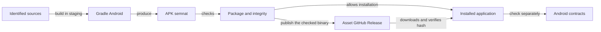

# Android delivery contract

## Overview

The delivery links the configuration of the sources to the identity of the APK and the compatibility of the installation. The version declared in the source, the produced binary and the installed application have identities that need to be checked separately.

## Responsibilities



<details>
<summary>Legend: build and behavior</summary>

The cylinder checks the production of the binary, and static controls check the package, the SDKs, the signature and the alignment. The device verification refers to the apk hashtrack actually installed.

</details>

## Delivery conditions

- Read the identity of the package, the SDKs and the version of [Gradle configuration of application](../../whist-lab-app/app/build.gradle).
- Build in your own temporary copy with identified dependencies.
- Check Java APIs available on the Android platform concerned; level `sourceCompatibility` does not add absent methods from the system. For Java APIs newer than `minSdk`, declare `coreLibraryDesugaringEnabled` and a version fixed `desugar_jdk_libs` in the application and Android modules that require isolated verification. Governance must confront the use of these APIs with the desugaring configuration.
- Check integrity, signature, alignment and key compatibility for upgrade.
- Keep APK and checksum in `release/<versionName>/`, next to the manifest and README. Store the evidence in the `reports` subdirectory. [Release catalog](../../release/README.md) identifies the current version. Keep intermediate runs outside the checkout.
- Check the binar installed before assigning the behaviour of that delivery to a scenario.
- Distance local building from distribution through the shop and from distribution keys management.

## Signing and migration plan

Qualify the key change starting from the last APK available to users. Identify package, `versionCode`, `minSdk`SHA...256 APK and SHA-256 of certificate of `apksigner verify --verbose --print-certs`If the certificate published is `Android Debug`, treat him as an old signatory and check that you can recover the exact key, with controlled access, before preparing the rotation. [Signature of Android applications](https://developer.android.com/studio/publish/app-signing)

1. Prepare a delivery key with protected storage and a test copy. Keep the key, passwords and local configuration outside Git and reports. The build process receives an explicit signature configuration and stops if the identity cannot be verified. Publish only the fingerprints of the certificates and the verification data.
2. If you have the exact old key and can be used safely, build a candidate with the same `applicationId`, `versionCode` larger and verifiable rotation history. explicitly set the level from which the new key enters into force. `apksigner` uses API's new key 33. For rotation from API 28, configure and qualify the threshold separately 28. Under the threshold, the compatibility of the upgrade depends on the old signatory. API 24–27 i can't use rotation v3. [Options `apksigner`](https://developer.android.com/tools/apksigner)
3. If the old key is missing or is no longer safe, stop publishing as a transparent upgrade for the affected installations. A migration to new installation requires a rescue transfer route available for the installed version, fully checked prior to distribution. Treat any decision to change the package or the minimum Android level separately.

| Profil Android | Sample prior to publication |
|---|---|
| API 24–27 | Upgrade from the published APK with the compatible signatory. Check first installation and data retention. |
| API 28–32 | Upgrade and clean installation. Check the actual signatory for the selected rotation threshold. |
| API 33 and later | Upgrade and clean installation. Check the new signatory and the rotation history. |

- For each profile, create a saved match and an ongoing hand in the published version.
- Install the candidate over it, resume the match and compare preferences, score, history and next legal action.
- Record previous version, API level, certificate prints and APK hash installed.
- Absent profile or lost rescue blocks the migration of the public. Qualify the distributed binary exactly.

## Compatibility and qualification

The compatibility of a new Android version qualifies separately from the `targetSdk` choice. The SDK number in APK does not prove installation, display or stability on that system.

| Level | What's he checking? | Limit |
|---|---|---|
| Construction and package | Sources, dependencies, manifest, SDKs, signature and full APK. | Do not execute the application on every accepted system. |
| JVM components | Window models, geometry, rescue and rules, with controlled inputs. | Do not execute system callbacks or actual gestures. |
| Android identificat | Installation, restoration, window, interaction and stability on actual binary. | Qualify the declared profile and system with the limits recorded. |

## Distribution through GitHub

- **Download: ** The main readme indicates a single APK. `currentVersion` selects the published edition and `candidateVersion` selects the announced candidate for testing.
- **Branch candidate: ** `release/candidate.json` declares `PREPARED`, `artifactSource: MAIN_BRANCH` and anonymous access. The candidate's file contains the guide, APK and checksumul, and the direct link GitHub reads the binary from `main`.
- **Publication:** After qualification, the READMEM indicates the asset of the GitHub Releases edition or the public copy checked. [Release catalog](../../release/README.md) keep the publications published and link the candidate separately.
- **Navigation: ** GitHub displays the directory of the repositoryas files and documentation; THE READMEul provides a link to the download without redirect HTTP automatically.

- **Identity:** [release register](../../release/README.md) be of the version, addresses of assetas and evidence of integrity.
- **Channels: ** Personal Loading authenticated and Anonymous Access have separate qualifications; the lack of anonymous access does not block the acceptance of the authenticated channel if it is the declared channel.

| Step | Acceptance criterion |
|---|---|
| Publication | The asset upload has the exact number of bytes of the signed APK; the checksums identify the same file. |
| Download | The assetul is accessible in the declared channel, and the downloaded copy is the original SHA-256 size; for personal use check the authenticated browser. |
| Integritate | The ZIP archive passes CRC for all entries and contains the Android manifest and application code; signature and alignment are checked separately. |
| Installation | The check uses the complete copy, with the package identity and the relay upgrade key. |

A HTTP error response does not constitute an APK, regardless of the file extension saved. The success of local construction and installation does not prove the success of public discharge; the integrity and provenance of the downloaded copy is checked separately.

- Write the transfer into a temporary file and publish the APK by moving to the same directory after verification. Upon failure, the download removes his own temporary file and retains the original error. Download the GitHub asset again and confront it before surrender.

- Qualify separately authenticated and anonymous access. `visibility=public`, state `uploaded` and correct asset digest do not prove that a visitor's browser can download the binary. The sample shall retain the HTTP code, the number of bytes and the hash of the copy received; a blockage of visibility shall remain open until the successful public response is reached.

## Separating access from Android transfer

- **Navigation.** The README opens the current GitHub release. Under **Assets**, select the APK, which is the same versioned file as the direct link.
- **Access: ** HTTP 404 on the project page or on the asset, prior to receipt of bytes, is kept separate from the integrity of the APK. The declared public visibility and the success of the authenticated API do not identify the cause of the refusal in the browser on its own.
- **Native Transfer: ** a Download Manager sample identifies the system, the authorisation mode, the status and reason of Android, the received bytes, the SHAA-256, CRC and the package read through PackageManager. The transfer of the network must be executed by Android; pushing the copy from the computer does not replace it.
- **Credential: ** API token remains on the computer. A temporary redirect authorised for asset may be consumed by the sample without global token on the device; the signed URL and the query shall not be entered in the documentation or reports.
- **Signature: ** on API 28 ask for both archive signature signs; refuse absence or unexpected number of signatories and confront the exact certificate. The failure of the verifier does not become PASS because the transfer has succeeded.
- **Audit: ** keep the result JSON and sources of the inline sample in Extent, for the duration of the captured execution. Failed attempts remain in the diagnosis separately; overpublication does not invent a new execution or JUnit invokes.
- **Limit: ** the authorised native transfer qualifies the file received on Android. The visual route README → authentication → Assets → saved file requires a distinct sample in the browser. Remove the temporary application and release the reservation after verification.

## Process of a version

[Step by step qualification](../testing/ATF_ReleaseQualification.md) orders the selections, HTML verification and candidate dossier; this guide holds the building, identity and publication.

[Modelul GitHub Releases](https://docs.github.com/en/repositories/releasing-projects-on-github/about-releases) links the delivery to a tag and allows attaching the binaries. The APK is distributed as an asset; the local file `release` keeps the delivery checked without creating a GitHub section or a HTTP redirect.

1. Identify the source communiqué and application version. Push the commit on the relay branch and confirm after `git fetch` that `git merge-base --is-ancestor <commit> origin/<ramură>` succeeds; the tag must indicate precisely that commit.
2. Set the construction copy in TMP, then build and sign once. Check the relevant package and scenarios of the same binary.
3. Prepare a tag-related draft with APK and checksum; confront the identity of the asset with the delivery register.
4. Publish the full version and mark it as the latest version; keep the binary published stable and corrections receive a new version.
5. Check the download to the requested channel and update the register, links and evidence file.

[GitHub recommends the draft before attaching the assets and publishing](https://docs.github.com/en/repositories/releasing-projects-on-github/managing-releases-in-a-repository) for the immutable relays. The project process uses this order and keeps the difference between the policy established and the activation of the native option of imutability.

## Maintenance releases

A patch close to the previous version uses targeted checks according to the real difference in code. The number of versions does not justify reducing checks alone; changing rules, saves, SDKs or dependencies may require further qualification. Governance uses the release snapshots and candidate metadata, keeping parallel work separate.

| Control | Minimum for patch | When it expands |
|---|---|---|
| Sources and build | Commit identified, copy in TMP, `assembleRelease` and `lintVitalRelease`. | Addictions, platform or changed construction configuration. |
| Comportament | Componentele/regresiile the modified area and relevant negative cases. | Rules, score, save or policy AI exchanged; selection follows the affected contract. |
| Governance | Folders and presentation release, plus links and style for the documents reached. | Architecture or agreements exchanged; controls of the area concerned are added. |
| APK | Identity, SDKs, CRC, signature, alignment, upgrade key compatibility and SHA-256. | Manifest, install or compatibility Android changed; add native smoke. |
| Interface | Components of geometry; short sanity for the changed interaction when the device is available. | A profile or a new transition requires distinct acceptance; no full match shall be automatically repeated on each resolution. |
| Distribution | Asset and checksum, then download into the requested channel, with size and Shah-256 confronted. | Change of channel or signature requires rechecking of distribution. |

The selected execution must pass; a relevant failure blocks publication. A missed native check shall be recorded in the technical file together with the reason, without taking over the qualification of the previous APK and without loading the Release page.

### Hand over the patch

1. Update `versionName` and increment `versionCode` in Gradle; fix the built commit. Relevant sources exchanged in parallel shall be confronted prior to publication.
2. Run the above selection in TMP; prepare the commands, JUnit results and logs for `release/<versionName>/reports/`, with a short read-through. Extent reports are only derived from actual version executions; an earlier benchmark is explicitly labelled.
3. Place the audit copy of the signed APK `WhistLab-<versionName>.apk` and checksum in `release/<versionName>/`; keep the current and immediately preceding edition. Archive older editions outside the active catalogue only after verifying their identities and hashes. The README links to the GitHub release asset. Use the retained copy to verify integrity.
4. Update the manifest and readme of the new version, `release/index.json`, catalogue and notes in the bulllets compared to the previous version. Generic guidelines change only if the process or contract has changed.
5. Run governance checks before publishing the tag and verified assets. Download the full APK from the advertised channel. Update the README links after verifying the version, size, SHA-256 and CRC. A versioned link identifies the qualified APK, while `releases/latest` does not pin its identity.

The draft metadata shall be kept separately in `github-release-draft.json`; `github-release.json` describes the actual publication. GitHub may use temporary addresses `untagged` in the draft, so the test of the notes related to published assetses is performed again after publication on the observed canonical addresses. When published, explicitly send the tag and the source communiqué and confront the answer with the identity of the APK.

## Source and evidence commits

- **Sources: ** the tag sets the qualified commit prior to publication. Confront all inputs of APK and new files; changes in documentation or subsequent samples do not move the tag.
- **Evidence: ** actual download shall be verified after publication and shall have a subsequent report commit. Note Release fixes this commit in `evidenceUrl`; metadata keeps separate `sourceCommit`.
- **Linking:** The evidence commit exists before its hash is added to the release notes. A final commit records the link and the GitHub response. It does not attempt to refer to its own hash.
- **Audit identity:** [Release presentation governance](../../atf-tests/src/test/java/atf/tests/governance/documentation/release/ReleasePresentationGovernanceTest.java) reads the index, manifest and direct report at the indicated commit. It compares the SHA-256 with the canonical report declared in the delivered dossier. If a rerun changes the canonical report, pin the new evidence commit in the release notes.
- **Closure:** After the final push, read the README on GitHub again and compare the exact URL with the downloaded asset. A local check alone cannot establish that the online document has been updated.

## Resumable publishing on GitHub

[Publication script](../../atf-tests/tools/publish-github-release.mjs) receives the candidate's file and his verdict `READY_FOR_HUMAN_REVIEW`.

- The manifest declares status `PREPARED`, the repositoryul, the access mode, the canonical URL and the apk hashes, the checksums and notes.
- Push the source to `main` and the tag of the version on the qualified commit prior to command.
- Use `GH_TOKEN` or `GITHUB_TOKEN` in the process environment. The running director shall be outside the project and the candidate.

```powershell
node .\atf-tests\tools\publish-github-release.mjs publish $ProjectRoot $CandidateDir $VerdictFile $PublicationRun
```

When resumed, use the qualified manifest, the verdict and the director of the initial running. Keep them until publication and retention are closed.

- The `github-publication.json` log links the commit, the manifest hashir, the asset hashs and the fingerprint's numeric IDs. Save status before calls that can leave undetermined results.
- The atomic writing and file `.lock` prevent two runs in the same directory. After forced shutdown, check the PID in the file before releasing the lock.

| Situation | Repetition behaviour |
|---|---|
| GitHub returns 422 to creation | Recite the authenticated inventory. If the draft is missing after refusal, correct the cause and run again. |
| Connection cut off when creating | Search the drawing on all pages after the tag and the symbol of the manifest. If the result remains undetermined, check the authenticated inventory and resume after the draft becomes visible. After saving the IDs, the script reads strictly after ID. |
| Upload interrupted or received 422 | Recite the asset, download the file and compare size and SHA- 256. A different file stops the flow. An empty set in condition `starter` can be withdrawn by ID in its own draft if the log identifies the exact upload interrupted. |
| Promotional response lost | Recite the same ID and check the published assets' The confirmed promotion is not repeated. |

In Release Notes keep HTML marking `atf-publication` when adding the link to the audit fixed on the commit. After the promotion, publish on the `main` catalogue, manifests and updated readmate. [Rotation Preflag](ATF_ReleaseRetention.md#download-verification-before-rotation) face them with real downloads.

## Folder of a version

[Release catalog](../../release/README.md) keep the current and immediately preceding edition, each in `release/<versionName>/`The presentation of the version and its metadata send to the evidence in `reports/`. [Retention policy](ATF_ReleaseRetention.md) define the archiving of older editions, replacing and resetting GitHub explicitly requested.

| Intrare | Responsibility |
|---|---|
| `release/index.json` | The 2 scheme declares `currentVersion` and at most two versions in `versions`, starting with the current edition and then the immediate previous edition; all main links identify the first version. |
| `release/README.md` | The stable catalogue of the active delivery and the entry point in her file. |
| `release/<versionName>/README.md` | Presents the edition, identified APK, state of surrender and links to metadata and reports. |
| `release/<versionName>/reports/README.md` | Presents the selected, the reports, results and the limits of qualification. |
| Manifesto and metadata in the folder | Tie `versionName`, tag, assetates, checksumes and notes; relative paths start from the version file. |
| Reports, catches, results and logs in `reports/` | Keep the identified execution, including negative diagnoses and labelled replicas; their local links start from that sub-directory. |
| [Test strategy](../testing/README.md) | It holds the selection and common principles independently of the version. |

- In a new version, qualify the external candidate and only file files older than the immediate previous edition. Update index and catalogue after identity verification; keep in the current and immediately preceding `release` edition, including their local APKs.
- When reorganizing, move the associated reports and files together, confront the hashes and redo the active references. The absolute captured paths and historical URLs attached to the commit shall retain their original meaning.
- `artifacts/` and `dist/` are the director who is withdrawn from the project's root. After archiving and confronting unique data, remove old directories, including empty ones; governance refuses to reoccur.
- The description of the edition starts with a short summary and lists changes at separate points. Check her before the manifest is sealed.
- The notes from GitHub Release send to the READMEL version in an identified comma; the change of navigation does not move the tag or replace the binary asset.

[Governance of dossiers](../../atf-tests/src/test/java/atf/tests/governance/documentation/release/ReleaseArtifactLayoutGovernanceTest.java) rejects unregistered population, accumulation of active versions, missing metadata and divergent identities. The verification of the integrity of files and links shall complete this structural contract.

### Main link and download test

| Situation | Presentation and verification |
|---|---|
| Candidat local | Link to exact folder from `release/<versionName>/`, state `PREPARED` and local APK; no statement of publication GitHub. |
| Asset publicat | Direct link `releases/download/<tag>/<apkName>`. The label, tag and file identify the same version. |
| Asset GitHub autentificat | `PUBLISHED` with `accessMode=AUTHENTICATED`; Receipt `authenticatedDownload` confirms the account session through a channel declared in RAG policy. The GitHub API proves HTTP 200; Browser MCP proves the completion of the download. Both routes check URL, bytes, SHA- 256 and CRC, without token, cookie or authorization header. |
| Public copy verified | `PUBLISHED_SITE` with `accessMode=ANONYMOUS`; the `publicDownload` Receipt confirms the page, APK and checksumes via HTTPS without any credit. |
| Copy complete | Successful response, size and HA- 256 identical to the stated asset and binar; ZIP with valid CRC, Android manifest and code. An error response shall not be renamed `.apk`. |
| Canal verificat | Each Receipt only qualifies the way it declares access. An authenticated result does not assert anonymous access and a public copy does not state the permissions of the GitHub accounts. |
| Unique identity | `currentVersion`, manifest, label, APK name and URL identify the same edition. Evidence of any previous version remains only audit references. |

The file shall be downloaded in a temporary name and shall be given the final extension after the checks. When you pass through `PUBLISHED`, replace the local link with the distribution address of the same version.

### Anonymous access and public route

1. After publishing, open the delivered README in a signed-out browser. Follow its APK link and download the APK and checksum without cookies, an Authorization header or a token. Compare the size and SHA-256 with `release-validation.json` and the published checksum.
2. At HTTP 404, Check the repositoryul, READMEul, page release and asset separately. Compare the result anonymously with the one from the owner's session. If the profile or other publicly marked repositoryes are inaccessible, keep URLs, UTC time, HTTP codes and application IDs for [GitHub Support](https://docs.github.com/en/support/contacting-github-support/creating-a-support-ticket). One 404 Anonymous alone does not identify the motive.
3. If GitHub remains inaccessible without signing in, publish the signed APK and checksum on a public HTTPS host controlled by the project. The stable APK URL ends in `/v<versionName>/WhistLab-<versionName>.apk` and contains no query string or fragment. If the GitHub README is also inaccessible, publish an identified copy on the public site and verify its link. Republish the copy when the download version or destination changes.
4. Record the declared mode in `release/<versionName>/reports/distribution-verification.json`: `authenticatedDownload` for authenticated GitHub downloads or `publicDownload` for an anonymous site. The authenticated channel and its proof must match `config/release-platform-rag-policy.json`. The API records `httpStatus=200`, and Browser MCP records `downloadCompleted=true` after the download completes. Compare the resulting file. Do not store cookies or authorization headers. Retain only verifiable metadata. Update the main link, regenerate the dossier integrity record and run governance. After the push, read the README again and download from that exact link again using the same access mode.

Run the check from the project root and enter the direct address copied from the published RADM.

```powershell
$version = (Get-Content release/index.json -Raw | ConvertFrom-Json).currentVersion
$expected = (Get-Content "release/$version/release-validation.json" -Raw | ConvertFrom-Json).release
$downloadUrl = Read-Host 'URL-ul direct din README'
$payload = [IO.Path]::GetTempFileName()
try {
    $status = curl.exe -q --fail --location --silent --show-error --max-time 60 `
        --proto '=https' --proto-redir '=https' --output $payload --write-out '%{http_code}' -- $downloadUrl
    if ($LASTEXITCODE -ne 0 -or $status -ne '200') { throw "Descărcarea a returnat HTTP $status" }
    $bytes = (Get-Item -LiteralPath $payload).Length
    $sha256 = (Get-FileHash -LiteralPath $payload -Algorithm SHA256).Hash.ToLowerInvariant()
    if ($bytes -ne $expected.apkBytes -or $sha256 -ne $expected.apkSha256) {
        throw 'APK-ul descărcat diferă de manifest'
    }
    [pscustomobject]@{ HttpStatus = [int]$status; Bytes = $bytes; Sha256 = $sha256 }
} finally {
    Remove-Item -LiteralPath $payload
}
```

### Automatic distribution checks

| Control | Purpose and limit |
|---|---|
| [Governance of links](../../atf-tests/src/test/java/atf/tests/governance/documentation/release/ReleaseArtifactLayoutGovernanceTest.java) | Same version in the catalog, label and APK, local or published; refuses `latest` ambiguous, Raw/blob, competing downloads, any old APK in the README and retired directories. |
| [Download components](../../atf-tests/src/test/java/atf/tests/governance/documentation/release/download/ApkDownloadComponentTest.java) | HTTP real loopback: complete response, 404, text saved as APK, truncation, excess, SHA wrong, CRC invalid, metadata divergent and cendential unpropagated to another origin. ZIP fixture does not qualify for Android installation. |
| [Identification selection](../../atf-tests/src/test/java/atf/tests/governance/documentation/release/download/DownloadSelectionComponentTest.java) | A positive result of the previous online version does not qualify the discharge of the current candidate. The number of bytes is read exactly without permission numerical conversion. |
| [Live acceptance](../../atf-tests/src/test/java/atf/tests/governance/documentation/release/download/PublishedApkDownloadAcceptanceTest.java) | GitHub explicit download with version, bytes, SHA- 256, CRC and verdict in Extent. The target is exclusively `currentVersion`; the absence of publication produces HTTP 404 and FAIL without access to any previous APK. |

Under a TMP copy with available dependencies, the components run without GitHub access:

```powershell
mvn -B -o -pl atf-tests -am '-Dtest=ReleaseArtifactLayoutGovernanceTest,ApkDownloadComponentTest,DownloadSelectionComponentTest' '-Dsurefire.failIfNoSpecifiedTests=false' test
```

After publication, check the current APK via separate network sample:

```powershell
mvn -B -o -pl atf-tests -am '-Dtest=PublishedApkDownloadAcceptanceTest' '-Dsurefire.failIfNoSpecifiedTests=false' '-Datf.release.download.enabled=true' '-Datf.release.download.scope=current' test
```

- **Channel: ** tokens read from `GH_TOKEN` or `GITHUB_TOKEN`; not submitted by argument, YAML or reports. The test does not publish or install the application.
- **Scoops: ** only `atf.release.download.scope=current` is accepted. The expected identity and size come from the current manifest, including when it is still `PREPARED`; the test is facing real publication.
- **Report: ** `atf.release.download.report-directory` requires an absolute path; by default uses TMP. The errors and refusal of publication remain FAIL, without PASS from an older subset.
- **Offline Suite: ** Normal governance excludes the `release-download-live` tag; network acceptance is explicitly selected without transforming its omission into a positive result.

- **Inventory: ** structured index, folders and catalogue form the same population checked.
- **Qualification:** structural validation; and [tying notes to published asset](../../atf-tests/src/test/java/atf/tests/governance/documentation/release/ReleasePresentationGovernanceTest.java) Distinguishing controls are carried out; their passage does not prove access in the declared manner, the provenance of the complete Git or the autonomy of the report.

### Integrity of files and results

[Governance of integrity](../../atf-tests/src/test/java/atf/tests/governance/documentation/release/ReleaseIntegrityGovernanceTest.java) read the APK and active folder without modifying them. Confront the name, canonical path in the file of the version, size, SHA- 256 and checksum file; read all the ZIP entries for CRC and refuse duplicate names or non-anonymous paths.

| Verified link | Contract |
|---|---|
| Manifest–payload | The `integrity.files` registry lists exactly all file files, size and SHA-256; the manifest itself is excluded to avoid self-reference. An added, deleted or modified file invalidates the observation. |
| Manifest–JUnit | Each group declares exactly the XMLs kept. Cases are recounted, the class-denomination is unique and the attributes of XML and the totals declared must coincide. |
| Manifest–HTML auditat | The audited groups shall declare a canonical HTML and Receipt protocol. The appeals, comparisons and verdicts are recounted to their owner; the same selection does not retain a parallel XML group. The qualification scheme distinguishes these groups from historical results still unmigrated. |
| Rezultat calificat | Actual cases and zero failures, errors or omissions are required; an empty container does not invent tests. A zero-failure header does not hide an item `failure`, `error` or `skipped`. |
| Manifest-inputs | The source input file is included in the hashs register; the print and the declared commit is consistent, and the inputs' pathways and hashes are valid and without duplicates. |

Recording of hashs is an explicit preparation step after setting files:

```powershell
node atf-tests/tools/record-release-integrity.mjs
```

- **Registration: ** the tool selects the version from the index, verifies the inventory stability and updates section `integrity`. Moment `observedUtc` identifies the observation of bytes, without changing the verdict, the date of execution or the state of publication.
- **Git:** [Atributul `text`](https://git-scm.com/docs/gitattributes) is deactivated by `.gitattributes` for the entire folder `release`Governance faces the actual attribute of each payload, including local overwrite; prior to push, bytes of Git objects must correspond to the registry.
- **Verification: ** after registration is performed the governance; recalculating hashes does not make valid an XML with failures or a corrupt APK.
- **Limits: ** CRCl and SHA-256 qualify local integrity, separate from APK signature, binary Android manifest, building reproduction and the identity of the published commit. The entry list does not yet face the full external archive or the population of live sources.
- **Catalogue: ** section delimitation shall be validated prior to current entry, with a diagnosis for missing or reversed titles. The presence of a version in the general table does not substitute the link in the current section.

## Presentation of a version

Release page is intended for the user. Keep three sections of the Bullets and send to the audit file:

| Section | Content |
|---|---|
| Download | Browser login, APK direct link and version checksum. |
| Improvements compared to the previous version | Confirmed changes for the published binary with the version of comparison identified. |
| Documentation | The link to reports and provenance in an identified commit. |

- **Comparison: ** if the differences from the previous version are not confirmed, the section is called **On the short ** and describes only known capabilities of the version. Do not turn the summary into a invented history; the next delivery gathers its changes during development.
- **Audit: ** test numbers, technical verdicts, messages about unchecked devices and the diagnosis of distribution belong to the evidence file. The Release link keeps access to them without loading the presentation of the product.

[Governance of presentation](../../atf-tests/src/test/java/atf/tests/governance/documentation/release/ReleasePresentationGovernanceTest.java) confronts the snapshots of notes with the asset and register: bullets, destination of APK, checksum, audit reference and declared comparison or explicit summary. The negative samples cover Raw links, wrong versions, lack of comparison basis and test details introduced in the presentation.

## New Android window and versions

[Android documentation](https://developer.android.com/develop/ui/views/layout/edge-to-edge) describe the display edge-to-edge for applications with `targetSdk` at least 35 on Android 15 Or more recently. [WindowContent](../../whist-lab-app/app/src/main/java/ro/whistlab/app/window/WindowContent.java) separate the protection of vision from the window measurement:

| Code | Comportament implementat |
|---|---|
| `protect`, API 35+ | Add bars, clippings and IME to the original paddin and consume the insets. The base is stored without accumulation upon re-application. |
| `widthDp` / `heightDp`, API 30+ | Use the current window and exclude bars and clippings, irrespective of their visibility. The EMI is not low in this measurement; the protection of the root has its own path. |
| Previous systems | Measurement uses platform configuration; the protection listener is not installed by this class before API 35. |

[Componentele ferestrei](../../whist-lab-app/app/src/test/java/ro/whistlab/app/window/WindowPaddingComponentTest.java) checks the arithmetic and model budgets. [Native acceptance](../feedback/ATF_Android.md#native-acceptance-on-android-17) confronts the actual viewporter, gestures, navigation with three buttons, clipping and keyboard; it does not result from the JVM model.

## Memory and Diagnosis on Android 17

[Android 17 / API 37](https://developer.android.com/about/versions/17/behavior-changes-all) applies memory limits including applications targeting previous versions. The documentation shall identify the interference of the limitation by `ApplicationExitInfo`, recital `REASON_OTHER` and the description containing `MemoryLimiter:AnonSwap`.

- Identify the APK, system, table profile and application status of the same execution.
- Record the reference memory and its evolution at resumption and at different hand sizes; the cost of looking for IA and reactivity have their own measurements.
- Face the reason for the exit with the Android Runtime log; the code or isolated message does not substitute process and range correlation.
- Keep the system boundaries for acceptance and explicitly record an incomplete diagnosis. JVM calculations are not accurate to qualify for Android process memory.

## Data restoration

1. Export the saved before intervention to an existing data application.
2. Check the integrity of the export prior to installation, reset or cleaning.
3. Treat reading error as error without interpreting it as data absence.
4. Check the restoration and schematic before removing the backup copy.
5. Keep explicitly the limits on missing information migration.

[Application building](../../whist-lab-app/README.md) · [Testarea Android](../testing/ATF_Android.md) · [Length history](../game/ATF_ScoreHistory.md)
