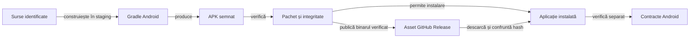

# Contractul livrării Android

Livrarea leagă configurația surselor de identitatea APK-ului și de compatibilitatea instalării. Versiunea declarată în sursă, binarul produs și aplicația instalată au identități care trebuie verificate separat.

## Responsabilități



<details>
<summary>Legendă: build și comportament</summary>

Build-ul verifică producerea binarului, iar controalele statice verifică pachetul, SDK-urile, semnătura și alinierea. Verificarea dispozitivului se referă la hash-ul APK-ului instalat efectiv.

</details>

## Condiții de livrare

- Citiți identitatea pachetului, SDK-urile și versiunea din [configurația Gradle a aplicației](../../whist-lab-app/app/build.gradle).
- Construiți într-o copie temporară proprie, cu dependențe identificate.
- Verificați API-urile Java disponibile pe platforma Android vizată; nivelul `sourceCompatibility` nu adaugă metode absente din sistem. Pentru API-uri Java mai noi decât `minSdk`, declarați `coreLibraryDesugaringEnabled` și o versiune fixată `desugar_jdk_libs` în aplicație și în modulele Android care necesită verificare izolată. Guvernanța trebuie să confrunte folosirea acestor API-uri cu configurația de desugaring.
- Verificați integritatea, semnătura, alinierea și compatibilitatea cheii pentru upgrade.
- Păstrați APK-ul și checksum-ul în `release/<versionName>/`, lângă manifest și README; dovezile aparțin subdirectorului `reports`. [Catalogul livrărilor](../../release/README.md) identifică versiunea curentă, iar rulările intermediare rămân externe.
- Verificați binarul instalat înainte de a atribui unui scenariu comportamentul acelei livrări.
- Distingeți build-ul local de distribuția prin magazin și de gestionarea cheilor de distribuție.

## Planul de semnare și de migrare

Calificați schimbarea cheii pornind de la ultimul APK disponibil utilizatorilor. Identificați pachetul, `versionCode`, `minSdk`, SHA-256 al APK-ului și amprenta SHA-256 a certificatului cu `apksigner verify --verbose --print-certs`. Dacă certificatul publicat este `Android Debug`, tratați-l ca semnatar vechi și verificați că puteți recupera exact cheia, cu acces controlat, înainte să pregătiți rotația. [Semnarea aplicațiilor Android](https://developer.android.com/studio/publish/app-signing)

1. Pregătiți o cheie dedicată livrării, cu stocare protejată și copie de siguranță testată. Păstrați cheia, parolele și configurația locală în afara Git și a rapoartelor. Procesul de build primește o configurație explicită de semnare și se oprește dacă identitatea nu poate fi verificată. Publicați doar amprentele certificatelor și datele de verificare.
2. Dacă aveți cheia veche exactă și poate fi utilizată în siguranță, construiți un candidat cu același `applicationId`, `versionCode` mai mare și un istoric de rotație verificabil. Stabiliți explicit nivelul de la care intră în vigoare cheia nouă. Rotația implicită din `apksigner` folosește cheia nouă de la API 33. Pentru rotație începând de la API 28, configurați și calificați separat pragul 28. Sub prag, compatibilitatea upgrade-ului depinde de semnatarul vechi. API 24–27 nu pot folosi rotația v3. [Opțiunile `apksigner`](https://developer.android.com/tools/apksigner)
3. Dacă cheia veche lipsește ori nu mai este sigură, opriți publicarea ca upgrade transparent pentru instalările afectate. O migrare către instalare nouă cere un traseu de transfer al salvării disponibil pentru versiunea instalată, verificat complet înainte de distribuție. Tratați separat orice decizie de schimbare a pachetului sau a nivelului Android minim.

| Profil Android | Probă înainte de publicare |
|---|---|
| API 24–27 | Upgrade de la APK-ul publicat cu semnatarul compatibil. Verificați prima instalare și păstrarea datelor. |
| API 28–32 | Upgrade și instalare curată. Verificați semnatarul efectiv pentru pragul de rotație ales. |
| API 33 și mai nou | Upgrade și instalare curată. Verificați semnatarul nou și istoricul de rotație. |

- Pentru fiecare profil, creați o partidă salvată și o mână în curs în versiunea publicată.
- Instalați candidatul peste ea, reluați partida și comparați preferințele, scorul, istoricul și următoarea acțiune legală.
- Înregistrați versiunea anterioară, nivelul API, amprentele certificatelor și hash-ul APK-ului instalat.
- Un profil absent sau o salvare pierdută blochează migrarea publicului respectiv. Calificați exact binarul distribuit.

## Compatibilitate și calificare

Compatibilitatea unei versiuni Android noi se califică separat de alegerea `targetSdk`. Numărul SDK-ului din APK nu dovedește instalarea, afișarea ori stabilitatea pe acel sistem.

| Nivel | Ce verifică | Limită |
|---|---|---|
| Construire și pachet | Surse, dependențe, manifest, SDK-uri, semnătură și APK complet. | Nu execută aplicația pe fiecare sistem acceptat. |
| Componente JVM | Modelele ferestrei, geometria, salvarea și regulile, cu intrări controlate. | Nu execută callback-urile sistemului sau gesturile reale. |
| Android identificat | Instalare, restaurare, fereastră, interacțiune și stabilitate pe binarul efectiv. | Califică profilul și sistemul declarate, cu limitele înregistrate. |

## Distribuția prin GitHub

- **Descărcare:** README-ul principal oferă APK-ul candidatului local. După publicare, indică asset-ul versiunii din GitHub Releases sau o copie publică a aceluiași APK. Canalul și accesul sunt declarate separat: asset GitHub autentificat pentru conturi cu permisiune ori copie publică verificată anonim. Directorul `release` al repository-ului păstrează documentația și copia locală.
- README-ul principal indică numai APK-ul din `currentVersion`. Pentru `PREPARED`, linkul duce la fișierul local. Pentru `PUBLISHED`, duce la asset-ul GitHub sau la copia publică verificată a aceleiași versiuni.

- **Copie locală:** [catalogul livrărilor](../../release/README.md) trimite la dosarul versiunii, care reunește APK-ul, checksum-ul și rapoartele; binarul și checksum-ul local sunt excluse din Git.
- **Navigare:** GitHub afișează directorul repository-ului ca fișiere și documentație; README-ul oferă o legătură către descărcare, fără redirect HTTP automat.

- **Identitate:** [registrul release-ului](../../release/README.md) deține versiunea, adresele asset-urilor și probele de integritate.
- **Canale:** descărcarea personală autentificată și accesul anonim au calificări separate; lipsa accesului anonim nu blochează acceptarea canalului autentificat dacă acesta este canalul declarat.

| Etapă | Criteriu de acceptare |
|---|---|
| Publicare | Upload-ul asset-ului are exact numărul de bytes al APK-ului semnat; checksum-ul identifică același fișier. |
| Descărcare | Asset-ul este accesibil în canalul declarat, iar copia descărcată are mărimea și SHA-256 originale; pentru folosirea personală se verifică browserul autentificat. |
| Integritate | Arhiva ZIP trece CRC pentru toate intrările și conține manifestul Android și codul aplicației; semnătura și alinierea sunt verificate separat. |
| Instalare | Verificarea folosește copia completă, cu identitatea pachetului și cheia de upgrade a release-ului. |

Un răspuns HTTP de eroare nu constituie un APK, indiferent de extensia fișierului salvat. Reușita construirii și instalării locale nu dovedește reușita descărcării publice; integritatea și proveniența copiei descărcate se verifică separat.

- Scrieți transferul într-un fișier temporar și publicați APK-ul prin mutare în același director, după verificare. La eșec, descărcătorul elimină fișierul temporar propriu și păstrează eroarea inițială. Descărcați din nou asset-ul GitHub și confruntați-l înainte de predare.

- Calificați separat accesul autentificat și accesul anonim. `visibility=public`, starea `uploaded` și digest-ul corect al asset-ului nu dovedesc că browserul unui vizitator poate descărca binarul. Proba păstrează codul HTTP, numărul de bytes și hash-ul copiei primite; un blocaj de vizibilitate rămâne deschis până la răspunsul public reușit.

## Separarea accesului de transferul Android

- **Navigare:** din README deschideți pagina GitHub Release a versiunii curente, apoi **Assets** și APK-ul. Legătura directă rămâne aceeași descărcare versionată; dosarul local de documentație nu este endpoint de distribuție.
- **Acces:** HTTP 404 pe pagina proiectului sau pe asset, înaintea primirii octeților, se păstrează separat de integritatea APK-ului. Vizibilitatea declarată publică și reușita API-ului autentificat nu identifică singure cauza refuzului din browser.
- **Transfer nativ:** o probă DownloadManager identifică sistemul, modul de autorizare, statusul și motivul Android, octeții primiți, SHA-256, CRC și pachetul citit prin PackageManager. Transferul de rețea trebuie executat de Android; împingerea copiei de pe calculator nu îl substituie.
- **Credențiale:** tokenul API rămâne pe calculator. Un redirect temporar autorizat pentru asset poate fi consumat de probă, fără token global pe dispozitiv; URL-ul semnat și query-ul nu intră în documentație sau rapoarte.
- **Semnătură:** pe API 28 cereți ambele flag-uri de citire a semnăturii arhivei; refuzați absența sau numărul neașteptat de semnatari și confruntați certificatul exact. Eșecul verificatorului nu devine PASS fiindcă transferul a reușit.
- **Audit:** păstrați JSON-ul rezultatului și sursele probei inline în Extent, cu durata execuției capturate. Încercările eșuate rămân în diagnosticul separat; republicarea offline nu inventează o nouă execuție ori invocări JUnit.
- **Limită:** transferul nativ autorizat califică fișierul primit pe Android. Traseul vizual README → autentificare → Assets → fișier salvat necesită o probă distinctă în browser. Eliminați aplicația temporară și eliberați rezervarea după verificare.

## Procesul unei versiuni

[Calificarea pas cu pas](../testing/ATF_ReleaseQualification.md) ordonează selecțiile, verificarea HTML și dosarul candidat; acest ghid deține build-ul, identitatea și publicarea.

[Modelul GitHub Releases](https://docs.github.com/en/repositories/releasing-projects-on-github/about-releases) leagă livrarea de un tag și permite atașarea binarelor. APK-ul se distribuie ca asset; dosarul local `release` păstrează livrarea verificată, fără să creeze o secțiune GitHub sau un redirect HTTP.

1. Identificați commit-ul surselor și versiunea aplicației. Împingeți commit-ul pe ramura de release și confirmați după `git fetch` că `git merge-base --is-ancestor <commit> origin/<ramură>` reușește; tag-ul trebuie să indice exact acel commit.
2. Fixați copia de construire în TMP, apoi construiți și semnați o singură dată. Verificați pachetul și scenariile relevante ale aceluiași binar.
3. Pregătiți un draft legat de tag, cu APK și checksum; confruntați identitatea asset-ului cu registrul livrării.
4. Publicați versiunea completă și marcați-o drept ultima versiune; păstrați binarul publicat stabil, iar corecțiile primesc o versiune nouă.
5. Verificați descărcarea în canalul cerut și actualizați registrul, legăturile și dosarul de dovezi.

[GitHub recomandă draftul înaintea atașării asset-urilor și publicării](https://docs.github.com/en/repositories/releasing-projects-on-github/managing-releases-in-a-repository) pentru release-urile imuabile. Procesul proiectului folosește această ordine și păstrează diferența dintre politica stabilită și activarea opțiunii native de imutabilitate.

## Release de mentenanță

Un patch apropiat de versiunea precedentă folosește verificări țintite după diferența reală de cod. Numărul versiunii nu justifică singur reducerea verificărilor; schimbarea regulilor, salvărilor, SDK-urilor ori dependențelor poate cere calificare suplimentară. Guvernanța folosește snapshot-ul de release și metadatele candidatului, păstrând lucrările paralele separate.

| Control | Minim pentru patch | Când se extinde |
|---|---|---|
| Surse și build | Commit identificat, copie în TMP, `assembleRelease` și `lintVitalRelease`. | Dependențe, platformă sau configurație de construire schimbate. |
| Comportament | Componentele/regresiile zonei modificate și cazurile negative relevante. | Reguli, scor, salvări sau politică AI schimbate; selecția urmărește contractul afectat. |
| Guvernanță | Dosare și prezentare release, plus linkuri și stil pentru documentele atinse. | Arhitectură ori convenții schimbate; se adaugă controalele ariei respective. |
| APK | Identitate, SDK-uri, CRC, semnătură, aliniere, compatibilitatea cheii de upgrade și SHA-256. | Manifest, instalare ori compatibilitate Android schimbate; se adaugă smoke nativ. |
| Interfață | Componentele geometriei; sanity scurt pentru interacțiunea schimbată, când dispozitivul este disponibil. | Un profil ori o tranziție nouă cere acceptanță distinctă; nu se repetă automat partida completă pe fiecare rezoluție. |
| Distribuție | Asset și checksum, apoi descărcare în canalul cerut, cu mărime și SHA-256 confruntate. | Schimbarea canalului ori a semnării cere reverificarea distribuției. |

Selecțiile executate trebuie să treacă; un eșec relevant blochează publicarea. O verificare nativă omisă se consemnează în dosarul tehnic împreună cu motivul, fără a prelua calificarea APK-ului anterior și fără a încărca pagina Release.

### Predarea patch-ului

1. Actualizați `versionName` și incrementați `versionCode` în Gradle; fixați commit-ul construit. Sursele relevante schimbate în paralel se confruntă înainte de publicare.
2. Rulați selecția de mai sus în TMP; pregătiți comenzile, rezultatele JUnit și jurnalele pentru `release/<versionName>/reports/`, cu un README scurt al verificării. Rapoartele Extent provin numai din execuțiile efective ale versiunii; un reper anterior este etichetat explicit.
3. Puneți copia de audit a APK-ului semnat `WhistLab-<versionName>.apk` și checksum-ul în `release/<versionName>/`; păstrați ediția curentă și imediat anterioară. Arhivați edițiile mai vechi în afara catalogului activ numai după confruntarea identității și a hash-urilor. Canalul de descărcare din README este asset-ul GitHub Release; copia din dosar servește verificării integrității.
4. Actualizați manifestul și README-ul noii versiuni, `release/index.json`, catalogul și notele în bullets față de versiunea precedentă. Ghidurile generice se modifică numai dacă s-a schimbat procesul ori contractul.
5. Confruntați guvernanța înainte de publicare, publicați tag-ul și asset-urile verificate, apoi descărcați asset-ul complet în canalul declarat. Actualizați dovada descărcării și linkul direct din README numai după confruntarea versiunii curente, mărimii, SHA-256 și CRC; portalul `releases/latest` nu fixează identitatea APK-ului.

Metadatele draftului se păstrează separat în `github-release-draft.json`; `github-release.json` descrie publicarea efectivă. GitHub poate folosi adrese temporare `untagged` în draft, astfel că testul notelor legate de asset-urile publicate se execută din nou după publicare, pe adresele canonice observate. La publicare, trimiteți explicit tag-ul și commit-ul surselor și confruntați răspunsul cu identitatea APK-ului.

## Commit-ul surselor și commit-ul dovezilor

- **Surse:** tag-ul fixează commit-ul calificat înaintea publicării. Confruntați toate intrările APK-ului și fișierele noi; modificările documentației ori ale probelor ulterioare nu mută tag-ul.
- **Dovezi:** descărcarea reală se verifică după publicare și are un commit ulterior al rapoartelor. Nota Release fixează acest commit în `evidenceUrl`; metadatele păstrează separat `sourceCommit`.
- **Legare:** commit-ul dovezilor există înaintea introducerii hash-ului său în note. Un commit final înregistrează legătura și răspunsul GitHub; nu se încearcă autoreferențierea hash-ului unui commit.
- **Identitatea auditului:** [Guvernanța predării](../../atf-tests/src/test/java/atf/tests/governance/documentation/release/ReleasePresentationGovernanceTest.java) citește indexul, manifestul și raportul direct din commitul indicat și compară SHA-256 cu raportul canonic declarat în dosarul predat. Dacă o reluare schimbă raportul canonic, fixați noul commit de dovezi în note.
- **Închidere:** după ultimul push, recitiți README-ul din GitHub și confruntați URL-ul exact cu asset-ul descărcat. Verificarea locală nu dovedește singură că documentul online a fost actualizat.
- **Reluarea draftului:** păstrați ID-ul răspunsului de creare și recitiți draftul după ID. Un 404 la căutarea după tag nu justifică repetarea creării; confruntați mai întâi inventarul drafturilor autorizate și asset-urile existente, fără upload sau înlocuire oarbă.

## Dosarul unei versiuni

[Catalogul livrărilor](../../release/README.md) păstrează ediția curentă și imediat anterioară, fiecare în `release/<versionName>/`. Prezentarea versiunii și metadatele ei trimit la dovezile din `reports/`. [Politica de retenție](ATF_ReleaseRetention.md) definește arhivarea edițiilor mai vechi, înlocuirea și resetarea GitHub cerută explicit.

| Intrare | Responsabilitate |
|---|---|
| `release/index.json` | Schema 2 declară `currentVersion` și cel mult două versiuni în `versions`, începând cu ediția curentă și apoi ediția imediat anterioară; toate legăturile principale identifică prima versiune. |
| `release/README.md` | Catalogul stabil al livrării active și punctul de intrare în dosarul ei. |
| `release/<versionName>/README.md` | Prezintă ediția, APK-ul identificat, starea predării și legăturile către metadate și rapoarte. |
| `release/<versionName>/reports/README.md` | Prezintă selecțiile executate, rapoartele, rezultatele și limitele calificării. |
| Manifest și metadate în dosar | Leagă `versionName`, tag-ul, asset-urile, checksum-ul și notele; căile relative pornesc din dosarul versiunii. |
| Rapoarte, capturi, rezultate și jurnale în `reports/` | Păstrează execuția identificată, inclusiv diagnosticele negative și replay-urile etichetate; legăturile lor locale pornesc din acel subdirector. |
| [Strategia testării](../testing/README.md) | Deține selecția și principiile comune, independent de versiune. |

- La o versiune nouă, calificați candidatul extern și arhivați numai dosarele mai vechi decât ediția imediat anterioară. Actualizați indexul și catalogul după verificarea identității; păstrați în `release` ediția curentă și imediat anterioară, inclusiv APK-urile locale ale acestora.
- La reorganizare, mutați împreună rapoartele și fișierele asociate, confruntați hash-urile și refaceți referințele active. Căile absolute capturate și URL-urile istorice fixate pe commit își păstrează sensul original.
- `artifacts/` și `dist/` sunt directoare retrase din rădăcina proiectului. După arhivarea și confruntarea datelor unice, eliminați directoarele vechi, inclusiv cele goale; guvernanța refuză reapariția lor.
- Notele din GitHub Release trimit la README-ul versiunii într-un commit identificat; schimbarea navigării nu mută tag-ul și nu înlocuiește asset-ul binar.

[Guvernanța dosarelor](../../atf-tests/src/test/java/atf/tests/governance/documentation/release/ReleaseArtifactLayoutGovernanceTest.java) respinge populația neînregistrată, acumularea versiunilor active, metadatele lipsă și identitățile divergente. Verificarea integrității fișierelor și a linkurilor completează acest contract structural.

### Linkul principal și proba descărcării

| Situație | Prezentare și verificare |
|---|---|
| Candidat local | Link la dosarul exact din `release/<versionName>/`, stare `PREPARED` și APK local; fără afirmație de publicare GitHub. |
| Asset publicat | Link direct `releases/download/<tag>/<apkName>`. Eticheta, tag-ul și fișierul identifică aceeași versiune. |
| Asset GitHub autentificat | `PUBLISHED` cu `accessMode=AUTHENTICATED`; receipt-ul `authenticatedDownload` confirmă sesiunea contului printr-un canal declarat în politica RAG. API-ul GitHub dovedește HTTP 200; Browser MCP dovedește finalizarea descărcării. Ambele rute verifică URL-ul, octeții, SHA-256 și CRC, fără token, cookie sau antet de autorizare. |
| Copie publică verificată | `PUBLISHED_SITE` cu `accessMode=ANONYMOUS`; receipt-ul `publicDownload` confirmă pagina, APK-ul și checksum-ul prin HTTPS fără credențiale. |
| Copie completă | Răspuns reușit, mărime și SHA-256 identice cu asset-ul și binarul declarat; ZIP cu CRC valid, manifest Android și cod. Un răspuns de eroare nu se redenumește `.apk`. |
| Canal verificat | Fiecare receipt califică numai modul de acces pe care îl declară. Un rezultat autentificat nu afirmă acces anonim, iar o copie publică nu afirmă permisiunile conturilor GitHub. |
| Identitate unică | `currentVersion`, manifestul, eticheta, numele APK-ului și URL-ul identifică aceeași ediție. Dovezile unei versiuni anterioare rămân numai referințe de audit. |

Fișierul se descarcă într-un nume temporar și primește extensia finală după verificări. La trecerea în `PUBLISHED`, înlocuiți linkul local cu adresa de distribuție a aceleiași versiuni.

### Accesul anonim și ruta publică

1. După publicare, deschideți README-ul livrat într-o sesiune de browser fără cont. Urmați linkul APK din pagina afișată. Descărcați fișierul și checksum-ul fără cookie-uri, antet de autorizare sau token. Comparați mărimea și SHA-256 cu `release-validation.json` și cu fișierul checksum publicat.
2. La HTTP 404, verificați separat repository-ul, README-ul, pagina release-ului și asset-ul. Comparați rezultatul anonim cu cel din sesiunea proprietarului. Dacă și profilul sau alte repository-uri marcate public sunt inaccesibile, păstrați URL-urile, ora UTC, codurile HTTP și ID-urile cererilor pentru [GitHub Support](https://docs.github.com/en/support/contacting-github-support/creating-a-support-ticket). Un 404 anonim singur nu identifică motivul.
3. Dacă asset-ul GitHub rămâne inaccesibil anonim, publicați APK-ul semnat și checksum-ul pe o gazdă HTTPS publică, controlată de proiect. Linkul APK se termină în `/v<versionName>/WhistLab-<versionName>.apk` și folosește o adresă stabilă, fără parametri de interogare sau fragment. Dacă și README-ul de pe GitHub este inaccesibil, publicați o copie din commitul identificat pe pagina publică și verificați linkul din ea. O copie nouă a README-ului se publică după fiecare schimbare de versiune sau de destinație a descărcării.
4. Înregistrați modul declarat în `release/<versionName>/reports/distribution-verification.json`: `authenticatedDownload` pentru GitHub cu autentificare sau `publicDownload` pentru Site anonim. Canalul autentificat și proba sa trebuie să corespundă politicii din `config/release-platform-rag-policy.json`: API-ul păstrează `httpStatus=200`, iar Browser MCP păstrează `downloadCompleted=true` numai după descărcare completă. Comparați fișierul obținut; nu salvați cookie-uri sau antete de autorizare. Includeți numai metadatele verificabile. Actualizați linkul principal, reînregistrați integritatea dosarului și rulați guvernanța. După push, recitiți README-ul și repetați descărcarea folosind exact acel link și același mod de acces.

Rulați verificarea din rădăcina proiectului și introduceți adresa directă copiată din README-ul publicat.

```powershell
$version = (Get-Content release/index.json -Raw | ConvertFrom-Json).currentVersion
$expected = (Get-Content "release/$version/release-validation.json" -Raw | ConvertFrom-Json).release
$downloadUrl = Read-Host 'URL-ul direct din README'
$payload = [IO.Path]::GetTempFileName()
try {
    $status = curl.exe -q --fail --location --silent --show-error --max-time 60 `
        --proto '=https' --proto-redir '=https' --output $payload --write-out '%{http_code}' -- $downloadUrl
    if ($LASTEXITCODE -ne 0 -or $status -ne '200') { throw "Descărcarea a returnat HTTP $status" }
    $bytes = (Get-Item -LiteralPath $payload).Length
    $sha256 = (Get-FileHash -LiteralPath $payload -Algorithm SHA256).Hash.ToLowerInvariant()
    if ($bytes -ne $expected.apkBytes -or $sha256 -ne $expected.apkSha256) {
        throw 'APK-ul descărcat diferă de manifest'
    }
    [pscustomobject]@{ HttpStatus = [int]$status; Bytes = $bytes; Sha256 = $sha256 }
} finally {
    Remove-Item -LiteralPath $payload
}
```

### Verificări automate ale distribuției

| Control | Scop și limită |
|---|---|
| [Guvernanța linkurilor](../../atf-tests/src/test/java/atf/tests/governance/documentation/release/ReleaseArtifactLayoutGovernanceTest.java) | Aceeași versiune în catalog, etichetă și APK, local sau publicat; refuză `latest` ambiguu, Raw/blob, descărcări concurente, orice APK vechi în README și directoarele retrase. |
| [Componentele descărcării](../../atf-tests/src/test/java/atf/tests/governance/documentation/release/download/ApkDownloadComponentTest.java) | HTTP loopback real: răspuns complet, 404, text salvat ca APK, trunchiere, exces, SHA greșit, CRC invalid, metadate divergente și credențială nepropagată către altă origine. Fixture-ul ZIP nu califică instalarea Android. |
| [Selecția identității](../../atf-tests/src/test/java/atf/tests/governance/documentation/release/download/DownloadSelectionComponentTest.java) | Un rezultat pozitiv al versiunii online anterioare nu califică descărcarea candidatului curent. Numărul de bytes este citit exact, fără conversie numerică permisivă. |
| [Acceptanța live](../../atf-tests/src/test/java/atf/tests/governance/documentation/release/download/PublishedApkDownloadAcceptanceTest.java) | Descărcare GitHub explicită, cu versiune, bytes, SHA-256, CRC și verdict în Extent. Ținta este exclusiv `currentVersion`; publicarea absentă produce HTTP 404 și FAIL, fără accesarea unui APK anterior. |

Dintr-o copie TMP cu dependențele disponibile, componentele rulează fără acces GitHub:

```powershell
mvn -B -o -pl atf-tests -am '-Dtest=ReleaseArtifactLayoutGovernanceTest,ApkDownloadComponentTest,DownloadSelectionComponentTest' '-Dsurefire.failIfNoSpecifiedTests=false' test
```

După publicare, verificați APK-ul curent prin proba separată de rețea:

```powershell
mvn -B -o -pl atf-tests -am '-Dtest=PublishedApkDownloadAcceptanceTest' '-Dsurefire.failIfNoSpecifiedTests=false' '-Datf.release.download.enabled=true' '-Datf.release.download.scope=current' test
```

- **Canal:** tokenul se citește din `GH_TOKEN` sau `GITHUB_TOKEN`; nu se transmite prin argumente, YAML ori rapoarte. Testul nu publică și nu instalează aplicația.
- **Scope:** numai `atf.release.download.scope=current` este acceptat. Identitatea și mărimea așteptată provin din manifestul curent, inclusiv când acesta este încă `PREPARED`; testul confruntă publicarea reală.
- **Raport:** `atf.release.download.report-directory` cere o cale absolută; implicit folosește TMP. Erorile și refuzul publicării lipsă rămân FAIL, fără PASS dintr-un subset mai vechi.
- **Suită offline:** guvernanța obișnuită exclude tag-ul `release-download-live`; acceptanța de rețea se selectează explicit, fără a transforma omisiunea ei într-un rezultat pozitiv.

- **Inventar:** indexul structurat, dosarele și catalogul formează aceeași populație verificată.
- **Calificare:** validarea structurală și [legarea notelor de asset-ul publicat](../../atf-tests/src/test/java/atf/tests/governance/documentation/release/ReleasePresentationGovernanceTest.java) sunt controale distincte; trecerea lor nu dovedește accesul în modul declarat, proveniența Git completă sau autonomia raportului.

### Integritatea fișierelor și rezultatelor

[Guvernanța integrității](../../atf-tests/src/test/java/atf/tests/governance/documentation/release/ReleaseIntegrityGovernanceTest.java) citește APK-ul și dosarul activ fără a le modifica. Confruntă numele, calea canonică din dosarul versiunii, mărimea, SHA-256 și fișierul checksum; citește toate intrările ZIP pentru CRC și refuză numele duplicate ori căile necanonice.

| Legătură verificată | Contract |
|---|---|
| Manifest–payload | Registrul `integrity.files` enumeră exact toate fișierele dosarului, cu mărime și SHA-256; manifestul însuși este exclus pentru a evita autoreferința. Un fișier adăugat, șters sau modificat invalidează observația. |
| Manifest–JUnit | Fiecare grup declară exact XML-urile păstrate. Cazurile sunt renumărate, identitatea clasă–invocare este unică, iar atributele XML și totalurile declarate trebuie să coincidă. |
| Manifest–HTML auditat | Grupurile auditate declară un HTML canonic și protocolul receipt-ului. Invocările, comparațiile și verdictele sunt renumărate la ownerul lor; aceeași selecție nu păstrează și un grup XML paralel. Schema calificării distinge aceste grupuri de rezultatele istorice încă nemigrate. |
| Rezultat calificat | Sunt necesare cazuri efective și zero eșecuri, erori ori omisiuni; un container gol nu inventează teste. Un antet cu zero eșecuri nu ascunde un element `failure`, `error` sau `skipped`. |
| Manifest–intrări | Fișierul intrărilor sursă este inclus în registrul hash-urilor; amprenta și commit-ul declarate concordă, iar căile și hash-urile intrărilor sunt valide și fără duplicate. |

Înregistrarea hash-urilor este un pas de pregătire explicit, după fixarea fișierelor:

```powershell
node atf-tests/tools/record-release-integrity.mjs
```

- **Înregistrare:** unealta selectează versiunea din index, verifică stabilitatea inventarului și actualizează secțiunea `integrity`. Momentul `observedUtc` identifică observarea octeților, fără modificarea verdictului, datei execuției sau stării publicării.
- **Git:** [Atributul `text`](https://git-scm.com/docs/gitattributes) este dezactivat prin `.gitattributes` pentru întregul dosar `release`. Guvernanța confruntă atributul efectiv al fiecărui payload, inclusiv suprascrierile locale; înainte de push, octeții din obiectele Git trebuie să corespundă registrului.
- **Verificare:** după înregistrare se execută guvernanța; recalcularea hash-urilor nu face valid un XML cu eșecuri sau un APK corupt.
- **Limite:** CRC-ul și SHA-256 califică integritatea locală, separat de semnătura APK-ului, manifestul Android binar, reproducerea build-ului și identitatea commit-ului publicat. Lista intrărilor nu confruntă încă arhiva externă completă ori populația surselor live.
- **Catalog:** delimitarea secțiunilor se validează înaintea intrării curente, cu diagnostic pentru titluri lipsă sau inversate. Prezența unei versiuni în tabelul general nu substituie legătura din secțiunea curentă.

## Prezentarea unei versiuni

Pagina Release este destinată utilizatorului. Păstrează trei secțiuni cu bullets și trimite către dosarul dedicat pentru audit:

| Secțiune | Conținut |
|---|---|
| Descărcare | Autentificare în browser, linkul direct al APK-ului și checksum-ul versiunii. |
| Îmbunătățiri față de versiunea precedentă | Schimbări confirmate pentru binarul publicat, cu versiunea de comparație identificată. |
| Documentație | Legătura către rapoarte și proveniență, într-un commit identificat. |

- **Comparație:** dacă diferențele față de versiunea precedentă nu sunt confirmate, secțiunea se numește **Pe scurt** și descrie doar capabilități cunoscute ale versiunii. Nu transformați rezumatul în istoric inventat; următoarea livrare își adună schimbările pe parcursul dezvoltării.
- **Audit:** numerele testelor, verdicturile tehnice, mesajele despre dispozitive neverificate și diagnosticul distribuției aparțin dosarului de dovezi. Linkul din Release păstrează accesul la ele fără a încărca prezentarea produsului.

[Guvernanța prezentării](../../atf-tests/src/test/java/atf/tests/governance/documentation/release/ReleasePresentationGovernanceTest.java) confruntă snapshot-ul notelor cu asset-ul și registrul: bullets, destinația APK-ului, checksum, referință de audit și comparație declarată ori rezumat explicit. Probele negative acoperă legături Raw, versiuni greșite, lipsa bazei de comparație și detalii de testare introduse în prezentare.

## Fereastra și versiunile Android noi

[Documentația Android](https://developer.android.com/develop/ui/views/layout/edge-to-edge) descrie afișarea edge-to-edge pentru aplicațiile cu `targetSdk` de cel puțin 35 pe Android 15 sau mai nou. [WindowContent](../../whist-lab-app/app/src/main/java/ro/whistlab/app/window/WindowContent.java) separă protecția vederii de măsurarea ferestrei:

| Cale din cod | Comportament implementat |
|---|---|
| `protect`, API 35+ | Adaugă barele, decupajul și IME la padding-ul inițial și consumă insets-urile. Baza se păstrează, fără acumulare la reaplicare. |
| `widthDp` / `heightDp`, API 30+ | Folosește fereastra curentă și exclude barele și decupajul, independent de vizibilitatea lor. IME nu este scăzut în această măsurare; protecția rădăcinii are cale proprie. |
| Sisteme anterioare | Măsurarea folosește configurația platformei; listenerul de protecție nu este instalat de această clasă înainte de API 35. |

[Componentele ferestrei](../../whist-lab-app/app/src/test/java/ro/whistlab/app/window/WindowPaddingComponentTest.java) verifică aritmetica și bugetele modelului. [Acceptanța nativă](../feedback/ATF_Android.md#acceptanță-nativă-android-17) confruntă viewport-ul real, gesturile, navigarea cu trei butoane, decupajul și tastatura; ea nu rezultă din modelul JVM.

## Memorie și diagnostic pe Android 17

[Android 17 / API 37](https://developer.android.com/about/versions/17/behavior-changes-all) aplică limite de memorie inclusiv aplicațiilor care țintesc versiuni anterioare. Documentația identifică intervenția limiterului prin `ApplicationExitInfo`, motivul `REASON_OTHER` și descrierea care conține `MemoryLimiter:AnonSwap`.

- Identificați APK-ul, sistemul, profilul mesei și starea aplicației din aceeași execuție.
- Înregistrați memoria de referință și evoluția ei la reluare și la mărimi diferite de mână; costul căutării AI și reactivitatea au măsurători proprii.
- Confruntați motivul ieșirii cu jurnalul AndroidRuntime; codul sau mesajul izolat nu substituie corelarea procesului și intervalului.
- Păstrați limitele sistemului pentru acceptanță și consemnați explicit un diagnostic incomplet. Corectitudinea calculelor JVM nu califică memoria procesului Android.

## Restaurarea datelor

1. Exportați salvările înaintea intervenției asupra unei aplicații cu date existente.
2. Verificați integritatea exportului înaintea instalării, resetării sau curățării.
3. Tratați eroarea de citire drept eroare, fără a o interpreta ca absență a datelor.
4. Verificați restaurarea și schema înainte de a elimina copia de siguranță.
5. Păstrați explicit limitele migrării informației lipsă.

[Build-ul aplicației](../../whist-lab-app/README.md) · [Testarea Android](../testing/ATF_Android.md) · [Istoricul scorului](../game/ATF_ScoreHistory.md)
