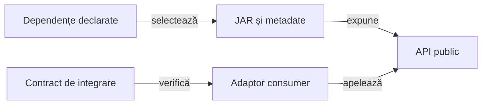

# Integrarea bibliotecilor comune

Consumerul folosește API-urile livrate prin dependențele declarate, cu o identitate binară verificabilă. Codul aplicației și adaptoarele sale păstrează responsabilitatea semanticii de domeniu.

## Limita de integrare

Legendă: contractul consumat

Coordonatele selectează livrarea, iar identitatea fizică a binarului se verifică separat. Consumerul validează contractul de care depinde fără a introduce o copie a implementării generice.

## Principii

- [POM-ul](../../pom.xml) este sursa coordonatelor și versiunilor efective.
- Metadatele livrării și hash-ul binarului disting configurația declarată de octeții utilizați.
- Un adaptor traduce datele domeniului către tipurile API, păstrând identitatea și rezultatul original.
- Contractele consumerului urmăresc suprafața publică folosită și cazurile de refuz.
- Îmbunătățirea generică a bibliotecii se solicită prin [rutarea feedback-ului](../feedback/README.md).
- Actualizarea bibliotecii cere reconcilierea API-ului și a testelor consumerului înainte de integrare.

## Modificări concurente

O execuție folosește o copie de build cu surse și biblioteci identificate la început. Schimbarea lor în checkout nu califică retrospectiv copia deja executată.

Configurația, binarul și sursele se verifică împreună. O versiune textuală egală nu justifică folosirea unor octeți diferiți sub aceeași identitate.

[Modulul de integrare](../../atf-tests/README.md) · [Publicarea rezultatelor](../reporting/README.md)
