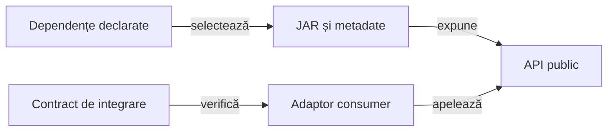

# Integrarea bibliotecilor comune

Consumerul folosește API-urile livrate prin dependențele declarate, cu o identitate binară verificabilă. Codul aplicației și adaptoarele sale păstrează responsabilitatea semanticii de domeniu.

## Limita de integrare

Legendă: contractul consumat

Coordonatele selectează livrarea, iar identitatea fizică a binarului se verifică separat. Consumerul validează contractul de care depinde fără a introduce o copie a implementării generice.

## Principii

[Consumul bibliotecilor comune](README.md) deține inventarul binar, identitatea fizică și limitele producător–consumator. Integrarea unui API urmează un traseu distinct:

1. Identificați contractul public folosit și dependența efectivă din POM.
2. Construiți adaptorul cu tipurile API și semantica domeniului păstrată explicit.
3. Verificați cazul nominal și refuzurile prin acceptanța independentă a consumatorului.
4. Reconciliați schimbarea API-ului cu configurația, binarul încărcat și adaptoarele afectate.
5. Direcționați schimbarea generică prin [feedback](../feedback/README.md), păstrând local acceptanța contractului folosit.

[CoreReportingConsumerContractTest](../../atf-tests/src/test/java/atf/tests/publishing/CoreReportingConsumerContractTest.java) verifică integrarea comună. Contractele de domeniu și [auditul publicării](../reporting/ATF_Audit.md) adaugă propriile oracole.

## Modificări concurente

O execuție folosește o copie de build cu surse și biblioteci identificate la început. Schimbarea lor în checkout nu califică retrospectiv copia deja executată.

Configurația, binarul și sursele se verifică împreună. O versiune textuală egală nu justifică folosirea unor octeți diferiți sub aceeași identitate.

[Modulul de integrare](../../atf-tests/README.md) · [Publicarea rezultatelor](../reporting/README.md)
