# Retenția rapoartelor și a release-urilor

## Responsabilitate

Directorul de lucru păstrează ediția curentă și imediat anterioară, fiecare cu propriul APK calificat și dovezi. Istoricul mai vechi se arhivează în afara catalogului activ; pregătirea locală nu publică și nu șterge release-uri.

## Structură activă

```text
release/
  README.md
  index.json
  <versionName>/
    README.md
    WhistLab-<versionName>.apk
    WhistLab-<versionName>.apk.sha256
    release-validation.json
    release-presentation.json
    release-notes.md
    github-release.json
    reports/
      README.md
      component/
      e2e/
      distribution-verification.json
      download-extent.html
```

- Indexul folosește `schemaVersion: 2`, `currentVersion` și cel mult două intrări în `versions`, începând cu ediția curentă și apoi ediția imediat anterioară.
- README-ul principal și indexul identifică exclusiv versiunea curentă. Un reper anterior poate documenta auditul, dar nu înlocuiește APK-ul, linkul sau proba descărcării candidatului activ.
- APK-ul și checksum-ul aparțin aceluiași dosar cu manifestul versiunii; nu se păstrează o a doua copie activă într-un director de distribuție. README-ul principal trimite la catalogul `release`.
- `release` conține catalogul, indexul și cel mult două dosare de versiune. Numele fiecărui dosar și manifestul trebuie să coincidă; `currentVersion` trebuie să existe în prima poziție.
- README-ul versiunii prezintă livrarea și trimite la `reports/README.md`, care explică selecțiile, rezultatele și limitele. Manifestul și metadatele prezentării aparțin versiunii; raportul canonic și diagnosticele aparțin subdirectorului `reports`.
- Dosarul păstrează raportul canonic și numai dovezile ori diagnosticele auxiliare justificate pentru APK. [Contractul predării](../reporting/ATF_Handoff.md#livrabil-compact-și-excepții) cere eliminarea copiilor deja încorporate și păstrarea dovezii unice până la publicarea completă. Un rezultat omis sau blocat rămâne explicit; nu se preia automat verdictul altei versiuni.
- Build-urile, candidații intermediari și diagnosticele istorice rămân în TMP sau în arhiva externă. [Strategia comună](../testing/README.md) rămâne independentă de versiune.

## Înlocuire și recuperare

1. Pregătiți noul dosar în afara directorului activ; fixați sursele și dependențele executate.
2. Arhivați dosarul precedent, manifestul și indexul. Confruntați fișierele prin SHA-256 și verificați arhiva înaintea mutării surselor vechi.
3. Calificați noul APK și toate selecțiile cerute de diferența de cod. Păstrați explicit tipul de binar: E2E cu fixture Debug și smoke Release au identități separate.
4. Adăugați ediția calificată, păstrați versiunea curentă precedentă drept reper și arhivați numai edițiile mai vechi după verificarea arhivei. Actualizați catalogul, indexul, prezentarea versiunii și indexul rapoartelor. Refuzați o populație goală, mai mult de două versiuni, dosare nerecunoscute sau redenumirea unui raport vechi drept versiune nouă.
5. Păstrați jurnalul de retenție, identitatea arhivei externe și hash-urile originale. La eșec, restaurați întregul dosar și indexul anterior.

- **Directoare retrase:** `artifacts/` și `dist/` nu mai apar în rădăcina activă. Înaintea eliminării, inventariați și arhivați datele unice; confruntați hash-urile și referințele mutate în `release`.
- **Identitate:** mutarea rapoartelor nu publică un GitHub Release și nu transformă un link către un fișier Git într-un asset descărcabil. [Procesul descărcării](ATF_AndroidDelivery.md#linkul-principal-și-proba-descărcării) deține această verificare.

Nu rescrieți capturile, HTML-ul sau trace-ul brut pentru a modifica proveniența. Legăturile active și metadatele de navigare pot fi adaptate la noua structură; copia originală rămâne în arhivă și în istoricul Git.

După fixarea dosarului, [înregistrați integritatea](ATF_AndroidDelivery.md#integritatea-fișierelor-și-rezultatelor) și rulați guvernanța. Registrul identifică exact fișierele păstrate, fără manifestul autoreferențial; înlocuirea unui fișier cere o observație nouă, cu moment propriu. Capturarea hash-urilor nu rescrie rezultatele istorice și nu acordă calificare surselor modificate ulterior.

- **Dezvoltare paralelă:** poate continua după fixarea candidatului. Inventariați fișierele ulterioare în `source-freeze.json` și păstrați arhiva surselor calificate cu hash și CRC; publicarea trebuie legată de acel snapshot. Un commit care include cod nou nu preia automat calificarea APK-ului anterior.
- **Comparație live:** identificați momentul observației și confruntați întreaga populație: fișiere modificate, adăugate și șterse. Manifestul snapshot-ului rămâne neschimbat; actualizarea comparației nu reconstruiește retrospectiv un alt APK sau alte rezultate.

## Pregătire și livrare

```mermaid
flowchart LR
    SOURCE[Snapshot identificat] -->|build în TMP| APK[APK și verificări]
    APK -->|dovezi curente| LOCAL[PREPARED local]
    LOCAL -->|pas ulterior al operatorului| BOUND[Commit identificat]
    BOUND -->|publicare și descărcare| LIVE[Release verificat]
    LIVE -->|arhivare și plan explicit| RETIRE[Retragere ediții vechi]
```



<details>
<summary>Legendă: pregătirea locală are o limită explicită</summary>

Snapshot-ul și APK-ul se califică înaintea predării. Operatorul fixează ulterior identitatea Git și publicarea; retragerea edițiilor vechi depinde de descărcarea verificată a înlocuitorului.

</details>

| Etapă | Rezultat | Acțiuni excluse din etapă |
|---|---|---|
| Pregătire locală | Surse înghețate prin hash, APK, rezultate și note pregătite. | Commit, push, publicare și ștergeri GitHub. |
| Fixarea surselor | Operatorul identifică și împinge commit-ul construit; diferențele față de snapshot sunt confruntate. | Mutarea tag-urilor vechi sau calificarea implicită a surselor schimbate. |
| Publicare | Draft, APK și checksum, apoi release curent și descărcare verificată. | Ștergerea versiunii funcționale înaintea validării înlocuitorului. |
| Resetare cerută | Se arhivează release-urile, asset-urile și tagurile vechi. Se retrag obiectele din afara catalogului confirmate în plan. | Rescrierea istoricului Git sau retragerea unei ediții încă prezente în catalog. |

Un candidat necomis este marcat `PREPARED`; hash-ul snapshot-ului nu este prezentat ca un commit. Publicarea cere confruntarea ulterioară cu commit-ul efectiv și completarea legăturii imuabile a documentației. Template-ul notelor nu constituie note deja publicate.

- Candidatul păstrează `release-notes.template.md`, `evidenceUrlTemplate` și `sourceCommit: null`; placeholder-ul `{evidenceCommit}` rămâne explicit.
- [Guvernanța prezentării](../../atf-tests/src/test/java/atf/tests/governance/documentation/release/ReleasePresentationGovernanceTest.java) verifică aceleași secțiuni și bullets, dar refuză metadate GitHub publicate alături de starea `PREPARED`.
- La publicare, operatorul fixează URL-ul documentației la commit-ul efectiv, generează `release-notes.md` și înregistrează canalul verificat. Nu folosiți un commit fictiv sau verdictul unei descărcări încă neefectuate.
- Un release GitHub folosește `publication.state: PUBLISHED`, manifestul `github-release.json` și același commit sursă în `targetCommit`. Un APK publicat prin Site folosește `publication.state: PUBLISHED_SITE` și dovada descărcării anonime din `reports/distribution-verification.json`; nu se inventează un release GitHub.
- Ambele tranziții înregistrează `source.sourceCommit`, înlocuiesc `evidenceUrlTemplate` cu `evidenceUrl` și cer note finale cu APK-ul și checksum-ul canalului publicat.

`versionName` identifică ediția cerută, iar `versionCode` crește la fiecare APK livrat. După resetarea numerotării vizibile, [codul Android](https://developer.android.com/studio/publish/versioning) și certificatul de semnare păstrează calea de actualizare; promovarea GitHub se marchează explicit drept ultimul release.

## Resetarea GitHub

- Folosiți un inventar explicit de ID-uri, tag-uri, asset-uri și digest-uri. Nu deduceți populația doar dintr-o pagină ori listă care poate fi filtrată.
- Arhivați metadatele și asset-urile vechi înaintea ștergerii. Noul APK trebuie să fie publicat ca ultimul release și descărcat integral prin canalul declarat.
- [Ștergerea unui release prin GitHub](https://docs.github.com/en/rest/releases/releases#delete-a-release) este o operație separată de [ștergerea tag-ului](https://hub.github.com/hub-release.1.html). Arhivați referințele înainte de retragerea tagurilor din afara catalogului.
- La final, colectați inventarul GitHub și verificați-l prin poarta RAG. Catalogul activ cuprinde exact două release-uri și tagurile lor, fiecare cu APK și checksum verificate. [Comanda de verificare](../testing/ATF_ReleaseQualification.md#retenția-pe-github-după-publicare)

[Contractul livrării](ATF_AndroidDelivery.md) deține build-ul și identitatea APK-ului; [guvernanța](../../atf-tests/src/test/java/atf/tests/governance/documentation/release/ReleaseArtifactLayoutGovernanceTest.java) verifică structura activă și refuzurile.
