# Retenția rapoartelor și a release-urilor

## Responsabilitate

Directorul de lucru păstrează ultimele dovezi calificate, asociate unui singur APK. Istoricul surselor, arhiva externă și distribuția GitHub au roluri distincte; pregătirea locală nu publică și nu șterge release-uri.

## Structură activă

```text
artifacts/
  README.md
  index.json
  reports/
    README.md
    <versionName>/
      README.md
      release-validation.json
      test-results/
      e2e/
```

- Indexul folosește `schemaVersion: 2`, `currentVersion` și exact o intrare în `versions`.
- `artifacts/reports` conține README-ul de navigare și un singur dosar de versiune. Numele dosarului, manifestul și versiunea curentă trebuie să coincidă.
- Dosarul păstrează raportul canonic și numai dovezile ori diagnosticele auxiliare justificate pentru APK. [Contractul predării](../reporting/ATF_Handoff.md#livrabil-compact-și-excepții) cere eliminarea copiilor deja încorporate și păstrarea dovezii unice până la publicarea completă. Un rezultat omis sau blocat rămâne explicit; nu se preia automat verdictul altei versiuni.
- Build-urile, candidații intermediari și diagnosticele istorice rămân în TMP sau în arhiva externă. [Strategia comună](../testing/README.md) rămâne independentă de versiune.

## Înlocuire și recuperare

1. Pregătiți noul dosar în afara directorului activ; fixați sursele și dependențele executate.
2. Arhivați dosarul precedent, manifestul și indexul. Confruntați fișierele prin SHA-256 și verificați arhiva înaintea mutării surselor vechi.
3. Calificați noul APK și toate selecțiile cerute de diferența de cod. Păstrați explicit tipul de binar: E2E cu fixture Debug și smoke Release au identități separate.
4. Înlocuiți dosarul activ și actualizați cele două README-uri și indexul. Refuzați o populație goală, două versiuni active, dosare nerecunoscute sau redenumirea unui raport vechi drept versiune nouă.
5. Păstrați jurnalul de retenție, identitatea arhivei externe și hash-urile originale. La eșec, restaurați întregul dosar și indexul anterior.

Nu rescrieți capturile, HTML-ul sau trace-ul brut pentru a modifica proveniența. Legăturile active și metadatele de navigare pot fi adaptate la noua structură; copia originală rămâne în arhivă și în istoricul Git.

- **Dezvoltare paralelă:** poate continua după fixarea candidatului. Inventariați fișierele ulterioare în `source-freeze.json` și păstrați arhiva surselor calificate cu hash și CRC; publicarea trebuie legată de acel snapshot. Un commit care include cod nou nu preia automat calificarea APK-ului anterior.
- **Comparație live:** identificați momentul observației și confruntați întreaga populație: fișiere modificate, adăugate și șterse. Manifestul snapshot-ului rămâne neschimbat; actualizarea comparației nu reconstruiește retrospectiv un alt APK sau alte rezultate.

## Pregătire și livrare

```mermaid
flowchart LR
    SOURCE[Snapshot identificat] -->|build în TMP| APK[APK și verificări]
    APK -->|dovezi curente| LOCAL[PREPARED local]
    LOCAL -->|pas ulterior al operatorului| BOUND[Commit identificat]
    BOUND -->|publicare și descărcare| LIVE[Release verificat]
    LIVE -->|arhivare și plan explicit| RETIRE[Retragere ediții vechi]
```



<details>
<summary>Legendă: pregătirea locală are o limită explicită</summary>

Snapshot-ul și APK-ul se califică înaintea predării. Operatorul fixează ulterior identitatea Git și publicarea; retragerea edițiilor vechi depinde de descărcarea verificată a înlocuitorului.

</details>

| Etapă | Rezultat | Acțiuni excluse din etapă |
|---|---|---|
| Pregătire locală | Surse înghețate prin hash, APK, rezultate și note pregătite. | Commit, push, publicare și ștergeri GitHub. |
| Fixarea surselor | Operatorul identifică și împinge commit-ul construit; diferențele față de snapshot sunt confruntate. | Mutarea tag-urilor vechi sau calificarea implicită a surselor schimbate. |
| Publicare | Draft, APK și checksum, apoi release curent și descărcare verificată. | Ștergerea versiunii funcționale înaintea validării înlocuitorului. |
| Resetare cerută | Inventarul release-urilor vechi și asset-urile sunt arhivate; se retrag numai obiectele confirmate din plan. | Rescrierea istoricului Git sau ștergerea tag-urilor surselor. |

Un candidat necomis este marcat `PREPARED`; hash-ul snapshot-ului nu este prezentat ca un commit. Publicarea cere confruntarea ulterioară cu commit-ul efectiv și completarea legăturii imuabile a documentației. Template-ul notelor nu constituie note deja publicate.

- Candidatul păstrează `release-notes.template.md`, `evidenceUrlTemplate` și `sourceCommit: null`; placeholder-ul `{evidenceCommit}` rămâne explicit.
- [Guvernanța prezentării](../../atf-tests/src/test/java/atf/tests/governance/documentation/release/ReleasePresentationGovernanceTest.java) verifică aceleași secțiuni și bullets, dar refuză metadate GitHub publicate alături de starea `PREPARED`.
- La publicare, operatorul fixează URL-ul documentației la commit-ul efectiv, generează `release-notes.md` și înregistrează asset-urile reale. Nu folosiți un commit fictiv sau verdictul unei descărcări încă neefectuate.
- Tranziția completă setează `publication.state: PUBLISHED` și `source.sourceCommit`, înlocuiește `evidenceUrlTemplate` cu `evidenceUrl` și păstrează același commit în `github-release.json.targetCommit`. Notele finale și asset-urile se verifică înaintea retragerii edițiilor vechi.

`versionName` identifică ediția cerută, iar `versionCode` crește la fiecare APK livrat. După resetarea numerotării vizibile, [codul Android](https://developer.android.com/studio/publish/versioning) și certificatul de semnare păstrează calea de actualizare; promovarea GitHub se marchează explicit drept ultimul release.

## Resetarea GitHub

- Folosiți un inventar explicit de ID-uri, tag-uri, asset-uri și digest-uri. Nu deduceți populația doar dintr-o pagină ori listă care poate fi filtrată.
- Arhivați metadatele și asset-urile vechi înaintea ștergerii. Noul APK trebuie să fie publicat ca ultimul release și descărcat integral prin canalul declarat.
- [Ștergerea unui release prin GitHub](https://docs.github.com/en/rest/releases/releases#delete-a-release) este o operație separată de [ștergerea tag-ului](https://hub.github.com/hub-release.1.html). Păstrați tag-urile pentru recuperarea surselor.
- La final, confruntați release-ul curent, checksum-ul și inventarul tag-urilor. Un eșec de arhivare sau verificare oprește resetarea.

[Contractul livrării](ATF_AndroidDelivery.md) deține build-ul și identitatea APK-ului; [guvernanța](../../atf-tests/src/test/java/atf/tests/governance/documentation/release/ReleaseArtifactLayoutGovernanceTest.java) verifică structura activă și refuzurile.
