# Report and release retention

## Overview

Git and GitHub retain the current published release and its immediate predecessor. A local delivery mirror holds only the newest qualified published release; its index is a projection of the canonical catalog.

## Active structure

New application releases use `0.<minor>.<patch>` for the Android name, dossier, tag and asset filename. Increment Android `versionCode` for every delivered APK; keep historical names unchanged.

| Boundary | Contract |
|---|---|
| Ordering | Compare numeric major, minor and optional historical patch values; an absent patch means zero. Numerically equivalent names cannot occupy both catalog slots. |
| New delivery | [Version policy](../../config/release-platform-rag-policy.json) and [component governance](../../atf-tests/src/test/java/atf/tests/governance/documentation/release/versioning/ReleaseVersionComponentTest.java) enforce `0.x.y` and the increment allowed by the declared change risk. |
| Maintenance or refactor | Increase `y` by one and keep `x`; `0.22` is the legacy spelling of `0.22.0`, so its next maintenance release is `0.22.1`. |
| Behavior or structural change | Increase `x` by one and set `y` to zero. Stay on major zero; adopting `1.0.0` requires an explicit policy update and release review. |
| Recovery | Publication, Git reconstruction and the local projection accept the same identity while retaining historical manifests and hashes. |

```text
release/
  README.md
  index.json
  <versionName>/
    README.md
    WhistLab-<versionName>.apk
    WhistLab-<versionName>.apk.sha256
    release-validation.json
    release-presentation.json
    release-notes.md
    github-release.json
    reports/
      README.md
      component/
      e2e/
      distribution-verification.json
      download-extent.html
```

- The index uses `schemaVersion: 2`, `currentVersion` and up to two entries in `versions`, starting with the current edition and then the immediate previous edition.
- The main README and index identify the current version. An older reference can support the audit, but cannot replace the active candidate's APK, link or verified download.
- The APK, checksum and version manifest belong in the same version directory. Do not keep a competing active copy in a distribution directory; the main README links to the `release` catalog.
- `release` contains the catalog, index and at most two version directories. Each directory name must match its manifest, and `currentVersion` must be the first entry.
- The version README presents delivery and links to `reports/README.md`, which describes selections, results and limits. The manifest and presentation metadata belong at version level; canonical reports and diagnostics belong under `reports`.
- Keep canonical reports and only evidence or diagnostics justified for that APK. [Handoff contract](../reporting/ATF_Handoff.md#compact-handoff-and-exceptions) removes incorporated duplicates and preserves unique evidence until publication completes. Keep omitted or blocked results explicit; never inherit another version's verdict automatically.
- Builds, intermediate candidates and historical diagnostics stay in external staging or an explicitly retained archive. [Shared test strategy](../testing/README.md) remains version-independent.

## Replacement and recovery

1. Prepare the new directory outside the active catalog; pin the executed sources and dependencies.
2. Preserve the previous directory, manifest and index. Compare SHA-256 values and verify the retained copy before moving old data.
3. Qualify the new APK and every selection required by the diff. Keep binary types explicit: E2E using a Debug fixture and Release smoke checks have distinct identities.
4. Add the qualified edition and retain the previous current version. Retire older editions only after verifying the retained copy; update the catalog, index, presentation and report index. Reject an empty catalog, more than two versions, unknown files or relabeled historical reports.
5. Retain the rotation journal, archive identity and original hashes. On failure, restore the complete previous directory and index.

- **Retired directories:** `artifacts/` and `dist/` do not belong at the active project root. Inventory unique data before disposal and compare hashes and references moved into `release`.
- **Identity:** moving reports neither publishes a GitHub Release nor turns a Git-file link into a downloadable asset. [Download process](ATF_AndroidDelivery.md#main-link-and-download-test) owns that verification.

Do not rewrite captures, HTML or raw traces to alter provenance. Active links and navigation metadata can change with the layout; preserve original evidence in the retained copy and Git history.

After fixing the payload, [record integrity](ATF_AndroidDelivery.md#integrity-of-files-and-results) and run governance. The inventory must identify every retained file except the self-referential manifest; replacing bytes requires a new observation. Recording hashes neither rewrites historical results nor qualifies subsequently changed sources.

- **Repository rename:** update the project policy and active product links; verify Pages separately. Compare asset IDs, tag commits, bytes and SHA-256 through the new addresses for each retained edition. Record a fresh distribution observation while preserving original execution commits.
- **Parallel development:** work can continue after pinning the candidate. Inventory later differences in `source-freeze.json` and retain the qualified sources with their hashes and CRCs; publication must identify that snapshot. A commit containing new code does not inherit the prior APK's qualification.
- **Live comparison:** record observation time and compare the full population of added, modified and deleted files. Keep the snapshot manifest immutable; refreshing the comparison does not reconstruct another APK or execution retrospectively.

## Preparation and delivery

```mermaid
flowchart LR
    SOURCE[Pinned snapshot] -->|build in TMP| APK[APK and checks]
    APK -->|current evidence| LOCAL[PREPARED local]
    LOCAL -->|subsequent step of operator| BOUND[Pinned commit]
    BOUND -->|publishes and downloads| LIVE[Verified release]
    LIVE -->|seal manifest and push| SEALED[Published payload]
    SEALED -->|observe GitHub| OBS[Fresh inventory]
    OBS -->|qualify rotation| RETIRE[Withdrawal of old editions]
```



<details>
<summary>Legend: local preparation has an explicit boundary</summary>

Qualify the snapshot and APK before handoff. Pin Git identity and verify publication afterward; retiring old editions requires a verified download of their replacement.

</details>

| Step | Result | Actions outside this stage |
|---|---|---|
| Local preparation | Hash-pinned sources, APK, results and prepared notes. | Commit, push, publication and GitHub deletion. |
| Pinning sources | Identify and push the built commit; compare all differences from the snapshot. | Moving existing tags or implicitly qualifying changed sources. |
| Publication | Draft, APK and checksum, followed by the current release and a verified download. | Deleting the working release before qualifying its replacement. |
| Requested reset | Inventory old releases, assets and tags; retire only objects outside the catalog and explicitly included in the approved plan. | Rewriting Git history or removing an edition still in the catalog. |

An uncommitted candidate is marked `PREPARED` and identified by its snapshot hash. Before publication, verify the actual commit and complete the immutable documentation link. The release-note template stays a draft.

- The candidate retains `release-notes.template.md`, `evidenceUrlTemplate` and `sourceCommit: null`; keep `{evidenceCommit}` explicit until the commit exists.
- [Presentation governance](../../atf-tests/src/test/java/atf/tests/governance/documentation/release/ReleasePresentationGovernanceTest.java) checks the required sections and bullets, and rejects published GitHub metadata alongside `PREPARED`.
- At publication, pin the documentation URL to the actual commit, generate `release-notes.md` and record the verified channel. Do not invent a commit or claim a download that did not complete.
- A GitHub release uses `publication.state: PUBLISHED`, the `github-release.json` manifest and the same source commit in `targetCommit`. An APK published through the Site uses `publication.state: PUBLISHED_SITE` and proof of anonymous download from `reports/distribution-verification.json`; no GitHub release is invented.
- Both transitions record `source.sourceCommit`, replace `evidenceUrlTemplate` by `evidenceUrl` and require final release notes with the APK and the checksum published on the distribution channel.

A `QUALIFIED` dossier is a source-bound, passing snapshot awaiting publication. It records the real source commit and keeps the evidence URL as a template; it has no published-release record. Before creating a draft, the [audit admission](../../atf-tests/tools/publication-audit.mjs) reads the referenced Git blobs and checks source, APK identity, canonical report hash and the direct index link.

`versionName` identifies the edition; increment `versionCode` for every delivered APK. Even after resetting visible numbering, preserve the Android [version-code](https://developer.android.com/studio/publish/versioning) and signing-certificate upgrade path. Explicitly mark the promoted GitHub edition as latest.

## Sealing publication before inventory

| Boundary | Required action |
|---|---|
| Final payload | Finish distribution receipts, payload integrity and publication fields; commit and push the final catalog and manifests before collecting retention. |
| Local seal | The [seal preflight](../../atf-tests/tools/github-retention-seal.mjs) compares the catalog and both manifests byte-for-byte with `origin/main`. Missing or unpushed inputs stop before any GitHub request. |
| Remote observation | The [collector](../../atf-tests/tools/collect-github-release-retention.mjs) requires the same main commit before enumerating releases, tags and assets; it rechecks remote inventory, remote main and the local seal before returning evidence. |
| Recovery | Restore or publish the final payload, refresh `origin/main`, then collect a new observation. Reuse unchanged APKs and accepted reports; repeat only the invalidated observation or Git proof. |

A changed manifest invalidates its observation even when the APK is unchanged. The observation binds the final manifest hashes and observed main commit; its existing freshness window still applies.

## Local cleaning after delivery

- A published GitHub edition requires local `refs/tags/v<versionName>` resolving to `source.sourceCommit`, including annotated tags. Missing or mismatched tags stop at `git-snapshot.local-tag` with reconstruction `NOT_RUN`.
- Resolve a missing tag explicitly with `git fetch origin tag "v$Version"`; the verifier does not move or fetch tags implicitly. A conflicting tag needs investigation against the qualified source commit.
- The publication receipt records `qualifiedTag` and rechecks it before allowing cleanup. Keep the APK, reports and EOL recipe while repairing only the missing Git proof.

After qualification and the verified download, run the [Git reconstruction verifier](../../atf-tests/tools/verify-release-git-snapshot.mjs). Supply the same published version directory and post-publication verdict. Refresh local `origin/main` and tags explicitly before verification.

```powershell
node .\atf-tests\tools\verify-release-git-snapshot.mjs --repo $ProjectRoot --candidate $PublishedEdition `
  --published-verdict $PublishedVerdict --output $GitProof
```

| Result | Effect |
|---|---|
| `GIT_EXACT` | Every Git blob and the complete inventory reproduce the qualified snapshot's SHA-256 values directly. |
| `GIT_WITH_EOL_RECIPE` | The saved recipe reconstructs qualified bytes from the same blobs. For mixed EOL, supply original bytes once through `--qualified-root`. |
| `BLOCKED` | Keep the unique files and reconcile the inventory difference, content or publication. |

Resume with `--recipe $GitProof` and a new output file when a recipe was required. `cleanupEligible: true` also requires matching post-publication evidence, the qualified tag and the entire canonical payload verified in Git. For a historical verdict, `--published-commit` selects its evidence commit from `origin/main` history.

- Keep the recipe and final evidence. Confirm that no active run or lease uses the directories selected for deletion.
- Remove staging, caches and copies reconstructible from Git or already retained with identical hashes. Preserve learning data and unique diagnostics for open issues.
- Keep captured sources while a resumable stage still requires them. [Evidence handoff](../reporting/ATF_Handoff.md)

## Synchronisation of local file with current version

Delivery is complete only when the local `release/` projection contains the newest published edition from the canonical catalogue.

| Location or control | Required state |
|---|---|
| Local projection | Exactly one version, selected by the published canonical catalogue. |
| Canonical Git catalogue and GitHub | The newest two versions, with their own verified APKs and evidence. |
| Delivery from 0.21.10 | `--local-release` is required after publication verification; cleanup remains blocked until the projection passes. |
| Integrity receipt | Catalogue commit, manifest SHA-256 and every payload file match; older versions, extra directories, missing files and modified bytes are rejected. |

After post-publication verification and source reconstruction, add `--local-release` to synchronize another checkout's local `release/` projection. Here `$ProjectRoot` is the canonical checkout and `$LocalCheckout` receives the projection. Write a new proof in the external run directory.

```powershell
node .\atf-tests\tools\verify-release-git-snapshot.mjs --repo $ProjectRoot --candidate $PublishedEdition `
  --published-verdict $PublishedVerdict --recipe $GitProof `
  --local-release (Join-Path $LocalCheckout 'release') --output $LocalSyncProof
```

- Omit `--recipe` for direct Git reconstruction. The tool copies the current edition from `origin/main`, verifies its bytes and updates the local index.
- If preparation or replacement fails, the existing directory remains available. The tool refuses local changes and unknown data.
- The canonical catalog and GitHub retain two editions for audit, rotation and diff calculation.

The local projection serves delivery. Git can show its `release/` differences in an older checkout; keep projection-only changes out of source commits. [Resume profiles](../testing/ATF_ReleaseQualification.md#work-profiles-for-resumption)

## Download verification before rotation

After publication, push the catalog, manifests and main README. Use the same inputs and run directory as [resumable publishing](ATF_AndroidDelivery.md#resumable-publishing-on-github).

```powershell
node .\atf-tests\tools\publish-github-release.mjs verify-rotation $ProjectRoot $CandidateDir $VerdictFile $PublicationRun
```

`READY_FOR_ROTATION` confirms that the online readme indicates the current edition's APK, and GitHub indicates it as the latest edition.

- Verify the tags and download the APK and checksum for both catalog editions.
- For a public repository, verify the direct anonymous links. For a private repository, compare canonical URLs with assets downloaded through the authenticated API.
- The command rereads `main` before saving the verification receipt in the journal.

Use a receipt obtained immediately before rotation and still within `expiresAtUtc`. Verify that `main` and the latest published edition still match. [Freshness windows](../testing/ATF_ReleaseQualification.md#evidence-freshness)

Retire only authorized editions outside the verified pair, then check the resulting inventory. A failed recheck clears rotation readiness in the journal.

## GitHub reset

- Use an explicit inventory of IDs, tags, assets and digests. Do not infer the population from just a page or list that can be filtered.
- Preserve metadata and unique assets before deletion. Publish the new APK as latest and download it completely through the declared channel first.
- [Deleting a GitHub release](https://docs.github.com/en/rest/releases/releases#delete-a-release) and [deleting its tag](https://hub.github.com/hub-release.1.html) are separate operations. Check references before removing tags outside the retained catalog.
- Finally, collect GitHub inventory and pass the RAG gate. The active catalog requires exactly two releases and their tags, each with a verified APK and checksum. [Verification command](../testing/ATF_ReleaseQualification.md#retention-on-github-after-publication)

[Delivery contract](ATF_AndroidDelivery.md) owns APK build and identity; [layout governance](../../atf-tests/src/test/java/atf/tests/governance/documentation/release/ReleaseArtifactLayoutGovernanceTest.java) verifies the active structure and rejection cases.
