# Report and release retention

## Overview

Git and GitHub retain the current published release and its immediate predecessor. A local delivery mirror holds only the newest qualified published release; its index is a projection of the canonical catalog.

## Active structure

```text
release/
  README.md
  index.json
  <versionName>/
    README.md
    WhistLab-<versionName>.apk
    WhistLab-<versionName>.apk.sha256
    release-validation.json
    release-presentation.json
    release-notes.md
    github-release.json
    reports/
      README.md
      component/
      e2e/
      distribution-verification.json
      download-extent.html
```

- The index uses `schemaVersion: 2`, `currentVersion` and up to two entries in `versions`, starting with the current edition and then the immediate previous edition.
- The main READMEM and index identify only the current version. An earlier benchmark can document the audit, but does not replace the APK, link or sample of the active candidate's download.
- The APK and checksumes belong to the same file as the version manifest; no second active copy shall be kept in a distribution directory. The main readme is sending to catalogue `release`.
- `release` contains the catalogue, index and not more than two version files. The name of each folder and the manifest shall coincide; `currentVersion` shall be in the first position.
- The readme of the version presents the delivery and sends to `reports/README.md`, which explains the selections, results and limits. The manifest and metadata of the presentation belong to the version; the canonical report and diagnoses belong to subdirectory `reports`.
- The file keeps the canonical report and only the supporting evidence or diagnoses justified for APK. [Handoff contract](../reporting/ATF_Handoff.md#compact-handoff-and-exceptions) requires the removal of already incorporated copies and the preservation of unique evidence until full publication. An omitted or blocked result remains explicit; no verdict of any other version shall be taken over automatically.
- Buildings, intermediate candidates and historical diagnostics remain in TMP or external archive. [Common strategy](../testing/README.md) remains independent of the version.

## Replacement and recovery

1. Prepare the new folder outside the active directory; fix the sources and dependencies executed.
2. Archive the previous folder, manifest and index. Confront files via SHAA-256 and check the archive before moving old sources.
3. Qualify the new APK and all the selections required by the code difference. Keep explicit type of binary: E2E with Debug fixture and Smoke Release have separate identities.
4. Add the qualified edition, keep the previous current version as a landmark and only file older editions after the archive check. Update catalogue, index, version presentation and report index. Refuse an empty population, more than two versions, unrecognised files or renaming an old report as a new version.
5. Keep the retention log, the identity of the external archive and the original hashes. Upon failure, restore the entire folder and previous index.

- **Withdrawn directories: ** `artifacts/` and `dist/` no longer appear in the active root. Before disposal, inventory and archive unique data; face hashes and references moved in `release`.
- **Identity:** moving reports does not publish a GitHub Release and does not convert a link to a Git file into a downloadable asset. [Download process](ATF_AndroidDelivery.md#main-link-and-download-test) be in possession of this verification.

Do not rewrite the captures, HTML or gross tracer to modify the provenance. Active links and navigation metadata can be adapted to the new structure; the original copy remains in the archive and in the history of Git.

Once the folder is fixed, [record integrity](ATF_AndroidDelivery.md#integrity-of-files-and-results) and run the governance. The registry shall identify exactly the files kept without the self-referential manifest; the replacement of a file shall require a new observation at its own time. Capturing hashs does not rewrite historical results and does not qualify for later modified sources.

- **Rename of the repository: ** update the reference from the project policy and active product links. Check Pages address separately. For each edition, please confront the IDs of the assets, the computation of the tag, bytes and SHA-256 from the new addresses. Record the new distribution observation and file integrity. The execution evidence shall preserve the original comms.
- **Parallel development: ** can continue after the candidate is set. Inventory subsequent files in `source-freeze.json` and keep the archive of the hash and CRC qualified sources; publication must be linked to that snapshot. A commit that includes a new code does not automatically take over the qualification of the previous APK.
- **Live comparison: ** identify the moment of observation and confront the entire population: modified, added and deleted files. The snapshots manifest remains unchanged; the update of the comparison does not retrospectively reconstruct another APK or other results.

## Preparation and delivery

```mermaid
flowchart LR
    SOURCE[Pinned snapshot] -->|build in TMP| APK[APK and checks]
    APK -->|current evidence| LOCAL[PREPARED local]
    LOCAL -->|subsequent step of operator| BOUND[Pinned commit]
    BOUND -->|publishes and downloads| LIVE[Verified release]
    LIVE -->|archiving and explicit plan| RETIRE[Withdrawal of old editions]
```



<details>
<summary>Legend: local training has an explicit limit</summary>

Snapshots and APK qualify before handoff. The operator shall subsequently fix the identity of Git and the publication; the withdrawal of the old editions depends on the verified discharge of the replacement.

</details>

| Step | Result | Shares excluded from the stage |
|---|---|---|
| Local preparation | Sources frozen by hash, APK, results and notes prepared. | Commit, push, publish and delete GitHub. |
| Fixing sources | The operator identifies and pushes the built commit; differences from snapshot are confronted. | Moving old tags or implicit qualification of changed sources. |
| Publication | Draft, APK and checksum, followed by the current release and a verified download. | Deleting the working release before qualifying its replacement. |
| Reset requested | Archives the relays, the old assetas and tags. Objects outside the cataloguing confirmed in the plan shall be withdrawn. | Rewriting the historian Git or withdrawing an edition still present in the catalogue. |

An uncommitted candidate is marked `PREPARED` and identified by its snapshot hash. Before publication, verify the actual commit and complete the immutable documentation link. The release-note template stays a draft.

- The candidate shall retain `release-notes.template.md`, `evidenceUrlTemplate` and `sourceCommit: null`; the placeholder `{evidenceCommit}` shall remain explicit.
- [Governance of presentation](../../atf-tests/src/test/java/atf/tests/governance/documentation/release/ReleasePresentationGovernanceTest.java) checks the same sections and bullets, but refuses GitHub metadata published alongside the state `PREPARED`.
- When published, the operator shall set the URL of documentation to the actual committal, generate `release-notes.md` and record the channel checked. Do not use a fictional commit or verdict of a uncompleted download.
- A GitHub release uses `publication.state: PUBLISHED`, the `github-release.json` manifest and the same source commit in `targetCommit`. An APK published through the Site uses `publication.state: PUBLISHED_SITE` and proof of anonymous download from `reports/distribution-verification.json`; no GitHub release is invented.
- Both transitions record `source.sourceCommit`, replace `evidenceUrlTemplate` by `evidenceUrl` and require final release notes with the APK and the checksum published on the distribution channel.

`versionName` identify the required edition, and `versionCode` increase at each APK delivered. After reset the visible numbering, [code Android](https://developer.android.com/studio/publish/versioning) and the signature certificate shall keep the update path; promotion of GitHub shall be explicitly marked as the last release.

## Local cleaning after delivery

After the published qualification and download, run [verifier Git](../../atf-tests/tools/verify-release-git-snapshot.mjs). Use the version file and post-publication verdict for the same manifest bytes. Update the local reference first `origin/main` and the tags with Git.

```powershell
node .\atf-tests\tools\verify-release-git-snapshot.mjs --repo $ProjectRoot --candidate $PublishedEdition `
  --published-verdict $PublishedVerdict --output $GitProof
```

| Result | Effect |
|---|---|
| `GIT_EXACT` | The inventory and each Git blob reproduce directly SHAA-256 from the qualified snapshots. |
| `GIT_WITH_EOL_RECIPE` | Saving the recipe allows recovery from the same blobs. For mixed EOL, provide once `--qualified-root` with original bytes. |
| `BLOCKED` | Keep the unique files and reconcile the inventory difference, content or publication. |

Resume the check with `--recipe $GitProof` and a new output if a prescription has been used. `cleanupEligible: true` also requires appropriate post-publication proof, the GitHub tag and the entire canon payload checked in the Git. For a historic verdict, `--published-commit` selects the evidence communiqué from the history of `origin/main`.

- Keep the recipe and the final samples. Check that no running or active booking uses the inventoried directories.
- Clean the staging, caches and regenerated copies from Git or already included with the same hash. Keep learning data and unique diagnosis for an open problem.
- Keep the sources captured while a resume still needs them. [Hand over evidence](../reporting/ATF_Handoff.md)

## Synchronisation of local file with current version

Delivery is complete only when the local `release/` projection contains the newest published edition from the canonical catalogue.

| Location or control | Required state |
|---|---|
| Local projection | Exactly one version, selected by the published canonical catalogue. |
| Canonical Git catalogue and GitHub | The newest two versions, with their own verified APKs and evidence. |
| Delivery from 0.21.10 | `--local-release` is required after publication verification; cleanup remains blocked until the projection passes. |
| Integrity receipt | Catalogue commit, manifest SHA-256 and every payload file match; older versions, extra directories, missing files and modified bytes are rejected. |

After the post-publication verdict and confirmation of sources in Git, add `--local-release` to the Git verifier for the `release` file of another checkout. In example, `$ProjectRoot` is the canon checkout, and `$LocalCheckout` is the checkout that receives the copy. Write the proof in a new file from the external running directory.

```powershell
node .\atf-tests\tools\verify-release-git-snapshot.mjs --repo $ProjectRoot --candidate $PublishedEdition `
  --published-verdict $PublishedVerdict --recipe $GitProof `
  --local-release (Join-Path $LocalCheckout 'release') --output $LocalSyncProof
```

- Omit`--recipe` when the reconstruction is exactly directly from Git. The instrument copies the current edition of `origin/main`, validates the bytes and updates the local index.
- If the training or move fails, the existing file remains available. The instrument shall refuse a file with local changes or unrecognised data.
- The canon catalogue and GitHub keep two editions for audit, rotation and diff calculation.

Local copy plays a distribution role. In a historical checkout, Git displays the differences in the `release/` keep this copy out of the source commits. [Resumption profiles](../testing/ATF_ReleaseQualification.md#work-profiles-for-resumption)

## Download verification before rotation

After publication, push the catalogue, manifests and main README. Use the same entries and directory as in [Reluable publication](ATF_AndroidDelivery.md#resumable-publishing-on-github).

```powershell
node .\atf-tests\tools\publish-github-release.mjs verify-rotation $ProjectRoot $CandidateDir $VerdictFile $PublicationRun
```

`READY_FOR_ROTATION` confirms that the online readme indicates the current edition's APK, and GitHub indicates it as the latest edition.

- Order the tags and download the APK and checksumes of both editions in the catalog.
- On a public repository, they check direct, unprofessional links. On a private one confronts canonical URLs with the assetos downloaded by authenticated API.
- The order rereads `main` before writing the receipt in the log.

Use a receipt obtained immediately before rotation, up to `expiresAtUtc`Check that. `main` and the last edition published shall continue to correspond. [Validity windows](../testing/ATF_ReleaseQualification.md#evidence-freshness)

Withdraw only the authorized editions outside the check pair, then check the resulting inventory. A refusal to resume the verification shall empty the state of rotation in the log.

## GitHub reset

- Use an explicit inventory of IDs, tags, assets and digests. Do not infer the population from just a page or list that can be filtered.
- Archive the metadata and old assetates prior to deletion. The new APK must be published as the last release and fully downloaded via the declared channel.
- [Delete a release via GitHub](https://docs.github.com/en/rest/releases/releases#delete-a-release) is a separate operation of [deleting the tag](https://hub.github.com/hub-release.1.html). Encrypt references before withdrawal of tags from the catalogue.
- Finally, collect the GitHub inventory and check it through the RAG gate. The active catalogue includes exactly two releases and their tags, each with APK and checksum checked. [Verification command](../testing/ATF_ReleaseQualification.md#retention-on-github-after-publication)

[Delivery contract](ATF_AndroidDelivery.md) holds the building and identity of the APK; [governance](../../atf-tests/src/test/java/atf/tests/governance/documentation/release/ReleaseArtifactLayoutGovernanceTest.java) checks the active structure and refusals.
