# Retenția rapoartelor și a release-urilor

## Pe scurt

Git și GitHub păstrează versiunea publicată curentă și predecesoarea imediată. O oglindă locală de livrare conține doar ultima versiune publicată și calificată; indexul ei este o proiecție a catalogului canonic.

## Structură activă

Edițiile noi ale aplicației folosesc `0.<minor>` pentru numele Android, dosar, tag și numele APK-ului. Creșteți `versionCode` la fiecare APK livrat; păstrați identitățile istorice cu trei componente.

| Limită | Contract |
|---|---|
| Ordonare | Comparați numeric valorile major, minor și patch-ul istoric opțional; patch-ul absent înseamnă zero. Numele echivalente numeric nu pot ocupa ambele poziții ale catalogului. |
| Livrare nouă | [Politica versiunilor](../../config/release-platform-rag-policy.json) și [guvernanța de componentă](../../atf-tests/src/test/java/atf/tests/governance/documentation/release/versioning/ReleaseVersionComponentTest.java) impun convenția aplicației cu două componente. |
| Recuperare | Publicarea, reconstrucția Git și proiecția locală acceptă aceeași identitate, păstrând manifestele și hash-urile istorice. |

```text
release/
  README.md
  index.json
  <versionName>/
    README.md
    WhistLab-<versionName>.apk
    WhistLab-<versionName>.apk.sha256
    release-validation.json
    release-presentation.json
    release-notes.md
    github-release.json
    reports/
      README.md
      component/
      e2e/
      distribution-verification.json
      download-extent.html
```

- Indexul folosește `schemaVersion: 2`, `currentVersion` și cel mult două intrări în `versions`, începând cu ediția curentă și apoi ediția imediat anterioară.
- README-ul principal și indexul identifică exclusiv versiunea curentă. Un reper anterior poate documenta auditul, dar nu înlocuiește APK-ul, linkul sau proba descărcării candidatului activ.
- APK-ul și checksum-ul aparțin aceluiași dosar cu manifestul versiunii; nu se păstrează o a doua copie activă într-un director de distribuție. README-ul principal trimite la catalogul `release`.
- `release` conține catalogul, indexul și cel mult două dosare de versiune. Numele fiecărui dosar și manifestul trebuie să coincidă; `currentVersion` trebuie să existe în prima poziție.
- README-ul versiunii prezintă livrarea și trimite la `reports/README.md`, care explică selecțiile, rezultatele și limitele. Manifestul și metadatele prezentării aparțin versiunii; raportul canonic și diagnosticele aparțin subdirectorului `reports`.
- Dosarul păstrează raportul canonic și numai dovezile ori diagnosticele auxiliare justificate pentru APK. [Contractul predării](../reporting/ATF_Handoff.md#livrabil-compact-și-excepții) cere eliminarea copiilor deja încorporate și păstrarea dovezii unice până la publicarea completă. Un rezultat omis sau blocat rămâne explicit; nu se preia automat verdictul altei versiuni.
- Build-urile, candidații intermediari și diagnosticele istorice rămân în TMP sau în arhiva externă. [Strategia comună](../testing/README.md) rămâne independentă de versiune.

## Înlocuire și recuperare

1. Pregătiți noul dosar în afara directorului activ; fixați sursele și dependențele executate.
2. Arhivați dosarul precedent, manifestul și indexul. Confruntați fișierele prin SHA-256 și verificați arhiva înaintea mutării surselor vechi.
3. Calificați noul APK și toate selecțiile cerute de diferența de cod. Păstrați explicit tipul de binar: E2E cu fixture Debug și smoke Release au identități separate.
4. Adăugați ediția calificată, păstrați versiunea curentă precedentă drept reper și arhivați numai edițiile mai vechi după verificarea arhivei. Actualizați catalogul, indexul, prezentarea versiunii și indexul rapoartelor. Refuzați o populație goală, mai mult de două versiuni, dosare nerecunoscute sau redenumirea unui raport vechi drept versiune nouă.
5. Păstrați jurnalul de retenție, identitatea arhivei externe și hash-urile originale. La eșec, restaurați întregul dosar și indexul anterior.

- **Directoare retrase:** `artifacts/` și `dist/` nu mai apar în rădăcina activă. Înaintea eliminării, inventariați și arhivați datele unice; confruntați hash-urile și referințele mutate în `release`.
- **Identitate:** mutarea rapoartelor nu publică un GitHub Release și nu transformă un link către un fișier Git într-un asset descărcabil. [Procesul descărcării](ATF_AndroidDelivery.md#linkul-principal-și-proba-descărcării) deține această verificare.

Nu rescrieți capturile, HTML-ul sau trace-ul brut pentru a modifica proveniența. Legăturile active și metadatele de navigare pot fi adaptate la noua structură; copia originală rămâne în arhivă și în istoricul Git.

După fixarea dosarului, [înregistrați integritatea](ATF_AndroidDelivery.md#integritatea-fișierelor-și-rezultatelor) și rulați guvernanța. Registrul identifică exact fișierele păstrate, fără manifestul autoreferențial; înlocuirea unui fișier cere o observație nouă, cu moment propriu. Capturarea hash-urilor nu rescrie rezultatele istorice și nu acordă calificare surselor modificate ulterior.

- **Redenumirea repository-ului:** actualizați referința din politica proiectului și linkurile active de produs. Verificați separat adresa Pages. Pentru fiecare ediție păstrată, confruntați ID-urile asset-urilor, commitul tagului, octeții și SHA-256 de la noile adrese. Înregistrați noua observație de distribuție și integritatea dosarului. Dovezile de execuție păstrează commiturile originale.
- **Dezvoltare paralelă:** poate continua după fixarea candidatului. Inventariați fișierele ulterioare în `source-freeze.json` și păstrați arhiva surselor calificate cu hash și CRC; publicarea trebuie legată de acel snapshot. Un commit care include cod nou nu preia automat calificarea APK-ului anterior.
- **Comparație live:** identificați momentul observației și confruntați întreaga populație: fișiere modificate, adăugate și șterse. Manifestul snapshot-ului rămâne neschimbat; actualizarea comparației nu reconstruiește retrospectiv un alt APK sau alte rezultate.

## Pregătire și livrare

```mermaid
flowchart LR
    SOURCE[Snapshot identificat] -->|build în TMP| APK[APK și verificări]
    APK -->|dovezi curente| LOCAL[PREPARED local]
    LOCAL -->|pas ulterior al operatorului| BOUND[Commit identificat]
    BOUND -->|publicare și descărcare| LIVE[Release verificat]
    LIVE -->|sigilează manifestul și publică| SEALED[Payload publicat]
    SEALED -->|observă GitHub| OBS[Inventar curent]
    OBS -->|califică rotația| RETIRE[Retragere ediții vechi]
```



<details>
<summary>Legendă: pregătirea locală are o limită explicită</summary>

Snapshot-ul și APK-ul se califică înaintea predării. Operatorul fixează ulterior identitatea Git și publicarea; retragerea edițiilor vechi depinde de descărcarea verificată a înlocuitorului.

</details>

| Etapă | Rezultat | Acțiuni excluse din etapă |
|---|---|---|
| Pregătire locală | Surse înghețate prin hash, APK, rezultate și note pregătite. | Commit, push, publicare și ștergeri GitHub. |
| Fixarea surselor | Operatorul identifică și împinge commit-ul construit; diferențele față de snapshot sunt confruntate. | Mutarea tag-urilor vechi sau calificarea implicită a surselor schimbate. |
| Publicare | Draft, APK și checksum, apoi release curent și descărcare verificată. | Ștergerea versiunii funcționale înaintea validării înlocuitorului. |
| Resetare cerută | Se arhivează release-urile, asset-urile și tagurile vechi. Se retrag obiectele din afara catalogului confirmate în plan. | Rescrierea istoricului Git sau retragerea unei ediții încă prezente în catalog. |

Un candidat necomis este marcat `PREPARED`; hash-ul snapshot-ului nu este prezentat ca un commit. Publicarea cere confruntarea ulterioară cu commit-ul efectiv și completarea legăturii imuabile a documentației. Template-ul notelor nu constituie note deja publicate.

- Candidatul păstrează `release-notes.template.md`, `evidenceUrlTemplate` și `sourceCommit: null`; placeholder-ul `{evidenceCommit}` rămâne explicit.
- [Guvernanța prezentării](../../atf-tests/src/test/java/atf/tests/governance/documentation/release/ReleasePresentationGovernanceTest.java) verifică aceleași secțiuni și bullets, dar refuză metadate GitHub publicate alături de starea `PREPARED`.
- La publicare, operatorul fixează URL-ul documentației la commit-ul efectiv, generează `release-notes.md` și înregistrează canalul verificat. Nu folosiți un commit fictiv sau verdictul unei descărcări încă neefectuate.
- Un release GitHub folosește `publication.state: PUBLISHED`, manifestul `github-release.json` și același commit sursă în `targetCommit`. Un APK publicat prin Site folosește `publication.state: PUBLISHED_SITE` și dovada descărcării anonime din `reports/distribution-verification.json`; nu se inventează un release GitHub.
- Ambele tranziții înregistrează `source.sourceCommit`, înlocuiesc `evidenceUrlTemplate` cu `evidenceUrl` și cer note finale cu APK-ul și checksum-ul canalului publicat.

Un dosar `QUALIFIED` este un snapshot trecut, legat de sursă, care așteaptă publicarea. Înregistrează commitul real al sursei și păstrează adresa dovezilor ca șablon; nu are înregistrare de release publicat. Înaintea creării draftului, [admiterea auditului](../../atf-tests/tools/publication-audit.mjs) citește obiectele Git indicate și verifică sursa, identitatea APK-ului, hash-ul raportului canonic și linkul direct din index.

`versionName` identifică ediția cerută, iar `versionCode` crește la fiecare APK livrat. După resetarea numerotării vizibile, [codul Android](https://developer.android.com/studio/publish/versioning) și certificatul de semnare păstrează calea de actualizare; promovarea GitHub se marchează explicit drept ultimul release.

## Sigilarea publicării înaintea inventarului

| Limită | Acțiune obligatorie |
|---|---|
| Payload final | Finalizați chitanțele de distribuție, integritatea payload-ului și câmpurile publicării; faceți commit și push pentru catalogul și manifestele finale înainte de colectarea retenției. |
| Sigiliu local | [Preflight-ul de sigilare](../../atf-tests/tools/github-retention-seal.mjs) compară catalogul și ambele manifeste octet cu octet cu `origin/main`. Intrările lipsă sau nepublicate opresc procesul înaintea oricărei cereri GitHub. |
| Observație la distanță | [Colectorul](../../atf-tests/tools/collect-github-release-retention.mjs) cere același commit main înainte de enumerarea release-urilor, tagurilor și asset-urilor; reverifică inventarul la distanță, main la distanță și sigiliul local înainte să returneze dovezi. |
| Recuperare | Restaurați sau publicați payload-ul final, actualizați `origin/main`, apoi colectați o observație nouă. Reutilizați APK-urile neschimbate și rapoartele acceptate; repetați numai observația sau proba Git invalidată. |

Un manifest schimbat invalidează observația sa chiar dacă APK-ul este neschimbat. Observația leagă hash-urile manifestelor finale și commitul main observat; fereastra existentă de valabilitate se aplică în continuare.

## Curățarea locală după livrare

- O ediție publicată pe GitHub cere local `refs/tags/v<versionName>` rezolvat la `source.sourceCommit`, inclusiv pentru taguri adnotate. Tagurile lipsă sau nepotrivite opresc procesul la `git-snapshot.local-tag`, cu reconstrucția `NOT_RUN`.
- Rezolvați explicit un tag lipsă prin `git fetch origin tag "v$Version"`; verificatorul nu mută și nu descarcă implicit taguri. Un tag în conflict trebuie investigat față de commitul sursă calificat.
- Chitanța publicării înregistrează `qualifiedTag` și îl reverifică înainte să permită curățarea. Păstrați APK-ul, rapoartele și rețeta EOL în timp ce reparați numai proba Git lipsă.

După calificarea și descărcarea publicată, rulați [verificatorul Git](../../atf-tests/tools/verify-release-git-snapshot.mjs). Folosiți dosarul versiunii și verdictul postpublicare pentru octeții aceluiași manifest. Actualizați mai întâi referința locală `origin/main` și tagurile cu Git.

```powershell
node .\atf-tests\tools\verify-release-git-snapshot.mjs --repo $ProjectRoot --candidate $PublishedEdition `
  --published-verdict $PublishedVerdict --output $GitProof
```

| Rezultat | Efect |
|---|---|
| `GIT_EXACT` | Inventarul și fiecare blob Git reproduc direct SHA-256 din snapshot-ul calificat. |
| `GIT_WITH_EOL_RECIPE` | Salvarea rețetei permite refacerea din aceleași bloburi. Pentru EOL mixt furnizați o singură dată `--qualified-root` cu octeții originali. |
| `BLOCKED` | Păstrați fișierele unice și reconciliați diferența de inventar, conținut ori publicare. |

Reluați verificarea cu `--recipe $GitProof` și o ieșire nouă dacă a fost folosită o rețetă. `cleanupEligible: true` cere și dovada postpublicare corespunzătoare, tagul GitHub și întregul payload canonic verificat în Git. Pentru un verdict istoric, `--published-commit` selectează commitul de dovezi din istoricul lui `origin/main`.

- Păstrați rețeta și probele finale. Verificați că nicio rulare ori rezervare activă nu folosește directoarele inventariate.
- Curățați staging-ul, cache-urile și copiile regenerate din Git sau deja incluse cu același hash. Păstrați datele de învățare și diagnosticul unic pentru o problemă deschisă.
- Păstrați sursele capturate cât timp o reluare mai are nevoie de ele. [Predarea dovezilor](../reporting/ATF_Handoff.md)

## Sincronizarea dosarului local cu versiunea curentă

Livrarea este completă numai când proiecția locală `release/` conține cea mai nouă ediție publicată din catalogul canonic.

| Locație sau control | Stare cerută |
|---|---|
| Proiecția locală | Exact o versiune, selectată de catalogul canonic publicat. |
| Catalogul Git canonic și GitHub | Ultimele două versiuni, cu propriile APK-uri și dovezi verificate. |
| Livrarea de la 0.21.10 | `--local-release` este obligatoriu după verificarea publicării; curățarea rămâne blocată până trece proiecția. |
| Receipt-ul de integritate | Commitul catalogului, SHA-256 al manifestului și fiecare fișier coincid; versiunile vechi, directoarele suplimentare, fișierele lipsă și octeții modificați sunt respinși. |

După verdictul postpublicare și confirmarea surselor din Git, adăugați `--local-release` la verificatorul Git pentru dosarul `release` al unui alt checkout. În exemplu, `$ProjectRoot` este checkout-ul canonic, iar `$LocalCheckout` este checkout-ul care primește copia. Scrieți dovada într-un fișier nou din directorul extern al rulării.

```powershell
node .\atf-tests\tools\verify-release-git-snapshot.mjs --repo $ProjectRoot --candidate $PublishedEdition `
  --published-verdict $PublishedVerdict --recipe $GitProof `
  --local-release (Join-Path $LocalCheckout 'release') --output $LocalSyncProof
```

- Omiteți `--recipe` când reconstrucția este exactă direct din Git. Instrumentul copiază ediția curentă din `origin/main`, validează octeții și actualizează indexul local.
- Dacă eșuează pregătirea sau mutarea, dosarul existent rămâne disponibil. Instrumentul refuză un dosar cu modificări locale ori date nerecunoscute.
- Catalogul canonic și GitHub păstrează două ediții pentru audit, rotație și calculul diff-ului.

Copia locală are rol de distribuție. Într-un checkout istoric, Git afișează diferențele din `release/` față de ramura activă. Păstrați această copie în afara commiturilor de sursă. [Profilurile de reluare](../testing/ATF_ReleaseQualification.md#profiluri-de-lucru-pentru-reluare)

## Verificarea descărcării înaintea rotației

După publicare, împingeți catalogul, manifestele și README-ul principal. Folosiți aceleași intrări și același director ca la [publicarea reluabilă](ATF_AndroidDelivery.md#publicarea-reluabilă-pe-github).

```powershell
node .\atf-tests\tools\publish-github-release.mjs verify-rotation $ProjectRoot $CandidateDir $VerdictFile $PublicationRun
```

`READY_FOR_ROTATION` confirmă că README-ul online indică APK-ul ediției curente, iar GitHub o indică drept ultima ediție.

- Comanda confruntă tagurile și descarcă APK-ul și checksum-ul ambelor ediții din catalog.
- Pe un repository public verifică linkurile directe, fără credențiale. Pe unul privat confruntă URL-urile canonice cu asset-urile descărcate prin API autentificat.
- Comanda recitește `main` înainte să scrie chitanța în jurnal.

Folosiți o chitanță obținută imediat înainte de rotație, până la `expiresAtUtc`. Verificați că `main` și ultima ediție publicată corespund în continuare. [Ferestrele de valabilitate](../testing/ATF_ReleaseQualification.md#valabilitatea-dovezilor)

Retrageți manual doar edițiile autorizate din afara perechii din chitanță, apoi verificați inventarul rezultat. Un refuz la reluarea verificării golește starea rotației din jurnal.

## Resetarea GitHub

- Folosiți un inventar explicit de ID-uri, tag-uri, asset-uri și digest-uri. Nu deduceți populația doar dintr-o pagină ori listă care poate fi filtrată.
- Arhivați metadatele și asset-urile vechi înaintea ștergerii. Noul APK trebuie să fie publicat ca ultimul release și descărcat integral prin canalul declarat.
- [Ștergerea unui release prin GitHub](https://docs.github.com/en/rest/releases/releases#delete-a-release) este o operație separată de [ștergerea tag-ului](https://hub.github.com/hub-release.1.html). Arhivați referințele înainte de retragerea tagurilor din afara catalogului.
- La final, colectați inventarul GitHub și verificați-l prin poarta RAG. Catalogul activ cuprinde exact două release-uri și tagurile lor, fiecare cu APK și checksum verificate. [Comanda de verificare](../testing/ATF_ReleaseQualification.md#retenția-pe-github-după-publicare)

[Contractul livrării](ATF_AndroidDelivery.md) deține build-ul și identitatea APK-ului; [guvernanța](../../atf-tests/src/test/java/atf/tests/governance/documentation/release/ReleaseArtifactLayoutGovernanceTest.java) verifică structura activă și refuzurile.
