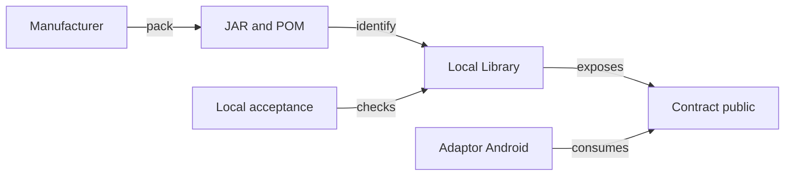

# Consumption of common libraries

## Overview

The project consumes Core, Reporting, Console, Mock and Test Kit as JAR/POM pairs. The reactor contains Validation, Android infrastructure and local integration checks. The joint manufacturer shall have the sources and tests of the libraries.

## Complementary guides

- [Code, feedback and timing](../../lib/README.md) explains the shared responsibility and the separate acceptance of consumers.
- [Integration of APIs](ATF_Integration.md) defines binary identity, adapters and synchronisation.
- [Livrarea Android](ATF_AndroidDelivery.md) explains the building, publication and installation of APK, including saving. [Anonymous access verification](ATF_AndroidDelivery.md#anonymous-access-and-public-route) covers the public route and diagnosis of HTTP 404.
- [Retention and preparation of the relay](ATF_ReleaseRetention.md) separates local candidate, publication and withdrawal of previous versions.

## Liabilities

Legend: separate implementation and acceptance

The manufacturer shall qualify for implementation and native tests. The consumer checks the physical delivery and contracts used by his adapters; the offline result does not certify the interaction on the device.

| Library | Responsibility | Dependency limit |
|---|---|---|
| Core | Common neutral contracts and mechanisms | It doesn't own the rules or the Whist interface. |
| Reporting | Publication and rendering of data assessed | Consume original comparisons and catches; do not decide the rules of the game. |
| Console | Event formatting and JUnit cycle projection | JUnit's link keeps the optional dependence on Kit; the consumer declares it when it uses it. |
| Mock | Determine replacement of HTTP transport and exact match | The data and the scenario catalogue belong to the consumer; they do not simulate the engine of the game. |
| Test Kit | Running configuration and JUnit extensions | The Suites and Whist selections are defined in the project. |

Console and Mock do not depend on Reporting, Validation or application modules. The published POM fixes the dependence of the library, independent of the local reactor version.

## Identity and integrity

- [Pome root](../../pom.xml) selects the actual coordinates and versions.
- `lib` contains one physical JAR/POM pair for each library, directly in the directory, along with the RADME index and the five user guides.
- `library-provenance.json` keeps the hashes, manufacturer's inputs, the catalogue of native tests and the reference of current acceptance.
- The JAR-embedded POM coincides with the byte with the next published POM.
- Parallel sources, additional versions, incomplete pairs and nested deposits are denied.
- The record of supplies and concrete checks shall be kept outdoors with original integrity.

## Acceptance and governance

| Verification | Contract local |
|---|---|
| [PlatformLibraryContractTest](../../atf-tests/src/test/java/atf/libraries/PlatformLibraryContractTest.java) | Physical identity, independent POMS, isolation and use without loading the prohibited infrastructure. |
| [PlatformLibraryIntegrityTest](../../atf-tests/src/test/java/atf/libraries/PlatformLibraryIntegrityTest.java) | Refusing altered artifacts or metadata, including when an external hash has been updated. |
| [CoreReportingConsumerContractTest](../../atf-tests/src/test/java/atf/tests/publishing/CoreReportingConsumerContractTest.java) | Configuration and bundles effectively loaded. |
| [LibraryReadmeExamplesIntegrationTest](../../atf-tests/src/test/java/atf/libraries/LibraryReadmeExamplesIntegrationTest.java) | Java fragments from the guides delivered, compiled and executed on physical JARs; nominal comparisons and explicit refusals. |
| [Quality Suite](../../atf-tests/src/test/java/atf/tests/governance/AtfQualityGovernanceSuite.java) | Source perimeter, documentation, packages and library acceptance. |

Negative evidence builds identifiable synthetic artifacts. Physical acceptance uses real JARs and does not replace them with locally compiled production classes.

## Construction and update

| Activitate | Contract |
|---|---|
| Isolated construction | [Governance Launcher](../../scripts/run-atf-governance.ps1) prepares its copy and warehouse; `validate` installs the pairs of `lib` before the addiction is resolved. |
| Development environment | The root POM and the Maven settings define the same dependencies; Kit is explicitly declared for the JUnit adapter that requires it. |
| Actualizare | Identified candidate, API verification and independent local acceptance; Android scenarios require separate device and initial status declared. |

[Integration of APIs](ATF_Integration.md) · [Test architecture](../testing/ATF_Architecture.md) · [Rerouting of responsibilities](../feedback/README.md)
