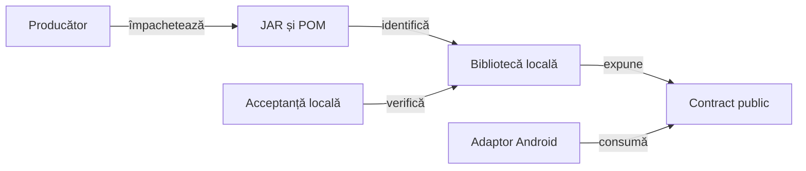

# Consumul bibliotecilor comune

## Pe scurt

Proiectul consumă Core, Reporting, Console și Mock ca perechi JAR/POM. Reactorul păstrează Kit, Validation, infrastructura Android și verificările locale de integrare; sursele și testele native ale bibliotecilor aparțin producătorului comun.

## Ghiduri complementare

- [Cod, feedback și sincronizare](../../lib/README.md) explică responsabilitatea comună și acceptanța separată a consumatorilor.
- [Integrarea API-urilor](ATF_Integration.md) definește identitatea binară, adaptoarele și sincronizarea.
- [Livrarea Android](ATF_AndroidDelivery.md) leagă sursele de APK, instalare și păstrarea salvărilor.
- [Retenția și pregătirea release-ului](ATF_ReleaseRetention.md) separă candidatul local, publicarea și retragerea versiunilor precedente.

## Responsabilități

Legendă: implementare și acceptanță separate

Producătorul califică implementarea și testele native. Consumatorul verifică livrarea fizică și contractele folosite de adaptoarele sale; rezultatul offline nu certifică interacțiunea pe dispozitiv.

| Bibliotecă | Responsabilitate | Limită de dependență |
|---|---|---|
| Core | Contracte și mecanisme neutre comune | Nu deține regulile sau interfața Whist. |
| Reporting | Publicarea și randarea datelor evaluate | Consumă comparațiile și capturile originale; nu decide regulile jocului. |
| Console | Formatarea evenimentelor și proiecția ciclului JUnit | Legătura JUnit păstrează dependența opțională de Kit; consumatorul o declară când o folosește. |
| Mock | Înlocuirea deterministă a transportului HTTP și potrivirea exactă | Datele și catalogul de scenarii aparțin consumatorului; nu simulează motorul jocului. |

Console și Mock nu depind de Reporting, Validation sau modulele aplicației. POM-ul publicat fixează dependențele bibliotecii, independent de versiunea reactorului local.

## Identitate și integritate

- [POM-ul rădăcină](../../pom.xml) selectează coordonatele și versiunile efective.
- `lib` conține o singură pereche fizică JAR/POM pentru fiecare bibliotecă, direct în director, alături de indexul README și cele patru ghiduri de utilizare.
- `library-provenance.json` păstrează hash-urile, intrările producătorului, catalogul testelor native și referința acceptanței curente.
- POM-ul încorporat în JAR coincide octet cu octet cu POM-ul publicat alăturat.
- Sursele paralele, versiunile suplimentare, perechile incomplete și depozitele imbricate sunt refuzate.
- Istoricul livrărilor și verificările concrete se păstrează în exterior, cu integritatea originală.

## Acceptanță și guvernanță

| Verificare | Contract local |
|---|---|
| [PlatformLibraryContractTest](../../atf-tests/src/test/java/atf/libraries/PlatformLibraryContractTest.java) | Identitatea fizică, POM-uri independente, izolare și utilizarea fără încărcarea infrastructurii interzise. |
| [PlatformLibraryIntegrityTest](../../atf-tests/src/test/java/atf/libraries/PlatformLibraryIntegrityTest.java) | Refuzul artefactelor ori metadatelor alterate, inclusiv când un hash exterior a fost actualizat. |
| [CoreReportingConsumerContractTest](../../atf-tests/src/test/java/atf/tests/publishing/CoreReportingConsumerContractTest.java) | Configurația și binarele comune efectiv încărcate. |
| [LibraryReadmeExamplesIntegrationTest](../../atf-tests/src/test/java/atf/libraries/LibraryReadmeExamplesIntegrationTest.java) | Fragmentele Java din ghidurile livrate, compilate și executate pe JAR-urile fizice; comparații nominale și refuzuri explicite. |
| [Suita de calitate](../../atf-tests/src/test/java/atf/tests/governance/AtfQualityGovernanceSuite.java) | Perimetru sursă, documentație, pachete și acceptanța bibliotecilor. |

Probele negative construiesc artefacte sintetice identificabile. Acceptanța fizică folosește JAR-urile reale și nu le înlocuiește cu clasele de producție compilate local.

## Construire și actualizare

| Activitate | Contract |
|---|---|
| Construire izolată | [Lansatorul guvernanței](../../scripts/run-atf-governance.ps1) pregătește copia și depozitul Maven proprii; `validate` instalează perechile din `lib` înaintea rezolvării dependențelor. |
| Mediu de dezvoltare | POM-ul rădăcină și setările Maven definesc aceleași dependențe; Kit se declară explicit pentru adaptorul JUnit care îl necesită. |
| Actualizare | Candidat identificat, verificarea API-ului și acceptanță locală independentă; scenariile Android cer separat dispozitiv și stare inițială declarate. |

[Integrarea API-urilor](ATF_Integration.md) · [Arhitectura testării](../testing/ATF_Architecture.md) · [Rutarea responsabilităților](../feedback/README.md)
