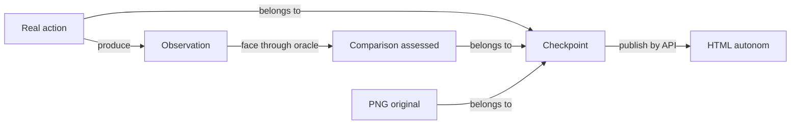

# Android and component reporting contract

## Overview

Publication provides an autonomous presentation of the purpose, inputs and results evaluated. The consumer provides the semantics of the domain and typed records; the common library provides presentation through the Public API.

## Responsibilities

Legend: data ownership

The action, observation, comparison and capture are distinct facts associated with the same claim and status. The Renderer designs the result evaluated without performing the oracle again or deducting success from a picture.

| Owner | Contract |
|---|---|
| Consumer | Capture, state extraction, independent oracle, rules, selection and composition. |
| Library | Neutral types, tables, disclosure, timing and image viewer. |
| Acceptor | Integrity, property, completeness and interactive verification of the stated purpose. |

## Invocations and phases

| Level | Required content |
|---|---|
| Invocare | Actual class identity, method and parameters with effective profile. |
| Setup | Input and preconditions assessed; training does not replace body verification. |
| Corp | Previous status, input, resulting status, expected independent, current and verdict. |
| Teardown | Actual cleaning and secondary cause without replacement of initial error. |
| Population | Cases, games, pairs, moves and comparisons delimited as distinct units. |

- Each actual claim shall be identifiable, including parametritions of the same name.
- The set, context or aggregated statistics shall not generate fictitious PASS invokes.
- PASS, FAIL, ERROR and SKIP results are kept distinct.
- The partial catch at failure shall retain the last safe context and original cause.
- The JUnit result without captured comparisons does not allow for their subsequent reconstruction by text.

## Action, observation and result

The action table shall keep the operation dispatched, the semantic target, the waiting, observation, time and result. The comparison table shall keep ASSERTION, EXPECTED, ACTUAL and RESULT for the assessment performed once only.

- ADB is the source of the Android Display, and UI Automator provides the hierarchy.
- The browser inspecting HTML is the report auditor.
- An accepted command and a correct semantic transition have distinct criteria.
- OBSERVE describes a state without inventing an input.
- HTTP, SQL, component comparisons and UI actions use the semantic surface of the actual fact.
- Titles and summaries shall not substitute for detailed comparisons.

### Full bodies and display budget

Preview of the assertions and the body ceiling are independent settings. [EvidenceTextParts](../../atf-test-android/src/main/java/atf/android/evidence/text/EvidenceTextParts.java) divides the text already written into consecutive parts that respect the actual budget without separating a unicode pair.

- Each body shall retain the source's host, hash and order `part i/N`; the concatenation of the parts shall fully reconstruct the design allowed.
- The division does not increase the ceiling or reassess the comparisons. A character that does not fit into the budget produces explicit refusal without hidden trunks.
- The same mechanism publishes component inputs, whole expected/actual and Android text annexes; tests include the tail of a hierarchy larger than the ceiling.

### Republishing without Android interaction

[CapturedAndroidFlow](../../atf-test-android/src/test/java/atf/android/e2e/support/replay/CapturedAndroidFlow.java) reads the existing manifest through the readonly publication contract. It keeps comparisons, verdicts, checkpoints and original intervals; it refuses unknown verdicts, artifacts leaving the host and times attributed to another stream.

The publication shall be labelled `offline-republication` and shall be made explicit. The new HTML does not become new Android execution; the original manifest remains unchanged and the browser checks the new presentation separately.
- A false allocation of the driver is refused even when the other values coincide.

## Capture and ownership

- Each published checkpoint may contain the original PNG of the entire physical screen, with the guidance and the preserved edges.
- The analysis of a region may derive a separate image without replacing the original catch.
- Base64 is incorporated into HTML; identical payloads can be canonical, with exact references for each checkpoint.
- The local status of the checkpoint is maintained; the final result does not retrospectively recolour all states.
- If more than one catch takes place, the window observed shall be explicitly declared.
- Components without device use status data and comparisons without manufactured Android catches.

The viewer keeps the image proportions and provides access to the original size. The return keeps the current owner, the dischargers, the running and the focus; the consumer's verification confronts the original payload with the exact reference.

## Autonomous content and budgets

HTML shall allow understanding of the verification without access to checkout: rule, units, comparative input, observation and limit of claim remain associated to the owner.

[Presentation policy](ATF_Presentation.md) has the selection of invokes, groups, fragments and budgets. The original catch and the values justifying the result are mandatory data; the optional diagnosis is explicitly framed.

A hash proves the identity of the bytes without replacing the oracle of the domain. An external link or summary of the reply shall not replace the comparisons necessary for the purpose published.

### Attachment capture

- [Captura text](../../atf-test-android/src/main/java/atf/android/evidence/text/CapturedTextEvidence.java) reads the bytes once and decodes strictly UTF-8; the fingerprint identifies the original, and the published body passes through the drawing up of the library.
- The publisher shall incorporate the manifest, the annexes declared by checkpoints and additional entries, deducting the same bodies; the non-identifiable data shall be refused prior to the session.
- The incorporation on publication is labelled as such and does not rebuild the time of the Android capture.

## Time and status

[Contractul temporal](ATF_PhaseTiming.md) holds the original ranges, axes and treatment of incomplete logs. [Teaching results](ATF_Handoff.md) holds the acceptance of an end and identity of republication.

- Failure to act, compare or catch is not cancelled by subsequent successful completion.
- The functional verdict and the result of the publication are distinct facts.
- Zero appeals, missing mandatory data or only the KSPE shall not close a purpose as verified.

## Implementation and verification

The data captured, published and audited shall have separate contracts:

| Owner | Contract |
|---|---|
| [AndroidUiFlowTrace](../../atf-test-android/src/test/java/atf/android/e2e/support/AndroidUiFlowTrace.java) | It shall maintain the order and ownership of the data prior to publication. |
| [AndroidUiFlowReportPublisher](../../atf-test-android/src/test/java/atf/android/e2e/support/AndroidUiFlowReportPublisher.java) | Design the checkpoints through the UI API of the library and manage the publication session. |
| [AndroidUiFlowReportAudit](../../atf-test-android/src/test/java/atf/android/e2e/support/AndroidUiFlowReportAudit.java) | Confronts the resulting report with the checkpoints, actions, comparisons, ranges and PNGs captured; refuses incomplete or divergent associations. |

The controls shall follow the exact owner, the multiplication, the last comparison, the order of fragments and the PNG bytes. The global search for a value or hash does not demonstrate its association with the correct scenario.

- The reader shall be checked on additional attributes, keeping the same labels, orders and images; the delimitation follows the DOM nodes, without depending on the serialisation of a tag.
- Negative control changes the image link from the selected checkpoint using the exact position of the node in the source. The rest of the document shall be kept intact so that the refusal to demonstrate the defect of the association concerned.
- The preview limit shall be read from the active configuration and shall be confronted with the metadata of the published comparisons. Timing tests check the configuration effect without fixing the default value of the library.

[Presentation policy](ATF_Presentation.md) · [Timing original](ATF_PhaseTiming.md) · [Publication audit](ATF_Audit.md) · [Liabilities](../feedback/README.md)
