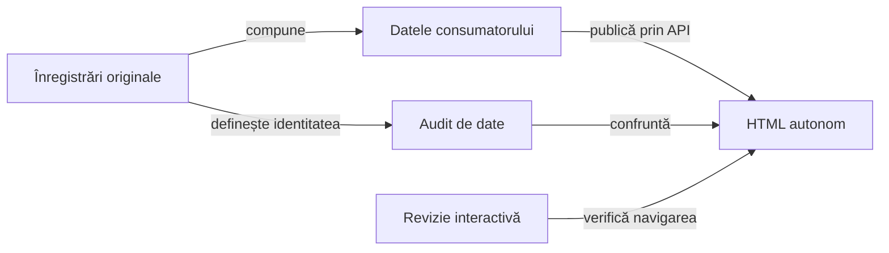

# Contractul verificării publicării

## Pe scurt

Publicarea trebuie să păstreze rezultatul evaluat și relația dintre invocare, comparație și captură. Verificarea urmărește separat inputul tipizat, transformarea către HTML și comportamentul interactiv al prezentării.

## Suprafețe de control

Legendă: același conținut, verificări distincte

Auditul datelor verifică proprietatea și valorile publicate. Revizia interactivă verifică accesul la acele valori, capturi și stări ale prezentării; ea nu execută din nou jocul.

## Invariante

Contractele verificate au proprietari expliciți; auditul le confruntă cu datele capturate:

| Contract | Sursă responsabilă |
|---|---|
| Invocare, acțiune, comparație și PNG | [Contractul Android](ATF_Android.md). |
| Populație, valori integrale, grupare și refuz | [Politica prezentării](ATF_Presentation.md). |
| Interval original și axele sale | [Contractul temporal](ATF_PhaseTiming.md). |
| Proveniență, pointer și acceptanță pe scop | [Predarea rezultatelor](ATF_Handoff.md). |

Pentru fiecare proprietate, oracolul auditului citește sursa originală și localizează proprietarul exact în rezultat. Găsirea globală a unei valori sau a unui hash nu demonstrează asocierea corectă.

## Controale și mutații

| Proprietate | Control negativ |
|---|---|
| Identitatea comparației | Mutarea unei valori sau a unui verdict către alt proprietar este refuzată. |
| Completitudine | Un fragment lipsă, reordonat sau modificat nu trece auditul. |
| Captură | Schimbarea payload-ului ori a referinței PNG este detectată. |
| Timp | Intervalul atribuit altui flow sau faze este respins. |
| Semantica acțiunii | Atribuirea falsă a driverului și confundarea dispatch-ului cu succesul UI sunt refuzate. |
| Navigare | Valorile și imaginile rămân accesibile după deschidere, închidere și schimbarea proprietarului. |

Implementarea verificării este legată de contractul exercitat:

- [LearningReportHtmlAudit](../../atf-tests/src/main/java/atf/tests/learning/LearningReportHtmlAudit.java) confruntă datele și scopul HTML-ului cu înregistrările selectate.
- [LearningRunReportContractTest](../../atf-tests/src/test/java/atf/tests/learning/LearningRunReportContractTest.java) verifică publicarea și mutațiile deliberate ale datelor.
- [AndroidInlineScreenshotReportContractTest](../../atf-tests/src/test/java/atf/tests/contracts/AndroidInlineScreenshotReportContractTest.java) verifică încorporarea PNG prin contractul public.

## Limite

Trecerea auditului structural nu demonstrează singură lizibilitatea sau navigarea interactivă. Verificarea publicării nu certifică o nouă execuție Android sau puterea politicii jocului.

[Politica de prezentare](ATF_Presentation.md) · [Contractul Android](ATF_Android.md) · [Arhitectura raportării](README.md)
