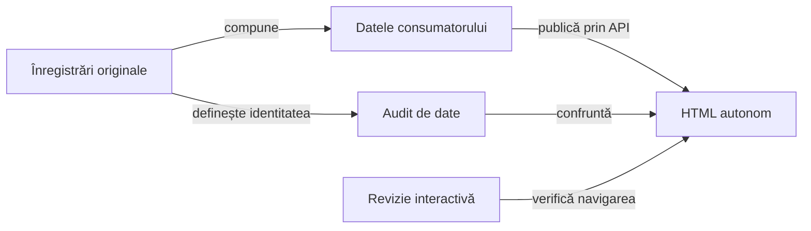
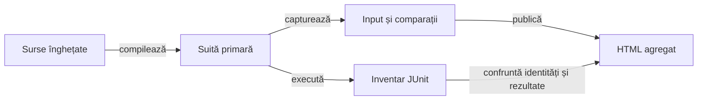

# Contractul verificării publicării

## Pe scurt

Publicarea trebuie să păstreze rezultatul evaluat și relația dintre invocare, comparație și captură. Verificarea urmărește separat inputul tipizat, transformarea către HTML și comportamentul interactiv al prezentării.

## Suprafețe de control



<details>
<summary>Legendă: același conținut, verificări distincte</summary>

Auditul datelor verifică proprietatea și valorile publicate. Revizia interactivă verifică accesul la acele valori, capturi și stări ale prezentării; ea nu execută din nou jocul.

</details>

## Invariante

Contractele verificate au proprietari expliciți; auditul le confruntă cu datele capturate:

| Contract | Sursă responsabilă |
|---|---|
| Invocare, acțiune, comparație și PNG | [Contractul Android](ATF_Android.md). |
| Populație, valori integrale, grupare și refuz | [Politica prezentării](ATF_Presentation.md). |
| Interval original și axele sale | [Contractul temporal](ATF_PhaseTiming.md). |
| Proveniență, pointer și acceptanță pe scop | [Predarea rezultatelor](ATF_Handoff.md). |

Pentru fiecare proprietate, oracolul auditului citește sursa originală și localizează proprietarul exact în rezultat. Găsirea globală a unei valori sau a unui hash nu demonstrează asocierea corectă.

## Controale și mutații

| Proprietate | Control negativ |
|---|---|
| Identitatea comparației | Mutarea unei valori sau a unui verdict către alt proprietar este refuzată. |
| Completitudine | Un fragment lipsă, reordonat sau modificat nu trece auditul. |
| Captură | Schimbarea payload-ului ori a referinței PNG este detectată. |
| Timp | Intervalul atribuit altui flow sau faze este respins. |
| Semantica acțiunii | Atribuirea falsă a driverului și confundarea dispatch-ului cu succesul UI sunt refuzate. |
| Navigare | Valorile și imaginile rămân accesibile după deschidere, închidere și schimbarea proprietarului. |
| Populație | O invocare JUnit eliminată din HTML ori reasociată altei parametrizări este detectată; egalitatea totalurilor singure este insuficientă. |

Implementarea verificării este legată de contractul exercitat:

- [LearningReportHtmlAudit](../../atf-tests/src/main/java/atf/tests/learning/LearningReportHtmlAudit.java) confruntă datele și scopul HTML-ului cu înregistrările selectate.
- [LearningRunReportContractTest](../../atf-tests/src/test/java/atf/tests/learning/LearningRunReportContractTest.java) verifică publicarea și mutațiile deliberate ale datelor.
- [AndroidInlineScreenshotReportContractTest](../../atf-tests/src/test/java/atf/tests/contracts/AndroidInlineScreenshotReportContractTest.java) verifică încorporarea PNG prin contractul public.

## Calificarea unui producător

Fiecare producător se califică pe suprafața API efectiv folosită. Trecerea unui publicator nu califică implicit alt adaptor sau revizia sa interactivă.

1. Identificați intrarea, invocările native, sursele, bibliotecile și proprietarul fiecărei capturi.
2. Confruntați toate comparațiile originale, inclusiv ultimul rând și continuările grupurilor; valorile integrale și verdictele rămân asociate aceleiași invocări.
3. Injectați lipsuri, proprietari greșiți, intervale imposibile și referințe alterate; publicarea ori auditul trebuie să refuze datele corupte.
4. Verificați separat navigarea, secțiunile pliabile, imaginile și revenirea cu contextul păstrat pe HTML-ul identificat prin hash.
5. Păstrați nivelurile executate și limitele în înregistrarea externă; [predarea rezultatelor](ATF_Handoff.md) decide acceptanța scopului.

## Agregarea componentelor pe sursa live

[Lansatorul componentelor](../../scripts/run-component-suites.ps1) execută intrările primare de componentă din [catalogul Maven](../../config/atf-test-suites.json). Compilarea și cache-ul aparțin unei copii TMP; fiecare modul produce un HTML canonic cu invocări distincte, comparațiile evaluate și proveniența surselor.



<details>
<summary>Legendă: execuție nouă și captură originală</summary>

Receipt-ul JUnit este independent de receipt-ul publicat în HTML. [Confruntarea](../../atf-tests/src/main/java/atf/tests/reporting/aggregate/ComponentReportCoverage.java) refuză identități lipsă, suplimentare ori duplicate și verdicte diferite; totalurile egale nu sunt suficiente.

</details>

| Frontieră | Contract |
|---|---|
| Captură | Aserțiunile auditate păstrează evaluarea JUnit; fazele și cauzele aparțin invocării originale. O componentă fără comparații auditate în corp eșuează explicit. |
| Adaptor | Înregistrările explicite pe metodă, clasă sau clasă exterioară `@Nested` au prioritate. Lansatorul completează lipsa adaptorului, iar lansările JUnit independente își păstrează contextul și populația. |
| Publicare | Un owner comun per suită; numele controlat combină metoda și ordinalul, iar display name-ul JUnit original rămâne input textual integral. Receipt-urile păstrează ID-ul parametrizării, rezultatul și numărul comparațiilor; corpurile lungi se reconstruiesc din părți ordonate. |
| Calificare HTML | Profilul așteptat provine din captură, independent de fișierul publicat. Etichetele vizibile se confruntă cu spațiile normalizate conform HTML; etichetele publicate, valorile și corpurile originale rămân păstrate. |
| Proveniență | HTML-ul indică amprenta surselor, configurația și cardinalitatea inventarului; manifestul unic de hash-uri este metadată tehnică a distribuției. Comparațiile și inputurile testului rămân în HTML, fără copii XML. |
| Dimensiunea părților | `InputPartCharacters` configurează corpurile integrale ale agregatului, păstrând preview-ul aserțiunilor și valorile evaluate. Părțile mai mari evită multiplicarea marcajelor HTML; nu elimină text și nu schimbă bugetul semantic al componentei testate. |
| Domeniu | Execuția califică sursa și suitele Maven declarate. Nu califică un APK istoric, componentele Gradle ori o interacțiune nouă pe Android. |

Din rădăcina proiectului, cu JDK-ul și cache-ul Maven pregătite:

```powershell
.\scripts\run-component-suites.ps1 -JavaHome '<cale-JDK>' -MavenCache '<cache-Maven>'
```

Rezultatele rămân externe. Copierea selectivă în dosarul unei livrări păstrează explicit domeniul sursă, distinct de calificarea APK-ului; verificarea finală confruntă HTML-ul detașat înaintea eliminării oricărei dovezi originale.

## Citirea unui raport

README-ul dosarului indică întâi raportul canonic, scopul și identitatea verificată. HTML-ul păstrează datele necesare verdictului; README-ul orientează cititorul și explică selecția, suprapunerile și dovezile auxiliare justificate.

| Ordine | Ce confruntăm |
|---|---|
| Context | Tipul verificării, sursele și bibliotecile, profilul și, pentru Android, APK-ul/dispozitivul efectiv. Momentul publicării se distinge de execuție. |
| Invocare | Clasa, metoda și parametrii aleși; setup-ul ori restaurarea apar numai dacă au avut loc și sunt delimitate de corp. |
| Componentă | Inputul integral și `Component assertions` din faza evaluării: numele invariantului, expected independent, actual și verdict. |
| Android | Acțiunea expediată, observația proaspătă, comparația și PNG-ul aceleiași stări. Acceptarea ADB și succesul tranziției au dovezi separate. |
| Eșec | Cauza primară, comparațiile trecute anterior și erorile secundare de curățare; Fails păstrează accesul la proprietarul original. |
| Închidere | Populația executată/publicată, cazurile omise și limitele reviziei; durata scenariilor nu se confundă cu timpul total al suitei. |

- **Sens:** când `true/false`, un număr ori o clasă de excepție nu explică proprietatea, comparația are mesaj declarativ despre obiect și invariant. Referința la linia sursei ajută trasabilitatea, fără a înlocui explicația.
- **Refuz așteptat:** `assertThrows` poate trece când operația refuză exact intrarea cerută; raportul arată așteptarea evaluată. Un eșec injectat intenționat al invocării rămâne FAIL, chiar dacă acceptanța publicatorului așteaptă acel eșec.
- **Mediu:** instrumentul care inspectează HTML-ul este auditorul raportului. Folosirea Playwright pentru această revizie nu transformă interacțiunea Android în automatizare Playwright.

## Revizia interactivă minimă

1. Identificați hash-ul HTML-ului final și copiați-l singur într-un director gol; blocați resursele externe și declarați browserul folosit.
2. Porniți din starea inițială a raportului și alegeți un proprietar reprezentativ; pentru un arbore mare, deschideți ramura necesară.
3. Verificați deschiderea și închiderea grupului de aserții, accesul la ultima comparație și independența vecinului; adăugați Enter/Space și focus când schimbarea afectează aceste controale.
4. Deschideți inputul integral, inclusiv valori peste preview și text care arată ca HTML; el rămâne text sigur, la invocarea corectă.
5. Când există captură, deschideți PNG-ul integral și reveniți la aceeași ramură. Proba păstrează proporțiile, rezoluția originală și contextul.
6. Înregistrați proprietarii și controalele verificate, verdictul și limitele. Calificați separat Extent și fallback când schimbarea afectează ambele suprafețe.

Revizia acoperă ramurile declarate. Reducerea la o probă reprezentativă cere aceeași implementare de prezentare; o ramură nouă, un eșec sau o problemă de acces primește propria probă.

## Limite

Trecerea auditului structural nu demonstrează singură lizibilitatea sau navigarea interactivă. Verificarea publicării nu certifică o nouă execuție Android sau puterea politicii jocului.

[Politica de prezentare](ATF_Presentation.md) · [Contractul Android](ATF_Android.md) · [Arhitectura raportării](README.md)
