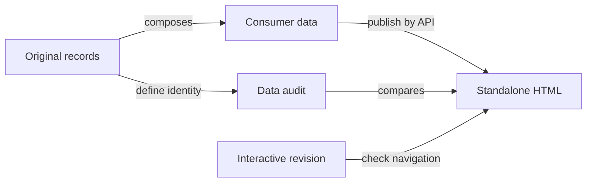
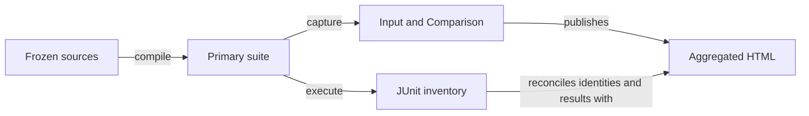

# Contract of publication verification

## Overview

Publication must retain the assessed result and the relationship between invoicing, comparison and catch. The verification shall follow the typed input, the transformation to HTML and the interactive behaviour of the presentation separately.

## Control areas



<details>
<summary>Legend: same content, separate checks</summary>

The data audit shall verify the property and published values. The interactive review checks access to those values, captures and status of the presentation; it does not execute the game again.

</details>

## Invariants

The verified contracts have explicit owners; the audit shall confront them with the data captured:

| Contract | Responsible source |
|---|---|
| Invocation, action, comparison and PNG | [Android contract](ATF_Android.md). |
| Population, full values, grouping and rejection | [Presentation policy](ATF_Presentation.md). |
| Original time interval and its dimensions | [Timing contract](ATF_PhaseTiming.md). |
| Provenance, pointer and scoped acceptance | [Results handoff](ATF_Handoff.md). |

For each property, the audit oracle reads the original source and locates the owner exactly in the result. The global finding of a value or hash does not demonstrate proper association.

## Controls and mutations

| Property | Control negative |
|---|---|
| Comparison identity | The transfer of a value or verdict to another owner is denied. |
| Completeness | A missing, reordered or modified fragment does not pass the audit. |
| Catch | The change of payload or PNG reference is detected. |
| Time | The range assigned to another flow or phases is rejected. |
| Semantics of action | False assignment of the driver and confusion of the display with the success of the IU are denied. |
| Navigation | Values and images shall be accessible after opening, closing and changing the owner. |
| Population | A JUnit claim removed from HTML or re-associated with another parametric finding is detected; equality of single totals is insufficient. |

The implementation of the verification shall be linked to the contract exercised:

- [LearningReportHtmlAudit](../../atf-tests/src/main/java/atf/tests/learning/LearningReportHtmlAudit.java) confronts the data and purpose of HTML with selected records.
- [LearningRunReportContractTest](../../atf-tests/src/test/java/atf/tests/learning/LearningRunReportContractTest.java) checks the publication and deliberate data mutations.
- [AndroidInlineScreenshotReportContractTest](../../atf-tests/src/test/java/atf/tests/contracts/AndroidInlineScreenshotReportContractTest.java) verifies the incorporation of PNG through the public contract.

## Qualification of a producer

Each producer shall qualify for API area actually used. The passage of a publisher does not necessarily qualify any other adapter or its interactive revision.

1. Identify the entry, native invoicing, sources, libraries and owner of each catch.
2. Face all original comparisons, including the last row and group sequels; full values and verdicts remain associated with the same claim.
3. Inject gaps, wrong owners, impossible intervals and altered references; publication or audit must refuse corrupt data.
4. Check separately navigation, folding sections, images and return with the context kept on the HTML identified by hash.
5. Keep the levels executed and limits in the external registration; [handing over results](ATF_Handoff.md) decides the acceptance of the purpose.

## Aggregation of components on live source

[Component Launcher](../../scripts/run-component-suites.ps1) Perform primary component inputs from [Catalog Maven](../../config/atf-test-suites.json), The declared Gradle collections of the application and the distinct selection of the common UI library. The compilation and cache of Maven belong to a TMP copy; each Gradle module and selection produces its own HTML Extent with distinct invokes, assessed comparisons and source provenance. Gradle reports do not concatenate in a synthetic report.



<details>
<summary>Legend: New execution and original catch</summary>

JUnit Receipt is independent of the Receipt published in HTML. [Comparison](../../atf-tests/src/main/java/atf/tests/reporting/aggregate/ComponentReportCoverage.java) refuses missing, additional or duplicate identities and different verdicts; equal totals are not sufficient.

Each of the three primary ATF suites has a canonical HTML, its own Receipt and the shared source inventory. The Receipt of components per source declares separately `apkQualification`; association with APK requires candidate qualification. [Active version index](../../release/README.md) keep the reports and the identities concrete.

</details>

| Border | Contract |
|---|---|
| Catch | The audited assertions shall keep the evaluation of JUnit; the phases and causes shall be the original declaration. A component without audited comparisons in the body fails explicitly. |
| Adaptor | Explicit records by method, class or external class `@Nested` shall be given priority. The launcher complements the lack of adaptor, and independent JUnit launches retain their context and population. |
| Publication | A common owner per suite; the controlled name combines method and ordinary, and the original JUnit nameplate remains a full textual input. Receipts keep the IDs of parametric, result and number of comparisons; long bodies are reconstructed from ordered parts. |
| HTML qualification | The expected profile comes from the catch, independent of the published file. Visible labels face the spaces normalized according to HTML; published labels, original values and bodies remain preserved. |
| Provenance | HTML indicates the source footprint, inventory configuration and cardinality; the unique manifest hash is technical metadata of the distribution. Comparison and input of the test remains in HTML without XML copies. |
| Dimension of the Parties | `InputPartCharacters` configures the aggregate's entire bodies, keeping the pre-view of the assertions and values evaluated. The larger parts avoid multiplying HTML markings; do not remove text or change the semantic budget of the tested component. |
| Scope | The execution qualifies the source and suite of Maven and Gradle as declared. Do not qualify an APK and do not execute Android interactions; E2E remains separate selection. |

From the project root, with JDK, Android SDK 36 and the Maven/Gradle caches prepared:

```powershell
.\scripts\run-component-suites.ps1 -JavaHome '<cale-JDK>' -MavenCache '<cache-Maven>'
```

The results remain external. Selective copying in the delivery file explicitly retains the source domain, distinct from the APK qualification; the final verification confronts the detached HTML prior to the removal of any original evidence.

### Inventory integrity

[Shared inventory](../../scripts/Get-AtfSourceInputs.ps1) feeds component launchers and governance. The generated directories shall be excluded at the borders of the project and the modules declared; the delivery dossier shall be excluded only at the root of the project. The name of a package does not justify the omission of the source: segments such as `release`, `target` and `build` remain inventoried in source trees, including the configured and additional roots of the Maven policy.

The manifest also includes files without extension, such as extension records. Indirect uninventoried routes are denied. [Inventory controls](../../atf-tests/src/test/java/atf/tests/governance/support/LauncherSourceInventoryComponentTest.java) confronts the declared Java population and detects additions, erasure and changes.

A subsequent correction of the inventory produces a new identity; does not rewrite the footprint of a historical execution.

[Staging copy](../../scripts/Copy-AtfSourceInputs.ps1) uses the captured manifest itself without a second list of exclusions after the directory name. The hash of each copy must coincide with the entry; a change before compilation shall be refused.

## Reading a report

[Bridge Gradle](../testing/ATF_GradleComponents.md) applies the same contracts to JUnit 4, with the original identity of the parametric and context captured prior to comparison. The publication intent is metadata from execution and is checked separately from HTML; a profile without HTTP does not invent transport. The XMLs remain only temporary oracle for migrated selections.

The dossier's README shall first indicate the canonical report, the purpose and the identity verified. HTML maintains the data required for the verdict; READMES directs the reader and explains the selection, overlaps and supporting evidence justified.

| Order | What are we facing? |
|---|---|
| Context | Type of verification, sources and libraries, profile and, for Android, actual APK/device. The timing of the publication is distinguished from the execution. |
| Invocation | The chosen class, method and parameters; the setup or restoration occurs only if they have occurred and are delimited by the body. |
| Component | Full input and `Component assertions` from the evaluation phase: invariant name, independently expected, current and verdict. |
| Android | The action dispatched, the fresh observation, the comparison and the PNG of the same state. The acceptance of the DBD and the success of the transition have separate evidence. |
| Failed | The primary cause, past comparisons and secondary cleaning errors; Fails keeps access to the original owner. |
| Closure | The population executed / published, the cases omitted and the limits of the revision; the duration of the scenarios is not confused with the total time of the suite. |

- **Meaning: ** when `true/false`, a number or an exceptional class does not explain the property, the comparison has declaratory message about the object and the invariant. The reference to the source line helps traceability without replacing the explanation.
- **Refusal expected: ** `assertThrows` can pass when the operation refuses exactly the required entry; the report shows the assessed expectation. A intentionally injected failure of the plea remains FAIL, even though the publicist's acceptance awaits that failure.
- **Environment: ** the instrument inspecting HTML is the report auditor. Using Playwright for this revision does not transform Android interaction into Playwright automation.

## Minimum interactive revision

1. Identify the final HTML hasher and copy it yourself into an empty directory; block external resources and declare the browser used.
2. Start from the initial status of the report and choose a representative owner; for a large tree, open the required branch.
3. Check the opening and closure of the group of assertions, access to the last comparison and the independence of the neighbor; add Enter/Space and focus when the change affects these controls.
4. Open the full input, including values over preview and text that looks like HTML; it remains safe text, at correct invoicing.
5. When there is catch, open the whole GNP and return to the same branch. The sample shall retain proportions, original resolution and context.
6. Record the owners and checked controls, verdict and limits. Qualify Extent and fallback separately when the change affects both surfaces.

The review shall cover the branches declared. The reduction to a representative sample requires the same presentation implementation; a new branch, failure or access problem receives its own sample.

## Limits

The passage of the structural audit does not demonstrate the legibility or interactive navigation alone. Checking the publication does not certify a new Android execution or the power of game policy.

[Presentation policy](ATF_Presentation.md) · [Android contract](ATF_Android.md) · [Reporting architecture](README.md)

## Report interface and evidence ownership

The Extent Overview keeps the standard Reporting dashboard. Consumer publishers must not inject screenshot galleries, game controls or custom sections into that view. Attach captured PNGs inline to their original scenario and phase through the public UI evidence API. Observation-only frames do not manufacture assertions or a new game result.

Report narration is English: suite names, phases, evidence labels and diagnostic explanations. Original application text, localized RO/EN captures and measured values remain unchanged. Each capture retains its title and case owner; all selected comparisons and the original outcome remain available in the standalone HTML.

Publisher components check the standard Overview, English narration, the first and final case, multiple frames, complete long values and failed outcomes. Missing, external or invalid images must be rejected before a report is created. Existing sealed release evidence remains immutable; republication records the original evidence identity and the publisher revision separately.
