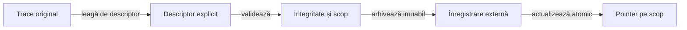

# Predarea și acceptarea rezultatelor Android

Predarea publică rezultatele într-un depozit extern și menține separat încercarea, republicarea și acceptanța unui scop. Identitatea execuției originale se păstrează la orice publicare ulterioară.

## Fluxul publicării

Legendă: publicare și acceptare

O înregistrare poate descrie succes, eșec sau refuzul execuției. Acceptarea cere controalele stabilite de scop; simpla existență a unui HTML sau trecerea JUnit nu actualizează implicit acceptanța.

## Contractul descriptorului

| Grup | Responsabilitate |
|---|---|
| Identitate | Run ID, sursa republicării, pachet, scenariu și scop declarat/efectiv. |
| Execuție | Verdict nativ, început/sfârșit capturat, bază temporală și limite. |
| Aplicație și surse | Identitatea binarului instalat, a surselor și a bibliotecilor folosite. |
| Conținut | HTML, manifest, checkpoint-uri și asocieri între acțiuni, observații și comparații. |
| Revizie | Verificările cerute de scop, legate de hash-ul conținutului inspectat. |

Datele lipsă rămân marcate explicit. Un timp estimat, o identitate citită ulterior sau o distribuție întreruptă nu devin capturi originale complete.

## Identitate și momentul măsurării

Descriptorul separă datele capturate la execuție de cele verificate la revizia offline. În [whist_ui_handoff.py](../../atf-test-android/tools/whist_ui_handoff.py), un JAR identificat din classpath-ul nativ poate avea hash disponibil numai la revizie; acel hash nu devine retrospectiv o măsurătoare de la execuție.

- Păstrați momentul și sursa fiecărei identități, inclusiv când informația originală lipsește.
- Corelați revizia interactivă cu hash-ul exact al HTML-ului verificat.
- Tratați acceptarea descriptorului de republicare și o nouă execuție Android ca înregistrări cu scop distinct.

## Spații de nume externe

| Contract | Semnificație |
|---|---|
| runs și metadata | Înregistrări imuabile pentru fiecare execuție sau republicare. |
| latest-attempt pe scop | Cea mai recentă încercare înregistrată, inclusiv eșecul. |
| latest-accepted pe scop | Cea mai recentă acceptanță care îndeplinește criteriile scopului. |
| public-trace | Observațiile permise pentru replay, distincte de datele ex-post ale oracolului. |
| indexes | Indici generați de conveniență, fără autoritate de a declara acceptanța. |

## Invariante operaționale

- Identificatorul unei înregistrări este imuabil; reimportul identic este idempotent.
- Pointerele sunt ordonate după timpul execuției, cu un singur lock și înlocuire atomică.
- O republicare veche nu devine execuție nouă prin data copierii.
- Scope-ul și pachetul delimitează rezultatele care pot fi comparate.
- Datele rezervate oracolului nu ajung în API-ul jucătorului.
- Rădăcina externă este transmisă explicit, independent de directorul de staging.
- Indexarea automată refuză destinațiile din checkout și nu rescrie README-uri editoriale.

## Livrabil compact și excepții

Ținta predării este un HTML auditabil care include informațiile obligatorii, valorile integrale și capturile asociate fiecărui checkpoint. Fișierele deja încorporate nu primesc copii finale doar pentru navigare; un director ori ZIP cu anexele raportului nu reprezintă autonomie.

| Conținut | Politică de predare |
|---|---|
| Date obligatorii ale verdictului | Corp accesibil în HTML, cu identitate și asociere; un hash sau nume de fișier nu înlocuiește conținutul. |
| Copie identică încorporată | Eliminată numai după confruntarea octeților și verificarea raportului detașat. |
| Diagnostic ori rezultat auxiliar cu scop separat | Păstrat numai cu motiv concret, consumator sau întrebare diagnostică și identitate; nu poate ascunde o informație necesară auditului HTML. |
| Metadate ale distribuției | Indexul și manifestul integrității rămân compacte, cu rol verificabil pentru navigare ori guvernanță; nu substituie inputul, comparațiile sau observațiile accesibile în HTML. |
| Dovadă unică încă externă | Păstrată până la publicarea completă; dependența rămâne explicită în feedback. |

[Publicatorul Android](../../atf-test-android/src/test/java/atf/android/e2e/support/AndroidUiFlowReportPublisher.java) include PNG-urile, manifestul și corpurile text furnizate ori declarate de checkpoint-uri. [Suitele de componentă migrate](../testing/ATF_DisplayComponents.md#familii-care-folosesc-același-audit) includ inputurile și comparațiile capturate; selecțiile fără adaptor păstrează calificarea distinctă a auditului.

- **Istoric:** rapoartele native produse înaintea acestei încorporări păstrează anexele unice; schimbarea publicatorului nu le actualizează retrospectiv.
- **Moment:** hash-ul și corpul text provin din aceeași citire la publicare; acest moment rămâne distinct de execuția Android și de revizia ulterioară.
- **Închidere:** [criteriul de consolidare](../feedback/ATF_Reporting.md#rpt-android-html-only--livrabilul-de-audit-fără-copii-auxiliare) cere calificarea inventarului și a asocierilor fiecărui producător înaintea eliminării dovezii unice.

## Implementări și limite

| Implementare | Contract și limită |
|---|---|
| [whist_ui_handoff.py](../../atf-test-android/tools/whist_ui_handoff.py) | Implementează republicarea offline, cu descriptor și rădăcină externă. Tipul său de înregistrare nu trebuie folosit pentru a pretinde o nouă execuție Android. |
| [WhistExtentFeedback](../../atf-test-android/src/main/java/atf/android/whist/evidence/WhistExtentFeedback.java) | Publică indexul unei rulări auditate în spațiul extern indexes. Rădăcina de handoff și directorul indexului sunt configurabile; directorul sursă nu este o destinație validă. |
| [Componentele predării](../../atf-test-android/tools/test_whist_ui_handoff.py) | Verifică refuzul datelor corupte și păstrarea acceptanței la eșec ori republicare veche. Indexul Java indică ultima publicare auditată; descriptorul și pointerul pe scop stabilesc acceptanța, inclusiv când ultima încercare a eșuat. |

[Arhitectura publicării](README.md) · [Contractul Android](ATF_Android.md) · [Criterii pentru handoff](../feedback/ATF_Reporting.md)
