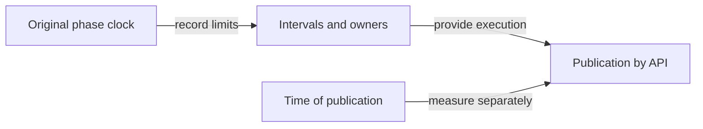

# Measurement of Android times

## Overview

The clock of a phase shall record the monotonous range of the original activity. The sending of orders, the capture, the persistence of the log and subsequent publication have distinct measurements.

## Time axes

| Axis | Source | Meaning |
|---|---|---|
| Interval original | Beginning and ending from the same monotonous origin. | Full or interrupted interval, measured directly. |
| Original execution | The original interval minus capture and measured persistence. | Orders, expectations, readings and domain checks from that phase. |
| reference ADB | THE ORIGINAL ACTION RECORDS. | Duration of the order as part of the execution. |
| Catch | Interactions adaptor controlled range. | Obtaining PNG and hierarchy, including failed attempts. |
| Persistence | Writing the manifest in the phase range. | Operations of input/output kept separate from execution. |
| Publication | Start a new clock when projecting the checkpoint. | The current publication activity, separate from the final HTML save. |



<details>
<summary>Legend: activity captured and subsequent presentation</summary>

A range belongs to a flow, phase and position. Returning to a phase creates a separate interval; the time spent in another phase is not retroactively attributed to the first phase.

</details>

## Capture and association

[AndroidPhaseClock](../../atf-test-android/src/main/java/atf/android/evidence/timing/AndroidPhaseClock.java) measures monotonous time. [AndroidPhaseTiming](../../atf-test-android/src/main/java/atf/android/evidence/timing/AndroidPhaseTiming.java) validates ranges and axes; these components do not perform ADB commands or game checks.

- [AndroidUiFlowTrace](../../atf-test-android/src/test/java/atf/android/e2e/support/AndroidUiFlowTrace.java) opens the phase before the first action.
- The catch measures the entire image and hierarchy; a subsequent checkpoint does not rebuild a missing beginning.
- Scheme `phase.<ordinal>.timing` shall retain the identity of the flow, phase and order, ranges, length of catch and persistence, plus condition COMPLETE/PARTIAL.
- The additive scheme keeps the diary format compatible with old readers.
- The PPG octets, the shares and the comparisons remain associated with the original checkpoint.

## Full, partial or absent data

| Entry point | Publication policy |
|---|---|
| Full original interval | Transmit execution via the typical library API. |
| Interval interrupted | Keep the partial and cause of failure, including prior to the first catch. |
| Temporal data absent in an old journal | Display UNAVAILABLE; the orders' times do not substitute the complete interval. |
| Date declared RUNNING or invalid | Refuse full publication and alert corrupt metadata. |
| Interval assigned to another flow or phase | Refuse association before accepting the result. |

## Individual and aggregated disclosure

[AndroidPhaseReportTiming](../../atf-test-android/src/main/java/atf/android/evidence/timing/AndroidPhaseReportTiming.java) projects the ranges captured in the public API. The Android publicist and the aggregate log adapter use the same projection.

The recording explains the original axes, and the final rescue of HTML remains outside the design time of a control point. The policy of preview shall be set up separately; the original captures shall retain their association.

## Verification of mechanism

| Limit | Checks |
|---|---|
| Clock | Axle separation, phase recovery, reverse, interruption and overlapping. |
| Serialization | Exact back-to-back conversion, missing scalars, impossible intervals and wrong owner. |
| Individual publication | The original execution, the sending of the order and the publication shall be checked separately. |
| Aggregated publication | Same intervals through Extent and backup presentation, with mutations of scalars and owners. |
| Interactive revision | The original duration, tables, folding sections and full NGPs shall remain accessible. |

```powershell
mvn -pl atf-test-android -am '-Dtest=AndroidUiFlowTimingComponentSuite' '-Dsurefire.failIfNoSpecifiedTests=false' test
mvn -pl atf-tests -am '-Dtest=GameReportComponentSuite' '-Dsurefire.failIfNoSpecifiedTests=false' test
```

The compilers shall be carried out in their own temporary copy. Checking a controlled watch or archived log has a distinct purpose from a new Android interaction.
