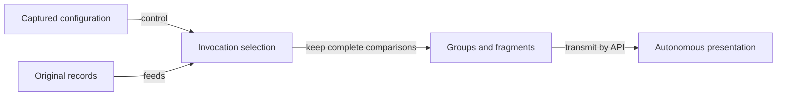
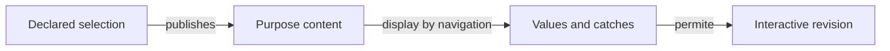

# Policy of presentation of game results

## Overview

An immutable policy controls AUTO, SUMMARY and FULL selection and the limits of presentation. The consumer prepares the data; the binary library provides the APIs, tables, folding sections and catch viewer.

## Configuration captured at first

| Configuration | Responsibility |
|---|---|
| `config/game-evidence.yml` | Consumer specific selection and limits; explicit route through `atf.evidence.policy`. |
| `atf.yaml` sau `atf.yml` | Preview of comparisons and content budget; explicit route through `atf.report.config`. |
| `EvidencePolicy` and `GameReportConfiguration` | Solving configuration once for publication. |

The subsequent change of configuration does not alter the object already captured. [GameReportConfiguration](../../atf-tests/src/main/java/atf/tests/reporting/GameReportConfiguration.java) requires previsualization of comparisons of 240 characters and a positive body budget; another preview value is denied by the current adapter.

Unknown or duplicate keys, multiple documents, invalid types, numerical overruns and negative limits are refused to load. Default values shall be consulted in the [actual configuration](../../config/game-evidence.yml).

Legend: selection and completeness

The selection shall decide which pleas are presented and declare the omissions. The grouping shall keep all mandatory comparisons of the selected invokes with the original identity and verdict.

## Modes of presentation

| Mod | Claims held | Background and presentation |
|---|---|---|
| AUTO | All population provided within inclusive limits; otherwise full deterministic examples, different results from PASS and mandatory checks. | Optional context in the captured budget and all selected comparisons. |
| SUMMARY | Successful complete examples, different results of PASS and mandatory checks. | Observe the optional context and fingerprints; declare the original inventory, retained and omitted. |
| FULL | All the submissions and control points provided. | The budgets remain active; the pre-selected diagnosis and the optional observation required for the session have distinct behaviors defined below. |

Collections explicitly marked for full storage shall be kept in accordance with policy in each way. The presentation mode does not extend the population provided by the manufacturer and does not execute the game or oracle.

## Grouping and full content

| Surface | Contract |
|---|---|
| Comparison | Natives with no more than `rowsPerGroup` rows; sequels indicate the original range. |
| Fragment Verdict | Derived from retained rows; the terminal fragment also retains the result of the explicitly provided group. |
| Valori lungi | Native preview of 240 characters and access to complete values associated with the original group. |
| Remarks | Not more than `fieldsPerGroup` rows; long values keep the content complete. |
| TEXT | Ordered parts, preferably for the end of the line and keeping CR/LF, Unicode and literal entities. |
| JSON | Full documents at object or painting limits; an indivisible element over budget is denied. |
| Capturi Android | The original whole PNG associated with the control point; the selection does not replace or cut the image. |
| Observation without comparison | The explicit API for attached materials without invented domain assertions. |

Every JSON fragment is a complete document. The original numerical forms shall be maintained by formatting and fragmentation; the lack or reordering of a game invalidates completeness.

## Optional data and refusal of publication

The optional character is declared by the caller. The file name or label shall not convert the comparative inputs, causes and catches into non-usable data.

| Step | Comportament implementat |
|---|---|
| [EvidenceSelection](../../atf-tests/src/main/java/atf/tests/learning/EvidenceSelection.java) | It deducts diagnostic fingerprints, keeps entire records in the budget and declares omissions including in FULL; SUMMARY omits them. |
| [GameReportPresentation](../../atf-tests/src/main/java/atf/tests/reporting/GameReportPresentation.java) | For optional comments requested for the session: AUTO omits that do not fit, SUMMARY omits the context and FULL refuses to exceed the budget. |
| [GameReportSession](../../atf-tests/src/main/java/atf/tests/reporting/GameReportSession.java) | Book the selected context before the scenarios and check the cumulative limit; the reservation does not restore the selection. |
| [GameReportPhase](../../atf-tests/src/main/java/atf/tests/reporting/GameReportPhase.java) | Keep INCOMPLETE at bay, including when the caller intercepts the error before closing. |

External diagnostic references are inventoried and omitted from HTML; mandatory information remains incorporated. The content is measured in UTF- 16, units and HTML markings add volume: the text budget is not a total file or memory limit.

[EvidenceSelectionContractTest](../../atf-tests/src/test/java/atf/tests/learning/EvidenceSelectionContractTest.java) checks selection before the session. [GameReportPublicationContractTest](../../atf-tests/src/test/java/atf/tests/reporting/GameReportPublicationContractTest.java) checks its publication and refusal; the two contracts are not confused.

## Implementation and verification

The composition of the data is in the main sources of [integration module](../../atf-tests/README.md). Maintenance of the generic rendering component shall be directed by [joint responsibilities](../feedback/README.md).

[Article 4](ATF_Audit.md) confronts identity, values, order and access to content. [Contractele Android](ATF_Android.md) distinguish the publication of a journal from a new interaction on the device.

## Navigation and cost of large reports

The consumer controls the population and context, and the library has the preparation and rendering of HTML. This guide sets out the observable consumer contract without promising an internal library optimization algorithm.

Legend: Input and rendering have different owners

The selection shall retain full claims and explicit omissions. The change of owner displayed, the opening of a group or catch shall keep access to the full content; generic implementation and optimisation shall qualify as the library's manager.

### Mechanisms

- Limit the optional diagnosis by the policy captured and keep mandatory comparisons of selected invokes.
- Measure separately the generation, opening and navigation operations on an identified input.
- Confront values, order and owner of catches after interaction.
- Check the return from the viewer without losing the reader's context.

### Performance governance

[Publication audit](ATF_Audit.md) has data checks and interactive review. a successful structural audit does not certify time or legibility in the browser; the generic rendering problem is directed by [feedback](../feedback/README.md).
