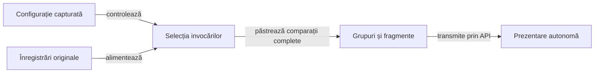
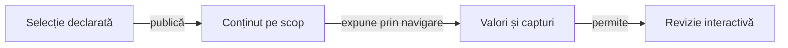

# Politica prezentării rezultatelor de joc

O politică imutabilă controlează selecția AUTO, SUMMARY și FULL și limitele prezentării. Consumatorul pregătește datele; biblioteca binară furnizează API-urile, tabelele, secțiunile pliabile și vizualizatorul capturilor.

## Configurația capturată la început

| Configurație | Responsabilitate |
|---|---|
| `config/game-evidence.yml` | Selecția și limitele specifice consumatorului; cale explicită prin `atf.evidence.policy`. |
| `atf.yaml` sau `atf.yml` | Previzualizarea comparațiilor și bugetul conținutului; cale explicită prin `atf.report.config`. |
| `EvidencePolicy` și `GameReportConfiguration` | Rezolvarea configurației o singură dată pentru publicare. |

Schimbarea ulterioară a configurației nu modifică obiectul deja capturat. [GameReportConfiguration](../../atf-tests/src/main/java/atf/tests/reporting/GameReportConfiguration.java) cere previzualizarea comparațiilor de 240 de caractere și un buget pozitiv al corpurilor; o altă valoare a previzualizării este refuzată de adaptorul curent.

Cheile necunoscute ori duplicate, documentele multiple, tipurile invalide, depășirile numerice și limitele nepozitive sunt refuzate la încărcare. Valorile implicite se consultă în [configurația efectivă](../../config/game-evidence.yml).

Legendă: selecție și completitudine

Selecția decide ce invocări sunt prezentate și declară omisiunile. Gruparea păstrează toate comparațiile obligatorii ale invocărilor selectate, cu identitatea și verdictul original.

## Modurile de prezentare

| Mod | Invocări păstrate | Context și prezentare |
|---|---|---|
| AUTO | Toată populația furnizată în limitele incluzive; altfel exemple complete deterministe, rezultate diferite de PASS și verificări obligatorii. | Context opțional în bugetul capturat și toate comparațiile selectate. |
| SUMMARY | Exemple complete reușite, rezultate diferite de PASS și verificări obligatorii. | Omite contextul opțional și amprentele; declară inventarul original, păstrat și omis. |
| FULL | Toate invocările și punctele de control furnizate. | Bugetele rămân active; diagnosticul preselectat și observația opțională cerută sesiunii au comportamente distincte, definite mai jos. |

Colecțiile marcate explicit pentru păstrare completă se păstrează conform politicii în fiecare mod. Modul de prezentare nu extinde populația furnizată de producător și nu execută jocul sau oracolul.

## Grupare și conținut integral

| Suprafață | Contract |
|---|---|
| Comparații | Grupuri native cu cel mult `rowsPerGroup` rânduri; continuările indică intervalul original. |
| Verdict de fragment | Derivat din rândurile păstrate; fragmentul terminal păstrează și rezultatul grupului furnizat explicit. |
| Valori lungi | Previzualizare nativă de 240 de caractere și acces la valorile complete, asociate grupului original. |
| Observații | Cel mult `fieldsPerGroup` rânduri; valorile lungi păstrează conținutul complet. |
| TEXT | Părți ordonate, cu preferință pentru sfârșitul de linie și păstrarea CR/LF, Unicode și entităților literale. |
| JSON | Documente complete la limite de obiect sau tablou; un element indivizibil peste buget este refuzat. |
| Capturi Android | PNG integral original, asociat punctului de control; selecția nu înlocuiește ori decupează imaginea. |
| Observație fără comparații | API-ul explicit pentru materiale atașate, fără aserțiuni de domeniu inventate. |

Fiecare fragment JSON este un document complet. Formele numerice originale se păstrează prin formatare și fragmentare; lipsa ori reordonarea unei părți invalidează completitudinea.

## Date opționale și refuzul publicării

Caracterul opțional este declarat de apelant. Numele fișierului sau eticheta nu transformă intrările comparate, cauzele și capturile în date dispensabile.

| Etapă | Comportament implementat |
|---|---|
| [EvidenceSelection](../../atf-tests/src/main/java/atf/tests/learning/EvidenceSelection.java) | Deduplică amprentele diagnostice, păstrează înregistrări întregi în buget și declară omisiunile inclusiv în FULL; SUMMARY le omite. |
| [GameReportPresentation](../../atf-tests/src/main/java/atf/tests/reporting/GameReportPresentation.java) | Pentru observații opționale solicitate sesiunii: AUTO omite ce nu încape, SUMMARY omite contextul, iar FULL refuză depășirea bugetului. |
| [GameReportSession](../../atf-tests/src/main/java/atf/tests/reporting/GameReportSession.java) | Rezervă contextul deja selectat înaintea scenariilor și verifică limita cumulativă; rezervarea nu reface selecția. |
| [GameReportPhase](../../atf-tests/src/main/java/atf/tests/reporting/GameReportPhase.java) | Păstrează INCOMPLETE la refuz, inclusiv când apelantul interceptează eroarea înaintea închiderii. |

Referințele diagnostice externe sunt inventariate și omise din HTML; informația obligatorie rămâne încorporată. Conținutul se măsoară în unități UTF-16, iar marcajele HTML adaugă volum: bugetul textului nu este o limită totală de fișier sau de memorie.

[EvidenceSelectionContractTest](../../atf-tests/src/test/java/atf/tests/learning/EvidenceSelectionContractTest.java) verifică selecția înaintea sesiunii. [GameReportPublicationContractTest](../../atf-tests/src/test/java/atf/tests/reporting/GameReportPublicationContractTest.java) verifică publicarea și refuzul ei; cele două contracte nu se confundă.

## Implementare și verificare

Compoziția datelor se află în sursele principale ale [modulului de integrare](../../atf-tests/README.md). Întreținerea componentei generice de randare se direcționează prin [responsabilitățile comune](../feedback/README.md).

[Verificarea publicării](ATF_Audit.md) confruntă identitatea, valorile, ordinea și accesul la conținut. [Contractele Android](ATF_Android.md) disting publicarea unui jurnal de o interacțiune nouă pe dispozitiv.

## Navigarea și costul rapoartelor mari

Consumatorul controlează populația și contextul, iar biblioteca deține pregătirea și randarea HTML-ului. Acest ghid stabilește contractul observabil al consumatorului, fără a promite un algoritm intern de optimizare a bibliotecii.

Legendă: inputul și randarea au proprietari diferiți

Selecția păstrează invocări întregi și omisiuni explicite. Schimbarea proprietarului afișat, deschiderea unui grup sau a unei capturi trebuie să păstreze accesul la conținutul complet; implementarea generică și optimizarea ei se califică la responsabilul bibliotecii.

### Mecanisme

- Limitați diagnosticul opțional prin politica capturată și păstrați comparațiile obligatorii ale invocărilor selectate.
- Măsurați separat generarea, deschiderea și operațiile de navigare pe un input identificat.
- Confruntați valorile, ordinea și proprietarul capturilor după interacțiune.
- Verificați revenirea din vizualizator fără pierderea contextului cititorului.

### Guvernanța performanței

[Auditul publicării](ATF_Audit.md) deține controalele de date și revizia interactivă. Un audit structural reușit nu certifică timpul sau lizibilitatea în browser; problema generică de randare se direcționează prin [feedback](../feedback/README.md).
