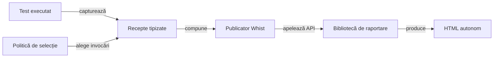

# Arhitectura publicării rezultatelor

## Pe scurt

Consumatorul Whist Lab deține selecția testelor, semantica jocului și datele de intrare publicării. Biblioteca de raportare transformă receptele tipizate într-o prezentare autonomă, păstrând verdictele evaluate și proprietatea capturilor.

## Fluxul publicării

Legendă și limite

Selecția și comparațiile aplicației aparțin consumatorului. Biblioteca păstrează verdictul, temporizarea și atașamentele primite; componenta de randare nu deduce un rezultat nou din text sau imagini.

## Contracte permanente

- Selectarea păstrează invocări întregi, toate eșecurile și inventarul omisiunilor.
- Așteptarea, valoarea observată și cauza originală rămân asociate aceleiași invocări.
- Capturile Android originale sunt încorporate PNG Base64 și aparțin punctului de control care le-a produs.
- Componentele, partidele simulate, reluarea și acțiunile Android au tipuri și limite distincte.
- Republicarea păstrează identitatea execuției originale; lipsa unui interval temporal rămâne explicită.
- Rezultatele și referințele lor sunt publicate în depozitul extern configurat.

## Configurare și responsabilități

[Politica de prezentare](../ATF_Game_Report_Presentation.md) definește volumul și selecția datelor de intrare. [Contractul Android](../ATF_Android_Report_Contract.md) definește relația acțiune–observație–comparație, iar [predarea rezultatelor](../WHIST_UI_REPORT_HANDOFF.md) definește publicarea atomică.

Defectele de date de intrare se corectează în consumator; cerințele generice ale bibliotecii sunt direcționate prin [feedback](../feedback/README.md). Identitatea binară se citește din configurația și proveniența livrării, fără versiuni sau rezultate copiate în acest ghid.
