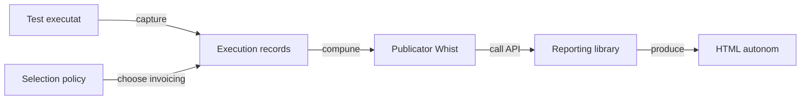

# Architecture of publication of results

## Overview

The consumer has the selection of tests, game semantics and entry dates for publication. The reporting library converts the execution records into an autonomous presentation, keeping the assessed verdicts and the association of catches with the tests that produced them.

## Publication flow

Legend and limits

The choice and comparisons of the application belong to the consumer. The library keeps the verdict, timing and attachments received; the rendering component does not deduce a new result from text or images.

## Contracte permanente

- The selection shall retain whole invoicing, all failures and the inventory of omissions.
- The waiting, the observed value and the original case remain associated with the same claim.
- The original Android catches are incorporated PNG Base64 and belong to the control point that produced them.
- Components, simulated parties, resumption and actions of Android have distinct types and limits.
- The republican shall retain the identity of the original execution; the lack of a time interval shall be explicit.
- Their results and references are published in the configured external repository.

## Configuration and responsibilities

| Mechanism | Owning contract |
|---|---|
| Selection, grouping and navigation | [Presentation policy](ATF_Presentation.md) |
| Actions, comparisons and images | [Contractul Android](ATF_Android.md) |
| Original execution and republication | [Time measurement](ATF_PhaseTiming.md) |
| Registration and acceptance on purpose | [Teaching results](ATF_Handoff.md) |
| Integrity and access to content | [Publication audit](ATF_Audit.md) |

[Presentation policy](ATF_Presentation.md) defines the volume and selection of input data. [Contractul Android](ATF_Android.md) defines the relationship between the action-observation-comparison and [handing over results](ATF_Handoff.md) defines atomic publication.

Entry data defects are corrected in the consumer; generic library requirements are directed by [feedback](../feedback/README.md). The binary identity shall be read from the configuration and provenance of the delivery without any versions or results copied to this guide.

## Verification of contracts

| Question | Responsible verification |
|---|---|
| Are the failures and omissions declared? | [EvidenceSelectionContractTest](../../atf-tests/src/test/java/atf/tests/learning/EvidenceSelectionContractTest.java) checks the selected, limited and configured catch. |
| Do the published values correspond to the entry? | [LearningRunReportContractTest](../../atf-tests/src/test/java/atf/tests/learning/LearningRunReportContractTest.java) faces deliberate values and mutations. |
| The catch stays at her checkpoint? | [AndroidInlineScreenshotReportContractTest](../../atf-tests/src/test/java/atf/tests/contracts/AndroidInlineScreenshotReportContractTest.java) checks the Inline GNP, including observation without invented assertions. |
| Can it be published for another game? | [Admission of domain](../learning/ATF_GameTransfer.md) requires semantic adaptor; the existence of generic API does not determine the meaning of a new event. |

[Focused verification](../../atf-tests/README.md#focused-verification) holds the starting command. Data contracts, HTML structure and browser interaction have distinct qualifications; a static result does not certify interactive navigation.
