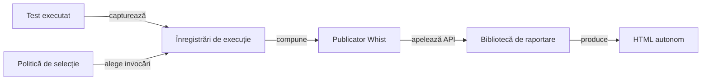

# Arhitectura publicării rezultatelor

## Pe scurt

Consumatorul Whist Lab deține selecția testelor, semantica jocului și datele de intrare pentru publicare. Biblioteca de raportare transformă înregistrările de execuție într-o prezentare autonomă, păstrând verdictele evaluate și asocierea capturilor cu testele care le-au produs.

## Fluxul publicării

Legendă și limite

Selecția și comparațiile aplicației aparțin consumatorului. Biblioteca păstrează verdictul, temporizarea și atașamentele primite; componenta de randare nu deduce un rezultat nou din text sau imagini.

## Contracte permanente

- Selectarea păstrează invocări întregi, toate eșecurile și inventarul omisiunilor.
- Așteptarea, valoarea observată și cauza originală rămân asociate aceleiași invocări.
- Capturile Android originale sunt încorporate PNG Base64 și aparțin punctului de control care le-a produs.
- Componentele, partidele simulate, reluarea și acțiunile Android au tipuri și limite distincte.
- Republicarea păstrează identitatea execuției originale; lipsa unui interval temporal rămâne explicită.
- Rezultatele și referințele lor sunt publicate în depozitul extern configurat.

## Configurare și responsabilități

| Mecanism | Contract responsabil |
|---|---|
| Selecție, grupare și navigare | [Politica prezentării](ATF_Presentation.md) |
| Acțiuni, comparații și imagini | [Contractul Android](ATF_Android.md) |
| Execuție originală și republicare | [Măsurarea timpilor](ATF_PhaseTiming.md) |
| Înregistrare și acceptare pe scop | [Predarea rezultatelor](ATF_Handoff.md) |
| Integritate și acces la conținut | [Auditul publicării](ATF_Audit.md) |

[Politica de prezentare](ATF_Presentation.md) definește volumul și selecția datelor de intrare. [Contractul Android](ATF_Android.md) definește relația acțiune–observație–comparație, iar [predarea rezultatelor](ATF_Handoff.md) definește publicarea atomică.

Defectele de date de intrare se corectează în consumator; cerințele generice ale bibliotecii sunt direcționate prin [feedback](../feedback/README.md). Identitatea binară se citește din configurația și proveniența livrării, fără versiuni sau rezultate copiate în acest ghid.

## Verificarea contractelor

| Întrebare | Verificare responsabilă |
|---|---|
| Sunt păstrate eșecurile și omisiunile declarate? | [EvidenceSelectionContractTest](../../atf-tests/src/test/java/atf/tests/learning/EvidenceSelectionContractTest.java) verifică selecția, limitele și configurația capturată. |
| Valorile publicate corespund intrării? | [LearningRunReportContractTest](../../atf-tests/src/test/java/atf/tests/learning/LearningRunReportContractTest.java) confruntă valorile și mutațiile deliberate. |
| Captura rămâne în punctul ei de control? | [AndroidInlineScreenshotReportContractTest](../../atf-tests/src/test/java/atf/tests/contracts/AndroidInlineScreenshotReportContractTest.java) verifică PNG-ul inline, inclusiv observația fără aserții inventate. |
| Se poate publica pentru alt joc? | [Admiterea domeniului](../learning/ATF_GameTransfer.md) cere adaptor semantic; existența API-ului generic nu stabilește sensul unui eveniment nou. |

[Verificarea focalizată](../../atf-tests/README.md#verificare-focalizată) deține comanda de pornire. Contractele de date, structura HTML și interacțiunea în browser au calificări distincte; un rezultat static nu certifică navigarea interactivă.
