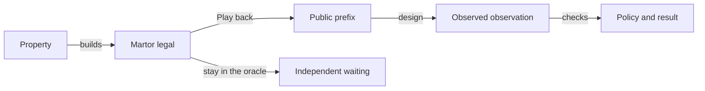

# Design of partial information policy tests

## Overview

The test checks a general property in her declared field. Observed match locates analysis; the expected outcome of a decision must be justified by rules, invariant or independent oracle.

## Construction of a valid situation

Legend: Witness and actor tested

The witness may contain the full distribution to demonstrate that the situation is possible. The policy only receives the observable projection of the actor and the comparison keeps the result separately.

## Family of properties

| Familie | Contract |
|---|---|
| Legalitate | Pack without duplicates, undivided card turned, bidding and every card played legally. |
| Information | Modification of actual adverse hands cannot change the same observation transmitted to policy. |
| Context | Controlled change of needs or opportunities may change choice with other fixed inputs. |
| Memorie | Public cards and proven shortcomings properly restrict the feasible worlds. |
| Score | Points, series and totals shall be calculated independently of the action selector. |
| Uncertain estimate | Comparing observations that differ by one factor: trump card, return card, public tender or series. For Hard, the common translation of scores shall keep the entire vector of the estimate, including the budget consumed. |
| Certificat | The numbers are complete, all relevant sequels are covered, and the exhausted budget keeps the fallback. |
| Comparison | Candidate actions use the same worlds and budgets; policies are compared on distributions and controlled places. |

## Verification level

[Test architecture](ATF_Architecture.md) defines the common classification. Pure calculus is checked unitary, policy API as a component, and policy-policy-oracle collaboration through domain integration.

An Android path remains E2E only when performing new interactions in the installed application. The statistical comparison has its own protocol and does not replace these contracts.

## Scope of the claim

- The test of an ancillary function shall verify that limit; it shall not automatically certify the entire API for decision.
- A better average in a world is not domination in all worlds.
- The elections optimized separately after knowledge of the world can be incompatible with a single public action.
- A complete search per world and a universal certificate have different quantifiers.
- Reproducibility on the same observation does not automatically imply invariance when changing scores or symmetry between places.
- A statistical policy result and the correctness of a component have separate qualification criteria.

## Verification sources

| Source | Responsibility |
|---|---|
| [ContextualHonorDiscardTest](../../whist-lab-app/game-core/src/test/java/ro/whistlab/core/ai/engine/ContextualHonorDiscardTest.java) | Legal witnesses, necessary and the effect of public cards. |
| [BlindPolicyObservationTest](../../whist-lab-app/game-core/src/test/java/ro/whistlab/core/ai/information/BlindPolicyObservationTest.java) | Separating his own hand and public information before the call for policy. |
| [CertifiedContractRegressionTest](../../whist-lab-app/game-core/src/test/java/ro/whistlab/core/ai/engine/CertifiedContractRegressionTest.java) | Certificate, lack of guarantee and fallback. |
| [HardSalvageObjectiveTest](../../whist-lab-app/game-core/src/test/java/ro/whistlab/core/ai/contract/HardSalvageObjectiveTest.java) | The order of objectives when the exact is publicly impossible. |
| [IndependentPlayerModelTest](../../whist-lab-app/game-core/src/test/java/ro/whistlab/coach/IndependentPlayerModelTest.java) | Fesibility and independent model. |
| [HumanUncertainBidComponentTest](../../whist-lab-app/app/src/test/java/ro/whistlab/app/bidding/HumanUncertainBidComponentTest.java) | Hard recommendation on public observation, atu, adverse bids, translation of score and independent formulas for configurable series. |

## Reading of archived observations

[ObservedPositionJson](../../whist-lab-app/game-core/src/test/java/ro/whistlab/core/testing/codec/ObservedPositionJson.java) adapts public catches to the current model without rewriting the original document. The absence of the penalty field retains the historical profile of five points; an explicit value remains explicit and an invalid one is refused.

[Adapter components](../../whist-lab-app/game-core/src/test/java/ro/whistlab/core/testing/codec/ObservedPositionJsonComponentTest.java) distinguish the absence, current value and data corruption. The compatibility of the catch is the responsibility of the archive reader and the engine remains independent of the JSON test parser.

## Organisation of collections

Default regression keeps small, stable and independent cases. Research, tournaments and diagnostics exploring unresolved boundaries are explicit collections with a stated budget and purpose.

A new case must bring a distinct property or border. The large sets of games and their results remain in the external corpus, and [Focused selection](../learning/ATF_Selection.md) controls the cost of analysis.

[Collections](ATF_Collections.md) · [Governance of changes](../governance/ATF_TestChanges.md) · [Modelul deciziei](../ai/ATF_DecisionModel.md)
