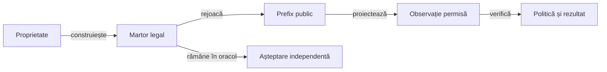

# Proiectarea testelor pentru politici cu informație parțială

## Pe scurt

Testul verifică o proprietate generală în domeniul ei declarat. O partidă observată localizează analiza; rezultatul așteptat al unei decizii trebuie justificat prin reguli, invariant sau oracol independent.

## Construcția unei situații valide

Legendă: martorul și actorul testat

Martorul poate conține distribuția completă pentru a demonstra că situația este posibilă. Politica primește numai proiecția observabilă a actorului, iar comparația păstrează separat rezultatul ulterior.

## Familii de proprietăți

| Familie | Contract |
|---|---|
| Legalitate | Pachet fără duplicate, carte întoarsă neîmpărțită, licitare și fiecare carte jucată legale. |
| Informație | Modificarea mâinilor adverse reale nu poate schimba aceeași observație transmisă politicii. |
| Context | Schimbarea controlată a necesarului sau oportunităților poate schimba alegerea, cu celelalte intrări fixate. |
| Memorie | Cărțile publice și lipsurile demonstrate restrâng corect lumile fezabile. |
| Scor | Punctele, seriile și totalurile se calculează independent de selectorul acțiunii. |
| Estimare incertă | Se compară observații care diferă printr-un singur factor: atu, carte întoarsă, licitație publică ori serie. Pentru Hard, translația comună a scorurilor păstrează întregul vector al estimării, inclusiv bugetul consumat. |
| Certificat | Enumerarea este completă, toate continuările relevante sunt acoperite, iar bugetul epuizat păstrează fallback-ul. |
| Comparație | Acțiunile candidate folosesc aceleași lumi și bugete; politicile sunt comparate pe distribuții și locuri controlate. |

## Nivelul verificării

[Arhitectura testării](ATF_Architecture.md) definește clasificarea comună. Calculul pur se verifică unitar, API-ul politicii ca o componentă, iar colaborarea motor–politici–oracol prin integrare de domeniu.

Un parcurs Android rămâne E2E numai când execută interacțiuni noi în aplicația instalată. Comparația statistică are protocol propriu și nu înlocuiește aceste contracte.

## Nivelul afirmației

- Testul unei funcții auxiliare verifică acea limită; nu certifică automat întregul API de decizie.
- O medie mai bună într-o lume nu este dominanță în toate lumile.
- Alegerile optimizate separat după cunoașterea lumii pot fi incompatibile cu o singură acțiune publică.
- O căutare completă per lume și un certificat universal au cuantificatori diferiți.
- Reproductibilitatea pe aceeași observație nu implică automat invarianță la schimbarea scorurilor sau simetrie între locuri.
- Un rezultat statistic de politică și corectitudinea unei componente au criterii de calificare distincte.

## Surse de verificare

| Sursă | Responsabilitate |
|---|---|
| [ContextualHonorDiscardTest](../../whist-lab-app/game-core/src/test/java/ro/whistlab/core/ai/engine/ContextualHonorDiscardTest.java) | Martori legali, necesar și efectul cărților publice. |
| [BidConditioningTest](https://github.com/crististefanita/whist/blob/main/whist-lab-app/game-core/src/test/java/ro/whistlab/core/ai/engine/BidConditioningTest.java) | Acoperire pentru onoruri și tăiere; plauzibilitate moderată cu licitații legale și oferta finală interzisă; reconstruire din levate curente și încheiate; oprire după mărimea efectivă a eșantionului; comportament neutru pentru moduri, programe și mărimi de masă necalibrate. |
| [ContractEndgameTest](../../whist-lab-app/game-core/src/test/java/ro/whistlab/core/ai/engine/ContractEndgameTest.java) | Restricții publice de lipsă de culoare, finaluri mici exacte, numărul cărților, excluderea atuului întors și dovezile mesei curente înainte de punctarea levatei. |
| [OfflinePerspectiveMatchTest](../../whist-lab-app/game-core/src/test/java/ro/whistlab/core/match/OfflinePerspectiveMatchTest.java) | Rejoacă aceeași secvență de distribuiri într-un mod ales cu toți Normal, toți Hard și fiecare loc Hard individual; validează angajamentele opace ale distribuirilor și programul mâinilor declarat în matrice. |
| [BlindPolicyObservationTest](../../whist-lab-app/game-core/src/test/java/ro/whistlab/core/ai/information/BlindPolicyObservationTest.java) | Separarea mâinii proprii și a informației publice înaintea apelului politicii. |
| [CertifiedContractRegressionTest](../../whist-lab-app/game-core/src/test/java/ro/whistlab/core/ai/engine/CertifiedContractRegressionTest.java) | Certificat, lipsa garanției și fallback. |
| [HardSalvageObjectiveTest](../../whist-lab-app/game-core/src/test/java/ro/whistlab/core/ai/contract/HardSalvageObjectiveTest.java) | Ordinea obiectivelor când exactul este imposibil public. |
| [IndependentPlayerModelTest](../../whist-lab-app/game-core/src/test/java/ro/whistlab/coach/IndependentPlayerModelTest.java) | Fezabilitate și model independent. |
| [HumanUncertainBidComponentTest](../../whist-lab-app/app/src/test/java/ro/whistlab/app/bidding/HumanUncertainBidComponentTest.java) | Recomandarea Hard pe observație publică, atu, licitații adverse, translația scorului și formule independente pentru seriile configurabile. |

## Citirea observațiilor arhivate

[ObservedPositionJson](../../whist-lab-app/game-core/src/test/java/ro/whistlab/core/testing/codec/ObservedPositionJson.java) adaptează capturile publice la modelul curent fără să rescrie documentul original. Absența câmpului penalizării păstrează profilul istoric de cinci puncte; o valoare explicită rămâne explicită, iar una invalidă este refuzată.

[Componentele adaptorului](../../whist-lab-app/game-core/src/test/java/ro/whistlab/core/testing/codec/ObservedPositionJsonComponentTest.java) disting absența, valoarea curentă și coruperea datelor. Compatibilitatea capturii aparține cititorului de arhivă, iar motorul rămâne independent de parserul JSON al testelor.

## Organizarea colecțiilor

| Colecție | Scop | Limită |
|---|---|---|
| Regresie implicită | Cazuri mici, stabile și independente | Fiecare caz acoperă o proprietate sau frontieră distinctă. |
| Cercetare, turneu și diagnostic | Explorează comportamente nerezolvate | Declară scopul și bugetul; păstrează loturile mari de jocuri în corpusul extern. [Selecția focalizată](../learning/ATF_Selection.md) controlează costul analizei. |
| `offlineMockMatchTest`, `offlinePerspectiveMatchTest` | Partide offline la patru jucători | Whistul românesc 1–8–1 este implicit; testele de perspective acceptă fiecare `GameMode` declarat, pentru a verifica izolarea regulilor românești față de celelalte variante. |

- `whist.offlineMatch.seed` alege primul seed determinist; `whist.offlineMatch.mode` selectează un `GameMode`; `whist.offlineMatch.roster` selectează patru locuri `NORMAL`/`HARD`; `whist.offlineMatch.count` acceptă 1–100 de partide complete.
- `run-offline-perspectives.ps1 -Mode <GameMode> -Seed <seed>` compară toate cele șase alcătuiri de locuri pe aceeași ordine privată de distribuiri. Valoarea implicită este `ROMANIAN_WHIST`; rulările alternative se păstrează cu modul și seed-ul pereche în rădăcina externă de dovezi.
- O partidă scrie urma publică completă a licitațiilor și cărților. Un lot scrie scoruri compacte pentru fiecare partidă și numărul contractelor exacte în `whist.offlineMatch.output`, care trebuie să indice în afara checkout-ului.
- Agregatele generează idei de ecranare; comparațiile pereche cu același seed și regresiile de componentă rămân necesare înainte de promovarea unei schimbări de politică.

[Colecții](ATF_Collections.md) · [Guvernanța schimbărilor](../governance/ATF_TestChanges.md) · [Modelul deciziei](../ai/ATF_DecisionModel.md)
