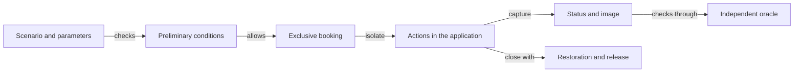

# Testing the Whist Lab on Android

## Overview

The project verifies the Whist Lab engine offline and the acceptance of its own interface.
Offline tests do not depend on the emulator; UI tests explicitly start the application
ro.whistle lab.app and act visible controls.

## Test areas

| Surface | Source | What's he checking? |
|---|---|---|
| Engine and IA | whist-lab-app/game-core and ai-lab | Rules, bids, tricks, score, persistence and repeatable assessments. |
| Adaptor Android | atf-test-android | DBD controls delimited, captures and contracts for the device. |
| UI and Extent | atf-test-android | Menu, table, bidding, cards, score, shares, assertions and captures of his own application. |

## Preparation and containment

Legend: device control and result

The scenario identifies the application and initial status prior to the actions. Reservation and restoration protect the shared resource; post-action observation determines whether the application has accepted the operation.

## Offline checks

[Collections](ATF_Collections.md) hold the JVM controls and preconditions. The check of the adapter without device is described in [Module Android](../../atf-test-android/README.md#verification-without-device).

[run-whist-ai-validation.ps1](../../scripts/run-whist-ai-validation.ps1) is a separate orchestrator of construction, components and integration, with its own device options. His use shall be decided after the actual selection in the script; the acceptance of the IU and the strategic promotion shall retain separate criteria.

## Whist Lab E2E

| Runner | Mechanism |
|---|---|
| [Sanity responsive](../../scripts/run-whist-responsive-sanity.ps1) | Check display on each profile; game flow is optional and only runs on the first profile. |
| [Romanian game](../../scripts/run-romanian-expert.ps1) | Normal hands with decisions and independently checked score. |
| [Replay complete](../../scripts/run-complete-match.ps1) | Resume external entries to the Whist Lab and check the rules, moves and score. |

On Windows, give the launcher a `RunRoot` in the external evidence director of Whist. It contains the work files and temporary files, test APKs, installation receipts and profile or match exports. Versified fixtures are part of the test inputs.

[Responsive display contract](ATF_Display.md) defines the profile boundaries and execution configuration.

Product E2Es selects the displayed items semantically, checks after
action the transition observed and keeps the catch of the same state. A ADB tap
successfully alone does not certify acceptance of the move. Test result, acceptance
the visual and objective of the match remain distinct verdicts.

## Profile, history, leaderboards and series

[Dedicated scenario](../../atf-test-android/src/test/java/atf/android/e2e/records/WhistRecordsE2eTest.java) separates data preparation from Android actions. The menu configures the name and series; the cards actually played on the interface trigger the closure of the hand or the game. The expectations for the serial points and the last trick shall be calculated prior to the action.

| Prohibited precondition | Controlled interaction |
|---|---|
| Isolated local profile | Opening dialogue, saving through Android control and name displayed after re-launch. The record scenario shall maintain the native reset and the names of the opponents. |
| Component profile | Delayed cancellation and callback, name incompatible with table, rejected writing, retest, reset and reload from simulated storage. [The check](../../whist-lab-app/app/src/test/java/ro/whistlab/app/profile/PlayerProfileEditComponentTest.java) |
| Unicode component input | Typing and gluing of 10 and 11 non-BMP letters, text selected and NFC form. The mock reproduces Android ranges; APK sample checks focus and selection in system keyboard. [The check](../../whist-lab-app/app/src/test/java/ro/whistlab/app/profile/PlayerNameInputComponentTest.java) |
| Full history prepared by JVM engine | First and last row, all columns, bids and scores, running in RO/EN. |
| Ready lap at each table site | Full label above the correct player, bidding and game, increased text and inactive human controls as AI bid. |
| Serial meters at the limit of the five hands | Selection ± 5 / ± 10 on the menu, closing by cards played in Android and re-launching without repeated payment. |
| Party prepared to the last human card | Interface closure, recalculation Top 20 with man and AI, Top 10/20 and isolation between configurations. |

Data prepared by diagnostic fixtures or replicas are excluded from the user's ranking. Verification of controls, observation of the entire cell and restoration of files have distinct criteria:

| Control | Mechanism |
|---|---|
| Initial data | Archiving before isolation; the hash of each restored file is faced before reopening the application. |
| Parameters | `whist.records.runRoot` identifies the installation and reservation metadata; `atf.android.artifacts` delimits the output. |
| Preconditions | [Components of fixtures](../../atf-test-android/src/test/java/atf/android/e2e/records/RecordsFixturesComponentTest.java) is run without device. |
| Readability | Distinguished JUnit case for tables, selectable without repeating names and series; the fully observed cell becomes a landmark for running. A cut knot does not confirm legibility. |
| Reservation | [Session contract](../../atf-test-android/src/test/java/atf/android/e2e/records/RecordsRunContract.java) checks the owner before each transport order. |
| APK | `setup-install.json` keeps `installedPath`, observed `installedApkSha256` hash and requested `requestedApkSha256` hash; lack or inconsistency stops context before Android commands. |
| Comparison | The whole JSON has a compact canon print; each position of the ranking has a separate comparison and complete diagnostic data. |

These scenarios do not qualify for an entire game played through the interface and neither does the recovery of corrupt files.

The `historyPresentationAcrossDeclaredPortraitProfiles` selection brings together the table, active actions and history in one stage, on the profiles of `atf.android.sanity.profiles`. It requires the identified installation, private archive and reservation of `whist.records.runRoot`; numerical hand formatting, separators and header alignment are confronted with the native observation.

- **Captures: ** phases use explicit names for profile and text scale. Repeats of the same profile have separate directories, keeping the original images of each checkpoint.
- **Diagnosis: ** calculation of AI bids and advance of AI cards stop separately, only in a debug APK. The frozen state checks the display and the actor; quality and speed of the decision have separate acceptance.

## History legend sanity check

The `WhistRecordsE2eTest#historyLegendWrapsWithinTheDialogAndStaysFixedWhileColumnsScroll` selection checks the fixed legend in RO/EN at the 1,0 and 1,5 stairs on the compact profile, plus reproduction of EN at 1,3 on the high profile. Use the same precondition of 24 hands played by the JVM engine on an identified APK.

[LegendProfiles](../../atf-test-android/src/test/java/atf/android/e2e/records/legend/LegendProfiles.java) holds the typed plan.

- **Selection: ** property `whist.history.legend.cases` may restrict running, e.g. `720x1280@360:1.5:RO`.
- **Format: ** `WIDTHxHEIGHT@DPI:SCALE:EN|RO`, separated by comma; maximum eight unique cases, scales 1,0–1,5.
- **Refuses: ** invalid configuration is rejected prior to the construction of Android context.

- Each navigation or running has fresh observation; the report retains the original actions, comparisons and GNP.
- The oracle checks the legend's property outside the columns, the line-to-line closure and the frame stability after running. The actual movement of columns shall be observed in text 1,5.
- The full register remains unchanged. The PNG review confirms the division and end of the explanation; the test does not require a full match played through IU.
- The validation of the plan, the duplicates, limits and interpretation of XML qualify for components. The restricted sanity check keeps the native font, the actual rewind and the PNG; they are not replaced by simulated rendering.
- Restoration distinguishes the lack of setting `font_scale` of a numerical value: absence required `settings delete`and the existing value is kept exactly. [Model restoration](../../atf-test-android/src/main/java/atf/android/evidence/FontScaleRestoration.java) refuse unknown values; literal text `null` it is not written as a numerical scale.

## Retention of results

For a live test, identify the show, check the exclusive availability of
Emulator and uses dedicated runner. No test deactivated or jumped
is the acceptance of the UI. Gross runs and captures shall be kept in the external directory
configured; [release package](../../release/README.md) retain in project
only relevant evidence, grouped by the delivered version.

If the renderer or fallback fails to comply with the common contract, record
problem by [Reporting feedback](../feedback/README.md). Here I stay
the game-specific expectations and consumer verification.
