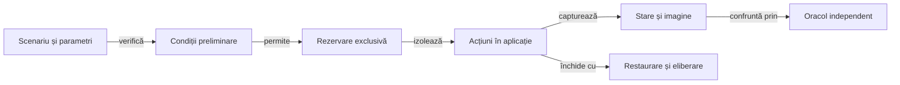

# Testarea Whist Lab pe Android

## Pe scurt

Proiectul verifică offline motorul Whist Lab și acceptanța interfeței proprii.
Testele offline nu depind de emulator; testele UI pornesc explicit aplicația
ro.whistlab.app și acționează controalele vizibile.

## Suprafețe testate

| Suprafață | Sursă | Ce verifică |
|---|---|---|
| Motor și AI | whist-lab-app/game-core și ai-lab | Reguli, licitații, levate, scor, persistență și evaluări repetabile. |
| Adaptor Android | atf-test-android | Comenzi ADB delimitate, capturi și contracte pentru dispozitiv. |
| UI și Extent | atf-test-android | Meniu, masă, licitare, cărți, scor, acțiuni, aserțiuni și capturi ale aplicației proprii. |

## Pregătire și izolare

Legendă: controlul dispozitivului și rezultatul

Scenariul identifică aplicația și starea inițială înaintea acțiunilor. Rezervarea și restaurarea protejează resursa partajată; observația de după acțiune stabilește dacă aplicația a acceptat operația.

## Verificări offline

[Colecțiile](ATF_Collections.md) dețin comenzile și precondițiile JVM. Verificarea adaptorului fără dispozitiv este descrisă în [modulul Android](../../atf-test-android/README.md#verificare-fără-dispozitiv).

[run-whist-ai-validation.ps1](../../scripts/run-whist-ai-validation.ps1) este un orchestrator separat de construire, componente și integrare, cu opțiuni proprii de dispozitiv. Folosirea lui se decide după selecția efectivă din script; acceptanța UI și promovarea strategică păstrează criterii distincte.

## E2E-ul Whist Lab

| Runner | Mecanism |
|---|---|
| [Sanity responsive](../../scripts/run-whist-responsive-sanity.ps1) | Verifică afișarea pe fiecare profil; fluxul de joc este opțional și rulează numai pe primul profil. |
| [Joc românesc](../../scripts/run-romanian-expert.ps1) | Mâini normale, cu decizii și scor verificate independent. |
| [Replay complet](../../scripts/run-complete-match.ps1) | Reia intrări externe în Whist Lab și verifică regulile, mutările și scorul. |

[Contractul responsive](ATF_Display.md) definește limitele profilului și configurarea execuției.

E2E-urile de produs selectează semantic elementele afișate, verifică după
acțiune tranziția observată și păstrează captura aceleiași stări. Un tap ADB
reușit singur nu certifică acceptarea mutării. Rezultatul testului, acceptanța
vizuală și obiectivul partidei rămân verdicte distincte.

## Profil, istoric, clasamente și serii

[Scenariul dedicat](../../atf-test-android/src/test/java/atf/android/e2e/records/WhistRecordsE2eTest.java) separă pregătirea datelor de acțiunile Android. Meniul configurează numele și seria; cărțile efectiv jucate în interfață declanșează închiderea mâinii ori a partidei. Așteptările pentru punctele de serie și ultima levată sunt calculate înaintea acțiunii.

| Precondiție declarată | Interacțiune verificată |
|---|---|
| Profil local izolat | Setare și resetare nume, nume AI scurte, identități păstrate la relansare. |
| Istoric complet pregătit de motorul JVM | Primul și ultimul rând, toate coloanele, licitații și punctaje, derulare în RO/EN. |
| Tură pregătită la fiecare loc al mesei | Eticheta integrală deasupra jucătorului corect, licitare și joc, text mărit și controale umane inactive cât licitează AI. |
| Contoare de serie la limita celor cinci mâini | Selectare ±5/±10 în meniu, închidere prin cărți jucate în Android și relansare fără plată repetată. |
| Partidă pregătită până la ultima carte umană | Încheiere prin interfață, recalculare Top 20 cu om și AI, Top 10/20 și izolare între configurații. |

Datele pregătite de fixture-uri sau replay-uri diagnostice sunt excluse din clasamentul utilizatorului. Verificarea controalelor, observația întregii celule și restaurarea fișierelor au criterii distincte:

| Control | Mecanism |
|---|---|
| Date inițiale | Arhivare înaintea izolării; hash-ul fiecărui fișier restaurat se confruntă înaintea redeschiderii aplicației. |
| Parametri | `whist.records.runRoot` identifică metadatele instalării și rezervării; `atf.android.artifacts` delimitează ieșirea. |
| Precondiții | [Componentele fixture-urilor](../../atf-test-android/src/test/java/atf/android/e2e/records/RecordsFixturesComponentTest.java) se execută fără dispozitiv. |
| Lizibilitate | Caz JUnit distinct pentru tabele, selectabil fără repetarea numelui și a seriilor; celula completă observată devine reper pentru derulare. Un nod tăiat nu confirmă lizibilitatea. |
| Rezervare | [Contractul sesiunii](../../atf-test-android/src/test/java/atf/android/e2e/records/RecordsRunContract.java) verifică proprietarul înaintea fiecărei comenzi de transport. |
| APK | `setup-install.json` păstrează `installedPath`, hash-ul observat `installedApkSha256` și hash-ul cerut `requestedApkSha256`; lipsa sau neconcordanța oprește contextul înaintea comenzilor Android. |
| Comparații | JSON-ul întreg are amprentă canonică compactă; fiecare poziție a clasamentului are comparație separată și date complete de diagnostic. |

Aceste scenarii nu califică o partidă întreagă jucată prin interfață și nici recuperarea fișierelor corupte.

Selecția `historyPresentationAcrossDeclaredPortraitProfiles` reunește masa, acțiunile active și istoricul într-un singur trace, pe profilele din `atf.android.sanity.profiles`. Ea cere instalarea identificată, arhiva privată și rezervarea din `whist.records.runRoot`; formatarea numerică a mâinii, separatoarele și alinierea antetului sunt confruntate cu observația nativă.

- **Capturi:** fazele folosesc nume explicite pentru profil și scara textului. Repetările aceluiași profil au directoare distincte, păstrând imaginile originale ale fiecărui checkpoint.
- **Diagnostic:** calculul licitațiilor AI și avansarea cărților AI se opresc separat, numai într-un APK debug. Starea înghețată verifică afișarea și actorul; calitatea și viteza deciziei au acceptanță separată.

## Sanity-ul legendei istoricului

Selecția `WhistRecordsE2eTest#historyLegendWrapsWithinTheDialogAndStaysFixedWhileColumnsScroll` verifică legenda fixă în RO/EN la scările 1,0 și 1,5 pe profilul compact, plus reproducerea EN la 1,3 pe profilul înalt. Folosește aceeași precondiție de 24 de mâini jucate de motorul JVM, pe un APK identificat.

[LegendProfiles](../../atf-test-android/src/test/java/atf/android/e2e/records/legend/LegendProfiles.java) deține planul tipizat.

- **Selecție:** proprietatea `whist.history.legend.cases` poate restrânge rularea, de exemplu `720x1280@360:1.5:RO`.
- **Format:** `WIDTHxHEIGHT@DPI:SCALE:EN|RO`, separat prin virgulă; maximum opt cazuri unice, scale 1,0–1,5.
- **Refuz:** configurația invalidă este respinsă înaintea construirii contextului Android.

- Fiecare navigare sau derulare are observație proaspătă; raportul păstrează acțiunile, comparațiile și PNG-ul original.
- Oracolul verifică proprietatea legendei în afara coloanelor, încadrarea între rânduri și închidere și stabilitatea ramei după derulare. La text 1,5 trebuie observată și deplasarea reală a coloanelor.
- Registrul complet rămâne neschimbat. Revizia PNG confirmă împărțirea și sfârșitul explicației; testul nu pretinde o partidă completă jucată prin UI.
- Validarea planului, duplicatele, limitele și interpretarea XML se califică în componente. Sanity-ul restrâns păstrează fontul nativ, derularea reală și PNG-ul; acestea nu sunt înlocuite cu randare simulată.

## Păstrarea rezultatelor

Pentru un test live, identifică serialul, verifică disponibilitatea exclusivă a
emulatorului și folosește runnerul dedicat. Niciun test dezactivat sau sărit nu
este acceptanță UI. Rulările brute și capturile se păstrează în directorul extern
configurat; [pachetul release-ului](../../artifacts/README.md) reține în proiect
numai dovezile relevante, grupate după versiunea livrată.

Dacă rendererul sau fallback-ul nu respectă contractul comun, înregistrează
problema prin [feedback-ul de raportare](../feedback/README.md). Aici rămân
așteptările specifice jocului și verificarea consumerului.
