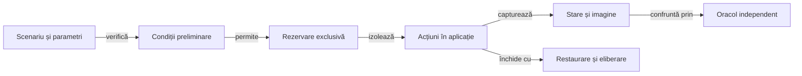

# Testarea Whist Lab pe Android

## Pe scurt

Proiectul verifică offline motorul Whist Lab și acceptanța interfeței proprii.
Testele offline nu depind de emulator; testele UI pornesc explicit aplicația
ro.whistlab.app și acționează controalele vizibile.

## Suprafețe testate

| Suprafață | Sursă | Ce verifică |
|---|---|---|
| Motor și AI | whist-lab-app/game-core și ai-lab | Reguli, licitații, levate, scor, persistență și evaluări repetabile. |
| Adaptor Android | atf-test-android | Comenzi ADB delimitate, capturi și contracte pentru dispozitiv. |
| UI și Extent | atf-test-android | Meniu, masă, licitare, cărți, scor, acțiuni, aserțiuni și capturi ale aplicației proprii. |

## Pregătire și izolare

Legendă: controlul dispozitivului și rezultatul

Scenariul identifică aplicația și starea inițială înaintea acțiunilor. Rezervarea și restaurarea protejează resursa partajată; observația de după acțiune stabilește dacă aplicația a acceptat operația.

## Verificări offline

Din rădăcina proiectului: run-whist-collection.ps1 -Collection context și
run-whist-collection.ps1 -Collection regression.

Colecțiile JVM și limitele lor sunt descrise în
[catalogul colecțiilor](ATF_Collections.md). Lansatorul agregat `scripts/run-whist-ai-validation.ps1` orchestrează construirea și verificările de integrare, cu selecțiile sale explicite.

Promovarea strategică urmează separat protocolul de învățare, candidatul înghețat și registrul loturilor rezervate. Sursele de build și rezultatele se pregătesc în directoare temporare sau externe, conform ghidului proiectului.

## E2E-ul Whist Lab

| Runner | Mecanism |
|---|---|
| [Sanity responsive](../../scripts/run-whist-responsive-sanity.ps1) | Meniu și joc normal pe profile declarate; preflight-ul precede rezervarea dispozitivului. |
| [Joc românesc](../../scripts/run-romanian-expert.ps1) | Mâini normale, cu decizii și scor verificate independent. |
| [Replay complet](../../scripts/run-complete-match.ps1) | Reia intrări externe în Whist Lab și verifică regulile, mutările și scorul. |

[Contractul responsive](ATF_Display.md) definește limitele profilului și configurarea execuției.

E2E-urile de produs selectează semantic elementele afișate, verifică după
acțiune tranziția observată și păstrează captura aceleiași stări. Un tap ADB
reușit singur nu certifică acceptarea mutării. Rezultatul testului, acceptanța
vizuală și obiectivul partidei rămân verdicte distincte.

## Dispozitiv și rezultate

Pentru un test live, identifică serialul, verifică disponibilitatea exclusivă a
emulatorului și folosește runnerul dedicat. Niciun test dezactivat sau sărit nu
este acceptanță UI. Rapoartele și capturile se păstrează în directorul extern
configurat; sursele proiectului nu sunt destinație pentru artefacte.

Dacă rendererul sau fallback-ul nu respectă contractul comun, înregistrează
problema prin [feedback-ul de raportare](../feedback/README.md). Aici rămân
așteptările specifice jocului și verificarea consumerului.
