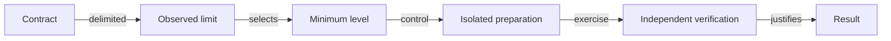

# Test architecture

## Overview

The level of a test results from the limit they check. The collection sets out the purpose and cost of selection, and the environment determines whether execution uses only JVM or an Android device.

## Choice of minimum level

Legend: contract precedes instrument

The level depends on the actual collaboration required for verification. An archived file, report or package name does not convert a test into an E2E execution.

| Level | Contract verified | Suitable preparation | Limit |
|---|---|---|---|
| Unit — `unit` | Pure policy, model, calculation, parsing or formatting | Typed inputs, watch controlled, no service | It does not certify integration between modules. |
| Component - `component` | Public API of an adaptor or module | Controlled doubles, local data, temporary files | It does not certify a new journey into the installed app. |
| Integration — `integration` | Real collaboration between components or modules | Physical libraries, configuration and controlled resources | Don't repeat all the variants already covered at the lower level. |
| Head to head - `e2e` | Observed course in Android app | Reserved device, identified application, explicit initial status | Ask for new actions and observations; it shall be activated separately. |

An auxiliary function, a data producer, a charger or an oracle is a support. A class executable from a support package declares its own level.

## Maven Executable Matrix

The table reflects the annotations of executable classes, including compound annotations. "- 'means the absence of a class declared at that level; it does not require the creation of an artificial suite.

| Module | Unit | Component | Integration | E2E | Responsibility |
|---|---|---|---|---|---|
| `atf-validation` | Da | Da | — | — | Validation rules and evaluation of public contracts. |
| `atf-test-android` | Da | Da | Da | Da | Time, simulated ADB, oracles, integration of reporting and real Android trails. |
| `atf-tests` | Da | Da | Da | — | Adapter contracts, joint binaries and project governance. |

[Math verification](../../atf-tests/src/test/java/atf/tests/governance/source/TestLayerGovernanceTest.java) faces this table with current sources. Each Maven executable class has one of the exact `@AtfUnitTest`, `@AtfComponentTest`, `@AtfIntegrationTest` and `@AtfE2eTest`, directly or through compound annotation.

Statements are extracted through JDK parser, independent of indentation and annotation position towards modifiers. Methods belong to the type declaring them, containers `@Nested` be explicit and modules retain the identity of the Maven roots; [syntax contract](../governance/README.md#test-declarations) delimited this inspection by the execution of JUnit.

- **Common libraries:** Core, Reporting, Console, Mock and [Test Kit](../../lib/README.TestKit.md) are [binary libraries](../platform/README.md). Their native tests remain with the joint responsible; the project verifies separately the integration of the binaries and its adapters.

| Contract representative | Source |
|---|---|
| Clock and intervals | [AndroidPhaseClockTest](../../atf-test-android/src/test/java/atf/android/evidence/timing/AndroidPhaseClockTest.java) |
| Adapter without device | [AdbClientContractTest](../../atf-test-android/src/test/java/atf/android/AdbClientContractTest.java) |
| Binar and consumer integration | [CoreReportingConsumerContractTest](../../atf-tests/src/test/java/atf/tests/publishing/CoreReportingConsumerContractTest.java) |
| Path Android | [WhistLabGameplayE2eTest](../../atf-test-android/src/test/java/atf/android/e2e/gameplay/WhistLabGameplayE2eTest.java) |
| Quality of sources and documents | [AtfQualityGovernanceSuite](../../atf-tests/src/test/java/atf/tests/governance/AtfQualityGovernanceSuite.java) |

## Primary suites and focused selections

[Catalog executable](../../config/atf-test-suites.json) assigns each Maven class exactly one primary suite from its module and level. Primary selects use the Jupiter engine packages and level label; a new class goes into the selection without manual completion of a list.

| Rol | Responsibility | Rule de aggregation |
|---|---|---|
| Primary | Full population of a level of one module | Every executive class has exactly one primary owner. |
| Focused | Explicit subset of one or more primary parents | Perform for diagnosis or a narrow purpose; do not add cases back to the primary total. |

- **Coverage: ** parents include the entire population of the targeted selection before channel filters. The primary suite does not allow exclusions; the filtration of an offline selection keeps the primary owner of the channel.

- **Governance:** [selection control](../../atf-tests/src/test/java/atf/tests/governance/suites/SuiteOwnershipGovernanceTest.java) face statements, roles and selections. Refuse missed classes, multiple owners, wrong level and unregistered or without parent selections; correction changes entry without removing the test.

- **Level: ** Governance is a focused selection that crosses several levels. Checks and publishers that consume external journals have their own level of integration and preconditions; rereading or republishing does not become an autonomous component or Android execution.

## Engine and interface in Gradle

Engine uses JUnit JVM via [configuration](../../whist-lab-app/game-core/build.gradle). It's not up to Test Kit and it's not claiming Maven annotations.

[ai-lab](../../whist-lab-app/ai-lab/README.md) is JVM mode consumed only when testing the engine. `:ai-lab:check` performs local Java contracts and Node.js tools, with legal data built without archive. The local Java classpath excludes the engine, Android and ATF; experiments kept below `experiments` are excluded from the main sources.

| Area | Test layer | What does it verify? | Execution |
|---|---|---|---|
| Rules and score | Unitary or component, after API exercised | Legality, tricks, points, series and limits | JVM, no Android. |
| Session and restoration | Component | Orders, transitions and rejection of an inconsistent state | Legal situations controlled. |
| AI policies | Component | Allowed observations, decisions and independently justified properties | [AI test design](ATF_AiComponents.md). |
| Decision cost | Component and integration between observation and the two decision APIs | Work, CPU time, legality and determinism on generated positions | [Explicit JVM profile](../ai/ATF_CostQualification.md). Android latency and strategic quality are evaluated separately. |
| Simulated match | Domain integration | Policy collaboration with engine and oracle up to final score | Distributions and places declared. |
| Android geometry and text | Unit or JVM component | Dimensions, regions, localization and presentation models | [App tests](../../whist-lab-app/app/src/test/java/ro/whistlab/app/). |
| Interaction in the installed app | E2E | The relationship between command, state, capture and score | [Android infrastructure](ATF_Android.md). |

A tournament is a policy assessment with its own population and criteria. The number of games or victory does not replace the independent expectation of a regression of the component.

## Independent dimensions

| Axis | Question to which he answers | Source of contract |
|---|---|---|
| Test layer | Which boundary is checked? | This guide and the executable assertions. |
| Collection | Why and when do we run this selection? | [Collection catalog](ATF_Collections.md). |
| Environment | What real resources are needed? | JVM, temporary copy or explicitly reserved device. |
| Channel | What observation is checked? | The user interface, the API or the declared combination. |
| Publication | Which invocations and data do we present? | [Published data contract](../reporting/ATF_Audit.md). |

`quick`, `regression`, `strategy` and `learning` are selection purposes. The publication adapter is a check of the Android journal; it does not execute historical interactions again.

## Construction and maintenance of a verification

Moving a check to a lower level keeps the invariant and the oracle. Observed responsibility is extracted; the smaller number of Android tests does not justify losing a refusal or transition.

1. Formula the ownership and limit before the instrument is chosen.
2. Choose the minimum level that notices the defect without borrowing the implementation verdict.
3. Prepare a valid state and an independently expected result.
4. Check the nominal case, relevant refusal and healthy neighbor.
5. Declare resources, budget, selection and activation conditions separately.
6. Update the contract document and remove overlaps without distinct properties.

The results shall be kept out of the source. Unit tests shall not be required to produce the presentation of an E2E path; the volume of publication shall be the purpose of the verification.

## Moving the checks from E2E to components

| Extract property | The appropriate component | What remains on Android |
|---|---|---|
| Geometry, crossings and centering | Typed, extreme legal measurements, increased text and neighbors who violate a single limit. | The actual font, the thirst, the tactile target and the same composition in raster. |
| Interpretation of the hierarchy | XML controlled: valid status, missing node, duplicate, cut region and malformed document. | Fresh catch after action and the identity of the screen observed. |
| Transition or resumption | Small ports, actual engine and controlled delivered events, including after cancellation. | Command through displayed control, callbacks and platform persistence. |
| Localised rules and persistence options | Text provided to the application in each language, configuration options, actual codec and invalid inputs. | Change of language and reopening of aid, a action for the selector and the check, resumption after the process has stopped. |
| Bidding under overlapping dialogues | The components play the closure of history and score with a recommendation already in the queue. The manual choice remains selected and the score does not change prior to confirmation. | Bidding on APK checks the score dialogue, confirmation and restoration after restart. Legend and rendering remain in the historic route. |
| Publication | Data captured, original comparisons and failures; Extent/fallback and output mutations. | The interactive review of HTMLs remains report audit with its own environment. |

- **equivalence: ** mapped the old case to new cases by property and identity; keep the nominal situation, refusal and healthy neighbor.
- **Isolation: ** the fixture changes the entrance or controlled observation, and the waiting comes from the rule or independent oracle. Do not use the result of implementation as expected.
- **Order: ** the injected timer checks the sequence of events; actual sleep or a retry does not replace proof of failure.
- **Selection:** Play the real point of the suite and face [the inventory of the execution](ATF_Collections.md#summary-of-selection); the file moved must be compiled and effectively selected.

The components of the oracle and the native sanity check qualify for different borders. [Display Guide](ATF_Display.md) holds the remaining native selection and [governance of test change](../governance/ATF_TestChanges.md) holds the withdrawal of cases without losing the contract.

[Collections and commands](ATF_Collections.md) · [Verification of the match](ATF_Gameplay.md) · [Quality governance](../governance/README.md)
