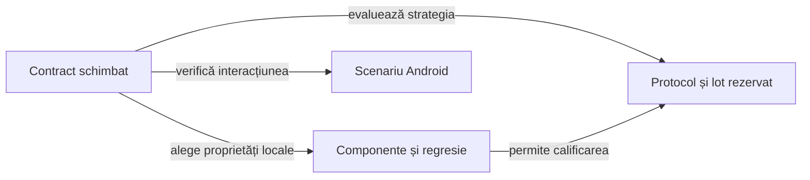

# Colecții de teste

## Pe scurt

[Catalogul colecțiilor](../../config/test-collections.json), [runnerul](../../scripts/run-whist-collection.ps1) și [task-urile Gradle](../../whist-lab-app/game-core/build.gradle) definesc execuția curentă. Numărul de cazuri se citește din rezultatele native ale fiecărei rulări, nu dintr-un inventar fixat în documentație.

[Arhitectura testării](ATF_Architecture.md) definește nivelurile și matricea executabilă. Colecția alege scopul și costul; numele ei nu schimbă nivelul verificării.

## Alegerea colecției



<details>
<summary>Legendă: selecții cu scop diferit</summary>

Colecția restrânge cazurile la proprietatea schimbată. Evaluarea unei politici adaugă un protocol și date rezervate, iar verificarea Android adaugă un dispozitiv; fiecare păstrează propriile limite și rezultat.

</details>

| Colecție | Scop | Execuție |
|---|---|---|
| `context` | Onoruri, necesar de levate, atu întors sau încă pe masă, legalitatea prefixelor | Verificări JVM restrânse |
| `quick` | Reguli, scor, serii, checkpoint-uri și gărzi de decizie | Subset al regresiei |
| `regression` | Regresia completă de domeniu, inclusiv restaurarea stării | Regresie JVM, fără turnee |
| `strategy` | Invariante și contraexemple mici pentru licitare și joc | Componente JVM selectate |
| `documentation` | Exemple de reguli și ajutor în română/engleză | Reguli și ajutor bilingv generate |
| `learning` | Comparație între un candidat și politici înghețate | Partide complete definite prin protocol |
| `arena` | Strategii distincte la aceeași masă și locuri rotite | Ligă virtuală definită prin protocol |
| `research` | Modele experimentale izolate de regresia implicită | Cercetare JVM activată explicit |

Catalogul descrie separat și acceptanța `e2e`. Aceasta folosește runner-ele Android; `e2e` nu este o valoare acceptată de parametrul `-Collection`.

Estimările `targetMinutes` din catalog ajută planificarea. Ele nu înlocuiesc timpul măsurat și nu transformă o execuție incompletă într-un rezultat reușit.

## Rulare offline din rădăcina proiectului

```powershell
.\scripts\run-whist-collection.ps1 -Collection context
.\scripts\run-whist-collection.ps1 -Collection quick
.\scripts\run-whist-collection.ps1 -Collection regression
```

Runnerul creează o copie proprie în directorul temporar și un director nou de rezultate, implicit sub `<evidence-root>/collections`. `-RunRoot` permite o altă destinație externă proiectului; o destinație existentă este refuzată. `-JavaHome` selectează JDK-ul.

Build-ul [algorithm-build](../../whist-lab-app/algorithm-build/settings.gradle) include numai modulul de domeniu. Nu configurează pluginul Android, nu construiește APK-ul și nu trimite comenzi ADB. Dependențele Gradle trebuie să existe deja în cache pentru execuția `--offline`.

Fiecare execuție păstrează inventarul SHA-256 al surselor copiate, logul, rezultatele JUnit XML și `collection-result.json`.

`-CaptureComponents` solicită și capturile JSON ale cazurilor instrumentate. Numărul capturilor nu este automat numărul tuturor testelor executate. Un subset `quick` nu se adună cu regresia completă ca și cum ar reprezenta alte cazuri.

## Experimente și surse înghețate

`learning` cere `-Candidate`, `-CorpusRoot` și `-ProtocolFile`. Protocolul declară rolul, familiile adverse, baseline-urile și intervalele de seed-uri. Runnerul alege task-ul după versiunea protocolului; nu folosi direct task-ul implicit ca substitut pentru această validare.

`-CandidateOverlay` aplică un manifest explicit numai în copia temporară. Validatorul verifică identitatea candidatului, rolul, setul și SHA-urile surselor de bază, fișierele declarate și limitele căilor. Manifestele de candidat sunt acceptate numai pentru `regression` și pentru formatul de protocol dedicat candidaților izolați, în `learning`.

`-ResearchCandidate` selectează o intrare din [catalogul de cercetare](../../config/whist-research-candidates.json).

Nu poate fi combinat cu `-CandidateOverlay`. Niciuna dintre opțiuni nu activează automat cod în aplicație.

Dacă sursele de bază s-au schimbat, păstrează modificarea și oprește calificarea acelei copii.

Nu actualiza doar hash-urile pentru a continua același experiment. Pentru o cohortă deja înghețată, folosește driverul copiei calificate care reproduce exact sursele declarate. Integrarea cu sursele curente se verifică separat.

`-CasesFile` selectează cazuri declarate și este legat de hash-urile politicii.

Un screening urmat de cazurile rămase păstrează același candidat și aceleași surse; cazurile deja închise nu se rerulează pentru a ascunde un rezultat nefavorabil. [Compoziția loturilor](../../scripts/whist-learning-batches.mjs) verifică fiecare caz, fiecare partidă și fiecare sursă înainte de a reuni rezultatele.

Pentru evaluarea finală, `-Phase heldout` cere și `-CandidateFreeze`, creat înainte de deschiderea lotului.

Intervalul trebuie verificat și înregistrat în ledgerul global `holdout-use` al arhivei, inclusiv când rezultatele unui experiment sunt ținute într-un corpus separat. Modelul și pragurile rămân înghețate după deschidere.

[Evaluatorul](../../scripts/whist-learning-evaluate.mjs) aplică obiectivul și gărzile declarate.

O execuție fără erori de reguli nu dovedește progres statistic. Un rezultat neutru poate rata cerința de câștig strict; un rol sau o familie favorabilă nu compensează un gate eșuat în alt rol sau în altă familie.

## Din observație în regresie

[Configurația corpusului](../../config/learning-corpus.json) indică manifestul activ. [Selecția focalizată](../learning/ATF_Selection.md) definește un subset diagnostic extern explicit, fără turneu implicit și fără traversarea arhivei brute. Verifică SHA-urile înainte de a folosi partidele selectate.

Un rezultat observat, o licitație sau o carte aleasă nu reprezintă automat acțiunea optimă.

Pentru o regresie implicită, redu cazul și stabilește un expected independent: regulă, invariant sau oracol complet pe un domeniu finit. Păstrează separat informația disponibilă la decizie și rezultatul ulterior. API-ul jucătorului primește numai propria mână și informația publică.

Rezultatele și eșecurile originale rămân păstrate.

Un lot de evaluare consumat nu devine din nou o evaluare neatinsă prin schimbarea numelui.

## Guvernanța proiectului

Calitatea surselor și documentației se verifică separat de colecțiile jocului:

```powershell
.\scripts\run-atf-governance.ps1
```

[Contractul guvernanței](../governance/README.md) definește inventarul, excepțiile și controalele negative. Această verificare nu joacă partide și nu comandă emulatorul.

## Reguli, ajutor și Android

[HowToPlay](../../whist-lab-app/game-core/src/main/java/ro/whistlab/core/rules/HowToPlay.java) furnizează catalogul comun pentru ajutor și exemplele RO/EN. Colecția `documentation` verifică regulile și produce proiecțiile în directorul execuției. Documentele de reguli sunt [română](../game/ATF_RulesRo.md) și [engleză](../game/ATF_RulesEn.md).

Pentru infrastructura dispozitivului și activarea explicită a fluxurilor UI, folosește [testarea Android](ATF_Android.md). Compilarea JVM, construirea unui APK și executarea pe dispozitiv sunt verificări distincte.
