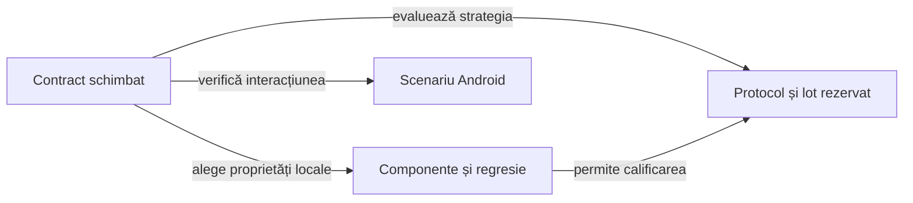

# Colecții de teste

## Pe scurt

[Catalogul colecțiilor](../../config/test-collections.json), [runnerul](../../scripts/run-whist-collection.ps1) și [task-urile Gradle](../../whist-lab-app/game-core/build.gradle) definesc execuția curentă. Numărul de cazuri se citește din rezultatele native ale fiecărei rulări, nu dintr-un inventar fixat în documentație.

[Arhitectura testării](ATF_Architecture.md) definește nivelurile și matricea executabilă. Colecția alege scopul și costul; numele ei nu schimbă nivelul verificării.

## Alegerea colecției



<details>
<summary>Legendă: selecții cu scop diferit</summary>

Colecția restrânge cazurile la proprietatea schimbată. Evaluarea unei politici adaugă un protocol și date rezervate, iar verificarea Android adaugă un dispozitiv; fiecare păstrează propriile limite și rezultat.

</details>

| Colecție | Scop | Execuție |
|---|---|---|
| `cost` | Cost JVM pentru Normal, Hard și independent la 2–8 cărți | Poziții generate, CPU și bugete din profil explicit |
| `context` | Onoruri, necesar de levate, atu întors sau încă pe masă, legalitatea prefixelor | Verificări JVM restrânse |
| `quick` | Reguli, scor, serii, checkpoint-uri și gărzi de decizie | Subset al regresiei |
| `regression` | Regresia completă de domeniu, inclusiv restaurarea stării | Regresie JVM, fără turnee |
| `strategy` | Invariante și contraexemple mici pentru licitare și joc | Componente JVM selectate |
| `documentation` | Punctaj documentat și reguli RO/EN | Extent confruntat cu JUnit și ajutor bilingv generat |
| `learning` | Comparație între un candidat și politici înghețate | Partide complete definite prin protocol |
| `arena` | Strategii distincte la aceeași masă și locuri rotite | Ligă virtuală definită prin protocol |
| `research` | Modele experimentale izolate de regresia implicită | Cercetare JVM activată explicit |

Catalogul descrie separat și acceptanța `e2e`. Aceasta folosește runner-ele Android; `e2e` nu este o valoare acceptată de parametrul `-Collection`.

Estimările `targetMinutes` din catalog ajută planificarea. Ele nu înlocuiesc timpul măsurat și nu transformă o execuție incompletă într-un rezultat reușit.

## Rulare offline din rădăcina proiectului

```powershell
.\scripts\run-whist-collection.ps1 -Collection context
.\scripts\run-whist-collection.ps1 -Collection quick
.\scripts\run-whist-collection.ps1 -Collection regression
.\scripts\run-whist-collection.ps1 -Collection cost
```

Runnerul creează o copie temporară proprie și un director nou de rezultate în arhiva externă implicită din script. `-RunRoot` selectează o altă destinație externă proiectului, iar o destinație existentă este refuzată; `-JavaHome` selectează JDK-ul.

Build-ul [algorithm-build](../../whist-lab-app/algorithm-build/settings.gradle) include motorul și laboratorul JVM; dependența motorului către laborator este numai pentru teste. Construirea aplicației Android și accesul ADB au intrări separate, iar dependențele Gradle trebuie să fie în cache pentru `--offline`.

Fiecare execuție păstrează inventarul SHA-256 al surselor copiate, logul, rezultatele JUnit XML și `collection-result.json`.

`cost` copiază înaintea execuției [profilul de cost](../../config/whist-ai-cost-profile.json), apoi măsoară poziții legale generate. `-CostProfile` poate selecta un alt profil explicit; copia exactă, mediul și fiecare măsurare rămân în rezultatul extern. [Contractul costului](../ai/ATF_CostQualification.md) deține interpretarea și limitele acestei calificări.

`-CaptureComponents` solicită și capturile JSON ale cazurilor instrumentate. Numărul capturilor nu este automat numărul tuturor testelor executate. Un subset `quick` nu se adună cu regresia completă ca și cum ar reprezenta alte cazuri.

## Inventarul unei selecții

[Nivelul testului](ATF_Architecture.md) și numele colecției nu garantează singure că un caz este descoperit. Inventarul se confruntă cu rezultatele execuției selectate, inclusiv după mutarea pachetului sau schimbarea profilului de compilare.

- Păstrați selectorul efectiv, configurația și identitatea `clasă + metodă + invocare`; includeți clasele interioare și parametrizările. Containerele suitei nu sunt cazuri suplimentare.
- Rulați entry point-ul suitei fără a selecta simultan încă o dată clasele incluse. La comparația cu o lansare individuală, păstrați explicit suprapunerea.
- Asociați XML-urile native cu selecția și logul acelei execuții. Un fișier rămas în Surefire de la rularea anterioară nu dovedește participarea la selecția curentă.
- Pentru o mutare, păstrați maparea vechi–nou și comparațiile relevante; un total neschimbat poate ascunde un caz pierdut și altul adăugat fără legătură.
- Pentru o suită auditată, confruntați invocările JUnit cu cele publicate. Existența unui HTML nu demonstrează că o clasă nouă a înregistrat adaptorul de audit; [calificarea rămasă](../feedback/ATF_Reporting.md#rpt-android-component-html--comparații-capturate-nu-doar-junit-xml) păstrează acest control.

[Dosarul de calificare](ATF_ReleaseQualification.md#readme-ul-dosarului) explică selecția cerută, cea executată și limitele. Comenzile unei execuții și totalurile ei rămân în dosarul rezultatului, separat de acest catalog generic.

## Experimente și surse înghețate

[Protocolul offline](../learning/README.md#ciclul-de-îmbunătățire) deține calificarea și criteriile; aici sunt precondițiile operaționale ale [runnerului](../../scripts/run-whist-collection.ps1).

| Intrare | Precondiție efectivă |
|---|---|
| `learning` | `-Candidate`, `-CorpusRoot` și `-ProtocolFile`; schema declară roluri, adversari, politici de bază și intervalul fazei. |
| `-CandidateOverlay` | Manifest extern de candidat înghețat, cu identitate, rol, căi și hash-uri; permis în `regression` sau în protocolul dedicat din `learning`. |
| `-ResearchCandidate` | Intrare unică în catalogul cercetării, colecție permisă și bază compatibilă. |
| `-CasesFile` | Selecție explicită pentru protocolul acceptat, cu surse identice între loturile compuse. |
| `-Phase heldout` | Cere și `-CandidateFreeze`, cu identitate și hash-uri verificate înaintea rezervării. |

- **Surse:** modurile `CandidateOverlay` și `ResearchCandidate` sunt mutual exclusive. Suprapunerea se aplică numai copiei temporare, iar baza schimbată este refuzată; migrarea cere calificare explicită, fără simpla înlocuire a hash-urilor.
- **Rezervare:** [registrul comun](../learning/ATF_EvaluationRegistry.md) verifică suprapunerile independent de corpus și de numele lotului. Dezvoltarea poate reutiliza distribuțiile cu expunere declarată; evaluarea rezervată refuză contaminarea, iar o continuare identică păstrează identitatea inițială.
- **Compoziție:** [verificatorul loturilor](../../whist-lab-app/ai-lab/tools/learning/whist-learning-batches.mjs) confruntă perechile și sursele, păstrând eșecurile închise. [Evaluatorul](../../whist-lab-app/ai-lab/tools/learning/whist-learning-evaluate.mjs) aplică criteriile protocolului, separat de rezervarea datelor.

### Identitatea completă a bazei candidatului

[Validatorul surselor](../../whist-lab-app/ai-lab/tools/qualification/WhistCandidateSource.psm1) confruntă toate fișierele Java principale din motor și laborator. Fiecare cale și fiecare hash trebuie să coincidă; cardinalitatea rezultă din inventar, fără număr istoric fixat în lansator.

| Manifest | Contract |
|---|---|
| `schemaVersion: 1` | Compatibilitate: `baselineGuards` acoperă în continuare mulțimea completă și hash-urile surselor curente. |
| `schemaVersion: 2` | Cere suplimentar `baselineInventory`, cu versiunea internă, cele două rădăcini și hash-ul canonic al inventarului. |

Rădăcinile declarate sunt `game-core/src/main/java` și `ai-lab/src/main/java`. Hash-ul canonic SHA-256 folosește UTF-8, căile sortate ordinal și câte un rând `cale`, TAB, hash-ul SHA-256 în litere mici, LF; directoarele și fișierele legate simbolic sunt refuzate.

Fragmentul unei baze noi se poate construi dintr-o copie acceptată și identificată:

```powershell
Import-Module .\whist-lab-app\ai-lab\tools\qualification\WhistCandidateSource.psm1
New-WhistCandidateBaseline -AppRoot '<copie-acceptată>\whist-lab-app' | ConvertTo-Json -Depth 12
```

Rezultatul furnizează numai `baselineGuards` și `baselineInventory`; autorul manifestului deține identitatea candidatului, rolul, protocolul și fișierele propuse. Construirea inventarului nu promovează un candidat și nu modifică manifestele înghețate existente.

Lansatorul verifică baza înaintea copierii și în copia temporară. După aplicare, verifică toate hash-urile finale, inclusiv fișierele noi declarate; sursele necunoscute, duplicatele și schimbările fără declarație sunt refuzate, iar dovada păstrează separat baza și candidatul.

## Din observație în regresie

[Selecția pentru învățare](../learning/ATF_Selection.md) identifică mecanismele implementate și extinderile propuse. [Proiectarea componentelor](ATF_AiComponents.md) deține reducerea la o situație legală mică, cu observație permisă și așteptare independentă.

Regresia implicită primește proprietăți justificate, iar jocurile și rezultatele complete rămân în corpusul extern. [Protocolul offline](../learning/README.md) deține trecerea de la diagnostic la candidat și promovare.

## Guvernanța proiectului

Calitatea surselor și documentației se verifică separat de colecțiile jocului:

```powershell
.\scripts\run-atf-governance.ps1
```

[Contractul guvernanței](../governance/README.md) definește inventarul, excepțiile și controalele negative. Această verificare nu joacă partide și nu comandă emulatorul.

## Reguli, ajutor și Android

Colecția `documentation` confruntă ajutorul bilingv și tabelul de scor cu motorul. [Ajutorul din aplicație](../../whist-lab-app/game-core/src/main/java/ro/whistlab/core/rules/HowToPlay.java) · [Reguli RO](../game/ATF_RulesRo.md) · [Reguli EN](../game/ATF_RulesEn.md)

- Raportul Extent păstrează intrările, comparațiile și refuzul modificărilor controlate.
- Raportul identifică inventarul sursei și se confruntă cu invocările JUnit în aceeași execuție.

Pentru infrastructura dispozitivului și activarea explicită a fluxurilor UI, folosește [testarea Android](ATF_Android.md). Compilarea JVM, construirea unui APK și executarea pe dispozitiv sunt verificări distincte.
