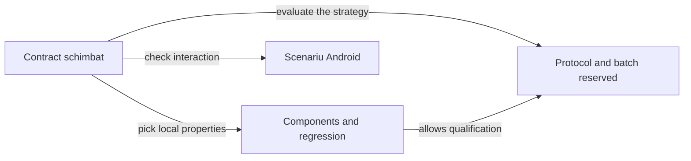

# Test collections

## Overview

[Catalogue of collections](../../config/test-collections.json), [runnerul](../../scripts/run-whist-collection.ps1) and [task-urile Gradle](../../whist-lab-app/game-core/build.gradle) The number of cases is read from the native results of each run, not from an inventory fixed in the documentation.

[Test architecture](ATF_Architecture.md) defines the levels and executable matrix. The collection chooses the purpose and cost; its name does not change the level of verification.

## Collection choice



<details>
<summary>Legend: Selections for different purposes</summary>

The collection restricts cases to the changed property. The evaluation of a policy adds a protocol and reserved data, and the verification of Android adds a device; each keeps its own limits and result.

</details>

| Collection | Purpose | Implementation |
|---|---|---|
| `cost` | Cost JVM for Normal, Hard and Independent at 2–8 cards | Proposed positions, CPU and explicit budgets |
| `context` | Honours, necessary levatates, returned attire or still on the table, legality of prefixes | Restricted JVM checks |
| `quick` | Rules, score, series, checkpoints and decision guards | Regression subset |
| `regression` | Full regression of domain, including restoration of status | JVM regression, no tournaments. [Proba sesiunii](../../atf-tests/src/test/java/atf/tests/governance/source/game/GameSessionBoundaryComponentTest.java) also checks the continuation after checkpoint, at the public limit of the engine. |
| `strategy` | Small options and counterexamples for bidding and playing | Componente JVM selectate |
| `documentation` | Documented score and rules RO/EN | Excessive face-to-face with JUnit and bilingual aid generated |
| `learning` | Comparison between candidate and frozen policies | Full parts defined by protocol |
| `arena` | Distinguishing strategies at the same table and rotated places | Virtual League defined by protocol |
| `research` | Experimental models isolated from implicit regression | JVM explicitly activated research |

The catalogue also describes the acceptance of `e2e` separately. This uses Android runners; `e2e` is not an accepted value of parameter `-Collection`.

The `targetMinutes` estimates in the catalogue help plan. They shall not replace the measured time and shall not convert an incomplete execution into a successful result.

## Offline rolling from the project root

```powershell
.\scripts\run-whist-collection.ps1 -Collection context
.\scripts\run-whist-collection.ps1 -Collection quick
.\scripts\run-whist-collection.ps1 -Collection regression
.\scripts\run-whist-collection.ps1 -Collection cost
```

Runner creates his own temporary copy and a new directory of results in the default external archive of the script. `-RunRoot` selects another external destination for the project and an existing destination is refused; `-JavaHome` selects JDK.

The [algorithm-build](../../whist-lab-app/algorithm-build/settings.gradle) cylinder includes the engine and JVM laboratory; the dependence of the engine to the laboratory is for tests only. The construction of the Android app and the ADB access have separate entries, and Gradle's dependencies must be in cache for `--offline`.

Each execution shall keep the inventory of the SHA-256 of copied sources, the log, JUnit XML results and `collection-result.json`.

`cost` Copy prior to execution [cost profile](../../config/whist-ai-cost-profile.json), then measure the legal positions generated. `-CostProfile` be able to select another explicit profile; exact copy, environment and each measurement remains in the external result. [Cost contract](../ai/ATF_CostQualification.md) be in possession of the interpretation and limits of this qualification.

`-CaptureComponents` also calls for JSON catches of the case. The number of catches shall not be automatically the number of all tests carried out. A `quick` sub-set does not add up with full regression as if it were other cases.

## Summary of selection

[Test level](ATF_Architecture.md) and the name of the collection do not guarantee themselves that a case is discovered. The inventory shall be confronted with the results of the selected execution, including after the package has been moved or the compilation profile has changed.

- Keep the actual selector, configuration and identity `clasă + metodă + invocare`; include the inner classes and parametrizations. The suite containers are not additional cases.
- Run the entry point of the suite without selecting the included classes simultaneously. When compared to an individual launch, explicitly keep the overlap.
- Associate native XMLs with the selection and log of that execution. A file remaining in Surefire since its previous run does not prove participation in the current selection.
- For a move, keep the old-new mapping and relevant comparisons; a total unchanged can hide one lost case and another added unrelated.
- For an audited suite, face JUnit's and published claims. The existence of an HTML does not demonstrate that a new class has registered the audit adapter; [the remaining qualification](../feedback/ATF_Reporting.md#rpt-android-component-html---captured-comparisons-not-just-junit-xml) maintains this control.

[Qualification folder](ATF_ReleaseQualification.md#readmeter-of-the-factor) explains the selection required, the one executed and the limits. The orders of an execution and its totals remain in the result file, separately from this generic catalogue.

## Frozen experiments and sources

[Protocolul offline](../learning/README.md#the-improvement-cycle) be qualified and criteria; here are the operational preconditions of the [runnerului](../../scripts/run-whist-collection.ps1).

| Intrare | Actual precondition |
|---|---|
| `learning` | `-Candidate`, `-CorpusRoot` and `-ProtocolFile`; the scheme declares roles, opponents, basic policies and phase interval. |
| `-CandidateOverlay` | Exterior frozen candidate manifesto with identity, role, paths and hashes; allowed in `regression` or in dedicated protocol of `learning`. |
| `-ResearchCandidate` | Unique entry into the research catalogue, allowed collection and compatible basis. |
| `-CasesFile` | Explicit selection for accepted protocol with identical sources between the composite lots. |
| `-Phase heldout` | Ask for `-CandidateFreeze`, with identity and hashes checked prior to booking. |

- **Sources: ** modes `CandidateOverlay` and `ResearchCandidate` are mutually exclusive. The overlay applies only to temporary copy and the changed base is refused; migration requires explicit qualification without simply replacing hashs.
- **Reservation:** [registrul comun](../learning/ATF_EvaluationRegistry.md) check the overlaps independently of the corpus and the name of the lot. Development may reuse the distributions with declared exposure; the reserved assessment refuses contamination and an identical continuation retains the original identity.
- **Composition:** [verificatorul loturilor](../../whist-lab-app/ai-lab/tools/learning/whist-learning-batches.mjs) face the pairs and sources, keeping the failures closed. [Evaluatorul](../../whist-lab-app/ai-lab/tools/learning/whist-learning-evaluate.mjs) apply the criteria of the protocol separately from the reservation of data.

### Full identity of candidate base

[Source Validator](../../whist-lab-app/ai-lab/tools/qualification/WhistCandidateSource.psm1) confronts all the main Java files in the engine and laboratory. Each path and hash must coincide; the cardinality results from the inventory, without historical number fixed in the launcher.

| Manifest | Contract |
|---|---|
| `schemaVersion: 1` | Compatibility: `baselineGuards` still covers the full crowd and hashes of current sources. |
| `schemaVersion: 2` | Ask additional `baselineInventory`, with the internal version, the two roots and the canonical hash of the inventory. |

The declared roots are `game-core/src/main/java` and `ai-lab/src/main/java`. The canonical hashir SHA-256 uses the UTF-8, ordinary sorted and row `cale`, TAB, the hashir SHA-256 in small letters, LF; the directories and files symbolically linked are refused.

The fragment of a new base can be constructed from an accepted and identified copy:

```powershell
Import-Module .\whist-lab-app\ai-lab\tools\qualification\WhistCandidateSource.psm1
New-WhistCandidateBaseline -AppRoot '<copie-acceptată>\whist-lab-app' | ConvertTo-Json -Depth 12
```

The result only provides `baselineGuards` and `baselineInventory`; the author of the manifesto holds the identity of the candidate, the role, protocol and the proposed files. The building of the inventory does not promote a candidate or alter existing frozen manifests.

The launcher shall check the base prior to copying and in the temporary copy. After application, check all final hashes, including new files declared; unknown sources, duplicates and changes without declaration are refused and the evidence keeps the basis and candidate separately.

## From observation to regression

[Selection for learning](../learning/ATF_Selection.md) identifies the mechanisms implemented and the proposed extensions. [Design of components](ATF_AiComponents.md) has the reduction to a small legal situation with an independent observation and waiting.

Default regression receives justified properties and complete games and results remain in the external corpus. [Protocolul offline](../learning/README.md) holds the transition from diagnosis to promotion.

## Project governance

The quality of the sources and documentation shall be checked separately from the game collections:

```powershell
.\scripts\run-atf-governance.ps1
```

[Governance contract](../governance/README.md) defines inventory, exceptions and negative controls. This check does not play games or command the emulator.

## Rules, aid and Android

Collection `documentation` face bilingual aid and score table with engine. [Aid from the application](../../whist-lab-app/game-core/src/main/java/ro/whistlab/core/rules/HowToPlay.java) · [RO rules](../game/ATF_RulesRo.md) · [EN rules](../game/ATF_RulesEn.md)

- Component tests face distribution to 3–6 players, both Romanian programs, the trump, bid, levatates, score and game to 0 with the engine.
- Published guides shall be compared in full with the aid generated in the same language. Negative cases identify a modified rule on a point.
- The Extent report shall retain the entries, comparisons and refusal of the controlled changes.
- The report identifies the source inventory and faces JUnit's claims in the same execution.

For device infrastructure and explicit activation of UI flows, use [testarea Android](ATF_Android.md). JVM compiling, construction of an APK and execution on the device are separate checks.
