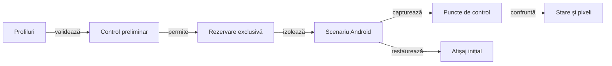

# Verificarea interfeței pe profile de ecran

## Pe scurt

Suita verifică mecanismele de configurare, licitare, joc și reluare pe profile de afișaj declarate. Scopul și numărul de mâini sunt parametri ai scenariului, cu limitele validate de runner.

## Fluxul execuției



<details>
<summary>Legendă: pregătire și restaurare</summary>

Validarea parametrilor și a contractelor componente precede controlul dispozitivului. Runnerul păstrează rezoluția și densitatea inițiale pentru restaurare, inclusiv după eșec.

Fiecare profil verifică afișarea; fluxul opțional de joc rulează numai pe primul profil. Auditul mapează coordonatele logice la raster înainte de comparația cărții, ramelor și indicatorului de atu.

</details>

## Intrări

| Parametru | Contract |
|---|---|
| Profiles | Listă de forme LĂȚIMExÎNĂLȚIME@DPI, portret și fără duplicate, în limitele componentei de profil. |
| Hands | Număr de mâini dacă `IncludeGameFlow` este activat; fluxul rulează numai pe primul profil. |
| IncludeGameFlow | Opțional. Implicit, matricea verifică display-ul și nu joacă o partidă la fiecare rezoluție. |
| DenseLayout | Opțional. Verifică numai mâna de 13 cărți și grila de 9 licitații pe profilele declarate; nu joacă o partidă. |
| HardAiCompatibility | Opțional. Verifică o singură dată fixture-ul de licitare Hard, pe primul profil. |
| Serial | Dispozitivul Android rezervat pentru scenariu. |
| AdbServerSocket | Serverul ADB configurat pentru stație sau VM. |
| Director de rezultate | Destinație externă pentru trace-ul și rezultatele execuției. |

[Runnerul](../../scripts/run-whist-responsive-sanity.ps1) și componentele sale definesc valorile implicite și limitele efective.

- Matricea normală parcurge meniul, configurarea și situațiile controlate de afișare pe fiecare profil.
- `-IncludeGameFlow` activează un singur flux normal pe primul profil.
- Pentru fluxul de joc, `-Hands` acceptă 1–5 mâini și are implicit 1.
- `-DenseLayout` selectează suita de afișare compactă: o mână de 13 cărți, 9 licitații și capturi după selectarea licitației. Profilele implicite verifică 320 dp, 353 dp, ROG 7 la 392 dp și tabletă la 600 dp; o rulare scurtă poate declara numai profilul compact.

```powershell
pwsh -NoProfile -File .\scripts\run-whist-responsive-sanity.ps1 -DenseLayout -Profiles '720x1280@360'
```

- **Publicare:** raportul și capturile sunt în `<director-rezultate>\android-artifacts\dense-layout\dense-layout.html`.
- **Fixture-ul DenseLayout:** păstrează separat captura titlului și verifică, după derularea înregistrată, fețele întregi ale celor 13 cărți, un singur rând și lizibilitatea indicilor. Acest scenariu nu cere titlul și mâna simultan în primul viewport.
- **Grilă:** verifică separarea țintelor, distanța față de scaunul uman și stabilitatea ramelor după selectarea valorii.

## Invariante vizuale și de interacțiune

- Meniul păstrează configurarea accesibilă în viewport.
- Mâna este poziționată după spațiul disponibil, cu indicii vizibili și derulare accesibilă când este necesară.
- Licitarea nu acoperă locurile jucătorilor; selecția semantică distinge etichetele duplicate.
- Fiecare acțiune este confruntată cu starea observată după ea.
- Reluarea păstrează registrul scorului și informația cunoscută.
- Captura păstrează ecranul fizic original; rezoluția logică cerută se verifică separat.
- La patru jucători, levatele urmează crucea scaunelor; locul omului este sud, iar cartea lui rămâne centrată acolo. Fața din mână are 98 dp; fața jucată are 94 dp sub 600 dp înălțime logică și 104 dp pe ferestre mai înalte. Rândul levatei păstrează eticheta, cu 2 dp spațiu vertical compact și 4 dp normal.
- Zona licitației ocupă banda liberă dintre locurile de sus și cel al omului. Dacă geometria oferă spațiu suplimentar, centrul se deplasează 62% din surplus către jucător; verificarea raportează și compară distanțele față de locurile adverse și cel uman. Țintele tactile rămân de minimum 48 dp.
- Rama atuului folosește aceeași fabrică de fundal și contur ca locul activ. E2E compară umplerea raster și verifică lizibilitatea titlului, simbolului și stării.
- Fixture-ul cu 13 cărți păstrează separat titlul vizibil înainte de derulare și verifică apoi toate cele 13 fețe întregi de 98 dp într-un singur rând, cu indicii lizibili în captura Extent. Pe ecranele compacte este permisă derularea controlată și înregistrată; cartea jucată are prag responsive separat de 94/104 dp. Profilul compact recuperează spațiu prin marginile mesei, padding-ul ramelor și distanța rândurilor, fără să micșoreze mâna, textul sau țintele tactile.
- Pe ferestrele care cer derulare, verificarea stilului și verificarea cărții vizibile complet folosesc puncte de control distincte. Testul de intersecții folosește dreptunghiurile reale ale cadrelor accesibile.
- La jocul normal, scenariul derulează până când observă întâi controlul turei și apoi o carte legală clicabilă; acțiunea rămâne verificată în viewport-ul efectiv.
- Simularea unei rezoluții logice nu dovedește proprietățile unui panou fizic de aceeași dimensiune.

## Guvernanța execuției

1. Verificați parametrii, binarele configurate și contractele profilului, driverului și publicatorului.
2. Rezervați dispozitivul și consemnați starea inițială.
3. Executați fixture-urile declarate pe toate profilurile și cel mult un flux de joc, dacă a fost activat.
4. Capturați relația acțiune–observație–comparație și publicarea Extent.
5. Restaurați setările de afișaj și eliberați rezervarea.
6. Păstrați rezultatul extern, cu limitele sale explicite.

[Contractul Android](../reporting/ATF_Android.md) · [Pregătirea dispozitivului](ATF_Android.md) · [Handoff](../reporting/ATF_Handoff.md)
