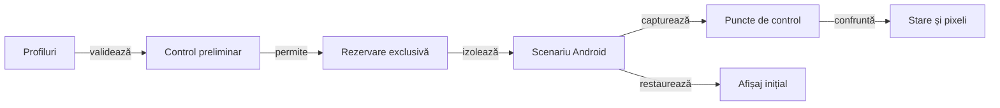

# Verificarea interfeței pe profile de ecran

## Pe scurt

Suita verifică mecanismele de configurare, licitare, joc și reluare pe profile de afișaj declarate. Scopul și numărul de mâini sunt parametri ai scenariului, cu limitele validate de runner.

## Fluxul execuției



<details>
<summary>Legendă: pregătire și restaurare</summary>

Validarea parametrilor și a contractelor componente precede controlul dispozitivului. Runnerul păstrează rezoluția și densitatea inițiale pentru restaurare, inclusiv după eșec.

Fiecare profil verifică afișarea; fluxul opțional de joc rulează numai pe primul profil. Auditul mapează coordonatele logice la raster înainte de comparația cărții, ramelor și indicatorului de atu.

</details>

## Intrări

[Colecția de componente display](ATF_DisplayComponents.md) verifică offline politicile aplicației, decodarea XML și oracolele pe observații controlate. E2E reutilizează același decodor; capturarea și interacțiunea rămân în scenariul nativ.

| Parametru | Contract |
|---|---|
| Profiles | Listă de forme LĂȚIMExÎNĂLȚIME@DPI, portret și fără duplicate, în limitele componentei de profil. |
| Hands | Număr de mâini dacă `IncludeGameFlow` este activat; fluxul rulează numai pe primul profil. |
| IncludeGameFlow | Opțional. Implicit, matricea verifică display-ul și nu joacă o partidă la fiecare rezoluție. |
| DenseLayout | Opțional. Verifică numai mâna de 13 cărți și grila de 9 licitații pe profilele declarate; nu joacă o partidă. |
| TableViewportOnly | Opțional. Mână maximă, levată completă și licitare cu selecție, fără meniu ori partidă completă; exclude celelalte opțiuni de flux. |
| HardAiCompatibility | Opțional. Verifică o singură dată fixture-ul de licitare Hard, pe primul profil. |
| Serial | Dispozitivul Android rezervat pentru scenariu. |
| AdbServerSocket | Serverul ADB configurat pentru stație sau VM. |
| Director de rezultate | Destinație externă pentru trace-ul și rezultatele execuției. |
| ComponentsOnly | Selectează exclusiv matricea JVM; exclude opțiunile de profil și flux, rezervarea și comenzile dispozitivului. |

[Runnerul](../../scripts/run-whist-responsive-sanity.ps1) și componentele sale definesc valorile implicite și limitele efective.

- Matricea normală parcurge meniul, configurarea și situațiile controlate de afișare pe fiecare profil.
- `-IncludeGameFlow` activează un singur flux normal pe primul profil.
- Pentru fluxul de joc, `-Hands` acceptă 1–5 mâini și are implicit 1.
- `-DenseLayout` selectează suita de afișare compactă: o mână de 13 cărți, 9 licitații și capturi după selectarea licitației. Profilele implicite verifică lățimi logice de aproximativ 320, 353, 393 și 600 dp; o rulare scurtă poate declara numai profilul compact.

```powershell
pwsh -NoProfile -File .\scripts\run-whist-responsive-sanity.ps1 -DenseLayout -Profiles '720x1280@360'
```

Pentru o acceptanță scurtă a vizibilității simultane, folosiți `-TableViewportOnly` în loc de `-DenseLayout`. Sunt patru checkpoint-uri: mâna maximă, levata completă, grila de licitație și selectarea unei valori cu ramele nemișcate.

- **Publicare:** `DenseLayout` scrie în `<director-rezultate>\android-artifacts\dense-layout\dense-layout.html`; verificarea standard și `TableViewportOnly` folosesc `responsive-ui-sanity\responsive-ui-sanity.html` în același director de artefacte.
- **Fixture-ul DenseLayout:** verifică cele 13 cărți întregi, un singur rând și indicii lizibili în primul viewport. Titlul și toate chenarele rămân vizibile; derularea nu poate recupera o regiune tăiată.
- **Grilă:** verifică separarea țintelor, distanța față de scaunul uman și stabilitatea ramelor după selectarea valorii.

## Profil și domeniu de calificare

Cerința folosește geometria și setările Android, separat de configurația comercială a unui telefon. Rezoluția completă nu este viewport-ul util: barele sistemului și decupajul se măsoară înaintea comparării regiunilor.

| Parametru | Domeniu de verificare |
|---|---|
| Profil înalt de referință | Portret 1080×2448 px; lățimea utilă depinde de insets și DPI-ul logic observat. |
| Densitate | 420/440/480 dpi oferă aproximativ 411/393/360 dp înainte de insets; setările de test nu presupun densitatea implicită a dispozitivului. |
| Text | Scale 1,0/1,15/1,3/1,5 în componente; sanity-ul nativ selectează normal și mărit după risc. |
| Identitate | Numele scenariilor și cerințele folosesc geometria; observațiile brute păstrează dispozitivul și setările efectiv capturate. |

Acțiunea integrală, mâna și toate locurile se confruntă în aceeași stare. [Istoricul](../game/ATF_ScoreHistory.md) deține semantica coloanelor; [feedback-ul Android](../feedback/ATF_Android.md) păstrează numai calificările încă necesare.

## Matricea minimă după risc

Selecția acoperă diferențele care pot produce altă geometrie sau altă interacțiune. Combinațiile respectă varianta jocului; stările imposibile primesc probe negative în componente, fără a fi prezentate ca partide Android valide.

| Risc | Componentă și variație | Sanity nativ selectat |
|---|---|---|
| Mână și carte selectată | O carte, maximul legal până la 13, benzi expuse și ridicare; locurile la masă nu modifică proporția feței. | Centrare la minim și lizibilitate la maxim pe profilul critic; fără repetarea partidei complete. |
| Licitare | Valorile permise ale mâinii curente, ținte distincte, distanțe până la locuri și rame stabile după selecție. | Cea mai densă grilă legală și selectarea unei valori prin controlul afișat. |
| Levata și ordinea | Locuri la 3–6 jucători, fiecare actor și câștigător, pauză și evenimente întârziate. | O levată completă și o tranziție reprezentativă; se adaugă alte locuri când schimbă aranjarea. |
| Istoric și reluare | Prima/ultima celulă, totaluri, serii și prefix necunoscut; RO/EN, text mărit și lățimi compacte. | Legendă, marcaj, derulare reală și aceeași stare după relansare, pe APK-ul care include schimbarea. |
| Fereastră și font | Bugete utile, densități fracționare, măsurători și scală de text. | Profil compact și profil înalt când disting riscul; barele sistemului și fontul se observă efectiv. |

- **Parcurs:** meniul, configurarea și un flux reprezentativ verifică legăturile dintre ecrane. Restul matricei folosește stări mici declarate și checkpoint-uri focalizate.
- **Extindere:** adăugați o combinație pentru un defect reprodus, o ramură geometrică ori un risc nou; aceeași formulă deja calificată nu cere automat o partidă completă la fiecare DPI.
- **Limită:** screenshot-ul, XML-ul, geometria modelului și rezultatul interacțiunii sunt dovezi distincte. Dosarul execuției arată ce a fost verificat și unde rămâne numai modelul JVM.

## Invariante vizuale și de interacțiune

- Meniul păstrează configurarea accesibilă în viewport.
- Masa de joc folosește înălțimea măsurată a ferestrei. Mâna, levata și chenarele încap simultan când există spațiu; pe ferestre joase, pagina se derulează fără să micșoreze cărțile sau țintele tactile.
- [Tipografia antetului](../../whist-lab-app/app/src/main/java/ro/whistlab/app/theme/GameHeaderTypography.java) păstrează titlul la 14 sp și progresul la 11 sp; cele două rânduri ale licitației folosesc 11,7 sp, exact +30% față de 9 sp. Dimensiunea fracționară rămâne în SP pentru scalarea Android, iar câmpul multilinie își măsoară înălțimea. [Componenta de contract](../../whist-lab-app/app/src/test/java/ro/whistlab/app/theme/GameHeaderTypographyComponentTest.java) protejează proporția și rolurile celorlalte texte; fontul Android are calificare nativă separată.
- Licitarea nu acoperă locurile jucătorilor; selecția semantică distinge etichetele duplicate.
- Fiecare acțiune este confruntată cu starea observată după ea.
- Reluarea păstrează registrul scorului și informația cunoscută.
- Captura păstrează PNG-ul nativ nemodificat. În funcție de dispozitiv, rasterul coincide exact cu dimensiunile fizice sau cu dimensiunile logice active din `wm size`; profilul logic este verificat separat.
- [Oracolul rasterului](../../atf-test-android/src/main/java/atf/android/evidence/DisplayRaster.java) identifică explicit modul fizic sau logic. O axă mixtă, o tăiere de un pixel ori o scalare arbitrară sunt respinse; coordonatele sunt mapate la rasterul observat.
- Fețele folosesc proporția comună 5:7: mâna are 63×88 dp, iar cărțile jucate au 46×64 sau 50×70 dp, după înălțimea ferestrei. Numărul cărților schimbă suprapunerea mâinii; numărul jucătorilor schimbă pozițiile, fără subțierea fețelor.
- La patru jucători, adversarii ocupă un arc superior și eliberează banda levatei; cărțile păstrează crucea cu omul la sud. La 3–6 locuri, numele și cărțile urmează circular indicii motorului, inclusiv reluarea de la jucătorul care începe levata.
- Banda dintre chenare rezervă înălțimea maximă dintre grila de licitație și levată. Licitația și jocul păstrează ancorele locurilor, iar conținutul fiecărei faze se centrează în banda rezervată. Masa cere un spațiu de 28 dp deasupra mâinii, dar folosește numai surplusul disponibil; ferestrele joase pot derula pagina. Țintele tactile ale licitației rămân de minimum 48 dp.
- Regiunea ocupată a unui loc include și acțiunea deasupra chenarului. Distanțele și intersecțiile licitației folosesc această regiune completă; comparația chenarelor după selectare păstrează separat conturul propriu al fiecărui jucător.
- Rama atuului folosește aceeași fabrică de fundal și contur ca locul activ. E2E compară umplerea raster și verifică lizibilitatea titlului și valorii; identitatea completă rămâne în descrierea accesibilă.
- Auditul umplerii compară culoarea dominantă din interiorul ramelor, după maparea coordonatelor la raster. Componentele verifică textul suprapus punctului de eșantionare, culori diferite și schimbarea scării capturii.
- [TableViewportAudit](../../atf-test-android/src/main/java/atf/android/whist/evidence/TableViewportAudit.java) deține comparațiile geometrice reutilizate de E2E și componente. Probele simulate introduc cadre lipsă, fețe tăiate, scroll, suprapuneri și o singură carte deplasată.
- Componentele validează oracolul pe observații controlate; verificarea rasterului și acceptanța nativă rămân niveluri separate. Rezumatele sunt confruntate cu limita efectivă de preview, iar geometria completă rămâne în XML-urile capturii.
- Fixture-ul maxim verifică 13 fețe întregi de 88 dp și toate chenarele în aceeași stare. Un al doilea fixture joacă legal o levată: cele patru cărți sunt afișate împreună cu cele 12 rămase în mână.
- Profilul compact decalează vertical crucea levatei în trei coloane distincte. Numele redundante de sub cărți rămân în descrierile accesibile și în chenare; acțiunea are o regiune proprie deasupra chenarului, centrată pe nume și măsurată integral.
- Scala feței este comună tuturor variantelor și meselor pe aceeași fereastră. Textul mărit păstrează proporția cărții și lizibilitatea indicelui; când banda măsurată nu încape pe lățime, mâna păstrează accesul orizontal la cărți. Dacă înălțimea utilă este sub înălțimea naturală a ecranului, pagina de joc se poate derula vertical și păstrează poziția la trecerea dintre licitație și joc în aceeași mână.
- Eticheta actorului se poate împărți pe rânduri și se măsoară la lățimea reală a locului, fără elipsă. Toate locurile rezervă aceeași înălțime, calculată după eticheta mai înaltă dintre licitare și joc; schimbarea fazei nu deplasează chenarul. Actorul rămâne marcat în AutoGame, chiar dacă omul nu poate interveni, și dispare numai cât se colectează levata ori pe ecranul scorului. Banda mâinii rezervă fața completă și ridicarea cărții în ambele faze.
- Chenarul păstrează regiunea de referință a antetului când acțiunea este mutată deasupra și îi rezervă o înălțime cu 25% mai mare, rotunjită în sus. Compoziția preferă un spațiu superior de 5% din masă, limitat la surplusul disponibil, pentru a păstra mâna separată.
- Alegerea aranjării compacte ține cont și de scara fontului. Textul mărit pe un ecran înalt poate elimina decorul redundant înainte de a pierde o regiune; această alegere nu micșorează fețele mâinii sau țintele tactile.
- Indicatorul atuului are lățimea de 57 dp și două regiuni măsurate: titlu și valoare. Înălțimea comună tuturor modurilor este de minimum 48 dp și crește după aceleași măsurători de font; cartea, culoarea și lipsa atuului nu schimbă dimensiunile la aceeași configurare.
- Valoarea atuului arată cartea întoarsă, simbolul culorii sau textul localizat pentru lipsa atuului. Nu există un rând suplimentar despre absența cărții întoarse; textul se adaptează lățimii utile.
- Butonul de depunere păstrează textul de 13 sp și ținta tactilă de 119 × 48 dp. La scara standard, conturul este cu 15% mai mic pe ambele axe, cu rotunjire în pixeli. La text mărit, conturul face loc etichetei măsurate.
- `Automat` apare în dreapta sus, lângă titlu când încape și pe un rând separat la text mărit. Atuul și progresul rămân dedesubt. Rezumatul separă licitațiile depuse de total printr-un rând nou. [Antetul comun](../../whist-lab-app/atf-card-table-ui/README.md#antetul-mesei)
- La jocul normal, indicatorul turei și o carte legală trebuie să fie vizibile înaintea acțiunii. Sanity-ul compact nu acceptă derularea ca remediu pentru o regiune lipsă.
- Simularea unei rezoluții logice nu dovedește proprietățile unui panou fizic de aceeași dimensiune.
- Istoricul folosește antete scurte și legendă. Lățimile compacte preferate sunt 29,7 dp pentru cărți și 18,9/23,4 dp pentru licitat și totalul afișat; separatoarele sunt de 2,1 dp, cu 30% sub grosimea de 3 dp, rotunjite o singură dată în pixeli. Textul măsurat poate extinde cele două coloane înaintea derulării, fără elipsă pe cifre; [modelul istoricului](../game/ATF_ScoreHistory.md) deține semantica și diferența față de punctele mâinii.
- Tăietura oblică traversează doar cifra licitației ratate, inclusiv zero. Componentele verifică încadrarea în coloană; sanity-ul verifică rezultatul accesibil, cifrele, legenda și captura nativă în RO/EN cu text normal și mărit.

## Guvernanța execuției

Comparațiile aceleiași stări folosesc un snapshot XML comun. [Scenariul istoricului](../../atf-test-android/src/test/java/atf/android/e2e/records/NameHistoryScenarios.java) reînnoiește observația după navigare și derulare; snapshot-ul nu se reutilizează după o mutație. Captura și verdictul checkpoint-ului rămân în urma originală, fără recitiri ADB pentru fiecare câmp al aceleiași stări stabile.

1. Verificați parametrii, binarele configurate și contractele profilului, driverului și publicatorului.
2. Rezervați dispozitivul și consemnați starea inițială.
3. Executați fixture-urile declarate pe toate profilurile și cel mult un flux de joc, dacă a fost activat.
4. Capturați relația acțiune–observație–comparație și publicarea Extent.
5. Restaurați setările de afișaj și eliberați rezervarea.
6. Păstrați rezultatul extern, cu limitele sale explicite.

[Contractul Android](../reporting/ATF_Android.md) · [Pregătirea dispozitivului](ATF_Android.md) · [Handoff](../reporting/ATF_Handoff.md)
