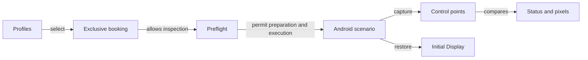

# Interface check on screen profiles

## Overview

The suite checks the configuration, bidding, game and restart mechanisms on the declared display profiles. The aim and number of hands are parameters of the scenario with the limits validated by the runner.

## Execution flow



<details>
<summary>Legend: preparation and restoration</summary>

Validation of parameters predates reservation, and prelightening prefares Maven's preparation. Runner shall maintain initial resolution and density for restoration, including after failure.

Each profile checks the display; the optional game flow only runs on the first profile. The audit mapped the logical coordinates at the raster prior to the comparison of the card, frames and index indicator.

</details>

## Inputs

[Collection of display components](ATF_DisplayComponents.md) checks the application policies, XML decoding and oracles on controlled observations offline. E2E reuses the same decoder; capture and interaction remain in the native scenario.

| Parameter | Contract |
|---|---|
| Profiles | List of forms LATIME EXHIBITION @ DPI, portrait and without duplicates, within the profile component. |
| Hands | Number of hands if `IncludeGameFlow` is activated; flow only runs on the first profile. |
| IncludeGameFlow | Optional. By default, the matrix checks the display and does not play a game at any resolution. |
| DenseLayout | Optional. Check only the 13 card hand and the 9 bid grid on the declared profiles; do not play a game. |
| TableViewportOnly | Optional. Full levitated and selection-winning maximum hand without menu or full match; excluding other flow options. |
| HardAiCompatibility | Optional. Check the hard bidding fixture once, first profile. |
| Serial | Android device reserved for scenario. |
| AdbServerSocket | The configured ADB server for the station or VM. |
| ExpectedApi and ExpectedDisplay Profile | API and expected initial profile in high-quality format @ IPR. |
| Results Director | External destination for the trackside and execution results. |
| ComponentsOnly | Select only the JVM matrix; exclude profile and flow options, reservation and device controls. |

[Runner](../../scripts/run-whist-responsive-sanity.ps1) and its components define default values and actual limits.

- Normal matrix crosses the menu, configuration and controlled display situations on each profile.
- `-IncludeGameFlow` activates a single normal flow on the first profile.
- For the game flow, `-Hands` accepts 1–5 hands and has implicitly 1.
- `-DenseLayout` selects compact display suite: a hand of 13 cards, 9 bids and captures after the selection of the bid. The default profiles check logical widths of approximately 320, 353, 393 and 600 dp; a short run can declare only the compact profile.

```powershell
pwsh -NoProfile -File .\scripts\run-whist-responsive-sanity.ps1 -DenseLayout -Profiles '720x1280@360'
```

For short acceptance of simultaneous visibility, use `-TableViewportOnly` instead of `-DenseLayout`. There are four checkpoints: maximum hand, full trick, bid grid and selection of a value with the frames still.

- **Publication: ** `DenseLayout` writes in `<director-rezultate>\android-artifacts\dense-layout\dense-layout.html`; standard verification and `TableViewportOnly` use `responsive-ui-sanity\responsive-ui-sanity.html` in the same artifact directory.
- **Fxturner DenseLayout: ** checks the 13 whole cards, one line and readable clues in the first view. The title and all boxes remain visible; the development cannot recover a cut region.
- **Grid: ** checks the separation of targets, distance from the human seat and stability of frames after selection of value.

## Profiles and field of qualification

The requirement uses the geometry and Android settings, separated from the commercial configuration of a phone. The full resolution is not the useful Viewporter: the system bars and the cut-off are measured before comparing regions.

| Parameter | Verification domain |
|---|---|
| High reference profile | Portrait 1080×2448 px; useful width depends on the insets and logical DPIs observed. |
| Density | 420/440/480 dpi offers about 411/393/360 dp before the sets; test settings do not assume default density of the device. |
| Text | Scale 1,0/1,15/1,3/1,5 in components; native sanity check selects normally and increases after risk. |
| Identitate | The names of the scenarios and requirements use geometry; the raw observations keep the device and settings effectively captured. |

Full action, hand and all places face in the same state. [History](../game/ATF_ScoreHistory.md) holds the semantics of columns; [Feedback Android](../feedback/ATF_Android.md) only keeps the qualifications still required.

## Minimum matrix by risk

The selection shall cover differences that may produce another geometry or interaction. The combinations respect the game variant; impossible states receive negative samples in components without being presented as valid Android games.

| Risk | Component and Variation | Sanity native selected |
|---|---|---|
| Hand and card selected | A card, the maximum legal up to 13, exposed and lifting lanes; table seats do not change the proportion of the face. | Minimum and maximum leeway to critical profile; no full partition repetition. |
| Bidding | Allowed current hand values, distinct targets, distances to places and stable frames after selection. | The most dense legal grid and selection of a value through displayed control. |
| Relay and order | Places at 3–6 players, each actor and winner, break and delayed events. | A full trick and a representative transition; add other places when changing the layout. |
| History and Resume | First/last cell, totals, series and prefix unknown; RO/EN, enlarged text and compact widths. | Legend, marking, actual running and same state after relaunch, on the APK that includes change. |
| Window and font | Useful budgets, fractional densities, measurements and text scale. | Compact profile and high profile when distinguishing risk; system bars and font are actually observed. |

- **Course: ** menu, configuration and a representative flow check the connections between the screens. The rest of the matrix uses declared small states and focused checkpoints.
- **Extension: ** add a combination for a reproduced defect, a geometric branch or a new risk; the same already qualified formula does not automatically require a complete match to each screen profile.
- **Limit: ** screenshot, XML, model geometry and interaction result are distinct evidence. The execution file shows what was checked and where only the JVM model remains.

## Visual and interaction invariants

- The menu keeps the configuration accessible in the view port.
- The table uses the measured window height. Hand, trick and boxes fit simultaneously when there is space; on the low windows, the page runs without shrinking the cards or tactile targets.
- [Header typography](../../whist-lab-app/app/src/main/java/ro/whistlab/app/theme/GameHeaderTypography.java) keep the title to 14 p and progress to 11 sp; the two rows of the bid use 11,7 sp, exact +30% vs 9 sp. Fractional size remains in SP for the scaling of Android, and the multiline field measures its height. [Contract component](../../whist-lab-app/app/src/test/java/ro/whistlab/app/theme/GameHeaderTypographyComponentTest.java) protects the proportion and roles of other texts; the Android font has a separate native qualification.
- Bidding does not cover players' seats; semantic selection distinguishes duplicate labels.
- Each action is confronted with the state observed after it.
- The resume shall keep the score register and the known information.
- The catch keeps the native PNG unchanged. Depending on the device, the raster coincides exactly with the physical dimensions or the logically active dimensions of `wm size`; the logic profile is checked separately.
- [RasterOracle](../../atf-test-android/src/main/java/atf/android/evidence/DisplayRaster.java) explicitly identifies the physical or logical way. A mixed axis, a pixel cut or arbitrary scaling are rejected; the coordinates are mapped at the observed raster.
- The faces use the common ratio 5: 7: the hand has 63×88 dp, and the cards played have 46×64 or 50×70 dp, by the height of the window. The number of cards changes the hand overlap; the number of players changes positions without thinning the faces.
- In four players, the opponents occupy a superior bow and release the trick band; the cards keep the cross with the man to the south. At 3–6 seats, the names and cards follow circular engine indices, including the resumption from the player who starts trick.
- The band between the boxes reserves the maximum height between the bid grid and levelled on the entire game schedule, not just for the current hand. Three players have the booking of the maximum hand of 17 cards; the bid and game keep the same anchors in all rounds. The table requires a space of 28 dp above the hand, but uses only the available surplus; the low windows can run the page. The Tactile Tasks of the bid shall remain at least 48 dp.
- The occupied region of a place also includes action above the box. The distance and intersections of the bid use this complete region; the comparison of the boxes after selection keeps the contour of each player separately.
- The frame of the card uses the same background and contour factory as the active place. E2E compares raster filling and verifies the legibility of the title and value; the full identity remains in the accessible description.
- The audit of filling compares the dominant color inside the frames after mapping the coordinates to the raster. The components shall check the text superimposed on the sampling point, different colours and change in the catch scale.
- [TableViewportAudit](../../atf-test-android/src/main/java/atf/android/whist/evidence/TableViewportAudit.java) has the geometric comparisons reused by E2E and components. The simulated samples shall introduce missing frames, cut faces, scroll, overlaps and a single card that is not in use.
- The components validate the oracle on controlled observations; the raster verification and native acceptance remain separate levels. Abstracts are confronted with the actual limit of preview, and complete geometry remains in the capture XMLs.
- The maximum fixed is 13 whole faces of 88 dp and all boxes in the same condition. A second fixture plays a trick legally: the four cards are displayed together with the 12 left in the hand.
- The compact profile vertically deletes the trick cross in three distinct columns. The redundant names under the cards remain in accessible descriptions and in boxes; the action has its own region above the box, centred on the name and fully measured.
- The scale of the face is common to all variations and tables on the same window. The enlarged text retains the proportion of the card and the readability of the index; when the measured band does not fit on the width, the hand retains horizontal access to the cards. If the useful height is below the natural height of the screen, the game page can roll vertically and keep the position at the pass between the bid and the game in the same hand.
- The actor's label may be divided into rows and measured at the true width of the place without ellipse. All seats reserve the same height, calculated by the higher label between the bidding and the game; the phase change does not move the box. The actor remains marked in AutoGame, even if man cannot intervene, and disappears only while the trick is collected or on the score screen. Hand band reserve the complete face and lifting the card in both phases.
- The quenary shall retain the header region when the action is moved above and shall reserve it a height of 25% higher, rounded up. The composition prefers a space of more than 5% by table, limited to the available surplus, to keep the hand separate.
- The choice of compact arrangement also takes account of the font scale. The increased text on a high screen can remove redundant decor before losing a region; this choice does not diminish the hand faces or tactile targets.
- The value of the asset shall be 57 dp and two measured regions: title and value. The height common to all modes is at least 48 dp and increases after the same font measurements; the card, color and lack of the card does not change the dimensions at the same configuration.
- The value of the card shows the card turned, the colour symbol or the text located for lack of the card. There is no additional line about the absence of the card turned; the text is adapted to the useful width.
- The deposit button shall keep the text of 13 sp and the tactile target of 119 × 48 dp. On the standard scale, the contour is 15% lower on both axes, rounded in pixels. With the text enlarged, the outline gives way to the measured label.
- `Automat` The title may be divided into two rows at most; the tick remains with it as long as it remains a useful width for text and passes to the next row at narrow screens or with increased text. The accessible description retains the full title. Trump and progress remain below. The summary separates the bids submitted by the total by a new row. [Shared header](../../whist-lab-app/atf-card-table-ui/README.md#table-header)
- In normal game, the indicator of the shift and a legal card must be visible before action. The compact sanity check rejects scrolling as a workaround for a missing region.
- Simulation of a logical resolution does not prove the properties of a physical panel of the same size.
- The historian uses short headers and legend. His favorite compact widths are 29,7 dp for cards; and 18,9/23,4 dp for bidding and the total displayed; separators are 2,1 dp, with 30% less than the thickness of 3 dp, rounded once in pixels. The measured text may extend the two columns before running without ellipse per digit; [model of history](../game/ATF_ScoreHistory.md) holds semantics and the difference from points of hand.
- The oblique cut only crosses the missed bid figure, including zero. Components check column classification; the sanity check verifies the accessible result, figures, legend and native capture in RO/EN with normal text and enlarged text.

## Governance of enforcement

Comparison of the same state uses a common XML snapshot. [History scenario](../../atf-test-android/src/test/java/atf/android/e2e/records/NameHistoryScenarios.java) renews the observation after navigation and running; the snapshots are not reused after a mutation. The capture and verdict of the checkpoint remains behind original, without ADB reversions for each field of the same stable state.

1. Check parameters, configured binaries and profile, driver and publisher contracts.
2. Book the device and record the initial status.
3. Run the declared fixtures on all profiles and at most a game stream if enabled.
4. Capture the relationship-observation-comparison and the publication of the Extent.
5. Restore display settings and free the reservation.
6. Keep the external result with its explicit limits.

[Android contract](../reporting/ATF_Android.md) · [Preparing the device](ATF_Android.md) · [Handoff](../reporting/ATF_Handoff.md)
