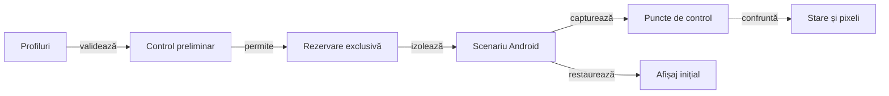

# Verificarea interfeței pe profile de ecran

## Pe scurt

Suita verifică mecanismele de configurare, licitare, joc și reluare pe profile de afișaj declarate. Scopul și numărul de mâini sunt parametri ai scenariului, cu limitele validate de runner.

## Fluxul execuției



<details>
<summary>Legendă: pregătire și restaurare</summary>

Validarea parametrilor și a contractelor componente precede controlul dispozitivului. Runnerul păstrează rezoluția și densitatea inițiale pentru restaurare, inclusiv după eșec.

Fiecare profil verifică afișarea; fluxul opțional de joc rulează numai pe primul profil. Auditul mapează coordonatele logice la raster înainte de comparația cărții, ramelor și indicatorului de atu.

</details>

## Intrări

| Parametru | Contract |
|---|---|
| Profiles | Listă de forme LĂȚIMExÎNĂLȚIME@DPI, portret și fără duplicate, în limitele componentei de profil. |
| Hands | Număr de mâini dacă `IncludeGameFlow` este activat; fluxul rulează numai pe primul profil. |
| IncludeGameFlow | Opțional. Implicit, matricea verifică display-ul și nu joacă o partidă la fiecare rezoluție. |
| DenseLayout | Opțional. Verifică numai mâna de 13 cărți și grila de 9 licitații pe profilele declarate; nu joacă o partidă. |
| TableViewportOnly | Opțional. Mână maximă, levată completă și licitare cu selecție, fără meniu ori partidă completă; exclude celelalte opțiuni de flux. |
| HardAiCompatibility | Opțional. Verifică o singură dată fixture-ul de licitare Hard, pe primul profil. |
| Serial | Dispozitivul Android rezervat pentru scenariu. |
| AdbServerSocket | Serverul ADB configurat pentru stație sau VM. |
| Director de rezultate | Destinație externă pentru trace-ul și rezultatele execuției. |

[Runnerul](../../scripts/run-whist-responsive-sanity.ps1) și componentele sale definesc valorile implicite și limitele efective.

- Matricea normală parcurge meniul, configurarea și situațiile controlate de afișare pe fiecare profil.
- `-IncludeGameFlow` activează un singur flux normal pe primul profil.
- Pentru fluxul de joc, `-Hands` acceptă 1–5 mâini și are implicit 1.
- `-DenseLayout` selectează suita de afișare compactă: o mână de 13 cărți, 9 licitații și capturi după selectarea licitației. Profilele implicite verifică 320 dp, 353 dp, ROG 7 la 392 dp și tabletă la 600 dp; o rulare scurtă poate declara numai profilul compact.

```powershell
pwsh -NoProfile -File .\scripts\run-whist-responsive-sanity.ps1 -DenseLayout -Profiles '720x1280@360'
```

Pentru o acceptanță scurtă a vizibilității simultane, folosiți `-TableViewportOnly` în loc de `-DenseLayout`. Sunt patru checkpoint-uri: mâna maximă, levata completă, grila de licitație și selectarea unei valori cu ramele nemișcate.

- **Publicare:** `DenseLayout` scrie în `<director-rezultate>\android-artifacts\dense-layout\dense-layout.html`; verificarea standard și `TableViewportOnly` folosesc `responsive-ui-sanity\responsive-ui-sanity.html` în același director de artefacte.
- **Fixture-ul DenseLayout:** verifică cele 13 cărți întregi, un singur rând și indicii lizibili în primul viewport. Titlul și toate chenarele rămân vizibile; derularea nu poate recupera o regiune tăiată.
- **Grilă:** verifică separarea țintelor, distanța față de scaunul uman și stabilitatea ramelor după selectarea valorii.

## Invariante vizuale și de interacțiune

- Meniul păstrează configurarea accesibilă în viewport.
- Masa de joc folosește înălțimea măsurată a ferestrei. Mâna, levata și toate chenarele încap simultan; suprafața de joc nu are container de derulare verticală.
- Licitarea nu acoperă locurile jucătorilor; selecția semantică distinge etichetele duplicate.
- Fiecare acțiune este confruntată cu starea observată după ea.
- Reluarea păstrează registrul scorului și informația cunoscută.
- Captura păstrează ecranul fizic original; rezoluția logică cerută se verifică separat.
- La patru jucători, levatele urmează crucea scaunelor; locul omului este sud, iar cartea lui rămâne centrată acolo. Mâna are fețe de 98 dp; politica ferestrei păstrează fețele jucate de 94/104 dp și spațiul vertical de 2/4 dp.
- Zona licitației ocupă banda liberă dintre locurile de sus și cel al omului. Dacă geometria oferă spațiu suplimentar, centrul se deplasează 62% din surplus către jucător; verificarea raportează și compară distanțele față de locurile adverse și cel uman. Țintele tactile rămân de minimum 48 dp.
- Rama atuului folosește aceeași fabrică de fundal și contur ca locul activ. E2E compară umplerea raster și verifică lizibilitatea titlului, simbolului și stării.
- Auditul umplerii compară culoarea dominantă din interiorul ramelor, după maparea coordonatelor la raster. Componentele verifică textul suprapus punctului de eșantionare, culori diferite și schimbarea scării capturii.
- [TableViewportAudit](../../atf-test-android/src/main/java/atf/android/whist/evidence/TableViewportAudit.java) deține comparațiile geometrice reutilizate de E2E și componente. Probele simulate introduc cadre lipsă, fețe tăiate, scroll, suprapuneri și o singură carte deplasată.
- Componentele validează oracolul pe observații controlate; verificarea rasterului și acceptanța nativă rămân niveluri separate. Rezumatele sunt confruntate cu limita efectivă de preview, iar geometria completă rămâne în XML-urile capturii.
- Fixture-ul maxim verifică 13 fețe întregi de 98 dp și toate chenarele în aceeași stare. Un al doilea fixture joacă legal o levată: cele patru cărți sunt afișate împreună cu cele 12 rămase în mână.
- Profilul compact decalează vertical crucea levatei în trei coloane distincte. Numele redundante de sub cărți rămân în descrierile accesibile și în chenare; indicatorul turei intră lângă nume, fără un rând separat.
- Fețele jucate păstrează pragul responsive de 94/104 dp; mâna și țintele tactile nu se micșorează. Testul confruntă intersecțiile, înălțimile complete și toate regiunile în același viewport, fără a uni capturi după scroll.
- La jocul normal, indicatorul turei și o carte legală trebuie să fie vizibile înaintea acțiunii. Sanity-ul compact nu acceptă derularea ca remediu pentru o regiune lipsă.
- Simularea unei rezoluții logice nu dovedește proprietățile unui panou fizic de aceeași dimensiune.

## Guvernanța execuției

1. Verificați parametrii, binarele configurate și contractele profilului, driverului și publicatorului.
2. Rezervați dispozitivul și consemnați starea inițială.
3. Executați fixture-urile declarate pe toate profilurile și cel mult un flux de joc, dacă a fost activat.
4. Capturați relația acțiune–observație–comparație și publicarea Extent.
5. Restaurați setările de afișaj și eliberați rezervarea.
6. Păstrați rezultatul extern, cu limitele sale explicite.

[Contractul Android](../reporting/ATF_Android.md) · [Pregătirea dispozitivului](ATF_Android.md) · [Handoff](../reporting/ATF_Handoff.md)
