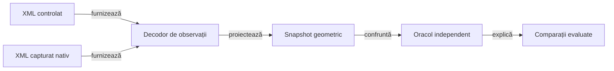

# Display verificat prin componente

## Responsabilitate

Colecția offline verifică politicile de dimensionare, decodarea observației Android și oracolele geometrice sau raster. Intrările simulate sunt explicite; acceptanța versiunii instalate păstrează o verificare nativă restrânsă.

## Arhitectură



<details>
<summary>Legendă: aceeași cale de verificare pentru date simulate și capturate</summary>

Fixture-ul descrie regiuni măsurate, fără să apeleze algoritmul de layout al aplicației. Decodorul consumă un singur XML; E2E deține capturarea, iar componenta deține interpretarea acelei observații.

</details>

## Ce se mută în componente

| Nivel | Intrare controlată | Proprietate verificată | Proprietar |
|---|---|---|---|
| Politici ale aplicației | Lățime, înălțime, densitate, font, număr de jucători și cărți | Distribuirea regiunilor, dimensiuni minime, spațiu disponibil, rotunjire și insets calculate | `app.table`, `app.hand`, `app.window` |
| Decodare | XML și profil de afișaj | Asociere semantică, fețe de carte, cadre, titlu, atu și fereastră de conținut | [TableViewportObservation](../../atf-test-android/src/test/java/atf/android/e2e/display/support/TableViewportObservation.java) |
| Oracol geometric | Snapshot cu defecte injectate | Număr, completitudine, centrare, încadrare și absența suprapunerilor | [TableViewportAudit](../../atf-test-android/src/main/java/atf/android/whist/evidence/TableViewportAudit.java) |
| Oracol raster | Imagine sintetică și coordonate logice | Schimbare de scară, culoare dominantă, contrast și toleranțe | [Componente display](../../atf-test-android/src/test/java/atf/android/e2e/display/component/) |

## Contractul mock-ului

- [Ierarhia sintetică](../../atf-test-android/src/test/java/atf/android/e2e/display/component/SyntheticTableHierarchy.java) păstrează o bază validă și modifică explicit regiunea care trebuie respinsă.
- [Matricea parametrizată](../../atf-test-android/src/test/java/atf/android/e2e/display/component/TableViewportObservationComponentTest.java) combină profile și înălțimi măsurate pentru scale de text diferite; nu randează fonturi Android.
- Transportul simulat aruncă eroare la orice comandă sau captură. Un apel accidental la dispozitiv eșuează în componentă.
- Prezența unui nod nu dovedește vizibilitatea lui; regiunile fără suprafață și elementele din afara ferestrei sunt respinse.
- Fereastra folosește `android:id/content` când este disponibil; capturile fără această regiune au fallback explicit la profilul declarat.
- Adaptorul diagnostic interpretează etichetele EN ale fixture-urilor; textele RO/EN sunt verificate separat în componentele aplicației.

## Colecții și comenzi

| Colecție | Precondiții | Rezultat |
|---|---|---|
| `AndroidDisplayComponentSuite` | Java 21, Maven și dependențe deja disponibile | JUnit XML și sumar `JVM_COMPONENTS`, fără ADB sau SDK Android. |
| `whist.displayComponents=true` | Java, Gradle și SDK Android pentru compilare | Componentele JVM ale aplicației; fără instalare sau emulator. |

Din rădăcina proiectului:

```powershell
pwsh -NoProfile -File .\scripts\run-whist-responsive-sanity.ps1 -ComponentsOnly
```

Lansatorul pregătește o copie temporară și un repository Maven privat. `-MavenRepository` indică sursa cache-ului; JAR-urile ATF sunt instalate și confruntate în copia execuției, fără înlocuirea celor citite de alt proces.

Regresia concurentă păstrează un JAR deschis pentru citire în cache-ul sursă și cere bootstrap reușit în copia privată, cu sursa intactă. Hash-urile bibliotecilor rezolvate trebuie să coincidă cu cele din copia surselor; un eșec de bootstrap rămâne distinct de verdictul interfeței.

Dintr-o copie temporară a aplicației, cu dependențele pregătite:

```powershell
.\gradlew.bat :app:testDebugUnitTest -Pwhist.displayComponents=true --offline --no-daemon
```

## Ce păstrează verificarea nativă

| Proprietate | Verificare rămasă pe Android |
|---|---|
| Font și glyph | Măsurare reală, fallback, text mărit, trunchiere și lizibilitatea capturii. |
| Fereastră | Consumul efectiv al insets, tastatură, decupaj și navigarea sistemului pe API-ul țintă. |
| Interacțiune | Tap acceptat, focus, hit testing, animație și tranziția observată. |
| Compoziție | Aceeași stare conține toate regiunile necesare în rasterul real. |

O modificare de formulă rulează întâi componentele; o schimbare de randare sau de integrare cu sistemul adaugă [sanity-ul nativ selectat](ATF_Display.md). Rezultatele sunt externe și identifică sursele verificate.
