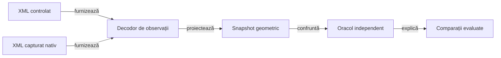

# Display verificat prin componente

## Responsabilitate

Colecția offline verifică politicile de dimensionare, decodarea observației Android și oracolele geometrice sau raster. Intrările simulate sunt explicite; acceptanța versiunii instalate păstrează o verificare nativă restrânsă.

## Arhitectură



<details>
<summary>Legendă: aceeași cale de verificare pentru date simulate și capturate</summary>

Fixture-ul descrie regiuni măsurate, fără să apeleze algoritmul de layout al aplicației. Decodorul consumă un singur XML; E2E deține capturarea, iar componenta deține interpretarea acelei observații.

</details>

## Ce se mută în componente

| Nivel | Intrare controlată | Proprietate verificată | Proprietar |
|---|---|---|---|
| Politici ale aplicației | Lățime, înălțime, densitate, font, număr de jucători și cărți | Distribuirea regiunilor, dimensiuni minime, spațiu disponibil, rotunjire și insets calculate | `app.table`, `app.hand`, `app.window` |
| Nume și acțiune | Înălțimi de text măsurate sau simulate, conținutul chenarului și locul egalizat | Acțiune completă deasupra numelui, spațiu rezervat între ture, chenar mărit fără scalare repetată | `app.seat` |
| Istoric | Număr de locuri și densitate | Aceleași frontiere pentru antete și subcoloane, separatoare între jucători, lățime completă inclusiv padding | `app.score` |
| Colectarea levatei | Centre, actor, istoric public, ceas, viewport și evenimente controlate ale scenei | Levata completă, convergență, suspendare/reluare și curățare unică; refacerea grupează redimensionările, așteaptă închiderea dialogurilor și respinge callback-urile scenei vechi, fără mutații ale partidei | `app.animation`, `app.lifecycle`, `app.navigation`, `app.presentation` |
| Decodare | XML și profil de afișaj | Asociere semantică, fețe de carte, cadre, titlu, atu și fereastră de conținut | [TableViewportObservation](../../atf-test-android/src/test/java/atf/android/e2e/display/support/TableViewportObservation.java) |
| Oracol geometric | Snapshot cu defecte injectate | Număr, completitudine, centrare, încadrare și absența suprapunerilor | [TableViewportAudit](../../atf-test-android/src/main/java/atf/android/whist/evidence/TableViewportAudit.java) |
| Oracol raster | Imagine sintetică și coordonate logice | Schimbare de scară, culoare dominantă, contrast și toleranțe | [Componente display](../../atf-test-android/src/test/java/atf/android/e2e/display/component/) |

## Contractul mock-ului

- [Ierarhia sintetică](../../atf-test-android/src/test/java/atf/android/e2e/display/component/SyntheticTableHierarchy.java) păstrează o bază validă și modifică explicit regiunea care trebuie respinsă.
- [Matricea parametrizată](../../atf-test-android/src/test/java/atf/android/e2e/display/component/TableViewportObservationComponentTest.java) combină profile și înălțimi măsurate pentru scale de text diferite; nu randează fonturi Android.
- Transportul simulat aruncă eroare la orice comandă sau captură. Un apel accidental la dispozitiv eșuează în componentă.
- Execuția JVM folosește dependențele Java reale înaintea stub-urilor SDK atunci când numele claselor coincid. Proveniența classpath-ului se păstrează; un eșec al infrastructurii nu substituie verdictul produsului.
- Prezența unui nod nu dovedește vizibilitatea lui; regiunile fără suprafață și elementele din afara ferestrei sunt respinse.
- Fereastra folosește `android:id/content` când este disponibil; capturile fără această regiune au fallback explicit la profilul declarat.
- Decodarea completă a fixture-urilor folosește semnalele EN, iar verificarea acțiunii are contracte explicite RO/EN. Schimbarea limbii nu permite prescurtarea etichetei sau pierderea asocierii cu jucătorul activ.
- [PlayerSeatMetrics](../../whist-lab-app/app/src/main/java/ro/whistlab/app/seat/PlayerSeatMetrics.java) primește înălțimea completă a acțiunii; Android o măsoară cu textul real, iar componenta injectează extinderi pentru text mărit și mai multe rânduri. Modelul nu limitează numărul rândurilor și nu deduce lizibilitatea din prezența textului în XML.
- Verificarea acțiunii din [decodor](../../atf-test-android/src/test/java/atf/android/e2e/display/support/TableViewportObservation.java) este comună observațiilor simulate și checkpoint-urilor E2E de joc și licitare. Controalele negative elimină acțiunea, îi schimbă textul sau o mută peste nume; pauza are explicit zero acțiuni active.
- Distanța până la jucător se măsoară față de reuniunea chenarului și a acțiunii lui. Un spațiu liber până la chenar nu permite unui control să acopere eticheta aflată deasupra.
- Dimensiunile declarate ale atuului și fețelor jucate au comparații în pixeli și toleranță de rotunjire. O față mai înaltă decât cea cerută nu trece doar pentru că depășește un prag minim.
- [ScoreHistoryMeasure](../../whist-lab-app/app/src/main/java/ro/whistlab/app/score/ScoreHistoryMeasure.java) primește separat măsurătorile fontului numeric și ale antetului. Componentele verifică întregul tabel, inclusiv ultima celulă, semnele, valori necunoscute, nume lungi și text mărit; Android furnizează implementarea măsurării glifurilor.
- [HistoryViewportComponentTest](../../whist-lab-app/app/src/test/java/ro/whistlab/app/score/layout/HistoryViewportComponentTest.java) verifică bugetul vertical, revenirea la o fereastră mai mare, densitățile fracționare și măsurile invalide. Politica nu substituie randarea fontului Android.
- [HistoryLegendAuditComponentTest](../../atf-test-android/src/test/java/atf/android/e2e/records/legend/HistoryLegendAuditComponentTest.java) reproduce proprietatea greșită din containerul orizontal, regiuni goale ori intersectate și dovezi lipsă. Textul complet din XML nu este suficient pentru PASS.
- [LegendProfilesComponentTest](../../atf-test-android/src/test/java/atf/android/e2e/records/legend/LegendProfilesComponentTest.java) califică offline planul implicit, selecția focalizată, identitățile canonice și refuzul configurațiilor invalide. E2E consumă cazurile tipizate și execută numai proba nativă selectată.
- [RecordsRunContractComponentTest](../../atf-test-android/src/test/java/atf/android/e2e/records/RecordsRunContractComponentTest.java) verifică selectarea textului vizibil cu o singură observație, recitirea după dezvăluire și identitatea erorii. Dispatch-ul păstrează citirea proaspătă a driverului și un singur tap; recitirile redundante nu sunt folosite ca mecanism de sincronizare.
- Istoricul măsoară numai licitația și punctele mâinii; totalul păstrat pentru audit și citirea asistată nu consumă o coloană. Componentele compară marcajele seriilor cu plățile motorului, după reîncărcare, și acoperă bonusul, penalizarea, seriile dezactivate și informația necunoscută; randarea nativă a sublinierii rămâne distinctă de proiecție.
- Coloanele de zero pixeli, depășirile numerice și măsurătorile negative sunt refuzate înaintea construirii vederii. Un eșec al furnizorului de font păstrează cauza inițială și nu devine o măsurătoare de zero.

- [TrumpIndicatorComponentTest](../../whist-lab-app/app/src/test/java/ro/whistlab/app/table/TrumpIndicatorComponentTest.java) verifică aceeași proiecție a atuului în toate modurile și limbile, lipsa rândului redundant, două regiuni de font complete și separarea conturului butonului de ținta tactilă. Măsurătorile injectate nu înlocuiesc randarea fontului Android.
- [CardFaceMetrics](../../whist-lab-app/app/src/main/java/ro/whistlab/app/cards/CardFaceMetrics.java) deține proporția 5:7: 63×88 dp în mână, respectiv 46×64 sau 50×70 dp pe masă. Componentele verifică reducerea înălțimii cu 10%, rotunjirea, ridicarea și dimensiunile identice la 1–13 cărți și 3–6 locuri.
- [Ordinea locurilor](../../whist-lab-app/app/src/test/java/ro/whistlab/app/table/TableSeatOrderComponentTest.java) confruntă numele și cărțile cu aceeași parcurgere circulară; un test folosește licitația și prima levată efectivă din motor, pentru fiecare variantă și număr de jucători. La patru locuri, arcul adversarilor eliberează lățimea completă a levatei.
- [Guvernanța API-urilor Java](../../atf-tests/src/test/java/atf/tests/governance/source/android/AndroidJavaApiGovernanceTest.java) respinge terminalul `Stream.toList()` în sursele Android; permite colectorii compatibili și ignoră comentariile și textele. JDK-ul testelor nu dovedește disponibilitatea metodei pe dispozitiv.
- Oracolul păstrează așteptări independente: înălțimea fiecărei cărți și lățimea ultimei fețe neacoperite au toleranță de un pixel. Pentru cărțile suprapuse, XML-ul Android descrie banda expusă, care trebuie să fie pozitivă și cel mult cât fața standard; nu dovedește lățimea ascunsă sub vecin. Componentele verifică separat lățimea completă a tuturor fețelor. Probele negative acoperă fața finală subțiată, banda nulă ori prea lată și fețele jucate deformate.
- Măsurarea indicilor adaugă padding-ul direct în pixeli, fără traseul pixeli–dp–pixeli. Cazul cu densitate 2,25 și 13 cărți verifică ambele margini ale evantaiului, inclusiv rotunjirea benzii măsurate.

## Colecții și comenzi

Pentru o modificare limitată la istoric, selecția JVM se poate restrânge la `:app:testDebugUnitTest --tests 'ro.whistlab.app.score.ScoreHistory*Test' --tests 'ro.whistlab.app.score.layout.*'`. Colecția display extinsă califică ulterior compoziția comună; testele de antrenare și emulatorul nu sunt precondiții pentru politica de măsurare.

| Colecție | Precondiții | Rezultat |
|---|---|---|
| `AndroidDisplayComponentSuite` | Java 21, Maven și dependențe deja disponibile | JUnit XML și sumar `JVM_COMPONENTS`, fără ADB sau SDK Android; include componentele istoricului și planului nativ. |
| `whist.displayComponents=true` | Java, Gradle și SDK Android pentru compilare | Componentele JVM ale aplicației; fără instalare sau emulator. |

Selecția aplicației include modelul colectării levatei, coada refacerii din `presentation` și fereastra temporală `CompletedTrick*`, alături de geometria statică. Navigarea și configurarea au componente proprii în selecția locală completă; modelele nu califică animatorul Android ori pixelii randării.

Portul scenei permite livrarea explicită a evenimentelor de layout, cadrelor și finalizării, inclusiv după anulare sau în timpul înregistrării. Compoziția folosește navigarea și motorul reale; un timp suspendat nu este latență a animatorului, iar un subproces sau un somn real nu înlocuiește ordinea controlată a evenimentelor.

- **Refacere:** coada citește ultima geometrie după eliberarea scenei anterioare; componentele variază lățimea și înălțimea pentru fiecare câștigător la 3–6 locuri.
- **Ordine:** bugetul se păstrează inclusiv înaintea scorului, iar evenimentele vechi se livrează după înlocuire; numai ultima închidere validă a dialogurilor permite reluarea în prim-plan.
- **Limită:** probele păstrează politica portret și nu califică tranziția sau fluiditatea nativă.

Din rădăcina proiectului:

```powershell
pwsh -NoProfile -File .\scripts\run-whist-responsive-sanity.ps1 -ComponentsOnly
```

Lansatorul pregătește o copie temporară și un repository Maven privat. `-MavenRepository` indică sursa cache-ului; JAR-urile ATF sunt instalate și confruntate în copia execuției, fără înlocuirea celor citite de alt proces.

Regresia concurentă păstrează un JAR deschis pentru citire în cache-ul sursă și cere bootstrap reușit în copia privată, cu sursa intactă. Hash-urile bibliotecilor rezolvate trebuie să coincidă cu cele din copia surselor; un eșec de bootstrap rămâne distinct de verdictul interfeței.

Dintr-o copie temporară a aplicației, cu dependențele pregătite:

```powershell
.\gradlew.bat :app:testDebugUnitTest -Pwhist.displayComponents=true --offline --no-daemon
```

## Ce păstrează verificarea nativă

| Proprietate | Verificare rămasă pe Android |
|---|---|
| Font și glyph | Măsurare reală, fallback, text mărit, trunchiere și lizibilitatea capturii. |
| Fereastră | Consumul efectiv al insets, tastatură, decupaj și navigarea sistemului pe API-ul țintă. |
| Interacțiune | Tap acceptat, focus, hit testing, animație și tranziția observată. |
| Compoziție | Aceeași stare conține toate regiunile necesare în rasterul real. |

O modificare de formulă rulează întâi componentele; o schimbare de randare sau de integrare cu sistemul adaugă [sanity-ul nativ selectat](ATF_Display.md). Rezultatele sunt externe și identifică sursele verificate.
