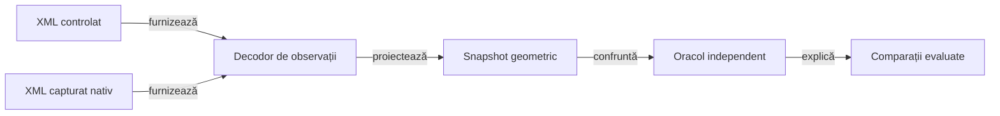

# Display verificat prin componente

## Responsabilitate

Colecția offline verifică politicile de dimensionare, decodarea observației Android și oracolele geometrice sau raster. Intrările simulate sunt explicite; acceptanța versiunii instalate păstrează o verificare nativă restrânsă.

## Arhitectură



<details>
<summary>Legendă: aceeași cale de verificare pentru date simulate și capturate</summary>

Fixture-ul descrie regiuni măsurate, fără să apeleze algoritmul de layout al aplicației. Decodorul consumă un singur XML; E2E deține capturarea, iar componenta deține interpretarea acelei observații.

</details>

## Ce se mută în componente

[Nucleul UI comun](../../whist-lab-app/atf-card-table-ui/README.md) are teste JVM proprii pentru meniu, editarea numelui, geometrie și frontiera de dependențe. Aplicația păstrează testele adaptoarelor și ale mesei, iar mutarea implementării nu schimbă oracolele existente; widgeturile și pixelii Android au acceptanță separată.

| Nivel | Intrare controlată | Proprietate verificată | Proprietar |
|---|---|---|---|
| Politici ale aplicației | Lățime, înălțime, densitate, font, număr de jucători și cărți | Distribuirea regiunilor, dimensiuni minime, spațiu disponibil, rotunjire și insets calculate | `app.table`, `app.hand`, `app.window` |
| Nume și acțiune | Înălțimi de text măsurate sau simulate, conținutul chenarului și locul egalizat | Acțiune completă deasupra numelui, spațiu rezervat între ture, chenar mărit fără scalare repetată | `app.seat` |
| Istoric | Fereastră utilă, număr de locuri, densitate și font | Lățime distribuită integral, minime lizibile, antete aliniate, buget vertical pentru legendă și diagonale roșii limitate la licitațiile ratate | `app.score` |
| Colectarea levatei | Centre, actor, istoric public, ceas, viewport și evenimente controlate ale scenei | Levata completă, convergență, suspendare/reluare și curățare unică; refacerea grupează redimensionările, așteaptă închiderea dialogurilor și respinge callback-urile scenei vechi, fără mutații ale partidei | `app.animation`, `app.lifecycle`, `app.navigation`, `app.presentation` |
| Decodare | XML și profil de afișaj | Asociere semantică, fețe de carte, cadre, titlu, atu și fereastră de conținut | [TableViewportObservation](../../atf-test-android/src/test/java/atf/android/e2e/display/support/TableViewportObservation.java) |
| Oracol geometric | Snapshot cu defecte injectate | Număr, completitudine, centrare, încadrare și absența suprapunerilor | [TableViewportAudit](../../atf-test-android/src/main/java/atf/android/whist/evidence/TableViewportAudit.java) |
| Oracol raster | Imagine sintetică și coordonate logice | Schimbare de scară, culoare dominantă, contrast și toleranțe | [Componente display](../../atf-test-android/src/test/java/atf/android/e2e/display/component/) |

## Contractul mock-ului

- [Ierarhia sintetică](../../atf-test-android/src/test/java/atf/android/e2e/display/component/SyntheticTableHierarchy.java) păstrează o bază validă și modifică explicit regiunea care trebuie respinsă.
- [Matricea parametrizată](../../atf-test-android/src/test/java/atf/android/e2e/display/component/TableViewportObservationComponentTest.java) combină profile și înălțimi măsurate pentru scale de text diferite; nu randează fonturi Android.
- Transportul simulat aruncă eroare la orice comandă sau captură. Un apel accidental la dispozitiv eșuează în componentă.
- Execuția JVM folosește dependențele Java reale înaintea stub-urilor SDK atunci când numele claselor coincid. Proveniența classpath-ului se păstrează; un eșec al infrastructurii nu substituie verdictul produsului.
- Prezența unui nod nu dovedește vizibilitatea lui; regiunile fără suprafață și elementele din afara ferestrei sunt respinse.
- Fereastra folosește `android:id/content` când este disponibil; capturile fără această regiune au fallback explicit la profilul declarat.
- Decodarea completă a fixture-urilor folosește semnalele EN, iar verificarea acțiunii are contracte explicite RO/EN. Schimbarea limbii nu permite prescurtarea etichetei sau pierderea asocierii cu jucătorul activ.
- [PlayerSeatMetrics](../../whist-lab-app/app/src/main/java/ro/whistlab/app/seat/PlayerSeatMetrics.java) primește înălțimea completă a acțiunii; Android o măsoară cu textul real, iar componenta injectează extinderi pentru text mărit și mai multe rânduri. Modelul nu limitează numărul rândurilor și nu deduce lizibilitatea din prezența textului în XML.
- Verificarea acțiunii din [decodor](../../atf-test-android/src/test/java/atf/android/e2e/display/support/TableViewportObservation.java) este comună observațiilor simulate și checkpoint-urilor E2E de joc și licitare. Controalele negative elimină acțiunea, îi schimbă textul sau o mută peste nume; pauza are explicit zero acțiuni active.
- Distanța până la jucător se măsoară față de reuniunea chenarului și a acțiunii lui. Un spațiu liber până la chenar nu permite unui control să acopere eticheta aflată deasupra.
- Dimensiunile declarate ale atuului și fețelor jucate au comparații în pixeli și toleranță de rotunjire. O față mai înaltă decât cea cerută nu trece doar pentru că depășește un prag minim.
- [ScoreHistoryMeasure](../../whist-lab-app/app/src/main/java/ro/whistlab/app/score/ScoreHistoryMeasure.java) primește separat măsurătorile fontului numeric și ale antetului. Componentele verifică întregul tabel, inclusiv ultima celulă, semnele, valori necunoscute, nume lungi și text mărit; Android furnizează implementarea măsurării glifurilor.
- [HistoryViewportComponentTest](../../whist-lab-app/app/src/test/java/ro/whistlab/app/score/layout/HistoryViewportComponentTest.java) verifică bugetul vertical, revenirea la o fereastră mai mare, densitățile fracționare și măsurile invalide. Politica nu substituie randarea fontului Android.
- [HistoryLegendAuditComponentTest](../../atf-test-android/src/test/java/atf/android/e2e/records/legend/HistoryLegendAuditComponentTest.java) reproduce proprietatea greșită din containerul orizontal, regiuni goale ori intersectate și dovezi lipsă. Textul complet din XML nu este suficient pentru PASS.
- [LegendProfilesComponentTest](../../atf-test-android/src/test/java/atf/android/e2e/records/legend/LegendProfilesComponentTest.java) califică offline planul implicit, selecția focalizată, identitățile canonice și refuzul configurațiilor invalide. E2E consumă cazurile tipizate și execută numai proba nativă selectată.
- [RecordsRunContractComponentTest](../../atf-test-android/src/test/java/atf/android/e2e/records/RecordsRunContractComponentTest.java) verifică selectarea textului vizibil cu o singură observație, recitirea după dezvăluire și identitatea erorii. Dispatch-ul păstrează citirea proaspătă a driverului și un singur tap; recitirile redundante nu sunt folosite ca mecanism de sincronizare.
- Istoricul măsoară licitația și punctajul total al fiecărui rând; diferența de puncte a mâinii rămâne în registru și în citirea asistată. Componentele confruntă soldurile tuturor locurilor, inclusiv zero, totaluri negative și limita prefixului vechi; marcajele seriilor se compară cu un oracol aritmetic independent după reîncărcare, iar randarea nativă a dreptunghiului rămâne distinctă de proiecție.
- Familia `score.award` păstrează dreptunghiul exclusiv în celula `P`; numărul, fontul și conturul participă la măsurare. Componentele acoperă bonusurile și penalizările configurate, plata pe ultima mână eligibilă, seriile dezactivate, schimbarea sensului seriei și istoricul complet după reluare, la 3–6 locuri.
- Familia de test `score.raster` randează proiecția și geometria reale cu fonturi JVM, fără dispozitiv. Oracolul compară pixelii cu o imagine identică fără contururi: licitațiile, antetele și vecinii trebuie să rămână identici, iar fiecare marcaj trebuie să aibă patru laturi și culoarea ajustării de serie.
- Recuperarea raster scrie și citește checkpoint-uri JSON prin codec-ul aplicației, apoi compară integral pixelii PNG decodați înainte și după restaurare. La 3–6 locuri, RO/EN și text mărit, verifică păstrarea marcajelor istorice în licitare, joc, închiderea mâinii și finalul partidei. Ultimul rând și ultima plată eligibilă se verifică separat când mâna finală are o singură carte; salvarea de fișier nu califică portul Android `SharedPreferences`.
- Grosimea separatoarelor are ținta de 2,1 dp, cu 30% sub 3 dp; conversia în pixeli întregi poate modifica procentul observat pe un profil. Componentele verifică grosimea rasterului pentru fiecare densitate, separat de lizibilitatea și randarea Android.
- Coloanele de zero pixeli, depășirile numerice și măsurătorile negative sunt refuzate înaintea construirii vederii. Un eșec al furnizorului de font păstrează cauza inițială și nu devine o măsurătoare de zero.

- [TrumpIndicatorComponentTest](../../whist-lab-app/app/src/test/java/ro/whistlab/app/table/TrumpIndicatorComponentTest.java) verifică aceeași proiecție a atuului în toate modurile și limbile, lipsa rândului redundant, două regiuni de font complete și separarea conturului butonului de ținta tactilă. Măsurătorile injectate nu înlocuiesc randarea fontului Android.
- [CardFaceMetrics](../../whist-lab-app/app/src/main/java/ro/whistlab/app/cards/CardFaceMetrics.java) deține proporția 5:7: 63×88 dp în mână, respectiv 46×64 sau 50×70 dp pe masă. Componentele verifică reducerea înălțimii cu 10%, rotunjirea, ridicarea și dimensiunile identice la 1–13 cărți și 3–6 locuri.
- [Ordinea locurilor](../../whist-lab-app/app/src/test/java/ro/whistlab/app/table/TableSeatOrderComponentTest.java) confruntă numele și cărțile cu aceeași parcurgere circulară; un test folosește licitația și prima levată efectivă din motor, pentru fiecare variantă și număr de jucători. La patru locuri, arcul adversarilor eliberează lățimea completă a levatei.
- [Guvernanța API-urilor Java](../../atf-tests/src/test/java/atf/tests/governance/source/android/AndroidJavaApiGovernanceTest.java) respinge terminalul `Stream.toList()` în sursele Android; permite colectorii compatibili și ignoră comentariile și textele. JDK-ul testelor nu dovedește disponibilitatea metodei pe dispozitiv.
- Oracolul păstrează așteptări independente: înălțimea fiecărei cărți și lățimea ultimei fețe neacoperite au toleranță de un pixel. Pentru cărțile suprapuse, XML-ul Android descrie banda expusă, care trebuie să fie pozitivă și cel mult cât fața standard; nu dovedește lățimea ascunsă sub vecin. Componentele verifică separat lățimea completă a tuturor fețelor. Probele negative acoperă fața finală subțiată, banda nulă ori prea lată și fețele jucate deformate.
- Măsurarea indicilor adaugă padding-ul direct în pixeli, fără traseul pixeli–dp–pixeli. Cazul cu densitate 2,25 și 13 cărți verifică ambele margini ale evantaiului, inclusiv rotunjirea benzii măsurate.

## Colecții și comenzi

Pentru o modificare limitată la istoric, selecția JVM se poate restrânge la `:app:testDebugUnitTest --tests 'ro.whistlab.app.score.ScoreHistory*Test' --tests 'ro.whistlab.app.score.layout.*'`. Colecția display extinsă califică ulterior compoziția comună; testele de antrenare și emulatorul nu sunt precondiții pentru politica de măsurare.

| Colecție | Precondiții | Rezultat |
|---|---|---|
| `AndroidDisplayComponentSuite` | Java 21, Maven și dependențe deja disponibile | JUnit XML și Extent cu auditul invocărilor selectate. Fără ADB sau SDK Android; include planul nativ. |
| `whist.displayComponents=true` | Java, Gradle și SDK Android pentru compilare | Componentele JVM ale aplicației; fără instalare sau emulator. |
| `:app:historyRasterTest` | JDK complet, Gradle și clasele aplicației compilate cu SDK | Proiecția totalurilor și imaginile de componentă, fără biblioteci grafice în compilarea Android. |

Selecția aplicației include modelul colectării levatei, coada refacerii din `presentation` și fereastra temporală `CompletedTrick*`, alături de geometria statică. Navigarea și configurarea au componente proprii în selecția locală completă; modelele nu califică animatorul Android ori pixelii randării.

Portul scenei permite livrarea explicită a evenimentelor de layout, cadrelor și finalizării, inclusiv după anulare sau în timpul înregistrării. Compoziția folosește navigarea și motorul reale; un timp suspendat nu este latență a animatorului, iar un subproces sau un somn real nu înlocuiește ordinea controlată a evenimentelor.

- **Refacere:** coada citește ultima geometrie după eliberarea scenei anterioare; componentele variază lățimea și înălțimea pentru fiecare câștigător la 3–6 locuri.
- **Ordine:** bugetul se păstrează inclusiv înaintea scorului, iar evenimentele vechi se livrează după înlocuire; numai ultima închidere validă a dialogurilor permite reluarea în prim-plan.
- **Limită:** probele păstrează politica portret și nu califică tranziția sau fluiditatea nativă.

Din rădăcina proiectului:

```powershell
pwsh -NoProfile -File .\scripts\run-whist-responsive-sanity.ps1 -ComponentsOnly
```

Lansatorul pregătește o copie temporară și un repository Maven privat. `-MavenRepository` indică sursa cache-ului; JAR-urile ATF sunt instalate și confruntate în copia execuției, fără înlocuirea celor citite de alt proces.

Regresia concurentă păstrează un JAR deschis pentru citire în cache-ul sursă și cere bootstrap reușit în copia privată, cu sursa intactă. Hash-urile bibliotecilor rezolvate trebuie să coincidă cu cele din copia surselor; un eșec de bootstrap rămâne distinct de verdictul interfeței.

Dintr-o copie temporară a aplicației, cu dependențele pregătite:

```powershell
.\gradlew.bat :app:testDebugUnitTest -Pwhist.displayComponents=true --offline --no-daemon
```

Pentru imaginile de componentă ale istoricului, proprietatea opțională indică un director extern; testele funcționează și fără export, în directoare temporare proprii:

```powershell
$historyRasterOutput = Join-Path ([IO.Path]::GetTempPath()) 'whist-history-raster'
.\gradlew.bat :app:historyRasterTest "-Pwhist.historyRasterOutput=$historyRasterOutput" --offline --no-daemon
```

PNG-ul exportat este o randare controlată de componentă, nu o captură Android. Etichetele și valorile provin din proiecția aplicației, iar fonturile și adaptorul grafic aparțin JVM-ului de test.

Sursele din `src/rasterTest/java` folosesc JDK-ul complet printr-o sarcină de compilare separată; compilarea unităților Android păstrează suprafața SDK. `historyRasterTest` consumă aceleași clase ale aplicației și fixture-uri legale deja compilate; verificarea `check` include ambele colecții.

## Raportarea componentelor istoricului

[AndroidHistoryComponentSuite](../../atf-test-android/src/test/java/atf/android/suites/AndroidHistoryComponentSuite.java) selectează oracolele legendei și planul profilelor. Intrările reale ale componentei și comparațiile evaluate sunt capturate în timpul invocării; publicarea ulterioară nu reexecută testele și nu reconstruiește valori din JUnit XML.

| Responsabil | Contract |
|---|---|
| Test Kit | `ComponentAuditExtension` păstrează fazele, durata și cauza originală; `TEST_BODY` cere o aserțiune auditată. |
| Testul | Folosește `AuditedAssertions` și declară inputurile prin `ComponentInputs`; fixture-ul nu este prezentat ca o captură Android. |
| Adaptorul Android | [Compoziția](../../atf-test-android/src/main/java/atf/android/evidence/component/AndroidComponentReports.java) capturează setările o singură dată; [ownerul](../../atf-test-android/src/main/java/atf/android/evidence/component/AndroidComponentRun.java) publică inputurile integrale și comparațiile în HTML. |
| Reporting | API-ul binar `AssertionAuditReport.publishStep` furnizează grupul standard pliabil; Extent și fallback au aceleași comparații capturate. |

Dintr-o copie TMP, cu repository-ul Maven propriu deja pregătit:

```powershell
mvn -B -o -pl atf-test-android -am -Phistory-components '-Dtest=AndroidHistoryComponentSuite' '-Dsurefire.failIfNoSpecifiedTests=false' test
```

- **Individual:** selectorul `HistoryLegendAuditComponentTest` produce raportul clasei; suita folosește `atf.test.run.scope=suite` și un singur owner.
- **Output:** implicit `%TEMP%/whist-component-reports`; `atf.android.component.report-directory` acceptă o cale absolută. Numele unic păstrează invocările distincte, fără suprascrierea unui raport deschis.
- **Renderer:** `atf.android.component.renderer=extent` este implicit; `fallback` permite verificarea aceluiași contract fără Extent.
- **Context:** XML-urile și selecțiile de profil sunt corpuri text integrale, pliabile; copiile externe nu sunt necesare acestei selecții. Preview-ul aserțiunilor folosește setarea Reporting capturată, după redactare.
- **Valori lungi:** expected și actual care depășesc preview-ul sunt publicate integral în observații, după redactare, fără reevaluarea comparației. Identitatea unică JUnit permite confruntarea fiecărei invocări parametrizate sau imbricate cu rezultatul XML.
- **Bugetul corpurilor:** părțile numerotate păstrează textul integral chiar peste plafonul de afișare; concatenarea și ultimul caracter au controale de componentă, separat de preview-ul aserțiunilor.
- **Timp:** fazele păstrează durata măsurată de Kit; începutul sesiunii HTML identifică publicarea ulterioară, fără inventarea unui timp Android.

### Familii care folosesc același audit

| Suită | Responsabilitate |
|---|---|
| `AndroidDisplayComponentSuite` | Geometrie, ierarhie, planuri de ecran, driver și fixture-uri ale istoricului. |
| `AndroidComponentSuite` | Intrare primară pentru toate componentele Maven ale adaptorului, inclusiv selecțiile focalizate de mai jos. |
| `AndroidUiFlowTimingComponentSuite` | Trace, publicare, republicare read-only și separarea timpului execuției de publicare. |
| `GameReportComponentSuite` | Contractele consumatorului pentru corpuri, politici și predarea rapoartelor. |

Clasele folosesc aserțiunile auditate, iar [lansatorul agregării](../reporting/ATF_Audit.md#agregarea-componentelor-pe-sursa-live) completează adaptorul numai când nu există unul explicit. Suitele display, istoric și timing sunt selecții focalizate; nu se adună peste populația intrării primare.

Selecțiile Gradle ale aplicației, motorului și bibliotecii grafice folosesc [puntea de audit Gradle](ATF_GradleComponents.md) și nu sunt incluse implicit în agregatul Maven. Fiecare task publică propriul HTML canonic și confruntă invocările cu JUnit-ul temporar; prezența raportului altei selecții nu îi califică auditul.

- **Contract:** [probele adaptorului](../../atf-test-android/src/test/java/atf/android/component/AndroidComponentReportContractTest.java) și [probele punții Gradle](../../whist-lab-app/test-audit/src/test/java/atf/gradle/audit/GradleAuditBridgeComponentTest.java) verifică sesiunea comună, eșecul original, abort-ul, lipsa aserțiunilor și textul mai lung decât plafoanele. [Criteriul complet](../feedback/ATF_Reporting.md#rpt-android-component-html--comparații-capturate-nu-doar-junit-xml) separă calificarea producătorilor de migrarea execuțiilor istorice.

- **Lansator:** `-ComponentsOnly -ComponentSuite History` și `-ComponentRenderer fallback` restrâng selecția; `Display` este implicit. Raportul apare în `component-reports` al rulării externe, iar `WORKING_STATE.json` identifică exemplarul și domeniul.
- **Compilare:** profilele Maven selectează testele la execuție; profilul larg nu omite sursele de istoric din compilare.

## Ce păstrează verificarea nativă

[Componentele grafice native](../../whist-lab-app/app/src/androidTest/README.md) verifică desenul claselor Android într-un părinte real, fără activitate ori partidă. Sunt distincte de rasterul JVM și de fluxurile E2E; derularea internă a textului se aplică înaintea evaluării pixelilor marcajelor.

| Proprietate | Verificare rămasă pe Android |
|---|---|
| Font și glyph | Măsurare reală, fallback, text mărit, trunchiere și lizibilitatea capturii. |
| Fereastră | Consumul efectiv al insets, tastatură, decupaj și navigarea sistemului pe API-ul țintă. |
| Interacțiune | Tap acceptat, focus, hit testing, animație și tranziția observată. |
| Compoziție | Aceeași stare conține toate regiunile necesare în rasterul real. |

O modificare de formulă rulează întâi componentele; o schimbare de randare sau de integrare cu sistemul adaugă [sanity-ul nativ selectat](ATF_Display.md). Rezultatele sunt externe și identifică sursele verificate.

## Frontiera componentelor UI reutilizabile

[atf-card-table-ui](../../whist-lab-app/atf-card-table-ui/README.md) are propriile componente pentru geometrie, meniu, editare și modelele vizibile ale mesei. Gardele de sursă refuză importurile de motoare sau sesiuni în producția și testele comune.

| Comun | Integrare Whist, păstrată în aplicația Whist |
|---|---|
| Proporții, centrare, regiuni și chenare | Ordinea actorilor motorului și legalitatea cărții. |
| Fapte ordonate și imuabile, însemne și identități | Licitație, atu, levate, punctaj și restaurare. |
| Widgeturi și porturi de selecție | Snapshot → proiecție, comanda originală și lifecycle. |

Aceleași teste Whist rulează înainte/după extragere cu surse și identități păstrate. Regulile și proiecțiile aparțin adaptorului fiecărui joc; clasele de licitație sau punctaj Whist nu se mută în suita comună doar pentru a reutiliza desenul.
