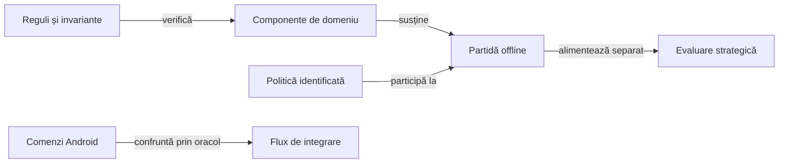

# Arhitectura verificării jocului

## Pe scurt

Verificarea separă corectitudinea regulilor, calitatea politicii și integrarea prin interfață. Fiecare nivel are intrări controlate și un contract propriu pentru rezultatul așteptat.

## Mecanisme și responsabilități

Legendă: proprietăți diferite

Componentele verifică regula locală, simularea verifică tranzițiile unei partide, iar evaluarea compară politici. Fluxul Android verifică integrarea dintre acțiune și stare; rezultatul unui nivel nu înlocuiește contractul altuia.

| Mecanism | Intrare | Responsabilitate |
|---|---|---|
| Componentă | Situație legală mică sau generată | Reguli, scor, prioritate și frontieră. |
| Model complet | Configurație, distribuție și politici | Tranziții, ordine, închiderea mâinilor și scor cumulativ. |
| Comparație de politici | Aceleași distribuții și locuri | Efectul strategiei în domeniul și bugetul declarat. |
| Replay | Trace extern identificat | Compatibilitatea și asocierea acțiunilor cu starea. |
| Android | Aplicație instalată și scenariu explicit | Semantica interacțiunii, geometrie, accesibilitate și reluare. |

Nivelurile unitar, componentă, integrare și E2E sunt definite în [arhitectura testării](ATF_Architecture.md). Modelul complet, evaluarea statistică și reluarea unui jurnal sunt mecanisme distincte; ele nu formează niveluri suplimentare.

## Contractul unei partide complete

1. Configurația identifică varianta, numărul de locuri, politica fiecărui actor și regulile de serie.
2. Programul mâinilor este derivat din regulile variantei.
3. Fiecare distribuție, licitație și carte este verificată în ordine.
4. Câștigătorul levatei determină actorul următor.
5. Închiderea mâinii aplică punctele și seria o singură dată.
6. Registrul păstrează contractul, punctele și totalul fiecărui loc.
7. Finalul partidei corespunde consumării programului, fără mâini omise.

## Independența oracolului

Motorul aplică regulile, iar oracolul calculează așteptarea printr-o implementare separată. Identitatea cărților, legalitatea, câștigătorul și scorul nu sunt validate prin simpla recitire a verdictului motorului.

Pentru politici, observația este proiectată înaintea apelului și exclude mâinile adverse reale. Pentru interfață, succesul dispatch-ului este confruntat cu tranziția semantică observată după acțiune.

[Proiectarea componentelor](ATF_AiComponents.md) · [Colecții](ATF_Collections.md) · [Android](ATF_Android.md) · [Reguli](../game/README.md)
