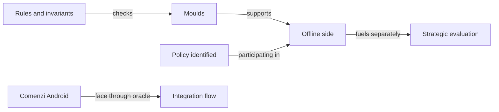

# The architecture of the game verification

## Overview

The verification separates the correctness of the rules, the quality of policy and integration through the interface. Each level has controlled inputs and a contract of its own for the expected result.

## Mechanisms and responsibilities

Legend: Different properties

Components check local rule, simulation checks the transitions of a party, and evaluation compares policies. The Android flow checks integration between action and status; the result of one level does not replace the contract of another.

| Mechanism | Intrare | Responsibility |
|---|---|---|
| Component | Small or generated legal situation | Rules, score, priority and border. |
| Model complet | Configuration, distribution and policies | Transitions, orders, closing hands and cumulative score. |
| Comparison of policies | Same distributions and places | The effect of the strategy in the area and budget declared. |
| Replay | External Trace Identified | Compatibility and association of actions with status. |
| Android | Installed application and explicit scenario | The semantics of interaction, geometry, accessibility and resumption. |

Unit, component, integration and E2E levels are defined in [the architecture of testing](ATF_Architecture.md). The complete model, statistical evaluation and resumption of a journal are distinct mechanisms; they do not form additional levels.

## A full-party contract

1. The configuration identifies the variant, the number of seats, the policy of each actor and the serial rules.
2. The hand program is derived from the rules of the variant.
3. Each distribution, bid and card is checked in order.
4. The winner of the trick determines the next actor.
5. The closing of the hand applies the points and series only once.
6. The register shall keep the contract, the points and the total of each place.
7. The end of the game corresponds to the consumption of the program, without the missed hands.

## Independence of the Oracle

The engine applies the rules and the oracle calculates the expectation of separate implementation. The identity of the cards, the legality, the winner and the score are not validated by simply revising the engine verdict.

For policies, the observation is designed before the call and excludes real side-hands. For the interface, the success of the display is confronted with the semantic transition observed after action.

[Design of components](ATF_AiComponents.md) · [Collections](ATF_Collections.md) · [Android](ATF_Android.md) · [Rules](../game/README.md)
