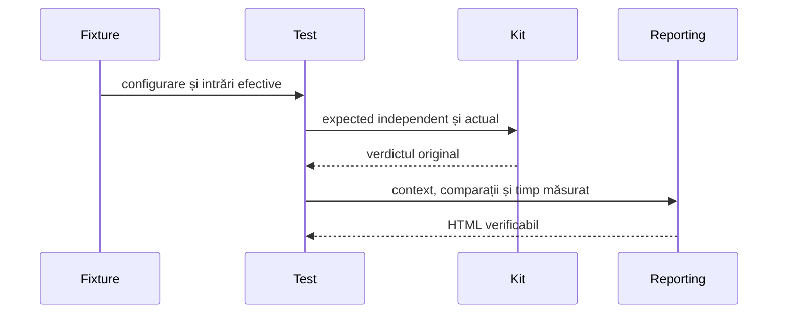

# Componentele Gradle și auditul lor

## Pe scurt

Componentele aplicației, motorului, jucătorului independent, bibliotecii grafice și rasterelor folosesc aceeași [punte JUnit](../../whist-lab-app/test-audit/README.md). Oracolul rămâne în test; Kitul capturează comparația când este evaluată, iar Reporting construiește HTML-ul canonic. [Strategia comună](README.md) stabilește selecția după risc.

## Responsabilități și niveluri

| Zonă | Nivel și proprietate |
|---|---|
| Aplicație | Componente ale comenzilor, salvării, licitației, localizării și prezentării; fără activitate Android reală. |
| Motor | Unități și componente de reguli, scor și decizie; colecțiile de învățare se activează separat. |
| Jucător independent | `:ai-lab:test` verifică observații publice, decizii legale, bugete și izolarea classpath-ului de producție. |
| Referințe experimentale | Suprapunerile de surse se păstrează separat de colecțiile Gradle curente. |
| Interfață comună | Prezentare neutră și frontiere; regulile jocului rămân în consumator. Testele JVM se califică separat de colecțiile aplicației. |
| Raster | Componente JVM cu imagini sintetice și oracole independente ale pixelilor. |
| Puntea auditului | Componente controlate pentru lifecycle, captură, refuz, parametrizare și publicare. |

[Catalogul pachetelor](../../config/gradle-app-collections.properties) atribuie fiecare clasă unei singure colecții; guvernanța refuză omisiunile și pachetele fără owner.

| Colecție primară | Task și responsabilitate |
|---|---|
| Comenzi | `testDebugCommandsComponents`: lifecycle, animație, navigare și persistență. |
| Licitare | `testDebugBiddingComponents`: recomandare, alegere și reluare. |
| Istoric | `testDebugHistoryComponents`: scor, serii, tabel și geometrie. |
| Afișare | `testDebugDisplayComponents`: modele de prezentare, masă, cărți și localizare. |
| Realizări | `testDebugAchievementsComponents`: catalog, fapte de joc, progres durabil și notificări confirmate de utilizator. |
| Interfață comună | `:atf-card-table-ui:testDebugUnitTest`: geometria mâinii și stabilitatea cadrului etichetelor de acțiune. |

Intrarea `testDebugUnitTest` deleagă colecțiilor, fără a repeta populația. Modulul comun `atf-card-table-ui` are un task separat și un HTML canonic distinct; nu se amestecă în colecțiile aplicației. Acestea păstrează cazurile și comparațiile și limitează memoria publicării prin responsabilități independente; compilarea și semnarea APK-ului Release se califică separat.

[Catalogul](../../config/gradle-audit-collections.properties) atribuie o singură categorie fiecărei clase. Categoria nu schimbă oracolul și nu include automat clasa în selecția release-ului. O colecție focalizată rămâne submulțime declarată; rularea ei și a colecției mari nu creează două populații unice.

## Captura contextului

Legendă: captura nu repetă operația

Argumentele constructorului sau ale salvării sunt proiectate înaintea apelului, fără reevaluare. Contextul local al aserțiunii poate conține și rezultate calculate; el nu este prezentat drept stare inițială. Oracolul și ordinea operanzilor rămân cele ale testului.

- `GradleInputs.created` capturează configurația înaintea construirii sesiunii, observația înaintea deciziei sau datele înaintea salvării și întoarce aceeași valoare.
- `GradleInputs.fixture` capturează valorile locale relevante înaintea comparației; câmpurile fixture-ului păstrează și parametrii constructorului JUnit.
- Proiecția citește explicit înregistrări, colecții și snapshot-ul public al sesiunii. Un helper fără proiecție declarată rămâne identificat ca atare; nu se inventează starea lui internă.
- Aserțiunile păstrează expected, actual, verdictul și invariantul. Valorile mai lungi decât preview-ul apar integral în corpuri ordonate.
- Rasterul se declară explicit drept imagine de componentă JVM și rămâne PNG inline. Nu dovedește randarea nativă Android.

## Proprietatea publicării

O invocare JUnit păstrează identitatea parametrizării și verdictul original. Statement-ul măsurat include fixture-urile before/after ale JUnit 4; publicarea este în afara acestui interval. Sesiunea Reporting se creează, folosește și închide pe același fir de publicare; testele nu se mută pe acel fir.

Profilul publicării provine din contextul și comparațiile capturate înaintea randării. El este încorporat ca metadată de control și se confruntă cu proprietarii, fazele și rândurile HTML. Absența HTTP este explicită; o componentă logică nu primește transport sau acțiuni fictive pentru a satisface un validator implicit.

## Acceptanță și retenție

Matricile exhaustive compară fiecare pereche prin oracolul domeniului. [Verificatorul matricilor](../../whist-lab-app/test-audit/src/testFixtures/java/atf/gradle/audit/matrix/ExhaustiveMatrixChecks.java) oprește prima nepotrivire cu poziție, expected și actual; la succes publică numărul perechilor evaluate pe invariant și absența nepotrivirilor. Istoricul și geometria păstrează grilele complete de intrări, fără milioane de rânduri PASS individuale ori numărarea lor ca invocări JUnit.

| Control | Refuz obligatoriu |
|---|---|
| Invocare | Lipsă de fixture, comparații necapturate sau clasificare absentă. |
| Parametrizare | Identitate lipsă, suplimentară ori duplicată și verdict diferit de JUnit. |
| Publicare | Rând eliminat, intenție modificată, receipt orfan sau date interpretate drept markup. |
| Livrare | Grup XML păstrat ca raportare paralelă pentru aceeași selecție auditată. |

XML-ul Gradle este oracol temporar de identitate și rezultat. După confruntarea lui cu HTML-ul și revizia detașată, livrarea păstrează HTML-ul selecției, fără copia XML a componentelor.

Schema de calificare cu grupuri auditate renumără invocările în HTML, iar metadatele distribuției păstrează hash-urile și limitele. Dovezile istorice unice nu se șterg înainte de migrarea lor reală.

## Rulare și limite

[Configurarea comună](../../whist-lab-app/gradle/component-audit.gradle) se aplică atât reactorului Android, cât și [intrării exclusiv JVM](../../whist-lab-app/algorithm-build/README.md). `whist.auditOutput` identifică directorul execuției, iar `whist.auditSource` fixează amprenta sursei. Fiecare task are un singur worker și un HTML propriu; paralelismul suplimentar cere calificare distinctă.

- Lansatorul agregat pornește taskurile Gradle necesare o singură dată, cu un worker de test pentru fiecare task.
- Verificarea JUnit–Extent lasă un marker temporar per task numai după confruntarea identităților și verdictelor.
- Un task independent poate publica dovada sa și când alt task eșuează. Rezultatul agregat păstrează eșecul și durata lansării.

Compilarea, auditul structural și revizia interactivă sunt controale diferite. Numai cazurile executate primesc rezultat; clasificarea unei colecții de învățare nu dovedește rularea ei. Acceptanța unui APK se leagă de binarul identificat, conform [calificării livrării](ATF_ReleaseQualification.md).
