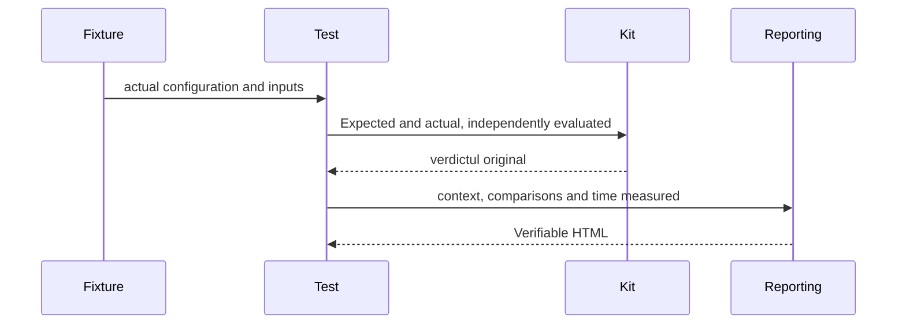

# Gradle components and their audit

## Overview

The application, game engine, independent player, graphics library and raster tests use the same [JUnit bridge](../../whist-lab-app/test-audit/README.md). The Oracle remains in the test; the kit captures the comparison when evaluated, and Reporting builds the canonical HTML. Use the [test strategy](README.md) to select suites based on risk.

## Liabilities and levels

| Area | Level and property |
|---|---|
| Application | Components of orders, rescue, bid, location and presentation; no real Android activity. |
| Engine | Units and components of rules, score and decision; learning collections shall be activated separately. |
| Independent Player | `:ai-lab:test` checks public observations, legal decisions, budgets and the isolation of the production classification. |
| Experimental references | Source overlays shall be kept separate from current Gradle collections. |
| Common interface | Neutral presentation and borders; the rules of the game remain in the consumer. JVM tests qualify separately from the application collections. |
| Raster | JVM components with synthetic images and independent pixel oracles. |
| Audit deck | Controlled components for lifecycle, capture, refusal, parametrization and publication. |

[Package catalogue](../../config/gradle-app-collections.properties) assigns each class to a single collection; governance refuses omissions and packages without owner.

| Primary collection | Task and Liability |
|---|---|
| Comenzi | `testDebugCommandsComponents`: lifecycle, animation, navigation and persistence. |
| Licitare | `testDebugBiddingComponents`: recommendation, choice and resumption. |
| Istoric | `testDebugHistoryComponents`: score, series, table and geometry. |
| Display | `testDebugDisplayComponents`: presentation, table, cards and location models. |
| Achievements | `testDebugAchievementsComponents`: catalog, game facts, sustainable progress and user confirmed notifications. |
| Common interface | `:atf-card-table-ui:testDebugUnitTest`: hand geometry and stability of action label frame. |

The `testDebugUnitTest` entry delegates to collections without repeating population. The Joint Module `atf-card-table-ui` has a separate task and a distinct canonical HTML; do not mix in the application collections. They shall retain cases and comparisons and limit the memory of publication through independent responsibilities; the compilation and signature of the Release APK shall qualify separately.

[Catalogul](../../config/gradle-audit-collections.properties) assigns one category to each class. Category does not change oracle and does not automatically include class in the selection of the relay. A focused collection remains the subset declared; running it and the large collection do not create two unique populations.

## Context Capture

Legend: catch does not repeat operation

Capture constructor or save arguments before the call without evaluating them twice. List computed values in the assertion context, separate from the initial state. The test owns the oracle and evaluation order.

- `GradleInputs.created` captures the configuration before the session is built, the observation before the decision or data before the rescue and returns the same value.
- `GradleInputs.fixture` captures the relevant local values prior to comparison; the fixture fields also retain the parameters of the JUnit manufacturer.
- The projection explicitly reads the recordings, collections and the public snack of the session. A helper without a declared projection remains identified as such; his internal state is not invented.
- The assertions keep the verdict and the invariant expected, present. Values longer than the preview appear in full order bodies.
- The raster is explicitly declared as a JVM component image and remains PNG inline. Doesn't prove the native android rendering.

## Reporting profile

Each JUnit invocation retains its parameterized identity and original verdict. The measured statement includes JUnit 4 before/after fixtures, with publishing outside that interval. Create, use and close the Reporting session on one publishing thread, while tests remain on their execution thread.

The publication profile comes from the context and comparisons captured prior to the rendering. It is incorporated as metadata control and faces owners, phases and rows of HTML. The absence of HTTP is explicit; a logical component does not receive transport or fictitious actions to satisfy an default validator.

## Acceptance and retention

In the RAG qualification, the verifier writes the receipt of each selection directly next to her report. The atomic publication of the checkpoint closes the selection before the next task force in the same release. [Resume after interruption](ATF_ReleaseQualification.md#resume-validated-steps)

The exhaustive matrix compares each pair through the oracle of the domain. [Verificatorul matricilor](../../whist-lab-app/test-audit/src/testFixtures/java/atf/gradle/audit/matrix/ExhaustiveMatrixChecks.java) stops the first inmatch with position, expected and current; the number of pairs assessed on the invariant and the absence of mismatches at public success. History and geometry keep complete input grids, without millions of individual PASS rows or counting them as JUnit invokes.

| Control | Refuz obligatoriu |
|---|---|
| Invocare | Absence of fixture, unflattened comparisons or missing classification. |
| Parametrizare | Missing, additional or duplicate identity and verdict different from JUnit. |
| Publication | Rand eliminated, modified intent, orphan Recipt or data interpreted as markup. |
| Livrare | XML group kept as parallel reporting for the same audited selection. |

The Gradle XMLis is a temporary identity and result oracle. After confronting HTML and detached revision, the delivery retains the HTML of the selection without copy of XML of the components.

The qualification scheme with audited groups renounces the invocation in HTML, and the distribution metadata keep the hashes and limits. Unique historical evidence does not erase prior to their actual migration.

## Rules, policies and memory

[Romanian Whist oracle](../../whist-lab-app/game-core/src/test/java/ro/whistlab/core/rules/RomanianWhistModelTest.java) checks the deal, bids, legal moves, trick winners, scoring and restoration. The report groups successes by invariant and records the hand, step, expected value and actual value of the first mismatch. Each parameterized invocation has its own report entry.

| Selection | Contract |
|---|---|
| [The simulated game](../../whist-lab-app/game-core/src/test/java/ro/whistlab/core/match/OfflineMockMatchTest.java) | The number of hands, moves and completion are game oracles. Unrecoverable contracts, fallbacks and certificates are policy observations on the selected distribution. |
| [Rescue objective](../../whist-lab-app/game-core/src/test/java/ro/whistlab/core/ai/contract/HardSalvageObjectiveTest.java) | Controlled positions shall verify the order of decision-making objectives. |
| offlinePerspectiveMatchTest and offlineStrategyProfileMatchTest | Compare policies on identical distributions in lots separate from default regression. |

| Proces JVM | Limit of heap and proof |
|---|---|
| Daemon, JVM exclusive input | 256 MiB. |
| Workerul [common decks](../../whist-lab-app/gradle/component-audit.gradle) | 512 MiB per task, with the limit observed in the report. |
| Verificatorul JUnit–Extent | 384 MiB for reconciling the report with the original results. |

Collection: gamecore: regressionTest shares the default inventory between AI, rules, session and score, variants, independent player and rest of components. Each partition publishes its own HTML.

Task keeps the claims after the first failure. The lot executed with --continue also keeps the results of the following taskpoints.

## Execution and limits

[Common configuration](../../whist-lab-app/gradle/component-audit.gradle) apply to both the Android reactor and [JVM exclusive input](../../whist-lab-app/algorithm-build/README.md). `whist.auditOutput` identify the director of the execution, and `whist.auditSource` Each task has one worker and one HTML of its own; additional parallelism requires distinct qualification.

- The aggregate launcher starts the required Gradle taskbooks once, with a test worker for each task.
- The JUnit-Extent check leaves a temporary marker per task only after confronting identities and verdicts.
- An independent task can publish his evidence when another task fails. The aggregate result shall retain the failure and duration of the launch.

Computing, structural audit and interactive review are different controls. Only executed cases receive results; classification of a learning collection does not prove running. Acceptance of an APK is linked to the identified binary, according to the [the qualification of delivery](ATF_ReleaseQualification.md).
