# Calificarea unui release

## Pe scurt

Un singur dosar candidat grupează planul, rezultatele și raportul fiecărei selecții. Pregătirea se face în afara proiectului; dosarul activ se înlocuiește numai după calificarea noului APK, conform [retenției](../platform/ATF_ReleaseRetention.md).

## Ordinea verificărilor

```mermaid
flowchart LR
    DIFF[Diferență și riscuri] -->|fixează| SOURCE[Surse și dependențe]
    SOURCE -->|execută în TMP| JVM[Componente și contracte]
    JVM -->|confruntă datele| HTML[HTML detașat]
    HTML -->|permite| APK[Build și identitate APK]
    APK -->|verifică schimbarea| NATIVE[Sanity Android selectat]
    NATIVE -->|confruntă live și guvernanța| HANDOFF[Dosar calificat]
```



<details>
<summary>Legendă: fiecare etapă păstrează propriul verdict</summary>

Un raport de componentă califică intrările și comparațiile JVM. Sanity-ul califică interacțiunea pe APK-ul identificat; browserul verifică accesul la dovezi. Publicarea GitHub este un pas ulterior al operatorului.

</details>

| Pas | Selecție și rezultat necesar |
|---|---|
| 1. Diferență | Identificați baza, fișierele modificate/adăugate/șterse și contractele afectate. Alegeți versiunea după comportament, apoi fixați inventarul complet al surselor și bibliotecilor copiate. |
| 2. Componente | Executați întâi oracolele schimbate și refuzurile relevante. Istoricul are [suită auditată](ATF_DisplayComponents.md#raportarea-componentelor-istoricului); aplicația Gradle și restul componentelor își păstrează rezultatele native până la migrarea capturii comparațiilor. |
| 3. Publicare | Verificați individual și prin suită, Extent și fallback, cauza originală, abort-ul și corpul fără aserții capturate. FAIL-urile controlate califică publicatorul și sunt delimitate de testele produsului. |
| 4. HTML | Copiați numai HTML-ul final într-un director gol, blocați resursele externe și verificați un owner: input integral, ultimul rând, expandare/colapsare și captura originală când există. |
| 5. APK | Construiți din snapshot în TMP; verificați versiunea, SDK-urile, bytes, SHA-256, CRC, semnătura și alinierea. Debug și Release au identități distincte. |
| 6. Android | Rezervați dispozitivul; rulați scenariul scurt al schimbării și profilul care distinge riscul. Restaurați datele și configurația. O partidă completă nu se repetă pe toate rezoluțiile. |
| 7. Predare | Confruntați sursele live, rapoartele, populația testelor, linkurile și guvernanța relevantă. Arhivați precedentul verificat înaintea înlocuirii dosarului activ și APK-ului. |

## Organizarea dosarului candidat

| Intrare | Conținut canonic |
|---|---|
| `README.md` | Pașii în ordine, selecțiile efective, starea fiecăreia și legăturile către rezultate. |
| `qualification.json` | Inventarul selecțiilor, comenzi, surse, hash-uri și limite; un pas neexecutat rămâne `PENDING`, fără total dedus. |
| `component/` | HTML-ul auditat al suitei și fallback-ul calificat, cu inputuri și comparații capturate în timpul testului. |
| `e2e/` | HTML-ul execuției Android identificată; republicarea istorică își păstrează proveniența. |
| `diagnostics/` | Numai dovezi distincte justificate: rezultat JUnit nemigrat, semnătură, crash ori control al randării. |

Nu copiați PNG/XML/JSON deja incluse integral în HTML după confruntarea octeților și a accesului offline. Păstrați încă dovezile unice necesare și declarați excepția; [predarea compactă](../reporting/ATF_Handoff.md#livrabil-compact-și-excepții) deține criteriul complet.

## Comenzi și limite

Din rădăcina proiectului, lansatorul existent pregătește TMP și un cache Maven privat:

```powershell
.\scripts\run-whist-responsive-sanity.ps1 -ComponentsOnly -ComponentSuite History
.\scripts\run-whist-responsive-sanity.ps1 -ComponentsOnly -ComponentSuite History -ComponentRenderer fallback
.\scripts\run-whist-responsive-sanity.ps1 -ComponentsOnly -ComponentSuite Display
```

- **Istoric:** raportul suitei selectate conține toate comparațiile capturate; `WORKING_STATE.json` păstrează calea HTML-ului și selecția.
- **Display:** HTML-ul acoperă pilotul de istoric, iar celelalte componente păstrează JUnit. Un raport al subsetului nu atribuie auditul comparațiilor întregii selecții.
- **Guvernanță:** folosiți [lansatorul izolat](../governance/README.md#rulare-izolată) și controalele documentelor, frontierelor și livrării afectate. O modificare concurentă invalidează certificarea acelei copii.
- **Promovare:** un rezultat trecut aparține surselor executate. Sursele schimbate ulterior cer evaluarea diferenței și reverificarea relevantă, înaintea build-ului final.

[Strategia comună](README.md) · [Selecțiile de display](ATF_Display.md) · [Procesul livrării](../platform/ATF_AndroidDelivery.md#procesul-unei-versiuni)
