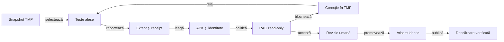

# Calificarea unui release

## Pe scurt

Un singur dosar candidat grupează planul, rezultatele și raportul fiecărei selecții. Pregătirea se face în afara proiectului; dosarul activ se înlocuiește numai după calificarea noului APK, conform [retenției](../platform/ATF_ReleaseRetention.md). [Politica de dovezi pe platforme](../../config/release-platform-rag-policy.json) fixează proveniența și porțile verdictului read-only înaintea promovării.

Ramura oficială a repository-ului este `main`. Codul calificat se împinge pe `main`, iar tagul versiunii se fixează pe commitul-sursă verificat.

## Ordinea verificărilor

```mermaid
flowchart LR
    SOURCE[Snapshot fixat] -->|compară cu ediția publicată| DIFF[Selecție din diff]
    DIFF -->|rulează sau reutilizează în TMP| JVM[Componente și contracte]
    JVM -->|confruntă datele| HTML[HTML detașat]
    HTML -->|permite| APK[Build și identitate APK]
    APK -->|verifică schimbarea| NATIVE[Sanity Android selectat]
    NATIVE -->|confruntă live și guvernanța| HANDOFF[Dosar calificat]
```



<details>
<summary>Legendă: fiecare etapă păstrează propriul verdict</summary>

Un raport de componentă califică intrările și comparațiile JVM. Sanity-ul califică interacțiunea pe APK-ul identificat; browserul verifică accesul la dovezi. Publicarea GitHub este un pas ulterior al operatorului.

</details>

| Pas | Selecție și rezultat necesar |
|---|---|
| 1. Diferență | Fixați în TMP inventarul complet al surselor și bibliotecilor copiate. [Selectorul](#selecția-testelor-din-diff) identifică baza, căile schimbate și probele cerute de fluxurile afectate. |
| 2. Componente | Executați oracolele schimbate și refuzurile relevante. [Componentele Gradle](ATF_GradleComponents.md) și [suita istoricului](ATF_DisplayComponents.md#raportarea-componentelor-istoricului) capturează contextul și comparațiile. Fiecare selecție Gradle are HTML Extent și receipt proprii, publicate prin `atf-reporting`; JUnit-ul temporar se confruntă cu HTML-ul înaintea eliminării copiilor finale. |
| 3. Publicare | Confruntați exact identitățile și rezultatele JUnit–HTML pe fiecare selecție; inspectați fallback-ul numai dacă a fost selectat și calificat. Verificați cauza originală, abort-ul, lipsa capturii și imaginile inline Base64. XML-ul rămâne oracol temporar, nu raport duplicat în dosarul final. FAIL-urile controlate califică publicatorul și sunt delimitate de testele produsului. |
| 4. HTML | Aplicați [revizia interactivă minimă](../reporting/ATF_Audit.md#revizia-interactivă-minimă) pe HTML-ul identificat prin hash; păstrați proprietarii, controalele și limitele probei. |
| 5. APK | Construiți din snapshot în TMP; verificați versiunea, SDK-urile, bytes, SHA-256, CRC, semnătura și alinierea. Debug și Release au identități distincte. |
| 6. Android | Rezervați dispozitivul; rulați scenariul scurt al schimbării și profilul care distinge riscul. Restaurați datele și configurația. O partidă completă nu se repetă pe toate rezoluțiile. |
| 7. Predare | Confruntați sursele live, rapoartele, populația testelor, linkurile și guvernanța relevantă. Arhivați precedentul verificat înaintea înlocuirii dosarului activ și APK-ului. |

## Organizarea dosarului candidat

| Intrare | Conținut canonic |
|---|---|
| `README.md` | Pașii în ordine, selecțiile efective, starea fiecăreia și legăturile către rezultate. |
| `qualification.json` | Inventarul selecțiilor, comenzi, surse, hash-uri și limite; un pas neexecutat rămâne `PENDING`, fără total dedus. |
| `component/` | HTML-ul auditat al suitei și fallback-ul calificat, cu inputuri și comparații capturate în timpul testului. |
| `e2e/` | HTML-ul execuției Android identificată; republicarea istorică își păstrează proveniența. |
| `diagnostics/` | Numai dovezi distincte justificate: rezultat JUnit nemigrat, semnătură, crash ori control al randării. |

Nu copiați PNG/XML/JSON deja incluse integral în HTML după confruntarea octeților și a accesului offline. Păstrați încă dovezile unice necesare și declarați excepția; [predarea compactă](../reporting/ATF_Handoff.md#livrabil-compact-și-excepții) deține criteriul complet.

## Contractul rapoartelor pe suite

Fiecare selecție primară executată deține un raport Extent canonic și un receipt al execuției.

- Căile sunt unice: componenta folosește `reports/component/{group}/component-report.html`; E2E folosește `reports/e2e/{suite}/report.html` și `execution.json` alături.
- Capturile PNG sunt încorporate Base64 în raportul suitei.
- Rapoartele de componentă și E2E au proprietari diferiți și nu se reunesc într-o populație comună.

| Selecție | Receipt-ul minim | Legătura verificată |
|---|---|---|
| Componentă Maven sau Gradle | `execution.json` per grup și receipt-urile comune de sursă | Hash-ul HTML-ului, numărul și rezultatele, proveniența și inventarul sursei corespund manifestului calificat. |
| E2E Android | `execution.json` alături de HTML-ul suitei | APK-ul instalat, versiunea, commitul și amprenta sursei, protocolul, rezultatele, hash-ul Extent și numărul imaginilor PNG inline corespund manifestului și raportului. |

- Manifestul de release hash-ează separat HTML-ul și receipt-ul.
- Evaluatorul blochează căile lipsă, duplicate sau necanonice, receipt-urile absente și nepotrivirile de rezultate, hash sau proveniență.
- Câmpul `executionReceipt` leagă grupul E2E de receipt-ul alăturat raportului.
- JUnit XML rămâne oracol temporar independent; dosarul final nu păstrează un al doilea raport.
- Capturile sunt inline Base64; dosarul de release nu duplică fișiere PNG deja încorporate.

## README-ul dosarului

Prima parte oferă raportul principal și starea calificării. Detaliile rămân schematice, cu o singură sursă pentru fiecare rezultat; README-ul trimite la inventar și la [strategia comună](README.md), fără a copia regulile generale.

| Secțiune | Informație necesară |
|---|---|
| Scop și stare | Proprietatea verificată, baza comparației și starea reală: pregătire, execuție încheiată ori calificare acceptată. |
| Identitate | APK și hash când există, surse/biblioteci și momentul identificării; o amprentă observată ulterior nu este prezentată drept captură inițială. |
| Deschidere | Link direct la HTML-ul canonic și ordinea scurtă de citire: context, invocare, input/acțiune, comparație și captură. |
| Selecții | Selectorul sau comanda și rezultatul fiecărei selecții, cu unitatea numărată, erori și omiteri. |
| Suprapuneri | Relația clasă–suită, parametrizări, checkpoint-uri și aceeași selecție în două renderere; totalurile nu se adună automat. |
| Revizie | Hash-ul HTML-ului, verificarea statică și interactivă efectuată, browserul și proprietarii verificați. |
| Dovezi separate | Pentru fiecare fișier: motiv concret, consumator ori întrebare diagnostică și identitate; JUnit fără comparații capturate își păstrează limita. |
| Limite și pas următor | Cazuri neexecutate, surse schimbate după rulare și criteriul rămas înaintea build-ului sau promovării. |

## Suprafața README-ului public

- **README public:** pagina principală oferă versiunea curentă și descărcarea directă. SHA-256 rămâne în manifest și în dovezi; RAG verifică separat că linkul corespunde binarului.
- **Candidat:** `release/index.json` păstrează edițiile publicate și poate declara `candidateVersion`. README-ul se confruntă cu `release/candidate.json`, în starea `PREPARED`. Folosiți [canalul de test din ramură](../platform/ATF_AndroidDelivery.md#distribuția-prin-github) când se cere acces înainte de calificare.
- **Promovare:** după calificare, mutați manifestul și dovezile în `release/{version}/`, actualizați `currentVersion` și `versions`, apoi eliminați `candidateVersion`. README-ul face parte din amprenta surselor; orice schimbare a linkului după selecții cere reluarea calificării.

- **Stări:** `PENDING` exprimă un pas neexecutat; `SKIP`/abort exprimă rezultatul invocării. Un rezultat `FAIL` sau o eroare de publicare se păstrează, împreună cu impactul asupra calificării.
- **Istoric:** o probă anterioară poate fi reper explicit, cu binarul și scopul ei. Mutarea documentelor sau actualizarea README-ului nu califică un APK nou.
- **Retratare:** la corecția documentelor, păstrați sursa rezultatelor și descrieți selecția reverificată; o compoziție de rezultate trecute nu devine o singură rulare integrală nouă.

## Comenzi și limite

### Verdictul RAG read-only

Evaluatorul RAG consumă dovezile deja produse și emite un verdict read-only.

- Intrări: plan JSON, manifestul candidatului, raportările Extent selectate și rădăcina snapshot-ului sursă.
- Nu construiește, nu rulează teste, nu apelează Git și nu mută ori publică fișiere.
- Scrie numai verdictul JSON, în afara proiectului, candidatului și snapshot-ului.
- Fiecare verificare citează calea, SHA-256 și JSON Pointer/linia sursei.
- Verdictul păstrează planul exact, în Base64 UTF-8, în `qualificationPlan.contentBase64`; hash-ul lui permite revizuirea fără o copie temporară externă.
- Lacunele nerezolvate sunt urmărite în [registrul de feedback](../feedback/README.md#todo-uri-prioritizate).

Planul fixează versiunea, canalul (`LOCAL`, `TEST` sau `PRODUCTION`), riscul, platformele, grupurile componente, schimbarea fluxului utilizatorului și decizia E2E cu motiv.

### Regresiile evaluatorului

Probele Node folosesc același executor cu termen limitat ca verificările Git. Citirea ieșirii începe odată cu procesul, iar diagnosticul copilului se păstrează la eșec. [Probe de componentă](../../atf-tests/src/test/java/atf/tests/governance/documentation/release/rag/scope/ComponentEvidenceScopeComponentTest.java)

Suita de componente rulează evaluatorul pe dosare de test locale. Fiecare clasă deține un contract și folosește același lansator al procesului Node.

| Contract | Test de componentă | Ce verifică |
|---|---|---|
| Proveniență | [ReleaseRagProvenanceComponentTest](../../atf-tests/src/test/java/atf/tests/governance/documentation/release/rag/ReleaseRagProvenanceComponentTest.java) | Snapshot, integritatea payload-ului, citarea planului și reutilizarea dovezilor de componentă. |
| Android | [ReleaseRagAndroidComponentTest](../../atf-tests/src/test/java/atf/tests/governance/documentation/release/rag/ReleaseRagAndroidComponentTest.java) | Semnarea, legarea dovezii E2E de APK și sursă, izolarea datelor și selecția fluxului. |
| GitHub | [ReleaseRagGithubComponentTest](../../atf-tests/src/test/java/atf/tests/governance/documentation/release/rag/ReleaseRagGithubComponentTest.java) | Modul de acces, identitatea descărcării și retenția GitHub pe inventare simulate. |

La mutarea unui caz, confruntați chitanțele din Extent după metodă, indicele invocării parametrizate și rezultat. Verificați că diferența de identitate se explică prin clasa nouă și că numărul comparațiilor auditate corespunde pentru fiecare invocare.

## Ciclul candidatului



<details>
<summary>Legendă: etapele și responsabilitățile candidatului</summary>

Snapshot-ul APK este reperul pentru compararea intrărilor fiecărei suite. RAG verifică receipt-urile, hash-urile și proveniența. Responsabilul candidatului confruntă inventarul complet și motivează selecția în funcție de risc. Verdictul permite revizia umană înainte de promovare și publicare.

</details>

| Grup Android | Dovadă necesară |
| --- | --- |
| `atf-validation`, `atf-test-android`, `atf-tests` | Fiecare suită Maven primară are HTML Extent canonic și rezultate fără FAIL/ERROR/SKIP. |
| `whist-lab-app-commands`, `whist-lab-app-bidding`, `whist-lab-app-history`, `whist-lab-app-display` | Colecțiile Android de bază au fiecare HTML Extent și receipt proprii. Modificările în sursele compilate împreună cer o rulare nouă. |
| `whist-lab-app-achievements` | Colecție introdusă prin `introducedComponentGroupsByPlatform`; `sinceReleaseVersion` o face obligatorie de la pragul declarat. Raportul este separat, iar JUnit XML singur nu satisface poarta. |
| `whist-lab-app-atf-card-table-ui` | Suită JVM distinctă pentru contractele bibliotecii grafice comune; introdusă la `0.20.2`, cu Extent și receipt separat. |
| Fiecare grup selectat | Receipt propriu și intrări identice în perimetrul suitei. `source-provenance.json` păstrează legătura dintre inventarul original, execuție și raport. |

### Snapshot și preflight înainte de Maven

[Lansatorul de componente](../../scripts/run-component-suites.ps1) și [lansatorul de guvernanță](../../scripts/run-atf-governance.ps1) folosesc [aceeași pregătire](../../scripts/AtfQualificationSnapshot.ps1). Maven compilează și verifică fișierele din aceeași copie temporară. Verificarea probelor publicate citește obiecte Git istorice din checkout-ul indicat, prin commit, fără a citi fișierele live din acesta.

[Preflight-ul directorului temporar](../../atf-tests/tools/qualification-temp-root.mjs) rulează înainte de a crea dosarul rulării, de a copia sursele sau de a porni Maven.

- `TMP`, `TEMP` și directorul ales de sistem trebuie să indice directoare externe existente.
- Controlul verifică atât calea declarată, cât și destinația fizică după rezolvarea linkurilor. Un checkout detectat la oricare dintre strămoși, inclusiv un worktree cu fișier `.git`, produce `QUALIFICATION-TEMP-IN-CHECKOUT`.
- O cale inexistentă, relativă ori inaccesibilă produce `QUALIFICATION-TEMP-INVALID`.

| Moment | Control și dovadă |
| --- | --- |
| Fixarea | `source-inputs.json` descrie sursele de build. `release-inputs.json` fixează separat toate fișierele din `release/`, inclusiv catalogul și dosarele păstrate. |
| Înainte de Maven | [Preflight-ul](../../atf-tests/tools/check-release-artifacts.mjs) confruntă numele, octeții și SHA-256 pentru APK-urile din catalog și fișierele lor `.sha256`. `release-preflight.log` păstrează identitățile observate sau cauza refuzului. |
| Închiderea | Inventarul copiei și al checkout-ului se confruntă din nou. Orice fișier adăugat, modificat sau șters invalidează rezultatul, iar receipt-ul indică locul și calea. |

`-PinnedSourceInputs` leagă lansarea de lista folosită la selecție. O modificare între plan și execuție oprește procesul înainte de Maven. Amprenta `release/` se păstrează separat, astfel încât dosarul de dovezi să nu intre în amprenta sursei APK.


[Limita surselor de semnare](../../.atf-signing/README.md) exclude materialul privat local atât din identitatea surselor, cât și din staging. Aceeași revizie Git trebuie reconstruită cu intrări sursă identice indiferent dacă există o cheie locală. Identitatea certificatului public rămâne intrare obligatorie. [Controalele de componentă](../../atf-tests/src/test/java/atf/tests/governance/support/SigningSourceIsolationComponentTest.java) verifică reconstrucția, rotația cheii private, manifestele falsificate și căile indirecte. Adăugările fără legătură rămân vizibile în inventar și invalidează o listă sursă fixată.

### Selecția testelor din diff

Calculați selecția înainte de build, din snapshot-ul copiat de lansatoarele de inventariere.

- Pentru o versiune nouă, baza este ediția curentă din `release/index.json`.
- La reevaluarea unei versiuni reținute, baza este ediția anterioară din același catalog.
- Baza trebuie să fie publicată și calificată, cu inventarul surselor legat prin hash de manifest.

```powershell
$ProjectRoot = (Get-Location).Path
node .\atf-tests\tools\plan-release-tests.mjs $ProjectRoot $SourceSnapshotDir `
  $SourceInputsFile $ReleaseVersion $SelectionFile
```

`$SourceInputsFile` este lista ordinală JSON produsă de [Get-AtfSourceInputs.ps1](../../scripts/Get-AtfSourceInputs.ps1), în afara snapshot-ului și a checkout-ului. `$SelectionFile` este un fișier nou în directorul de lucru extern. Rezultatul arată căile adăugate, modificate și șterse, regula aplicată, suitele obligatorii și selecțiile E2E cerute. [Regulile selectorului](../../atf-tests/tools/release-test-scope.mjs)

| Rezultat | Acțiune |
| --- | --- |
| Ajutorul RO/EN | Conținutul din `HowToPlay.java` și ghidurile aferente rulează în suita de reguli. Schimbările în ecran, navigare și regulile motorului își păstrează porțile de flux. |
| Schimbare editorială | Rulează guvernanța. Refolosește dovezile compatibile pentru celelalte suite. E2E poate rămâne `NOT_RUN` cu motiv. |
| Schimbare de licitare, masă, scor, profil sau alt flux identificat | Selectează probele native indicate în `requiredE2eGroups`. Testele de componentă rămân obligatorii pentru contractele lor. |
| Cale de produs ori intrare partajată neclasificată | Selectează toate probele de flux prevăzute de selector și verifică perimetrele de componentă. |
| Creștere a versiunii Android | Excepția de E2E se aplică dacă înlocuirea celor două valori `versionName` și `versionCode` reproduce exact hash-ul fișierului de build publicat. Dovezile de componentă se verifică separat pe intrările lor. |

În planul calificării cu `schemaVersion: 2`, păstrați `releaseVersion`, `scope`, `componentGroups` și `userFlowChanged` din selecție.

- Completați `channel`, `declaredPlatforms`, `changeRisk` și `e2e`. Planul poate cere probe suplimentare.
- Pentru `e2e.status: PASS`, enumerați în `e2e.groups` grupurile trecute, inclusiv toate cele cerute de diff.
- Evaluatorul recalculează selecția și blochează legătura cu altă bază, subestimarea unui flux sau omiterea unui grup.

Folosiți selecția calculată la lansarea componentelor. `$PreviousComponentEvidence` indică dosarul cu dovezile disponibile pentru reutilizare.

```powershell
$Selection = Get-Content -LiteralPath $SelectionFile -Raw | ConvertFrom-Json
.\scripts\run-component-suites.ps1 -SourceRoot $ProjectRoot -PinnedSourceInputs $SourceInputsFile `
  -Groups $Selection.componentGroups -ReuseFrom $PreviousComponentEvidence
```

`runComponentGroups` arată suitele afectate față de baza publicată. Lansatorul verifică fiecare dovadă față de sursa ei originală înainte să decidă ce rulează efectiv.

### Reutilizarea dovezilor de componentă

Evaluatorul compară fișierele adăugate, șterse și modificate. [Perimetrul suitei](../../atf-tests/tools/component-evidence-scope.mjs) stabilește ce diferențe pot afecta rezultatul.

- Guvernanța verifică inventarul complet.
- Componentele bibliotecii grafice au perimetru propriu. Modificările în consumatorii de joc permit reutilizarea raportului bibliotecii. Sursele, testele, resursele, configurația de compilare și puntea auditului fac parte din perimetrul acestei suite.
- Modulele Maven independente pot reutiliza rezultate după schimbări limitate la UI Android dacă dependențele lor rămân identice.
- Colecțiile Gradle ale jocului urmăresc codul și configurația lor compilată; documentația și fișierele exclusiv din alte suite nu le invalidează. Calea necunoscută păstrează decizia sigură `RUN`.

| Decizie | Acțiune |
|---|---|
| `MATCH` | Folosește execuția cu inventar identic. |
| `REUSE` | Păstrează Extent și receipt-ul cu amprenta execuției originale. Toate diferențele sunt în afara perimetrului suitei. |
| `RUN` | Rulează selecția indicată și consultă intrările afectate din verdict. |
| `INVALID` | Recuperează dovezile originale sau execută selecția dacă receipt-ul, proveniența ori raportul nu pot fi validate. |

- `componentEvidenceOrigin` identifică dosarul original din `reports/component/snapshots/{id}/`. Acesta păstrează `source-inputs.json`, `source-provenance.json`, `source-component-run.json` și, când este declarată, lista `release-inputs.json`.
- Pentru un candidat nou, evaluatorul cere suitei `atf-tests` inventarul de release și îl confruntă cu dosarul catalogului. O proveniență mai veche fără inventar separat poate susține în continuare celelalte suite, conform perimetrului fiecăreia.
- Extent și `execution.json` păstrează calea canonică a suitei și intră în inventarul cu hash-uri al candidatului.
- O rulare agregată cu eșecuri poate furniza dovezi pentru grupurile trecute dacă sursa a rămas stabilă. Fiecare grup obligatoriu trebuie să aibă propria dovadă validată.
- Lansatorul acceptă numai grupuri din catalog. Parametrul -ReuseFrom primește o rulare anterioară de componente sau dosarul reports/component cu receipt-urile originale.
- Planul component-reuse.json indică motivul deciziei și ID-ul snapshot-ului. Păstrați planul, Extent, receipt-ul de execuție și snapshot-ul original la asamblarea candidatului. În manifest, setați componentEvidenceOrigin pentru fiecare grup refolosit și folosiți calea androidComponentsReceipt, relativă la reports/component, pentru poarta Android de componente. [Componente](../../scripts/README.md)

### Probe native și porți Android

Schimbările vizibile în fluxul utilizatorului cer un E2E focalizat pe acel flux. Pentru catalogul realizărilor, selecția de release deschide ecranul din APK-ul semnat, verifică progresul local și revine la pagina principală; testele de componentă păstrează oracolele pentru praguri, deduplicare și persistența popup-ului.

- Porțile platformei cer receipt-uri legate prin hash pentru componente, build APK, identitate și semnare.
- Stadiul publicat cere dovada descărcării în modul declarat, `AUTHENTICATED` pentru conturile autorizate sau `ANONYMOUS` pentru o copie publică.
- Flux neschimbat: E2E poate rămâne `NOT_RUN` cu justificare explicită.
- Flux schimbat: verdictul cere rapoarte E2E trecute.
- `NOT_RUN` nu devine rezultat pozitiv.

### Cronologia calificării

| Intrare | Intervale măsurate |
|---|---|
| `timing.json` din lansatoare | Snapshot și preflight, cache, compilare Maven, suite sau lansarea Gradle comună, verificarea rapoartelor, pregătirea și restaurarea Android. |
| Chitanța de lângă HTML | Generarea Extent și auditul HTML în JVM și Android. Gradle măsoară finalizarea și auditul sesiunii. |
| Verdictul RAG și observația GitHub | Durata fiecărei porți RAG, inventarul, descărcarea, hash-urile și confruntarea publicării. |
| [Comandă măsurată](../../scripts/Measure-AtfReleaseCommand.ps1) | Build APK, semnare, push, publicare sau audit executat separat. Blocul de comandă întoarce un singur cod de ieșire numeric. |

Fiecare etapă are început și sfârșit UTC observate, durată monotonă și rezultat. `REUSED` și `NOT_RUN` au motiv și zero timp de execuție. Pentru procesele care lucrează în paralel, [cronologia](../../atf-tests/tools/assemble-release-timeline.mjs) calculează reuniunea intervalelor observate și arată separat pauzele.

Cronologia păstrează diferența dintre durata monotonă și intervalul UTC al aceleiași etape.

```powershell
.\scripts\Measure-AtfReleaseCommand.ps1 -Stage apk.build -TimingFile $BuildTiming -Command {
  & $GradleLauncher --offline :app:assembleRelease | Out-Host
  $LASTEXITCODE
}
node .\atf-tests\tools\assemble-release-timeline.mjs $ProjectRoot $TimelineFile @TimingReceipts
```

Alegeți receipt-urile aceleiași calificări, inclusiv verdictul RAG. Cronologia nu deduce durate pentru faze lipsă. [Verificarea înaintea curățării](../platform/ATF_ReleaseRetention.md#curățarea-locală-după-livrare)

### Promovarea, push-ul și linkul public

Verdictul read-only nu comite, nu împinge și nu publică artefacte. După `READY_FOR_HUMAN_REVIEW`, responsabilul release-ului închide separat fiecare pas:

1. Compară inventarul candidatului cu snapshot-ul calificat, inclusiv fișiere noi și excluderi; confirmă același fingerprint și un arbore Git curat care conține exact sursele calificate.
2. Comite sursele, împinge commit-ul pe `main` și creează tag-ul versiunii numai pe commit-ul verificat. Build-ul și manifestul trebuie să identifice acel commit și același APK calificat.
3. Publică APK-ul și checksum-ul pe canalul declarat. Pentru GitHub folosește [publicarea reluabilă](../platform/ATF_AndroidDelivery.md#publicarea-reluabilă-pe-github) și păstrează jurnalul în directorul rulării. Actualizează `release/index.json`, catalogul și README-ul principal astfel încât versiunea curentă și linkul direct să indice același artefact.
4. După push, citește README-ul din repository, extrage linkul afișat efectiv și descarcă URL-ul în modul declarat de `publication.accessMode`. Pentru `AUTHENTICATED`, folosește contul GitHub care are acces și păstrează în receipt numai faptul autentificării, URL-ul, HTTP 200, numărul de octeți, SHA-256 și CRC; tokenul și antetele nu se salvează. Pentru `ANONYMOUS`, descarcă fără cookie-uri sau autorizare și păstrează separat confirmarea paginii și a checksum-ului.
5. Înregistrează probele de publicare și descărcare în dosarul versiunii, comite și împinge dovezile, apoi repetă citirea README-ului și descărcarea folosind exact acel link și același mod de acces declarat.

Instrucțiunile executabile și formatul chitanței de distribuție sunt în [ghidul livrării Android](../platform/ATF_AndroidDelivery.md#commit-ul-surselor-și-commit-ul-dovezilor). Dacă un pas nu poate fi verificat, starea rămâne `PENDING` sau `BLOCKED`; nu se promovează dintr-o verificare locală.

Din rădăcina proiectului, cu planul și candidatul păstrate în locația TMP:

```powershell
$ProjectRoot = (Get-Location).Path
node .\atf-tests\tools\evaluate-release-rag.mjs `
  --project-root $ProjectRoot `
  --candidate-dir $CandidateDir `
  --source-root $SourceSnapshotDir `
  --plan-file $QualificationPlan `
  --output $VerdictFile
```

- Variabilele indică dosarul de versiune din candidatul TMP, rădăcina completă a surselor fixate, planul JSON și destinația verdictului; creează destinația separat, în afara tuturor intrărilor.
- `READY_FOR_HUMAN_REVIEW` confirmă numai probele citite care au trecut verificările implementate.
- Evaluatorul nu inspectează indexul Git. Compară inventarul complet din directorul fixat cu manifestul, iar operatorul confruntă commitul și arborele înainte de promovare.
- Verdictul include `DIFF_SCOPE`, cu identitatea bazei și a candidatului, regulile aplicate pe căi și grupurile rezultate.
- `BLOCKED` arată verificările eșuate și hash-urile dovezilor, fără să aplice o corecție automată.

### Retenția pe GitHub după publicare

Înainte de retragere, verificați [descărcările și edițiile păstrate](../platform/ATF_ReleaseRetention.md#verificarea-descărcării-înaintea-rotației).

- După retragerea autorizată, rulați colectorul din checkout-ul `main` sincronizat. Colectorul citește catalogul și manifestele de la commitul observat pe GitHub.
- Folosiți `GH_TOKEN` sau `GITHUB_TOKEN` cu acces la ciorne. Colectorul inventariază toate paginile de release-uri, inclusiv ciornele, toate tagurile și toate asset-urile.

```powershell
node .\atf-tests\tools\collect-github-release-retention.mjs $ProjectRoot $GithubRetentionFile
```

Evaluatorul post-publicare primește aceeași observație prin `--github-retention-file $GithubRetentionFile`. Poarta `GITHUB_RETENTION` cere exact cele două versiuni din `release/index.json`, cu tagurile la commiturile sursă declarate. Fiecare release trebuie să aibă exact APK-ul și checksum-ul, cu numele, URL-ul, dimensiunea și SHA-256 confruntate inclusiv după descărcare.

Colectorul scrie inventarul într-un fișier extern nou și semnalează abaterile prin `BLOCKED`. Dacă accesul sau colectarea eșuează, diagnosticul identifică pasul, iar evaluatorul cere o observație completă. După retragerea autorizată, colectați o observație nouă și reluați evaluarea. [Procesul de retenție](../platform/ATF_ReleaseRetention.md#resetarea-github)

### Edițiile documentației

Verificarea release-ului cere documentația în engleză pe `main` și ediția corespunzătoare în română pe `main_RO`. Citește commitul candidatului în engleză și commitul românesc publicat.

- Actualizați ambele ediții când se schimbă un contract. Păstrați căile, nivelurile titlurilor, tabelele, topologia diagramelor, exemplele executabile și destinațiile linkurilor.
- Pentru release-urile arhivate, păstrați fișierele din manifestul de integritate. Folosiți, unde este nevoie, copii `.en.md` sau `.ro.md` pentru cealaltă limbă.
- Faceți commit pentru ambele ediții, actualizați referința `main_RO` și rulați comparația de mai jos. După revizia editorială, înregistrați obiectul `review` în `config/documentation-editions.json`.
- Controlul `DOCUMENTATION_EDITIONS` blochează calificarea când lipsește o traducere sau inventarele diferă de amprentele revizuite. Confruntați schimbările de sens cu sursa sau testul care deține contractul.

```powershell
git fetch origin main_RO
node atf-tests/tools/documentation-editions.mjs inspect . HEAD origin/main_RO
node atf-tests/tools/documentation-editions.mjs verify . HEAD
```

### Valabilitatea dovezilor

Politica de calificare citește ora UTC a observației, cu milisecunde și sufixul `Z`. Fereastra se închide exact la termen. Ora lipsă, invalidă sau din viitor blochează folosirea observației pentru o acțiune nouă.

| Dovadă | Fereastră | Când se obține o observație nouă |
|---|---|---|
| Preflight Android | 5 minute de la ultima verificare reușită a ADB, bootului și profilului | Înainte de prima acțiune protejată dacă a expirat sau s-au schimbat lease-ul, serialul, ruta ADB ori profilul cerut. |
| Inventarul GitHub post-publicare | 15 minute de la recitirea stabilă a ramurii, tagurilor și asset-urilor | La expirare sau după orice modificare a catalogului, tagurilor, release-urilor, asset-urilor ori accesului. Rulați din nou colectorul pentru un verdict actual. |
| Preflight GitHub de rotație | 5 minute de la confirmarea descărcărilor și recitirea ramurii și a ultimei ediții | Imediat înaintea retragerii. Respectați `expiresAtUtc` și reluați verificarea dacă starea s-a schimbat. |
| Artefacte și probe fixate prin hash | Fără termen cronologic | Când se schimbă octeții, sursa, scenariul sau identitatea cerută. APK-ul, semnătura, rapoartele, capturile și chitanța unei descărcări istorice păstrează valoarea de audit. |

Verificați ferestrele în [politica executabilă](../../config/release-platform-rag-policy.json). RAG verifică din nou prospețimea inventarului GitHub la finalul evaluării curente și păstrează revalidarea istorică prin verdictul original și dovezile fixate.

### Preflight Android

[Lansatorul responsive](../../scripts/run-whist-responsive-sanity.ps1) rezervă dispozitivul și rulează [preflight-ul comun](../../scripts/check-android-release-device.ps1) înainte să copieze sursele sau cache-ul Maven. Pentru o selecție pe APK semnat, apelați aceeași comandă imediat după obținerea rezervării, înainte de instalare, backup sau interacțiuni cu aplicația.

```powershell
$device = @{
    AdbExecutable=$AdbExecutable; Serial=$Serial; AdbServerSocket=$AdbServerSocket
    LeasePath=$LeasePath; LeaseId=$LeaseId; Receipt=(Join-Path $CandidateRun 'android-preflight.json')
    ExpectedApi=$ExpectedApi; ExpectedDisplayProfile=$ExpectedDisplayProfile
}
.\scripts\check-android-release-device.ps1 @device
```

| Control | Criteriu de acceptare |
| --- | --- |
| Rezervare și ADB | Rezervarea activă corespunde serialului și ID-ului. ADB răspunde `device` pe ruta cerută în limita de timp a fiecărei comenzi. |
| Boot | `sys.boot_completed` este exact `1`. |
| Profil | API-ul este numeric și corespunde valorii așteptate dacă este specificată. Pentru rezoluție și DPI se compară valorile efective în format `LĂȚIMExÎNĂLȚIME@DPI`, cu `Override` înainte de `Physical`. |

- Pentru un E2E semnat care schimbă starea jocului, folosiți backup cu restaurare verificată sau un utilizator Android secundar temporar. [Scriptul de izolare](../../scripts/Invoke-AtfAndroidDisposableUser.ps1) cere pachetul absent înainte de instalare și chitanța de eliminare după test, folosind rezervarea existentă și păstrând utilizatorul original.
- APK-ul candidat și rădăcinile `whist.records.runRoot`, `atf.android.artifacts` și `atf.match.evidenceDir` trebuie să fie în afara checkout-ului. Testele refuză directoarele din proiect; instalarea temporară, exporturile de profil și joc, capturile și chitanțele rămân în dosarul extern al rulării. Copia APK-ului trimisă temporar pe Android se șterge după instalare, iar salvările private rămân în utilizatorul temporar până la eliminarea lui.

- Valorile așteptate vin din planul selecției; `ExpectedApi=0` și profilul gol cer observarea unor valori valide. În modul responsive, profilul descrie starea inițială, iar `Profiles` descrie matricea aplicată în scenariu.

- `android-preflight.json` păstrează rezultatul, observația UTC și cauza refuzului. Lansatorul responsive verifică din nou dispozitivul după Maven și păstrează a doua dovadă în `android-preflight-execution.json`.
- Pregătirea utilizatorului Android secundar colectează aceeași dovadă înainte de interacțiune și verifică valabilitatea ei înainte să creeze utilizatorul. Curățarea folosește în continuare identitatea lease-ului și a utilizatorului creat.

### Reluarea unei calificări

| Dovadă | Când se reutilizează | Când se repetă |
|---|---|---|
| Build și semnare | APK-ul și manifestul de intrări sunt identice, iar verificările de pachet și certificat corespund. | Schimbarea unei intrări de build cere un binar nou și verificarea impactului. |
| Componente | Folosiți dosarul publicat `reports/component` cu receipt-urile și originea lor, prin `-ReuseFrom`. Verificați deciziile pe grup. | Reexecutați grupurile afectate sau invalide. Guvernanța verifică și inventarul release-ului citit. |
| E2E semnat | Păstrați HTML-ul, verdictul, capturile, APK-ul, profilul și dovada de izolare din execuția originală. Confruntați și diferența scenariului înainte de reutilizare. | Rerulați fluxul afectat dacă s-au schimbat binarul, contractul, profilul ori scenariul relevant sau dacă lipsește o dovadă obligatorie. |

Pregătiți un staging propriu și cache-ul Maven înainte să rezervați dispozitivul. Verificați proveniența claselor compilate și validați captura și raportul la închiderea fiecărui flux. Păstrați referințele la loguri în dosarul extern și chitanțele originale de teardown.

### Rularea și reluarea unui flux pe APK semnat

- Alegeți grupurile din selecția calculată de RAG. Pregătiți un JSON extern cu `releaseVersion`, `groups` și `executionProfile`. Profilul conține `api` (număr), `displayProfile` și `responsiveProfiles` (matricea portrait, separată prin virgule).
- Folosiți aceeași valoare la `e2e.executionProfile` în planul RAG. Din 0.21.5, execuțiile E2E incluse în RAG cer acest profil și chitanțe v2. Dovezile v1 păstrează contractul ediției publicate.

```powershell
.\scripts\run-whist-signed-e2e.ps1 -CandidateDir $CandidateDir `
  -SourceRoot $SourceSnapshotDir -SelectionFile $AndroidSelectionJson `
  -RunRoot $FreshRunRoot -Group $SelectedGroup -ApkPath $ExternalApk

node .\atf-tests\tools\apply-android-e2e.mjs $CandidateDir $FreshRunRoot
```

- Lansatorul scrie `e2e-reuse.json` înainte de Maven și rezervare. O dovadă compatibilă produce `REUSE` și încheie comanda.
- Pentru `RUN`, Maven compilează în staging cu depozit privat. Launcherul confruntă perechile JAR/POM și metoda selectată din clasele compilate, apoi folosește direct Surefire pentru o singură metodă.
- Opțiunea `-PrepareOnly` se oprește după verificarea compilării, fără Android.

- Execuția verifică exact cazul JUnit, trace-ul încheiat cu PASS și fiecare captură originală, inclusiv octeții din Extent. Verifică și chitanța de restaurare.
- Importul verifică din nou dosarul acceptat și actualizează manifestul candidatului `PREPARED`. Reluați doar grupurile cu `RUN`; importul le lasă celorlalte raportul și chitanța originale. După import rulați evaluatorul pentru dosarul întreg.

### Acceptanța APK-ului semnat

- Smoke-ul [WhistReleaseSmokeE2eTest](../../atf-test-android/src/test/java/atf/android/e2e/display/flow/WhistReleaseSmokeE2eTest.java) verifică pachetul instalat, pagina inițială și configurarea fără pornirea altei partide. [Acceptanța licitației](../../atf-test-android/src/test/java/atf/android/e2e/release/README.md) are un domeniu separat: un prefix real de Whist românesc, recomandare, alegere manuală, dialog și contract restaurat.

| Selecție | Precondiție suplimentară | Criteriu de închidere |
|---|---|---|
| Home și configurare | APK-ul semnat instalat și hash confruntat | Controale vizibile, configurare accesibilă și revenire la pagina inițială. |
| Interfață comună | Utilizator secundar temporar sau backup verificat, cu același APK identificat | Limbă RO/EN, anulare fără salvare, nume păstrat între limbi și preferințe restabilite după relansare. |
| Licitație și restaurare | Rezervare exclusivă și chitanță de izolare, cu teardown verificat | Recomandarea legală rămâne neconfirmată; alegerea manuală supraviețuiește dialogului, iar contractul confirmat și scorurile publice se păstrează după oprirea procesului. |
| Istoric și afișaj | Profil și intrări explicite, cu aceeași identitate a binarului verificat | Coloane, marcaje și accesul la conținut conform diferenței de cod; fixture-urile Debug se disting de execuția APK-ului Release. |

Verificați identitatea APK-ului și limita de izolare a datelor înaintea primei schimbări a aplicației. Un E2E neexecutat rămâne `PENDING`. Auditul static verifică fișierul HTML, iar revizia interactivă verifică accesul și randarea lui.

Din rădăcina proiectului, lansatorul existent pregătește TMP și un cache Maven privat:

```powershell
.\scripts\run-whist-responsive-sanity.ps1 -ComponentsOnly -ComponentSuite History
.\scripts\run-whist-responsive-sanity.ps1 -ComponentsOnly -ComponentSuite History -ComponentRenderer fallback
.\scripts\run-whist-responsive-sanity.ps1 -ComponentsOnly -ComponentSuite Display
```

- **Istoric:** raportul suitei selectate conține toate comparațiile capturate; `WORKING_STATE.json` păstrează calea HTML-ului și selecția.
- **Display:** În lansatorul responsive, HTML-ul subsetului de istoric are populație proprie. Pentru raportul complet de componente și proveniență folosiți lansatorul de agregare.
- **Guvernanță:** folosiți [lansatorul izolat](../governance/README.md#rulare-izolată) și controalele documentelor, frontierelor și livrării afectate. O modificare concurentă invalidează certificarea acelei copii.
- **Promovare:** un rezultat trecut aparține surselor executate. Sursele schimbate ulterior cer evaluarea diferenței și reverificarea relevantă, înaintea build-ului final.

[Strategia comună](README.md) · [Selecțiile de display](ATF_Display.md) · [Procesul livrării](../platform/ATF_AndroidDelivery.md#procesul-unei-versiuni)

## Profiluri de lucru pentru reluare

Setați `$EvidenceRoot` la un director extern existent și `$Version` la versiunea candidatului. Din checkout-ul calificat, rezervați un subdirector pentru fișiere de lucru și directoare distincte pentru rapoarte, probe și încercările Android.

```powershell
$shortCommit = git rev-parse --short=12 HEAD
$run = Join-Path $EvidenceRoot "$Version-$shortCommit"
$scratch = Join-Path $run 'workspace'
New-Item -ItemType Directory -Path $scratch -Force | Out-Null
$env:TMP = $scratch
$env:TEMP = $scratch
```

Folosiți același director la reluarea aceleiași identități. Alegeți un director nou când se schimbă commitul, APK-ul sau setul de intrări. Salvați verdictul și chitanța fiecărei etape lângă raportul ei.

| Profil de lucru | Pregătire | Condiție de reluare |
|---|---|---|
| Componente | Fixați manifestul surselor și inventarul dosarului activ. Păstrați cache-ul Maven izolat, clasele, classpath-ul și chitanțele de etapă până la finalul livrării. | Refolosiți rapoartele prin planul selecției și hash-urile acceptate. Reutilizarea compilării cere verificarea sursei, claselor și bibliotecilor. |
| Android headless | Păstrați APK-ul semnat, profilul API și display cerut, selecția și calea de rezervare. Dați fiecărei încercări director propriu și profil Android temporar. | Reluați doar fluxurile fără dovadă validă pentru APK, snapshot, selecție și profil. Verificați boot-ul, fereastra activă și curățarea profilului. După repornirea gazdei, confruntați rezervarea și profilul înainte de orice curățare. |
| Publicare | Păstrați verdictul, ID-ul draftului, jurnalul încărcării și hash-urile APK-ului și checksum-ului. | Reluați publicarea din același jurnal după ce reconciliați ID-ul și octeții încărcați. Verificați linkul de pe `main` și reînnoiți observația GitHub când expiră. |

Păstrați profilurile de lucru și cache-urile pe durata reluărilor. După publicare și reconstrucția verificată din Git, păstrați rapoartele finale, chitanțele, rețeta EOL aplicabilă și datele de învățare. Directoarele de build și cache-urile izolate se pot elimina. [Retenția după livrare](../platform/ATF_ReleaseRetention.md#curățarea-locală-după-livrare)

### Limitele reutilizării și curățării

| Resursă | În timpul calificării | După livrarea verificată |
|---|---|---|
| Dovezi de componentă | Reutilizează numai grupurile admise prin hash-urile surselor, dependențelor și rapoartelor. Păstrează chitanțele și snapshot-urile originale, inclusiv starea sinceră a unei încercări parțial eșuate. | Păstrează rapoartele Extent canonice și toată proveniența necesară verificării lor; clasele compilate și cache-urile private de dependențe sunt regenerabile. |
| Profil de execuție | Lansatorul componentelor transmite `atf.test.run.scope=suite` și proprietățile raportării direct către JVM-ul responsabil. Preflight-ul refuză `JAVA_TOOL_OPTIONS`, `_JAVA_OPTIONS` și `JDK_JAVA_OPTIONS` moștenite, inclusiv valori doar cu spații, înainte de staging sau Maven. | Păstrează profilul aplicat și diagnosticul său alături de auditul final; elimină lansatoarele temporare după documentarea mecanismului. |
| Dovezi native | Folosește o singură pregătire verificată prin `-PrepareOnly` și `-PreparedFrom`. Reutilizează un flux acceptat numai când APK-ul, sursele relevante, scenariul, profilul și capturile originale satisfac admiterea. | Păstrează identitatea APK-ului semnat, capturile inline și chitanțele de execuție și izolare. Cache-ul pregătirii nu este un rezultat de calificare. |
| Observații ale publicării | Finalizează schimbările payload-ului și publică commitul dovezilor înaintea colectării retenției. Reîmprospătează observațiile expirate sau invalidate fără reconstruirea APK-ului sau reluarea suitelor acceptate. | Păstrează jurnalul publicării, descărcarea verificată și verdictul final. O observație istorică demonstrează starea consemnată, nu disponibilitatea curentă pe GitHub. |
| Reconstrucție Git | Rezolvă local tagul calificat și verifică-i commitul înaintea testării reconstrucției surselor și payload-ului. | Păstrează proba Git și rețeta EOL. Șterge staging-ul numai după `cleanupEligible: true` și verificarea proiecției locale. |

Folosește chitanțele etapelor pentru duratele scurse și precizează dacă măsurătorile se suprapun. Când marcajele UTC și duratele monotone diferă, păstrează-le pe ambele și folosește `elapsedMs` pentru costul măsurat al etapei. Nu afirma o durată integrală sau un câștig de viteză pe baza unor măsurători incomplete ori suprapuse. [Îmbunătățiri rămase](../feedback/ATF_Governance.md#lansarea-și-finalizarea-release-ului)

- Păstrează starea locală reținută de responsabil în `.imp`, sub rădăcina externă a dovezilor: materialul de semnare, configurația locală a dispozitivului, datele valoroase de învățare și chitanțele finale absente din Git. Curățarea trebuie să excludă acel director și fiecare descendent, inclusiv căile accesate prin linkuri.

- Sursele canonice și depozitul lor Git aparțin checkout-ului proiectului, nu unui director de build dispensabil. Păstrează munca necomisă înaintea refacerii unui checkout; un worktree vechi nu este cache până la inventarierea acelei munci.

### Snapshot Git și proiecția locală

Snapshot-ul surselor înregistrează commitul documentației române revizuite și ambele inventare de documente.

- Verificați că acel commit rămâne publicat în ascendența ramurii române.
- Editările ulterioare ale ramurii nu rescriu perechea imuabilă a release-ului; perechea engleză/română curentă are propria revizie.
- Respingeți textul sursă nerevizuit și traducerile nepublicate, păstrând reproductibilitatea livrării separată de întreținerea documentației.

Controlul Maven rulează separat probele de reconstrucție a surselor și probele de proiecție a ediției publicate. Fiecare proces Node păstrează același termen. Fixture-urile folosesc Git real și directoare izolate, inclusiv pentru octeți cu EOL mixt, payload modificat, editări locale și rotația ediției. [Reconstrucție](../../atf-tests/tools/release-git-snapshot.test.mjs) · [Proiecție](../../atf-tests/tools/local-release-sync.test.mjs)

### Reluarea etapelor validate

După întrerupere păstrați directorul încercării și zona de lucru. Lansați din același checkout fixat, cu aceleași `TMP` și `TEMP` ca la pregătire. Folosiți un director nou pentru următoarea încercare.

```powershell
& .\scripts\run-component-suites.ps1 -SourceRoot $ProjectRoot -RunRoot $NextAttempt `
  -ResumeFrom $InterruptedAttempt -PinnedSourceInputs $SourceInputs -Groups $RequiredGroups
```

| Etapă | Ce se validează și ce se reia |
|---|---|
| Identitatea reluării | Lansatorul confruntă amprentele sursei și ale dosarului de release, în copia de lucru și în checkout. Refuză schimbările de inventar și folosirea simultană a aceleiași copii. |
| Maven | Fiecare selecție are o chitanță după execuție. Verificați chitanța compilării pentru clase, resurse și JAR-uri și reluați classpath-ul dacă rezolvarea a fost întreruptă. O copie fără manifest valid cere o nouă încercare. |
| Gradle | Fiecare task publică atomic checkpoint-ul după paritatea JUnit și Extent. Un HTML fără checkpoint valid poate explica o întrerupere. Taskul respectiv se rulează din nou. |
| Rapoarte | Rapoartele acceptate își păstrează octeții și proveniența. Selecțiile lipsă, incomplete, corupte sau eșuate rulează în directorul nou. |
| Pregătirea APK-ului semnat | Pregătiți clasele cu `-PrepareOnly` și transmiteți directorul prin `-PreparedFrom`. Verificați SHA‑256 al APK-ului și amprenta sursei înainte să refolosiți clasele și bibliotecile. Fiecare execuție folosește un director JUnit nou. |
| Fluxuri native | Dacă proba a fost produsă integral, importați-o cu `apply-android-e2e.mjs`. Planul refolosește rapoartele acceptate înaintea pregătirii Maven sau a accesului la dispozitiv. |

| Nivel | Verificare a licitației |
|---|---|
| Componentă de joc | Primele patru mâini cu o carte, rotația dealerului, trecerea la două cărți și checkpoint-ul scorului. Alegerea alternativă, prioritatea față de recomandare și persistența contractului se verifică și cu mai multe mărimi de mână. |
| Componentă de driver | Ierarhia XML și o notificare de realizări apărută după începerea derulării. Mock-ul ADB măsoară ordinea observațiilor și numărul de gesturi. |
| E2E pe APK | Recomandarea vizibilă, opțiunea alternativă, dialogul de scor și contractul păstrat după repornirea procesului. Se joacă o singură mână pregătitoare dacă licitația din deschidere este forțată. |
