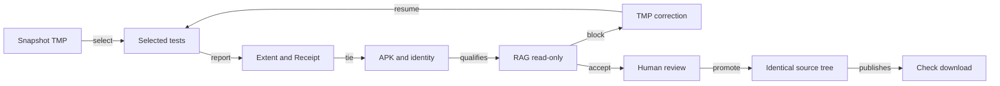

# Release qualification

## Overview

The candidate dossier contains the test plan, results and report for each selection. Prepare it outside the checkout and replace the active dossier only after qualifying the new APK, as defined by the [retention policy](../platform/ATF_ReleaseRetention.md). The [platform evidence policy](../../config/release-platform-rag-policy.json) defines the provenance requirements and checks for the read-only verdict before promotion.

The official repository branch is `main`. Push qualified code to `main` and tag the verified source commit for the version.

## Order of checks


<details>
<summary>Legend: each stage keeps its own verdict</summary>

The component report validates JVM inputs and comparisons. The sanity check validates interaction with the identified APK, and the browser verifies access to the evidence. An operator publishes the release on GitHub after qualification.

</details>

| Step | Selection and required result |
|---|---|
| 1. Difference | Set the full inventory of copied sources and libraries in TMP. [The selector](#selection-of-diff-tests) identifies the basis, the changed paths and the evidence required by the affected flows. |
| 2. Components | Run the affected oracles and rejection checks. [Gradle components](ATF_GradleComponents.md) and the [history suite](ATF_DisplayComponents.md#reporting-of-historical-components) capture the context and comparisons. Each Gradle selection has its own Extent HTML report and receipt, published through `atf-reporting`. Temporary JUnit results are checked against the HTML before the temporary copies are removed. |
| 3. Publication | Face exact identities and results of JUnit-HTML on each selection; inspect the fallback only if selected and qualified. Check the original cause, the abort, lack of capture and inline images Base64. The XMLs remain temporary oracle, not duplicate report in the final folder. Controlled FAILs qualify the publicist and are delimited by the product tests. |
| 4. HTML | Apply [minimum interactive revision](../reporting/ATF_Audit.md#minimum-interactive-revision) to the HTML identified by hash; keep owners, controls and sample limits. |
| 5. APK | Build from snapshot in TMP; check the version, SDKs, bytes, SHA- 256, CRC, signature and alignment. Unbug and Release have distinct identities. |
| 6. Android | Book the device; run the short change scenario and risk-distinguishing profile. Restore data and configuration. A full match is not repeated on all resolutions. |
| 7. Handoff | Verify the relevant live sources, reports, executed tests, links and governance. Record the previously qualified release before replacing the active dossier and APK. |

## Candidate dossier layout

| Entry | Canonical content |
|---|---|
| `README.md` | Steps in order, actual selections, status of each and links to results. |
| `qualification.json` | The inventory of selections, orders, sources, hashes and limits; an unexecuted step remains `PENDING`, with no total deduction. |
| `component/` | The audited HTML of the suite and the qualified fallback, with inputs and comparisons captured during the test. |
| `e2e/` | The identified Android execution HTML; historical republication remains its origin. |
| `diagnostics/` | Only separate justified evidence: Unmigrated JUnit result, signature, crash or rendering control. |

Do not copy PNG/XML/JSON already fully included in HTML after confrontation of bytes and offline access. Keep still the unique evidence required and declare the exception; [compact surrender](../reporting/ATF_Handoff.md#compact-handoff-and-exceptions) be fully qualified.

## Contract of reports by suite

Each executed primary selection owns a canonical Extent report and an execution receipt.

- The paths are unique: the component uses `reports/component/{group}/component-report.html`; E2E uses `reports/e2e/{suite}/report.html` and `execution.json` side by side.
- PNG captures are incorporated Base64 in the suite report.
- The component reports and E2E have different owners and do not meet in a common population.

| Selection | Minimum receipt | Verified link |
|---|---|---|
| Maven or Gradle component | `execution.json` per group and common source receipts | The HTML hash, test counts and results, source provenance and inventory match the qualified manifest. |
| Android E2E | `execution.json` next to the suite HTML | The installed APK, version, commit and source fingerprint, protocol, results, Extent hash and inline PNG image count match the manifest and report. |

- The release manifest hashs separately HTML and Receipt.
- The evaluator shall block missing, duplicate or non-anonymous pathways, missing receipts and mismatches of results, hash or provenance.
- Field `executionReceipt` links the E2E group to the next Receipt report.
- JUnit XML remains temporarily independent; the final dossier does not keep a second report.
- The catches are inline Base64; release folder does not duplicate PNG files already incorporated.

## Release dossier README

The first part provides the main report and the status of the qualification. Details remain schematic, with one source for each result; the READMEM sends to inventory and to [joint strategy](README.md), without copying the general rules.

| Section | Information required |
|---|---|
| Purpose and status | The property checked, the basis of the comparison and the actual status: preparation, completed execution or accepted qualification. |
| Identitate | APK and hash when there is, surse/biblioteci and the time of identification; a later observed fingerprint is not presented as initial catch. |
| Deschidere | Direct link to canon HTML and short reading order: context, invoicing, input/action, comparison and capture. |
| Selections | The selection or command and the result of each selection, with the unit counted, errors and omissions. |
| Suprapuneri | The class-suite relationship, parametrization, checkpoints and the same selection in two renderers; totals do not automatically add up. |
| Review | HTML hashtag, static and interactive verification performed, browser and checked owners. |
| Dovezi separate | For each file: specific reason, consumer or diagnostic question and identity; JUnit without captured comparisons remains within its limit. |
| Limits and next step | Unexecuted cases, sources exchanged after rolling and the criterion left before the building or promotion. |

## Public README contract

- **README public: ** main page offers the current version and direct download. SHA-256 remains in the manifest and evidence; RAG verifies separately that the link corresponds to the binar.
- **Candidate:** `release/index.json` keep the editions published and may declare `candidateVersion`The readmees face. `release/candidate.json`, in the condition `PREPARED`Use. [branch test channel](../platform/ATF_AndroidDelivery.md#distribution-through-github) when requiring access before qualification.
- **Promotion: ** by qualification, move the manifest and evidence in `release/{version}/`, update `currentVersion` and `versions`, then remove `candidateVersion`. The READMEM is part of the source print; any change in link after selection requires resumption of qualification.

- **Statements: ** `PENDING` expresses an unexecuted step; `SKIP` / abort expresses the result of the statement of statement. A result of `FAIL` or a publication error shall be retained, together with the impact on the qualification.
- **History: ** a previous sample may be explicitly highlighted, with the binary and its purpose. The movement of documents or updating of the README does not qualify a new APK.
- **Retreatment: ** to document correction, keep the source of the results and describe the re-checked selection; a past composition of results does not become a single whole new run.

## Commands and boundaries

### Read-only RAG verdict

The RAG evaluator consumes the evidence already produced and issues a readonly verdict.

- Entry: JSON plan, candidate manifest, selected Excent reports and source snack root.
- It doesn't build, run tests, call Git, or move or publish files.
- Write only the JSON verdict, outside the project, to the candidate and snapshots.
- Each check cites the path, SHA- 256 and JSON Pointer/linia to the source.
- The verdict keeps the exact plan in Base64 UTF-8, in `qualificationPlan.contentBase64`; his hashery allows revision without an external temporary copy.
- Unresolved gaps are tracked in [registrul de feedback](../feedback/README.md#prioritized-todos).

The plan sets out the version, channel (`LOCAL`, `TEST` or `PRODUCTION`), risk, platforms, component groups, user flow change and E2E decision for reasons.

### Evaluator regression tests

Node samples use the same limited-term executor as Git checks. Reading the output begins with the process, and the diagnosis of the child is kept at failure. [Component samples](../../atf-tests/src/test/java/atf/tests/governance/documentation/release/rag/scope/ComponentEvidenceScopeComponentTest.java)

The suite of components runs the evaluator on local test files. Each class holds a contract and uses the same Node trial launcher.

| Contract | Component test | What's he checking? |
|---|---|---|
| Provenance | [ReleaseRagProvenanceComponentTest](../../atf-tests/src/test/java/atf/tests/governance/documentation/release/rag/ReleaseRagProvenanceComponentTest.java) | Snapshot, the integrity of the payload, the citation of the plan and the re-use of component evidence. |
| Android | [ReleaseRagAndroidComponentTest](../../atf-tests/src/test/java/atf/tests/governance/documentation/release/rag/ReleaseRagAndroidComponentTest.java) | Signature, attaching E2E proof to APK and source, data isolation and flow selection. |
| GitHub | [ReleaseRagGithubComponentTest](../../atf-tests/src/test/java/atf/tests/governance/documentation/release/rag/ReleaseRagGithubComponentTest.java) | Access mode, download identity and GitHub retention against simulated GitHub inventories. |

When moving a case, compare its Extent receipts by method, parameterized invocation index and outcome. Check that the new class accounts for the identity change and that the audited comparison count matches for each invocation.

## Candidate lifecycle



<details>
<summary>Legend: candidate's stages and responsibilities</summary>

APK Snapshots is the benchmark for comparing the inputs of each suite. RAG checks the receipts, hashes and provenance. The candidate's manager shall face the full inventory and shall motivate the selection according to risk. The verdict allows for human revision prior to promotion and publication.

</details>

| Group Android | Proof required |
| --- | --- |
| `atf-validation`, `atf-test-android`, `atf-tests` | Each Maven primary suite has HTML Extent canon and results without FAIL/ERROR/SKIP. |
| `whist-lab-app-commands`, `whist-lab-app-bidding`, `whist-lab-app-history`, `whist-lab-app-display` | The basic Android collections have each HTML Extent and its own Receipt. Changes in the sources compiled together require a new run. |
| `whist-lab-app-achievements` | The collection introduced by `introducedComponentGroupsByPlatform`; `sinceReleaseVersion` makes it mandatory from the stated threshold. The report is separate, and JUnit XML alone does not satisfy the gate. |
| `whist-lab-app-atf-card-table-ui` | JVM suite for joint graphic library contracts; introduced on `0.20.2`, with Extent and Receipt separately. |
| Each selected group | Receipt own and identical entries in the suite perimeter. `source-provenance.json` keeps the link between the original inventory, execution and report. |

### Snapshot and preflight before Maven

[Component Launcher](../../scripts/run-component-suites.ps1) and [Governance launcher](../../scripts/run-atf-governance.ps1) use [Same preparation](../../scripts/AtfQualificationSnapshot.ps1). Maven compiles and checks files from the same temporary copy. The verification of published samples reads historical Git objects from the checked indicated by commit without reading live files from it.

[The temporary director's preflightul](../../atf-tests/tools/qualification-temp-root.mjs) runs before creating the running folder, copy the sources or turn Maven on.

- `TMP`, `TEMP` the Director-elect of the system shall indicate the existing external guidelines.
- Control checks both the declared path and the physical destination after the links have been resolved. A checkout detected in any of the ancestors, including a `.git` file worktree, produces `QUALIFICATION-TEMP-IN-CHECKOUT`.
- A non-existent, relative or inaccessible path produces `QUALIFICATION-TEMP-INVALID`.

| Moment | Control and proof |
| --- | --- |
| Fixarea | `source-inputs.json` describes the sources of the building. `release-inputs.json` sets out all files in `release/` separately, including the catalogue and files kept. |
| Before Maven | [Preflight-ul](../../atf-tests/tools/check-release-artifacts.mjs) confronts the names, bytes and SHA-256 for the APKs in the catalogue and their files `.sha256`. `release-preflight.log` keeps the identities observed or the cause of the refusal. |
| Closure | The inventory of the copy and the checkout is facing again. Any file added, modified or deleted invalidates the result, and the Receipt indicates the location and path. |

`-PinnedSourceInputs` links the launch to the list used for selection. A change between plan and execution stops the process before Maven. The `release/` fingerprint shall be kept separately so that the evidence file does not fall into the APK source's fingerprint.

### Selection of diff tests

Calculate the selection before the build, from the snapshots copied by the inventory launchers.

- For a new version, the base is the current edition of `release/index.json`.
- When reassessing a retained version, the base is the previous edition of the same catalogue.
- The base shall be published and qualified, with the inventory of sources linked by hash to the manifest.

```powershell
$ProjectRoot = (Get-Location).Path
node .\atf-tests\tools\plan-release-tests.mjs $ProjectRoot $SourceSnapshotDir `
  $SourceInputsFile $ReleaseVersion $SelectionFile
```

`$SourceInputsFile` is the ordinary JSON list produced by [Get-AtfSourceInputs.ps1](../../scripts/Get-AtfSourceInputs.ps1), outside snapshots and checkout. `$SelectionFile` is a new file in the external workdirectory. The result shows the added, modified and deleted pathways, the rule applied, the mandatory suites and the required E2E selections. [Selector rules](../../atf-tests/tools/release-test-scope.mjs)

| Result | Action |
| --- | --- |
| Ajutorul RO/EN | The content of `HowToPlay.java` and the related guides run in the suite of rules. The changes in the screen, navigation and engine rules keep their flow gates. |
| Editorial Change | Run the governance. Reuse the evidence compatible with the other suites. E2E can stay `NOT_RUN` for a reason. |
| Bidding change, mass, score, profile or other identified flow | Select the native samples indicated in `requiredE2eGroups`. Component tests shall remain mandatory for their contracts. |
| Product path or unclassified shared entry | Select all the flow samples provided by the selector and check the component perimeter. |
| Increase in Android version | The exception of E2E applies if the replacement of the two values `versionName` and `versionCode` exactly reproduces the hash of the published build file. The component evidence shall be checked separately on their inputs. |

In the `schemaVersion: 2` qualification plan, keep `releaseVersion`, `scope`, `componentGroups` and `userFlowChanged` from the selection.

- Complete `channel`, `declaredPlatforms`, `changeRisk` and `e2e`. The plan may require further evidence.
- For `e2e.status: PASS`, list in `e2e.groups` the past groups, including all those required by diff.
- The evaluator shall recalculate the selection and block the connection to another base, underestimate a flow or miss a group.

Use the calculated selection when launching the components. `$PreviousComponentEvidence` indicates the folder with the evidence available for reuse.

```powershell
$Selection = Get-Content -LiteralPath $SelectionFile -Raw | ConvertFrom-Json
.\scripts\run-component-suites.ps1 -SourceRoot $ProjectRoot -PinnedSourceInputs $SourceInputsFile `
  -Groups $Selection.componentGroups -ReuseFrom $PreviousComponentEvidence
```

`runComponentGroups` shows the affected suites from the published base. The launcher checks every single piece of evidence of her original source before deciding what actually runs.

### Re-use of component evidence

The evaluator compares the added, deleted and modified files. [Perimetrul suitei](../../atf-tests/tools/component-evidence-scope.mjs) determines what differences can affect the result.

- The government checks the inventory completely.
- The graphic library components have their own perimeter. Changes in gaming consumers allow the library's report to be re-used. Sources, tests, resources, compiling configuration and audit deck are part of the perimeter of this suite.
- Independent Maven modules can reuse results after changes limited to Android IU if their dependencies remain identical.
- Gradle collections of the game follow the code and their compiled configuration; documentation and files exclusively from other suites do not invalidate them. The unknown route keeps the safe decision `RUN`.

| Decision | Action |
|---|---|
| `MATCH` | Use execution with identical inventory. |
| `REUSE` | Keep the Extent and Receipt with the original execution print. All differences are outside the suite perimeter. |
| `RUN` | Run the selected and consult affected entries in the verdict. |
| `INVALID` | Recover original evidence or execute the selection if the Receipt, provenance or report cannot be validated. |

- `componentEvidenceOrigin` identifies the original file of `reports/component/snapshots/{id}/`. It shall keep `source-inputs.json`, `source-provenance.json`, `source-component-run.json` and, when declared, the list `release-inputs.json`.
- For a new candidate, the valuer asks suite `atf-tests` for the release inventory and confronts it with the catalogue file. An older provenance without separate inventory may continue to support the other suites, according to the perimeter of each.
- Ecstatic and `execution.json` keep the canonical path of the suite and enter the candidate's hash inventory.
- An aggregated failure run can provide evidence for past groups if the source remains stable. Each mandatory group must have its own validated evidence.
- The launcher only accepts groups from the catalogue. The ResuseFrom parameter receives a previous run of components or folder reports/component with original receipts.
- The component-reuse.json plan indicates the reason for the decision and the Snapshots ID.Keep the plan, Extent, the execution Receipt and the original snapshots when assembling the candidate. In the manifest, set up componentEvidenceOrigin for each reused group and use the path androidComponentsReceipt, relative to reports/component, for the Android component gate. [Componente](../../scripts/README.md)

### Native samples and Android gates

The visible changes in the user's flow require an E2E focused on that flow. For the catalogue of achievements, the selection of releases opens the screen in the signed APK, checks local progress and returns to the main page; component tests keep the oracles for thresholds, replenishment and persistence of the popup.

- Platform gates require hash-linked receipts for components, APK build, identity and signature.
- The published stage requires proof of discharge in the declared manner, `AUTHENTICATED` for the authorised accounts or `ANONYMOUS` for a public copy.
- Unchanged flow: E2E can remain `NOT_RUN` with explicit justification.
- Flow changed: verdict calls for past E2E reports.
- `NOT_RUN` never counts as a passing result.

### Qualification timeline

| Intrare | Measured ranges |
|---|---|
| `timing.json` of launchers | Snapshot and preflight, cache, compilation Maven, suite or launch of the common Gradle, checking reports, preparing and restoring Android. |
| Receipt near HTML | Generating Extent and HTML audit in JVM and Android. Gradle measures the completion and audit of the session. |
| RAG verdict and GitHub observation | The duration of each RAG gate, inventory, download, hashes and confrontation of publication. |
| [Measured command](../../scripts/Measure-AtfReleaseCommand.ps1) | Build APK, signing, push, publication or audit executed separately. The control block returns a single numerical output code. |

Each stage has the beginning and end of observed UTC, monotone duration and result. `REUSED` and `NOT_RUN` have motive and zero time of execution. For processes that work in parallel, [cronologia](../../atf-tests/tools/assemble-release-timeline.mjs) calculate the observed intervals meeting and show the breaks separately.

The timeline shall keep the difference between the monotone duration and the UTC interval of the same stage.

```powershell
.\scripts\Measure-AtfReleaseCommand.ps1 -Stage apk.build -TimingFile $BuildTiming -Command {
  & $GradleLauncher --offline :app:assembleRelease | Out-Host
  $LASTEXITCODE
}
node .\atf-tests\tools\assemble-release-timeline.mjs $ProjectRoot $TimelineFile @TimingReceipts
```

Choose the receipts of the same qualification, including the RAG verdict. The timeline does not deduce durations for missing phases. [Verification before cleaning](../platform/ATF_ReleaseRetention.md#local-cleaning-after-delivery)

### Promotion, push and public download link

The read-only verdict does not commit, does not push and does not publish artifacts. After `READY_FOR_HUMAN_REVIEW`, the relay's responsible closes each step separately:

1. Compare candidate inventory with qualified snapshots, including new files and exclusions; confirm same fingerprint and a clean Git tree containing exactly qualified sources.
2. Commit the sources and push the commit to `main`. Create the version tag on the verified commit. The build and the manifest must identify that commit and the same qualified APK.
3. Publish APK and checksumes on the declared channel. For GitHub uses [Reluable publication](../platform/ATF_AndroidDelivery.md#resumable-publishing-on-github) and keeps the log in the running directory. Update `release/index.json`, the catalogue and the main README so that the current version and direct link indicate the same artifact.
4. After the push, read the README from the repository, extract the link shown there and download the URL in the mode declared by `publication.accessMode`. For `AUTHENTICATED`, use a GitHub account with access and record only the fact that the download was authenticated, the URL, HTTP 200, byte count, SHA-256 and CRC. Do not retain the token or headers. For `ANONYMOUS`, download without cookies or authorization and record verification of the page and checksum separately.
5. Record publication and download evidence in the release dossier, commit and push the evidence, then read the README again and download from that exact link using the same declared access mode.

The executable instructions and the format of the distribution receipt are in [Android delivery guide](../platform/ATF_AndroidDelivery.md#source-and-evidence-commits). If a step cannot be checked, the condition remains `PENDING` or `BLOCKED`; no promotion shall be made from a local check.

From the root of the project, with the plan and candidate kept in the location of TMP:

```powershell
$ProjectRoot = (Get-Location).Path
node .\atf-tests\tools\evaluate-release-rag.mjs `
  --project-root $ProjectRoot `
  --candidate-dir $CandidateDir `
  --source-root $SourceSnapshotDir `
  --plan-file $QualificationPlan `
  --output $VerdictFile
```

- Variables indicate the version file of the TMP candidate, the full root of the fixed sources, the JSON plan and the destination of the verdict; it creates the destination separately, outside all entries.
- `READY_FOR_HUMAN_REVIEW` confirms only the read evidence that has passed the checks implemented.
- The evaluator does not inspect the Git index. It compares the complete inventory at the pinned location with the manifest. Before promotion, the operator checks the commit and its tree.
- The verdict includes `DIFF_SCOPE`, with the identity of the basis and candidate, the rules applied by route and the resulting groups.
- `BLOCKED` shows failed checks and evidence hashes without applying an automatic correction.

### Retention on GitHub after publication

Before withdrawal, check [kept downloads and editions](../platform/ATF_ReleaseRetention.md#download-verification-before-rotation).

- After the authorized withdrawal, run the collector in the synchronized checkout `main`. The collector reads the catalogue and manifests from the repository state observed on GitHub.
- Use `GH_TOKEN` or `GITHUB_TOKEN` with access to the drafts. The collector inventories all pages of relays, including the drafts, all tags and all assetses.

```powershell
node .\atf-tests\tools\collect-github-release-retention.mjs $ProjectRoot $GithubRetentionFile
```

The post-publication evaluator receives the same observation through `--github-retention-file $GithubRetentionFile`. Gate `GITHUB_RETENTION` requires precisely the two versions of `release/index.json`, with the tags to the declared source commits. Each release must have the exact APK and checksum, with the name, URL, size and SHA- 256 faced even after unloading.

The collector writes the inventory in a new external file and reports deviations as `BLOCKED`. If access or collection fails, the diagnosis identifies the step, and the evaluator asks for a full observation. After the authorized withdrawal, collect a new observation and resume the evaluation. [Retention process](../platform/ATF_ReleaseRetention.md#github-reset)

### Documentation editions

The release check expects English documentation on `main` and its Romanian counterpart on `main_RO`. It reads the English candidate commit and the published Romanian commit.

- Update both editions when a contract changes. Preserve document paths, heading levels, tables, diagram topology, executable examples and link destinations.
- For archived releases, preserve the files listed in the integrity manifest. Use `.en.md` or `.ro.md` companions for the other language when needed.
- Commit the two editions, fetch `main_RO`, and run the paired inspection below. After editorial review, record its `review` object in `config/documentation-editions.json`.
- The `DOCUMENTATION_EDITIONS` check blocks qualification when a counterpart is missing or the inventories differ from the reviewed hashes. Review changes to meaning against the owning code or test.

```powershell
git fetch origin main_RO
node atf-tests/tools/documentation-editions.mjs inspect . HEAD origin/main_RO
node atf-tests/tools/documentation-editions.mjs verify . HEAD
```

### Evidence freshness

The qualification policy reads UTC time of observation by milliseconds and suffix `Z`. The window closes exactly on term. The time missing, invalid or future block the use of observation for a new action.

| Evidence | Window | When a new observation is obtained |
|---|---|---|
| Preflight Android | 5 minutes after the last successful check of ADB, boot and profile | Before the first protected action if the leastland, series, ADB route or requested profile has expired or changed. |
| GitHub inventory post-publication | 15 minutes after stable rereading of the branch, tags and assetons | On expiry or after any change in the catalogue, tags, relays, assetons or access. Run the collector again for an actual verdict. |
| Preflight GitHub Rotation | 5 minutes after confirmation of downloads and rereading of branch and latest edition | Right before the retreat. Follow `expiresAtUtc` and resume checking that the condition has changed. |
| Artifacts and evidence fixed by hash | No chronological term | When bytes change, the source, scenario or identity required. The APK, signature, reports, catches and receipt of a historical download shall retain the audit value. |

Check the windows in [executable policy](../../config/release-platform-rag-policy.json). RAG is again checking the freshness of the GitHub inventory at the end of the current evaluation and restores historical revalidation through the original verdict and established evidence.

### Preflight Android

[Lansatorul responsive](../../scripts/run-whist-responsive-sanity.ps1) reserves the device and runs [preflight-ul comun](../../scripts/check-android-release-device.ps1) before copying the Maven sources or cachet. For a signed APK selection, call the same order immediately after booking, prior to installation, backup or interactions with the application.

```powershell
$device = @{
    AdbExecutable=$AdbExecutable; Serial=$Serial; AdbServerSocket=$AdbServerSocket
    LeasePath=$LeasePath; LeaseId=$LeaseId; Receipt=(Join-Path $CandidateRun 'android-preflight.json')
    ExpectedApi=$ExpectedApi; ExpectedDisplayProfile=$ExpectedDisplayProfile
}
.\scripts\check-android-release-device.ps1 @device
```

| Control | Acceptance criterion |
| --- | --- |
| Reservation and ADB | The active reservation corresponds to the series and the IDA. ADB responds `device` on the requested route within the time limit of each command. |
| Boot | `sys.boot_completed` is exactly `1`. |
| Profil | API is numeric and corresponds to the expected value if specified. For resolution and IPR, the actual values in `LĂȚIMExÎNĂLȚIME@DPI` format, `Override` before `Physical`, shall be compared. |

- For a signed E2E that changes the status of the game, use backup with verified restoration or a temporary secondary Android user. [Isolation script](../../scripts/Invoke-AtfAndroidDisposableUser.ps1) requires the package absent prior to installation and the removal receipt after the test, using the existing reservation and keeping the original user.
- The candidate APK and roots `whist.records.runRoot`, `atf.android.artifacts` and `atf.match.evidenceDir` must be outside the checkout. The tests refuse the project directories; temporary installation, profile and game exports, catches and receipts remain in the external running file. The copy of the APK sent to the Android temporarily is deleted after installation, and private saves remain in the temporary user until it is removed.

- The expected values come from the selection plan; `ExpectedApi=0` and the empty profile require the observation of valid values. In responsive mode, the profile describes the initial state and `Profiles` describes the matrix applied in the scenario.

- `android-preflight.json` keeps the result, UTC observation and the cause of the refusal. The responsive launcher rechecks the device after Maven and restores the second evidence in `android-preflight-execution.json`.
- The secondary Android user's preparation collects the same evidence prior to interaction and verifies its validity before creating the user. The cleaning still uses the identity of the lease- and user created.

### Resume a qualification

| Evidence | When re-used | When repeated |
|---|---|---|
| Building and signing | The APK and input manifest are identical and package and certificate checks match. | Changing a building input requires a new binary and impact check. |
| Componente | Use the published file `reports/component` with their Receipts and origins through `-ReuseFrom`. Check decisions on the group. | Rerun affected or invalid groups. The government also checks the inventory of the read release. |
| E-2E signed | Keep HTML, verdict, catches, APK, profile and evidence of isolation from original execution. Confront the difference in the scenario before re-use. | Rerulate the affected flow if the binary, contract, profile or relevant scenario has changed or if there is no mandatory evidence. |

Prepare your own staging and Maven cachet before booking the device. Check the origin of the compiled classes and validate the catch and the ratio on each flow closure. Keep references to logbooks in the external folder and original teardown receipts.

### Starting and resuming a game on the signed APK

- Choose groups from the selection calculated by RAG. Prepare an external JSON with `releaseVersion`, `groups` and `executionProfile`. The profile contains `api` (number), `displayProfile` and `responsiveProfiles` (matrix portrait, separated by comma).
- Use the same value at `e2e.executionProfile` in RAG plan. Since 0.21.5, E2E executions included in RAG require this profile and receipts v2. Evidence v1 keeps the contract of the published edition.

```powershell
.\scripts\run-whist-signed-e2e.ps1 -CandidateDir $CandidateDir `
  -SourceRoot $SourceSnapshotDir -SelectionFile $AndroidSelectionJson `
  -RunRoot $FreshRunRoot -Group $SelectedGroup -ApkPath $ExternalApk

node .\atf-tests\tools\apply-android-e2e.mjs $CandidateDir $FreshRunRoot
```

- The launcher writes `e2e-reuse.json` before Maven and booking. A compatible evidence produces `REUSE` and concludes the order.
- For `RUN`, Maven compiles in staging with private storage. Launcher confronts JAR/POM pairs and selected method from compiled classes, then uses Surefire directly for one method.
- Option `-PrepareOnly` stops after compiling check without Android.

- The execution checks the exact case of JUnit, the PASS track and each original catch, including the bytes of Extent. Check the restoration receipt.
- The import shall re-check the accepted dossier and update the manifest of candidate `PREPARED`. Only resume the groups with `RUN`; import leaves the other original report and receipt. After import run the evaluator for the entire folder.

### Acceptance of signed APK

- The [WhistReleaseSmokeE2eTest](../../atf-test-android/src/test/java/atf/android/e2e/display/flow/WhistReleaseSmokeE2eTest.java) Smokey checks the installed package, initial page and configuration without starting another game. [Acceptance of the tender](../../atf-test-android/src/test/java/atf/android/e2e/release/README.md) has a separate field: a real prefix of Romanian Whist, recommendation, manual choice, dialogue and restored contract.

| Selection | Additional precondition | Closure criterion |
|---|---|---|
| Home and configuration | The signed APK installed and hash faced | Obvious controls, accessible configuration and return to the initial page. |
| Common interface | Temporary secondary user or backup checked with same identified APK | Language RO/EN, cancellation without rescue, name preserved between languages and re-established preferences after relaunch. |
| Bidding and restoration | Exclusive booking and isolation receipt with teardown checked | The legal recommendation remains unconfirmed; manual choice survives dialogue and the confirmed contract and public scores are maintained after the process has stopped. |
| History and display | Profile and explicit inputs with same binar identity checked | Column, marking and access to content according to the code difference; Debug fixtures are distinguished from the execution of the Release APK. |

Check the identity of the APK and the data isolation limit before the first change of application. An unexecuted E2E remains `PENDING`. Static audit checks HTML file, and interactive revision checks access and rendering.

From the project root, the existing launcher prepares TMP and a private Maven cache:

```powershell
.\scripts\run-whist-responsive-sanity.ps1 -ComponentsOnly -ComponentSuite History
.\scripts\run-whist-responsive-sanity.ps1 -ComponentsOnly -ComponentSuite History -ComponentRenderer fallback
.\scripts\run-whist-responsive-sanity.ps1 -ComponentsOnly -ComponentSuite Display
```

- **History: ** the ratio of the selected suite contains all the captured comparisons; `WORKING_STATE.json` keeps the HTML path and selection.
- **Display: ** In the responsive launcher, the HTML of the historical subset has its own population. For the full component and provenance ratio use the aggregation launcher.
- **Governance:** use [lansatorul izolat](../governance/README.md#isolated-execution) A competitive change invalidates the certification of that copy.
- **Promotion: ** a past result belongs to the executed sources. The sources subsequently changed require the assessment of the difference and the relevant reverification before the final building.

[Common strategy](README.md) · [Display selections](ATF_Display.md) · [Delivery process](../platform/ATF_AndroidDelivery.md#process-of-a-version)

## Work profiles for resumption

Set `$EvidenceRoot` to an existing external director and `$Version` to the candidate's version. From the qualified checkout, book a subdirectory for separate work files and directories for Android reports, samples and tests.

```powershell
$shortCommit = git rev-parse --short=12 HEAD
$run = Join-Path $EvidenceRoot "$Version-$shortCommit"
$scratch = Join-Path $run 'workspace'
New-Item -ItemType Directory -Path $scratch -Force | Out-Null
$env:TMP = $scratch
$env:TEMP = $scratch
```

Use the same directory when resuming the same identity. Choose a new directory when changing the comma, APK or input set. Save the verdict and receipt of each stage next to her report.

| Working profile | Preparation | Reception condition |
|---|---|---|
| Componente | Set the source manifest and the inventory of the active file. Keep the Maven cachet isolated, classes, leaderboard and stage receipts until the end of delivery. | Reuse reports through selection plan and accepted hashes. The reuse of compilation requires verification of source, classes and libraries. |
| Android headless | Keep the APK signed, API profile and display requested, selection and booking path. Give each of your own director's tests and temporary Android profile. | Just resume the flows without valid proof for APK, snapshot, selection and profile. Check the boot, active window and clean profile. After restarting the host, confront the reservation and profile before any cleaning. |
| Publication | Keep the verdict, the Draft's IDU, the loading log and the APK and checksumes hashes. | Resume publication from the same journal after reconciling the IDA and uploaded bytes. Check the link on `main` and renew the GitHub observation when it expires. |

Keep the work profiles and cachets during reruns. After publication and verified reconstruction in Git, keep final reports, receipts, applicable EOL recipe and learning data. Built-in directories and isolated cachets can be removed. [Retention after delivery](../platform/ATF_ReleaseRetention.md#local-cleaning-after-delivery)

### Snapshot Git and local projection

Maven control runs the sources reconstruction and projection samples of the published edition separately. Every Node trial keeps the same term. Fixturees use real Git and isolated directories, including for bytes with mixed EOL, modified payload, local editing and edition rotation. [Reconstruction](../../atf-tests/tools/release-git-snapshot.test.mjs) · [Projection](../../atf-tests/tools/local-release-sync.test.mjs)

### Resume validated steps

After interruption keep test director and working area. Launch from the same fixed checkout with the same `TMP` and `TEMP` as in preparation. Use a new director for your next attempt.

```powershell
& .\scripts\run-component-suites.ps1 -SourceRoot $ProjectRoot -RunRoot $NextAttempt `
  -ResumeFrom $InterruptedAttempt -PinnedSourceInputs $SourceInputs -Groups $RequiredGroups
```

| Step | What validates and what resumes |
|---|---|
| Identity of the resumption | The launcher shall take the fingerprints of the source and release file, in the copy of the work and checkout. Refuse inventory changes and simultaneous use of the same copy. |
| Maven | Each selection has a receipt after execution. Check the compilation receipt for classes, resources and JARs and resume the ranking if the solution has been interrupted. A copy without a valid manifest requires a new test. |
| Gradle | Each task publishes the checkpoint atomic after JUnit and Extent parity. A valid HTML without checkpoint can explain a disruption. That task is running again. |
| Rapoarte | Accepted reports shall retain their octeness and provenance. Missing, incomplete, corrupt or failed selections run in the new directory. |
| Preparing the signed APK | Prepare the classes with `-PrepareOnly` and transmit the directory via `-PreparedFrom`. Check APK's SHA-256 and source print before reusing the classes and libraries. Each execution uses a new JUnit Director. |
| Fluxuri native | If the sample was produced in full, import it by `apply-android-e2e.mjs`. The plan reuses the accepted reports prior to the preparation of Maven or access to the device. |

| Level | Tender verification |
|---|---|
| Game component | The first four hands with one card, the dealer's rotation, the switch to two cards and the score checkpoint. The alternative choice, priority to the recommendation and persistence of the contract shall be checked by several hand sizes. |
| Driver component | XML hierarchy and a notification of achievements after the start of the run. ADB Mocker measures the order of observations and the number of gestures. |
| E 2E on APK | Visible recommendation, alternative option, score dialogue and contract maintained after restart. Only one preparatory hand shall be played if the opening bid is forced. |
