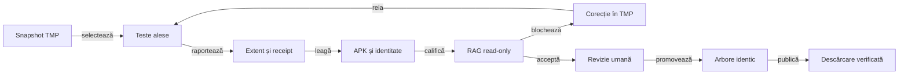

# Calificarea unui release

## Pe scurt

Un singur dosar candidat grupează planul, rezultatele și raportul fiecărei selecții. Pregătirea se face în afara proiectului; dosarul activ se înlocuiește numai după calificarea noului APK, conform [retenției](../platform/ATF_ReleaseRetention.md). [Politica de dovezi pe platforme](../../config/release-platform-rag-policy.json) fixează proveniența și porțile verdictului read-only înaintea promovării.

Ramura oficială a repository-ului este `main`. Codul calificat se împinge pe `main`, iar tagul versiunii se fixează pe commitul-sursă verificat.

## Ordinea verificărilor

```mermaid
flowchart LR
    SOURCE[Snapshot fixat] -->|compară cu ediția publicată| DIFF[Selecție din diff]
    DIFF -->|rulează sau reutilizează în TMP| JVM[Componente și contracte]
    JVM -->|confruntă datele| HTML[HTML detașat]
    HTML -->|permite| APK[Build și identitate APK]
    APK -->|verifică schimbarea| NATIVE[Sanity Android selectat]
    NATIVE -->|confruntă live și guvernanța| HANDOFF[Dosar calificat]
```



<details>
<summary>Legendă: fiecare etapă păstrează propriul verdict</summary>

Un raport de componentă califică intrările și comparațiile JVM. Sanity-ul califică interacțiunea pe APK-ul identificat; browserul verifică accesul la dovezi. Publicarea GitHub este un pas ulterior al operatorului.

</details>

| Pas | Selecție și rezultat necesar |
|---|---|
| 1. Diferență | Fixați în TMP inventarul complet al surselor și bibliotecilor copiate. [Selectorul](#selecția-testelor-din-diff) identifică baza, căile schimbate și probele cerute de fluxurile afectate. |
| 2. Componente | Executați oracolele schimbate și refuzurile relevante. [Componentele Gradle](ATF_GradleComponents.md) și [suita istoricului](ATF_DisplayComponents.md#raportarea-componentelor-istoricului) capturează contextul și comparațiile. Fiecare selecție Gradle are HTML Extent și receipt proprii, publicate prin `atf-reporting`; JUnit-ul temporar se confruntă cu HTML-ul înaintea eliminării copiilor finale. |
| 3. Publicare | Confruntați exact identitățile și rezultatele JUnit–HTML pe fiecare selecție; inspectați fallback-ul numai dacă a fost selectat și calificat. Verificați cauza originală, abort-ul, lipsa capturii și imaginile inline Base64. XML-ul rămâne oracol temporar, nu raport duplicat în dosarul final. FAIL-urile controlate califică publicatorul și sunt delimitate de testele produsului. |
| 4. HTML | Aplicați [revizia interactivă minimă](../reporting/ATF_Audit.md#revizia-interactivă-minimă) pe HTML-ul identificat prin hash; păstrați proprietarii, controalele și limitele probei. |
| 5. APK | Construiți din snapshot în TMP; verificați versiunea, SDK-urile, bytes, SHA-256, CRC, semnătura și alinierea. Debug și Release au identități distincte. |
| 6. Android | Rezervați dispozitivul; rulați scenariul scurt al schimbării și profilul care distinge riscul. Restaurați datele și configurația. O partidă completă nu se repetă pe toate rezoluțiile. |
| 7. Predare | Confruntați sursele live, rapoartele, populația testelor, linkurile și guvernanța relevantă. Arhivați precedentul verificat înaintea înlocuirii dosarului activ și APK-ului. |

## Organizarea dosarului candidat

| Intrare | Conținut canonic |
|---|---|
| `README.md` | Pașii în ordine, selecțiile efective, starea fiecăreia și legăturile către rezultate. |
| `qualification.json` | Inventarul selecțiilor, comenzi, surse, hash-uri și limite; un pas neexecutat rămâne `PENDING`, fără total dedus. |
| `component/` | HTML-ul auditat al suitei și fallback-ul calificat, cu inputuri și comparații capturate în timpul testului. |
| `e2e/` | HTML-ul execuției Android identificată; republicarea istorică își păstrează proveniența. |
| `diagnostics/` | Numai dovezi distincte justificate: rezultat JUnit nemigrat, semnătură, crash ori control al randării. |

Nu copiați PNG/XML/JSON deja incluse integral în HTML după confruntarea octeților și a accesului offline. Păstrați încă dovezile unice necesare și declarați excepția; [predarea compactă](../reporting/ATF_Handoff.md#livrabil-compact-și-excepții) deține criteriul complet.

## Contractul rapoartelor pe suite

Fiecare selecție primară executată deține un raport Extent canonic și un receipt al execuției.

- Căile sunt unice: componenta folosește `reports/component/{group}/component-report.html`; E2E folosește `reports/e2e/{suite}/report.html` și `execution.json` alături.
- Capturile PNG sunt încorporate Base64 în raportul suitei.
- Rapoartele de componentă și E2E au proprietari diferiți și nu se reunesc într-o populație comună.

| Selecție | Receipt-ul minim | Legătura verificată |
|---|---|---|
| Componentă Maven sau Gradle | `execution.json` per grup și receipt-urile comune de sursă | Hash-ul HTML-ului, numărul și rezultatele, proveniența și inventarul sursei corespund manifestului calificat. |
| E2E Android | `execution.json` alături de HTML-ul suitei | APK-ul instalat, versiunea, commitul și amprenta sursei, protocolul, rezultatele, hash-ul Extent și numărul imaginilor PNG inline corespund manifestului și raportului. |

- Manifestul de release hash-ează separat HTML-ul și receipt-ul.
- Evaluatorul blochează căile lipsă, duplicate sau necanonice, receipt-urile absente și nepotrivirile de rezultate, hash sau proveniență.
- Câmpul `executionReceipt` leagă grupul E2E de receipt-ul alăturat raportului.
- JUnit XML rămâne oracol temporar independent; dosarul final nu păstrează un al doilea raport.
- Capturile sunt inline Base64; dosarul de release nu duplică fișiere PNG deja încorporate.

## README-ul dosarului

Prima parte oferă raportul principal și starea calificării. Detaliile rămân schematice, cu o singură sursă pentru fiecare rezultat; README-ul trimite la inventar și la [strategia comună](README.md), fără a copia regulile generale.

| Secțiune | Informație necesară |
|---|---|
| Scop și stare | Proprietatea verificată, baza comparației și starea reală: pregătire, execuție încheiată ori calificare acceptată. |
| Identitate | APK și hash când există, surse/biblioteci și momentul identificării; o amprentă observată ulterior nu este prezentată drept captură inițială. |
| Deschidere | Link direct la HTML-ul canonic și ordinea scurtă de citire: context, invocare, input/acțiune, comparație și captură. |
| Selecții | Selectorul sau comanda și rezultatul fiecărei selecții, cu unitatea numărată, erori și omiteri. |
| Suprapuneri | Relația clasă–suită, parametrizări, checkpoint-uri și aceeași selecție în două renderere; totalurile nu se adună automat. |
| Revizie | Hash-ul HTML-ului, verificarea statică și interactivă efectuată, browserul și proprietarii verificați. |
| Dovezi separate | Pentru fiecare fișier: motiv concret, consumator ori întrebare diagnostică și identitate; JUnit fără comparații capturate își păstrează limita. |
| Limite și pas următor | Cazuri neexecutate, surse schimbate după rulare și criteriul rămas înaintea build-ului sau promovării. |

## Suprafața README-ului public

- **README public:** pagina principală oferă versiunea curentă și descărcarea directă. SHA-256 rămâne în manifest și în dovezi; RAG verifică separat că linkul corespunde binarului.
- **Candidat local:** `release/index.json` păstrează edițiile publicate și poate declara `candidateVersion`. README-ul se confruntă cu `release/candidate.json`, în starea `PREPARED`; candidatul nu intră în inventarul publicat.
- **Promovare:** după calificare, mutați manifestul și dovezile în `release/{version}/`, actualizați `currentVersion` și `versions`, apoi eliminați `candidateVersion`. README-ul face parte din amprenta surselor; orice schimbare a linkului după selecții cere reluarea calificării.

- **Stări:** `PENDING` exprimă un pas neexecutat; `SKIP`/abort exprimă rezultatul invocării. Un rezultat `FAIL` sau o eroare de publicare se păstrează, împreună cu impactul asupra calificării.
- **Istoric:** o probă anterioară poate fi reper explicit, cu binarul și scopul ei. Mutarea documentelor sau actualizarea README-ului nu califică un APK nou.
- **Retratare:** la corecția documentelor, păstrați sursa rezultatelor și descrieți selecția reverificată; o compoziție de rezultate trecute nu devine o singură rulare integrală nouă.

## Comenzi și limite

### Verdictul RAG read-only

Evaluatorul RAG consumă dovezile deja produse și emite un verdict read-only.

- Intrări: plan JSON, manifestul candidatului, raportările Extent selectate și rădăcina snapshot-ului sursă.
- Nu construiește, nu rulează teste, nu apelează Git și nu mută ori publică fișiere.
- Scrie numai verdictul JSON, în afara proiectului, candidatului și snapshot-ului.
- Fiecare verificare citează calea, SHA-256 și JSON Pointer/linia sursei.
- Lacunele nerezolvate sunt urmărite în [registrul RAG](../feedback/ATF_Release_RAG.md).

Planul fixează versiunea, canalul (`LOCAL`, `TEST` sau `PRODUCTION`), riscul, platformele, grupurile componente, schimbarea fluxului utilizatorului și decizia E2E cu motiv.

## Ciclul candidatului



<details>
<summary>Legendă: etapele și responsabilitățile candidatului</summary>

Snapshot-ul APK este reperul pentru compararea intrărilor fiecărei suite. RAG verifică receipt-urile, hash-urile și proveniența. Responsabilul candidatului confruntă inventarul complet și motivează selecția în funcție de risc. Verdictul permite revizia umană înainte de promovare și publicare.

</details>

| Grup Android | Dovadă necesară |
| --- | --- |
| `atf-validation`, `atf-test-android`, `atf-tests` | Fiecare suită Maven primară are HTML Extent canonic și rezultate fără FAIL/ERROR/SKIP. |
| `whist-lab-app-commands`, `whist-lab-app-bidding`, `whist-lab-app-history`, `whist-lab-app-display` | Colecțiile Android de bază au fiecare HTML Extent și receipt proprii. Modificările în sursele compilate împreună cer o rulare nouă. |
| `whist-lab-app-achievements` | Colecție introdusă prin `introducedComponentGroupsByPlatform`; `sinceReleaseVersion` o face obligatorie de la pragul declarat. Raportul este separat, iar JUnit XML singur nu satisface poarta. |
| `whist-lab-app-atf-card-table-ui` | Suită JVM distinctă pentru contractele bibliotecii grafice comune; introdusă la `0.20.2`, cu Extent și receipt separat. |
| Fiecare grup selectat | Receipt propriu și intrări identice în perimetrul suitei. `source-provenance.json` păstrează legătura dintre inventarul original, execuție și raport. |

### Snapshot și preflight înainte de Maven

[Lansatorul de componente](../../scripts/run-component-suites.ps1) și [lansatorul de guvernanță](../../scripts/run-atf-governance.ps1) folosesc [aceeași pregătire](../../scripts/AtfQualificationSnapshot.ps1). Maven compilează și verifică fișierele din aceeași copie temporară. Verificarea probelor publicate citește obiecte Git istorice din checkout-ul indicat, prin commit, fără a citi fișierele live din acesta.

| Moment | Control și dovadă |
| --- | --- |
| Fixarea | `source-inputs.json` descrie sursele de build. `release-inputs.json` fixează separat toate fișierele din `release/`, inclusiv catalogul și dosarele păstrate. |
| Înainte de Maven | [Preflight-ul](../../atf-tests/tools/check-release-artifacts.mjs) confruntă numele, octeții și SHA-256 pentru APK-urile din catalog și fișierele lor `.sha256`. `release-preflight.log` păstrează identitățile observate sau cauza refuzului. |
| Închiderea | Inventarul copiei și al checkout-ului se confruntă din nou. Orice fișier adăugat, modificat sau șters invalidează rezultatul, iar receipt-ul indică locul și calea. |

`-PinnedSourceInputs` leagă lansarea de lista folosită la selecție. O modificare între plan și execuție oprește procesul înainte de Maven. Amprenta `release/` se păstrează separat, astfel încât dosarul de dovezi să nu intre în amprenta sursei APK.

### Selecția testelor din diff

Calculați selecția înainte de build, din snapshot-ul copiat de lansatoarele de inventariere.

- Pentru o versiune nouă, baza este ediția curentă din `release/index.json`.
- La reevaluarea unei versiuni reținute, baza este ediția anterioară din același catalog.
- Baza trebuie să fie publicată și calificată, cu inventarul surselor legat prin hash de manifest.

```powershell
$ProjectRoot = (Get-Location).Path
node .\atf-tests\tools\plan-release-tests.mjs $ProjectRoot $SourceSnapshotDir `
  $SourceInputsFile $ReleaseVersion $SelectionFile
```

`$SourceInputsFile` este lista ordinală JSON produsă de [Get-AtfSourceInputs.ps1](../../scripts/Get-AtfSourceInputs.ps1), în afara snapshot-ului și a checkout-ului. `$SelectionFile` este un fișier nou în directorul de lucru extern. Rezultatul arată căile adăugate, modificate și șterse, regula aplicată, suitele obligatorii și selecțiile E2E cerute. [Regulile selectorului](../../atf-tests/tools/release-test-scope.mjs)

| Rezultat | Acțiune |
| --- | --- |
| Schimbare editorială | Rulează guvernanța. Refolosește dovezile compatibile pentru celelalte suite. E2E poate rămâne `NOT_RUN` cu motiv. |
| Schimbare de licitare, masă, scor, profil sau alt flux identificat | Selectează probele native indicate în `requiredE2eGroups`. Testele de componentă rămân obligatorii pentru contractele lor. |
| Cale de produs ori intrare partajată neclasificată | Selectează toate probele de flux prevăzute de selector și verifică perimetrele de componentă. |
| Creștere a versiunii Android | Excepția de E2E se aplică dacă înlocuirea celor două valori `versionName` și `versionCode` reproduce exact hash-ul fișierului de build publicat. Dovezile de componentă se verifică separat pe intrările lor. |

În planul calificării cu `schemaVersion: 2`, păstrați `releaseVersion`, `scope`, `componentGroups` și `userFlowChanged` din selecție.

- Completați `channel`, `declaredPlatforms`, `changeRisk` și `e2e`. Planul poate cere probe suplimentare.
- Pentru `e2e.status: PASS`, enumerați în `e2e.groups` grupurile trecute, inclusiv toate cele cerute de diff.
- Evaluatorul recalculează selecția și blochează legătura cu altă bază, subestimarea unui flux sau omiterea unui grup.

Folosiți selecția calculată la lansarea componentelor. `$PreviousComponentEvidence` indică dosarul cu dovezile disponibile pentru reutilizare.

```powershell
$Selection = Get-Content -LiteralPath $SelectionFile -Raw | ConvertFrom-Json
.\scripts\run-component-suites.ps1 -SourceRoot $ProjectRoot -PinnedSourceInputs $SourceInputsFile `
  -Groups $Selection.componentGroups -ReuseFrom $PreviousComponentEvidence
```

`runComponentGroups` arată suitele afectate față de baza publicată. Lansatorul verifică fiecare dovadă față de sursa ei originală înainte să decidă ce rulează efectiv.

### Reutilizarea dovezilor de componentă

Evaluatorul compară fișierele adăugate, șterse și modificate. [Perimetrul suitei](../../atf-tests/tools/component-evidence-scope.mjs) stabilește ce diferențe pot afecta rezultatul.

- Guvernanța verifică inventarul complet.
- Componentele bibliotecii grafice au perimetru propriu. Modificările în consumatorii de joc permit reutilizarea raportului bibliotecii. Sursele, testele, resursele, configurația de compilare și puntea auditului fac parte din perimetrul acestei suite.
- Modulele Maven independente pot reutiliza rezultate după schimbări limitate la UI Android dacă dependențele lor rămân identice.
- Colecțiile Gradle ale jocului urmăresc codul și configurația lor compilată; documentația și fișierele exclusiv din alte suite nu le invalidează. Calea necunoscută păstrează decizia sigură `RUN`.

| Decizie | Acțiune |
|---|---|
| `MATCH` | Folosește execuția cu inventar identic. |
| `REUSE` | Păstrează Extent și receipt-ul cu amprenta execuției originale. Toate diferențele sunt în afara perimetrului suitei. |
| `RUN` | Rulează selecția indicată și consultă intrările afectate din verdict. |
| `INVALID` | Recuperează dovezile originale sau execută selecția dacă receipt-ul, proveniența ori raportul nu pot fi validate. |

- `componentEvidenceOrigin` identifică dosarul original din `reports/component/snapshots/{id}/`. Acesta păstrează `source-inputs.json`, `source-provenance.json`, `source-component-run.json` și, când este declarată, lista `release-inputs.json`.
- Pentru un candidat nou, evaluatorul cere suitei `atf-tests` inventarul de release și îl confruntă cu dosarul catalogului. O proveniență mai veche fără inventar separat poate susține în continuare celelalte suite, conform perimetrului fiecăreia.
- Extent și `execution.json` păstrează calea canonică a suitei și intră în inventarul cu hash-uri al candidatului.
- O rulare agregată cu eșecuri poate furniza dovezi pentru grupurile trecute dacă sursa a rămas stabilă. Fiecare grup obligatoriu trebuie să aibă propria dovadă validată.
- Lansatorul acceptă numai grupuri din catalog. Parametrul -ReuseFrom primește o rulare anterioară de componente sau dosarul reports/component cu receipt-urile originale.
- Planul component-reuse.json indică motivul deciziei și ID-ul snapshot-ului. Păstrați planul, Extent, receipt-ul de execuție și snapshot-ul original la asamblarea candidatului. În manifest, setați componentEvidenceOrigin pentru fiecare grup refolosit și folosiți calea androidComponentsReceipt, relativă la reports/component, pentru poarta Android de componente. [Componente](../../scripts/README.md)

### Probe native și porți Android

Schimbările vizibile în fluxul utilizatorului cer un E2E focalizat pe acel flux. Pentru catalogul realizărilor, selecția de release deschide ecranul din APK-ul semnat, verifică progresul local și revine la pagina principală; testele de componentă păstrează oracolele pentru praguri, deduplicare și persistența popup-ului.

- Porțile platformei cer receipt-uri legate prin hash pentru componente, build APK, identitate și semnare.
- Stadiul publicat cere dovada descărcării în modul declarat, `AUTHENTICATED` pentru conturile autorizate sau `ANONYMOUS` pentru o copie publică.
- Flux neschimbat: E2E poate rămâne `NOT_RUN` cu justificare explicită.
- Flux schimbat: verdictul cere rapoarte E2E trecute.
- `NOT_RUN` nu devine rezultat pozitiv.

### Promovarea, push-ul și linkul public

Verdictul read-only nu comite, nu împinge și nu publică artefacte. După `READY_FOR_HUMAN_REVIEW`, responsabilul release-ului închide separat fiecare pas:

1. Compară inventarul candidatului cu snapshot-ul calificat, inclusiv fișiere noi și excluderi; confirmă același fingerprint și un arbore Git curat care conține exact sursele calificate.
2. Comite sursele, împinge commit-ul pe `main` și creează tag-ul versiunii numai pe commit-ul verificat. Build-ul și manifestul trebuie să identifice acel commit și același APK calificat.
3. Publică APK-ul și checksum-ul pe canalul declarat. Actualizează `release/index.json`, catalogul și README-ul principal astfel încât versiunea curentă și linkul direct să indice același artefact.
4. După push, citește README-ul din repository, extrage linkul afișat efectiv și descarcă URL-ul în modul declarat de `publication.accessMode`. Pentru `AUTHENTICATED`, folosește contul GitHub care are acces și păstrează în receipt numai faptul autentificării, URL-ul, HTTP 200, numărul de octeți, SHA-256 și CRC; tokenul și antetele nu se salvează. Pentru `ANONYMOUS`, descarcă fără cookie-uri sau autorizare și păstrează separat confirmarea paginii și a checksum-ului.
5. Înregistrează probele de publicare și descărcare în dosarul versiunii, comite și împinge dovezile, apoi repetă citirea README-ului și descărcarea folosind exact acel link și același mod de acces declarat.

Instrucțiunile executabile și formatul chitanței de distribuție sunt în [ghidul livrării Android](../platform/ATF_AndroidDelivery.md#commit-ul-surselor-și-commit-ul-dovezilor). Dacă un pas nu poate fi verificat, starea rămâne `PENDING` sau `BLOCKED`; nu se promovează dintr-o verificare locală.

Din rădăcina proiectului, cu planul și candidatul păstrate în locația TMP:

```powershell
$ProjectRoot = (Get-Location).Path
node .\atf-tests\tools\evaluate-release-rag.mjs `
  --project-root $ProjectRoot `
  --candidate-dir $CandidateDir `
  --source-root $SourceSnapshotDir `
  --plan-file $QualificationPlan `
  --output $VerdictFile
```

- Variabilele indică dosarul de versiune din candidatul TMP, rădăcina completă a surselor fixate, planul JSON și destinația verdictului; creează destinația separat, în afara tuturor intrărilor.
- `READY_FOR_HUMAN_REVIEW` confirmă numai probele citite care au trecut verificările implementate.
- Evaluatorul nu inspectează indexul Git. Compară inventarul complet din directorul fixat cu manifestul, iar operatorul confruntă commitul și arborele înainte de promovare.
- Verdictul include `DIFF_SCOPE`, cu identitatea bazei și a candidatului, regulile aplicate pe căi și grupurile rezultate.
- `BLOCKED` arată verificările eșuate și hash-urile dovezilor, fără să aplice o corecție automată.

### Retenția pe GitHub după publicare

Din checkout-ul `main` sincronizat, colectorul citește catalogul și manifestele de la commitul observat pe GitHub. El inventariază toate paginile de release-uri, inclusiv ciornele, toate tagurile și toate asset-urile. Folosiți `GH_TOKEN` sau `GITHUB_TOKEN` în mediul procesului, cu acces la ciornele repository-ului.

```powershell
node .\atf-tests\tools\collect-github-release-retention.mjs $ProjectRoot $GithubRetentionFile
```

Evaluatorul post-publicare primește aceeași observație prin `--github-retention-file $GithubRetentionFile`. Poarta `GITHUB_RETENTION` cere exact cele două versiuni din `release/index.json`, cu tagurile la commiturile sursă declarate. Fiecare release trebuie să aibă exact APK-ul și checksum-ul, cu numele, URL-ul, dimensiunea și SHA-256 confruntate inclusiv după descărcare.

Colectorul scrie inventarul într-un fișier extern nou și semnalează abaterile prin `BLOCKED`. Dacă accesul sau colectarea eșuează, diagnosticul identifică pasul, iar evaluatorul cere o observație completă. După retragerea autorizată, colectați o observație nouă și reluați evaluarea. [Procesul de retenție](../platform/ATF_ReleaseRetention.md#resetarea-github)

### Preflight Android

[Lansatorul responsive](../../scripts/run-whist-responsive-sanity.ps1) rezervă dispozitivul și rulează [preflight-ul comun](../../scripts/check-android-release-device.ps1) înainte să copieze sursele sau cache-ul Maven. Pentru o selecție pe APK semnat, apelați aceeași comandă imediat după obținerea rezervării, înainte de instalare, backup sau interacțiuni cu aplicația.

```powershell
$device = @{
    AdbExecutable=$AdbExecutable; Serial=$Serial; AdbServerSocket=$AdbServerSocket
    LeasePath=$LeasePath; LeaseId=$LeaseId; Receipt=(Join-Path $CandidateRun 'android-preflight.json')
    ExpectedApi=$ExpectedApi; ExpectedDisplayProfile=$ExpectedDisplayProfile
}
.\scripts\check-android-release-device.ps1 @device
```

| Control | Criteriu de acceptare |
| --- | --- |
| Rezervare și ADB | Rezervarea activă corespunde serialului și ID-ului. ADB răspunde `device` pe ruta cerută în limita de timp a fiecărei comenzi. |
| Boot | `sys.boot_completed` este exact `1`. |
| Profil | API-ul este numeric și corespunde valorii așteptate dacă este specificată. Pentru rezoluție și DPI se compară valorile efective în format `LĂȚIMExÎNĂLȚIME@DPI`, cu `Override` înainte de `Physical`. |

Stabiliți valorile așteptate din planul selecției. `ExpectedApi=0` și profilul de afișaj gol cer numai observarea unor valori valide. În modul responsive, profilul așteptat descrie starea inițială a dispozitivului, iar `Profiles` descrie matricea aplicată în timpul scenariului.

`android-preflight.json` păstrează rezultatul și observația sau cauza refuzului. Un refuz rămâne `BLOCKED` și oprește execuția. Un preflight trecut permite continuarea către verificarea APK-ului, backup și E2E.

### Acceptanța APK-ului semnat

Smoke-ul [WhistReleaseSmokeE2eTest](../../atf-test-android/src/test/java/atf/android/e2e/display/flow/WhistReleaseSmokeE2eTest.java) verifică pachetul instalat, pagina inițială și configurarea fără pornirea altei partide. [Acceptanța licitației](../../atf-test-android/src/test/java/atf/android/e2e/release/README.md) are un domeniu separat: un prefix real de Whist românesc, recomandare, alegere manuală, dialog și contract restaurat.

| Selecție | Precondiție suplimentară | Criteriu de închidere |
|---|---|---|
| Home și configurare | APK-ul semnat instalat și hash confruntat | Controale vizibile, configurare accesibilă și revenire la pagina inițială. |
| Interfață comună | Backup verificat înaintea editării profilului și același APK identificat | Limbă RO/EN, anulare fără salvare, nume păstrat între limbi și preferințe restabilite după relansare. |
| Licitație și restaurare | Copie verificată a datelor, rezervare exclusivă și restaurare obligatorie | Recomandarea legală rămâne neconfirmată; alegerea manuală supraviețuiește dialogului, iar contractul confirmat și scorurile publice se păstrează după oprirea procesului. |
| Istoric și afișaj | Profil și intrări explicite, cu aceeași identitate a binarului verificat | Coloane, marcaje și accesul la conținut conform diferenței de cod; fixture-urile Debug se disting de execuția APK-ului Release. |

Verificați separat identitatea APK-ului și copia datelor înaintea primei schimbări a aplicației. Un E2E neexecutat rămâne `PENDING`. Auditul static verifică fișierul HTML, iar revizia interactivă verifică accesul și randarea lui.

Din rădăcina proiectului, lansatorul existent pregătește TMP și un cache Maven privat:

```powershell
.\scripts\run-whist-responsive-sanity.ps1 -ComponentsOnly -ComponentSuite History
.\scripts\run-whist-responsive-sanity.ps1 -ComponentsOnly -ComponentSuite History -ComponentRenderer fallback
.\scripts\run-whist-responsive-sanity.ps1 -ComponentsOnly -ComponentSuite Display
```

- **Istoric:** raportul suitei selectate conține toate comparațiile capturate; `WORKING_STATE.json` păstrează calea HTML-ului și selecția.
- **Display:** HTML-ul acoperă pilotul de istoric, iar celelalte componente păstrează JUnit. Un raport al subsetului nu atribuie auditul comparațiilor întregii selecții.
- **Guvernanță:** folosiți [lansatorul izolat](../governance/README.md#rulare-izolată) și controalele documentelor, frontierelor și livrării afectate. O modificare concurentă invalidează certificarea acelei copii.
- **Promovare:** un rezultat trecut aparține surselor executate. Sursele schimbate ulterior cer evaluarea diferenței și reverificarea relevantă, înaintea build-ului final.

[Strategia comună](README.md) · [Selecțiile de display](ATF_Display.md) · [Procesul livrării](../platform/ATF_AndroidDelivery.md#procesul-unei-versiuni)
